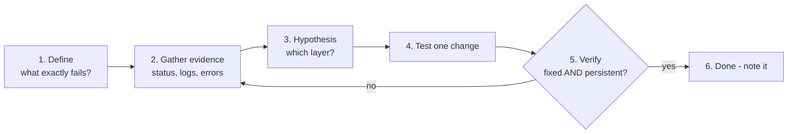

# Troubleshooting Methodology

> Many LFCS tasks are "X doesn't work - fix it". Guessing wastes time. Follow the same loop every time.

---

## The Loop

1. **Define** - reproduce it. "Users can't reach the website" → from where? HTTP or HTTPS? Name or IP?
2. **Gather evidence** before changing anything - the error message usually names the problem.
3. **Hypothesis** - pick the most likely **layer** (below).
4. **Change one thing** at a time; keep a backup (`cp file file.bak`).
5. **Verify** the original symptom is gone **and** the fix survives a restart/reboot.

---

## Evidence Commands (memorize)

| Question | Command |
|----------|---------|
| Is the service running? Why not? | `systemctl status unit` · `journalctl -u unit -b --no-pager \| tail -50` |
| What failed at boot? | `systemctl --failed` · `journalctl -b -p err` |
| Kernel / hardware messages | `journalctl -k` · `dmesg -T \| tail` |
| Is the config valid? | `nginx -t` · `sshd -t` · `visudo -c` · `named-checkconf` · `findmnt --verify` · `systemd-analyze verify unit` |
| Is it listening? On which address? | `ss -tulpn` |
| Can I reach it? | `ping` → `ip route get <ip>` → `nc -zv host port` / `curl -v` |
| Is a firewall blocking? | `firewall-cmd --list-all` · `ufw status verbose` · `nft list ruleset` |
| Is SELinux/AppArmor blocking? | `ausearch -m AVC -ts recent` · `journalctl -k \| grep -i apparmor` |
| Resource problem? | `df -h` · `df -i` · `free -h` · `uptime` · `top` · `vmstat 1 5` |
| Permissions? | `ls -ld` on **every** path component (`namei -l /path/to/file`) · `getfacl` · `id user` |
| What changed recently? | `find /etc -mmin -60` · `rpm -Va` / `dpkg -V` · package logs (`/var/log/dnf.log`, `/var/log/apt/history.log`) |

---

## Bottom-Up Layer Checklist

Work up from the bottom - each layer depends on all below it.

| # | Layer | Check |
|---|-------|-------|
| 1 | Hardware / VM | disk present (`lsblk`), NIC present (`ip link`) |
| 2 | Kernel | module loaded (`lsmod`), sysctl set (`sysctl key`) |
| 3 | Storage | mounted (`findmnt`), space/inodes (`df -h`, `df -i`), read-only remount? |
| 4 | Network | link up, IP, route, DNS (`getent hosts`) |
| 5 | Firewall | port open in the right zone, runtime **and** permanent |
| 6 | Service | enabled, running, listening on the right address/port |
| 7 | Access control | users/groups, permissions, ACLs, **SELinux/AppArmor** |
| 8 | Application | config syntax, application logs (`/var/log/<app>/`) |

---

## Classic Symptoms → Usual Causes

| Symptom | Look at |
|---------|---------|
| "Permission denied" but `rwx` looks right | parent dir `x`, ACL mask, SELinux label, AppArmor, `noexec` mount, wrong user |
| "No space left on device" with free space | inodes (`df -i`), deleted-but-open files (`lsof +L1`), reserved blocks, quota |
| "Connection refused" | nothing listening on that port/address (service down or bound to 127.0.0.1) |
| "Connection timed out" / no reply | firewall dropping, wrong route, host down |
| "Name or service not known" | DNS / `/etc/hosts` / `resolv.conf` / nsswitch |
| "Host key verification failed" | server reinstalled → `ssh-keygen -R host` |
| Key-based SSH asks for a password | perms on `~`, `~/.ssh`, `authorized_keys`; wrong key; `PubkeyAuthentication` |
| Service starts then dies | `journalctl -u` - config error, missing dir/user, port in use, SELinux |
| Boot drops to emergency mode | `/etc/fstab` (UUID, typo, missing disk) |
| Change gone after reboot | it was runtime-only - see [Persistence Checklist](Persistence-Checklist.md) |
| Cron job doesn't run | `PATH`, permissions, `%` not escaped, wrong crontab format (user field), `crond` running |

---

## Exam Discipline

- **Read the whole task** - note exact paths, names, permissions and "make it persistent".
- **Back up** a config file before editing: `cp -a file{,.bak}`.
- **Validate** syntax before reload/restart.
- **Verify** with the same check the grader will use (does the file exist? does `curl` return the page? does the mount appear in `findmnt` after `mount -a`?).
- Don't leave half-finished changes that break *other* tasks (e.g. a broken fstab or sshd).
