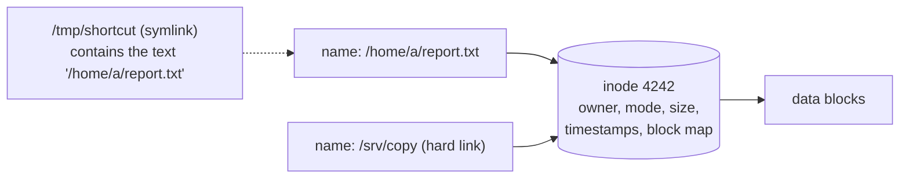

# The Linux Filesystem Hierarchy

<!-- nav:start -->
> **Module 01 · Foundations & Essential Commands** — lesson 1 of 6  
> [Module index](README.md) · [Course lesson (commands)](../../course/01-Foundations.md#lesson-1---the-filesystem-hierarchy-standard) · [Exercises for this lesson](../../exercises/01-foundations/01-filesystem-hierarchy.md)
<!-- nav:end -->

In this lesson you will learn how Linux organizes **every** file on the system into a single tree, what each top-level directory is for, and how files are really stored (inodes and links). Knowing this layout is what lets you walk onto an unfamiliar server and immediately know where to find its configuration, its logs and its live kernel state.

## What you will learn

- What "one tree" means and how other disks are attached to it
- The purpose of every top-level directory defined by the **FHS**
- The difference between real, virtual (pseudo) and RAM-backed filesystems
- What a **file type**, an **inode**, a **hard link** and a **symbolic link** are
- How to explore the tree with `ls`, `stat`, `df`, `findmnt` and `tree`

---

## Key terms

| Term | Definition |
|------|-----------|
| **Root directory (`/`)** | The top of the single directory tree. Every path starts here. Not to be confused with `/root`, the home directory of the root user. |
| **Absolute path** | A path that starts at `/`, e.g. `/etc/ssh/sshd_config`. It means the same thing no matter where you are. |
| **Relative path** | A path interpreted from the current working directory, e.g. `ssh/sshd_config` when you are in `/etc`. `.` is the current directory, `..` the parent. |
| **Mount point** | An (empty) directory where another filesystem is attached to the tree. |
| **FHS** | *Filesystem Hierarchy Standard*: a Linux Foundation specification describing which directory holds what. |
| **Pseudo-filesystem** | A filesystem with no data on disk; the kernel generates its content when you read it (`/proc`, `/sys`). |
| **Inode** | The on-disk record that *is* the file: owner, permissions, timestamps, size and the location of its data. |
| **Link count** | How many directory entries (names) point to an inode. |

---

## One tree, no drive letters

Windows gives every disk its own letter (`C:`, `D:`). Linux does the opposite: there is **one** tree starting at `/`, and every disk, partition, USB stick or network share is **mounted** onto some directory inside it.

```text
/                      ← root filesystem (e.g. /dev/sda2, ext4)
├── boot               ← could be a separate partition (/dev/sda1)
├── home               ← could be a separate disk (/dev/sdb1)
│   └── alice
├── mnt
│   └── nfs            ← could be a network share (server:/exports)
└── proc               ← not a disk at all: generated by the kernel
```

To a program, `/home/alice/notes.txt` is just a path. It does not need to know that `/home` lives on a different disk.

### Example: see which filesystem holds each directory

```console
$ df -hT
Filesystem                Type   Size  Used Avail Use% Mounted on
/dev/mapper/ubuntu--vg-root ext4   19G  5.1G   13G  29% /
tmpfs                     tmpfs  982M     0  982M   0% /dev/shm
/dev/vda2                 ext4   1.8G  130M  1.5G   9% /boot
/dev/vdb1                 xfs    5.0G   68M  4.9G   2% /data
```

`df` (*disk free*) lists mounted filesystems; `-h` prints human-readable sizes and `-T` adds the filesystem type. Here `/data` is a separate XFS disk mounted into the tree.

`findmnt` shows the same information as a tree, including virtual filesystems:

```console
$ findmnt --real
TARGET  SOURCE                       FSTYPE OPTIONS
/       /dev/mapper/ubuntu--vg-root  ext4   rw,relatime
├─/boot /dev/vda2                    ext4   rw,relatime
└─/data /dev/vdb1                    xfs    rw,relatime,attr2,inode64
```

> **Note:** if you mount a filesystem on a directory that already contains files, those files are **hidden** (not deleted) until you unmount it. This is a common cause of "my files disappeared".

---

## The top-level directories

The FHS groups directories by two questions: *is the data static or does it change while the system runs?* and *is it specific to this host or could it be shared?* You don't need to memorize the standard, but you must know where things live.

| Directory | What lives there | Example |
|-----------|-----------------|---------|
| `/bin`, `/sbin` | Essential commands. On modern distributions these are **symlinks** to `/usr/bin` and `/usr/sbin` ("usr merge"). | `/bin/ls` → `/usr/bin/ls` |
| `/boot` | Kernel images, initramfs, bootloader (GRUB) files. | `/boot/vmlinuz-6.8.0-45-generic` |
| `/dev` | Device files created by udev: disks, terminals, `null`, `random`. | `/dev/sda`, `/dev/null` |
| `/etc` | **Host-specific configuration**, almost all plain text. "Editable Text Configuration" is a good mnemonic. | `/etc/ssh/sshd_config`, `/etc/fstab` |
| `/home` | Personal directories of regular users. | `/home/alice` |
| `/root` | Home directory of the `root` user (kept on `/` so it is available even if `/home` fails to mount). | `/root/.bashrc` |
| `/lib`, `/lib64` | Shared libraries and kernel modules (also symlinks into `/usr` today). | `/lib/modules/$(uname -r)/` |
| `/media` | Auto-mount points for removable media. | `/media/alice/USBSTICK` |
| `/mnt` | Temporary mount point for the administrator. | `mount /dev/sdb1 /mnt` |
| `/opt` | Self-contained third-party software. | `/opt/google/chrome/` |
| `/proc` | **Virtual**: one directory per process plus kernel information and tunables. | `/proc/1/`, `/proc/meminfo` |
| `/sys` | **Virtual**: the kernel's view of devices, drivers and buses. | `/sys/class/net/eth0/address` |
| `/run` | Runtime data since the last boot (PID files, sockets). RAM-backed (tmpfs), empty after reboot. | `/run/sshd.pid` |
| `/srv` | Data *served* by this host (web, FTP, Git). | `/srv/www`, `/srv/git` |
| `/tmp` | Temporary files for everyone. Has the **sticky bit**; often cleaned at boot. | `/tmp/build123` |
| `/usr` | Installed software: binaries, libraries, documentation. Read-only during normal operation. | `/usr/bin/python3`, `/usr/share/doc/` |
| `/usr/local` | Software you compiled or installed by hand; package managers never touch it. | `/usr/local/bin/backup.sh` |
| `/var` | **Variable data** that grows while the system runs. | `/var/log/`, `/var/lib/mysql/`, `/var/cache/`, `/var/spool/cron/` |

### The four directories you will use most

1. **`/etc`** – configuration. If a task says "configure X", the answer is almost always a file under `/etc`.
2. **`/var/log`** – logs (plus `journalctl` for the systemd journal).
3. **`/proc` and `/sys`** – the live state of the kernel; reading them is how tools such as `ps`, `free` and `lsblk` get their data.
4. **`/usr/share/doc`** – documentation and example config files shipped with packages. Very useful in an exam without internet.

### Example: explore `/proc`

```console
$ cat /proc/loadavg
0.08 0.12 0.10 1/312 4821

$ head -3 /proc/meminfo
MemTotal:        2011236 kB
MemFree:          912340 kB
MemAvailable:    1520112 kB

$ ls /proc/1/
cmdline  cwd  environ  exe  fd  limits  maps  status ...
```

Nothing here is stored on disk: the kernel produces these numbers at the moment you read them. `man 5 proc` documents every file.

### Example: what is in `/var`?

```console
$ sudo du -sh /var/* 2>/dev/null | sort -h | tail -5
24M     /var/cache
58M     /var/log
310M    /var/lib
```

`/var/lib` holds application state (package database, containers, databases). This is usually the first place to look when a disk fills up.

---

## Everything is a file

Unix exposes almost every resource as a path that can be opened, read and written. The first character of `ls -l` tells you the **file type**:

| Char | Type | Example |
|------|------|---------|
| `-` | Regular file | `/etc/hostname` |
| `d` | Directory | `/etc` |
| `l` | Symbolic link | `/bin` → `usr/bin` |
| `b` | Block device (disk) | `/dev/sda` |
| `c` | Character device (stream) | `/dev/tty`, `/dev/null` |
| `p` | Named pipe (FIFO) | created with `mkfifo` |
| `s` | Socket | `/run/systemd/journal/socket` |

```console
$ ls -ld /etc /bin /dev/sda /dev/null /etc/hostname
lrwxrwxrwx 1 root root       7 Apr 22 13:08 /bin -> usr/bin
crw-rw-rw- 1 root root    1, 3 Oct 21 08:01 /dev/null
brw-rw---- 1 root disk    8, 0 Oct 21 08:01 /dev/sda
drwxr-xr-x 98 root root 4096 Oct 21 08:05 /etc
-rw-r--r-- 1 root root      5 Oct 20 17:44 /etc/hostname
```

The `file` command identifies content: `file /bin/ls` → `ELF 64-bit LSB pie executable`.

---

## Inodes: the file behind the name

A filename is **not** the file. When you create `report.txt`, the filesystem:

1. allocates an **inode** (a numbered record holding metadata and pointers to the data blocks);
2. writes the data into blocks;
3. adds a **directory entry** mapping the name `report.txt` to that inode number.



### Example: look at an inode

```console
$ stat /etc/hostname
  File: /etc/hostname
  Size: 5           Blocks: 8          IO Block: 4096   regular file
Device: 252,0       Inode: 1048611     Links: 1
Access: (0644/-rw-r--r--)  Uid: (    0/    root)   Gid: (    0/    root)
Access: 2026-10-21 08:01:10.000000000 +0000
Modify: 2026-10-20 17:44:02.000000000 +0000
Change: 2026-10-20 17:44:02.000000000 +0000
```

- **Access (atime)** – last read. **Modify (mtime)** – last change of the *content*. **Change (ctime)** – last change of the *inode* (permissions, owner, link count). `find -mtime` uses mtime.
- `ls -i` shows inode numbers. `df -i` shows how many inodes are used/free per filesystem.

> **Warning:** a filesystem can run out of **inodes** before it runs out of space (millions of tiny files). Symptom: "No space left on device" while `df -h` shows free space. Check with `df -i`.

---

## Hard links and symbolic links

| | Hard link (`ln target name`) | Symbolic link (`ln -s target name`) |
|--|-------------------------------|-------------------------------------|
| What it is | A second **name** for the same inode | A tiny file that **contains a path** |
| Same inode number? | Yes | No (it has its own) |
| Across filesystems? | No – inode numbers are per filesystem | Yes |
| To a directory? | No | Yes |
| If the original name is deleted | Data still reachable (link count > 0) | Link becomes **dangling** (broken) |

### Example: see the difference

```console
$ echo "hello" > original.txt
$ ln original.txt hard.txt
$ ln -s original.txt soft.txt
$ ls -li
1310722 -rw-r--r-- 2 alice alice  6 Oct 21 09:00 hard.txt
1310722 -rw-r--r-- 2 alice alice  6 Oct 21 09:00 original.txt
1310724 lrwxrwxrwx 1 alice alice 12 Oct 21 09:00 soft.txt -> original.txt

$ rm original.txt
$ cat hard.txt
hello
$ cat soft.txt
cat: soft.txt: No such file or directory
```

The hard link shares inode `1310722` and the link count is `2`. After deleting `original.txt`, the data survives through `hard.txt`, but the symlink points to a name that no longer exists.

> **Key idea:** data is freed only when the link count is 0 **and** no process still has the file open. This explains why deleting a huge log file that a service is still writing to does not free any space (see [Troubleshooting Disk Space](../04-processes-services/03-disk-space.md)).

---

## RAM-backed and virtual filesystems

| Filesystem | Mounted on | Backed by | Survives reboot? |
|------------|-----------|-----------|------------------|
| `proc` | `/proc` | kernel | n/a (generated) |
| `sysfs` | `/sys` | kernel | n/a (generated) |
| `devtmpfs` | `/dev` | kernel + udev | no |
| `tmpfs` | `/run`, `/dev/shm`, often `/tmp` | RAM (and swap) | **no** |

Practical consequence: never store anything you need to keep in `/run` or a tmpfs `/tmp`.

---

## Try it yourself

1. Run `ls -l /` and identify which entries are symlinks.
2. Run `findmnt` and find which filesystems are of type `proc`, `sysfs` and `tmpfs`.
3. Run `man hier` – your system's own description of the hierarchy.
4. Find the configuration file of the SSH server and the directory where its logs go.
5. Create a file, a hard link and a symlink to it; compare `ls -li` output; delete the original and test both links.

---

## Common mistakes

- Confusing `/` (root of the tree) with `/root` (root's home).
- Installing hand-made scripts in `/usr/bin` – use `/usr/local/bin`, which packages never overwrite.
- Expecting files written to `/tmp` or `/run` to survive a reboot.
- Trusting `df -h` alone when the error is "No space left on device" – also check `df -i`.

---

## Summary

- Linux has a **single tree**; other filesystems are **mounted** onto directories.
- `/etc` = configuration · `/var` = changing data and logs · `/usr` = installed software · `/home` = users · `/proc` & `/sys` = live kernel state.
- A file is an **inode**; names are directory entries pointing to inodes.
- Hard links share an inode; symlinks store a path and can break.

## Check yourself

1. Why is `/root` not under `/home`?
2. What is the difference between mtime and ctime?
3. Why can't a hard link point to a file on another partition?
4. A directory looks empty after you mount a USB stick on it and then unmount it. Where did the original files go?

<details>
<summary>Answers</summary>

1. So that root can still log in and repair the system even if `/home` (often a separate filesystem) fails to mount.
2. mtime changes when the content changes; ctime changes when the inode (permissions, owner, links, and also content) changes.
3. A hard link is a directory entry holding an **inode number**, and inode numbers are only unique inside one filesystem.
4. Nowhere – the original files were only *hidden* while the stick was mounted; after unmounting they are visible again. If the directory is still empty, the files never were in it.

</details>

## Further reading

- `man 7 hier`, `man 7 inode`, `man 5 proc`, `man 1 stat`
- [Filesystem Hierarchy Standard 3.0](https://refspecs.linuxfoundation.org/FHS_3.0/fhs/index.html)
- [The Linux Command Line – Chapter 3: Exploring the System](https://linuxcommand.org/tlcl.php)
- [ArchWiki: File systems](https://wiki.archlinux.org/title/File_systems)

---

<!-- footer:start -->
[Module index](README.md) · [Finding Files →](02-finding-files.md)  
**Practice now:** [Exercises – The Linux Filesystem Hierarchy](../../exercises/01-foundations/01-filesystem-hierarchy.md)
<!-- footer:end -->
