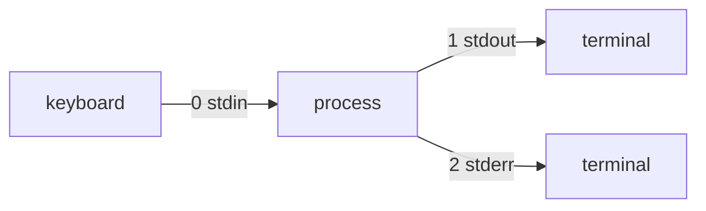

# Redirection, Pipes and Archives

<!-- nav:start -->
> **Module 01 · Foundations & Essential Commands** — lesson 4 of 6  
> [Module index](README.md) · [Course lesson (commands)](../../course/01-Foundations.md#lesson-4---redirection-pipes-archives) · [Exercises for this lesson](../../exercises/01-foundations/04-redirection-pipes-archives.md)
<!-- nav:end -->

Every Linux command reads input and writes output through **standard streams**. Redirecting those streams to files and connecting commands with **pipes** is the glue of the command line. In the second half of this lesson you will learn to bundle and compress files with `tar` and friends – the basis of backups and software distribution.

## What you will learn

- What stdin, stdout and stderr are, and their file descriptor numbers
- How to redirect output, errors and input, and why the order of redirections matters
- How pipes and `tee` work, and how exit codes chain commands
- The difference between **archiving** and **compressing**
- Creating, listing and extracting archives with `tar`, and using `gzip`, `bzip2`, `xz`, `zstd`, `zip`

---

## Key terms

| Term | Definition |
|------|-----------|
| **File descriptor (FD)** | A small integer a process uses to refer to an open file, pipe or socket. |
| **stdin (0)** | Standard input – where a program reads from (keyboard by default). |
| **stdout (1)** | Standard output – normal results (terminal by default). |
| **stderr (2)** | Standard error – error and diagnostic messages (terminal by default). |
| **Redirection** | Re-pointing an FD to a file before the program starts. |
| **Pipe (`\|`)** | Connects stdout of one process to stdin of the next. |
| **Exit status** | Number a program returns when it ends: `0` = success, anything else = failure. Stored in `$?`. |
| **Archive** | One file containing many files plus their metadata (names, permissions, owners, times). |
| **Compression** | Encoding data so it takes less space. |

---

## The three standard streams



Both stdout and stderr go to the terminal by default, which is why you see them mixed. They are **separate** streams, so you can send them to different places.

### Example: two streams from one command

```console
$ ls /etc/hostname /nonexistent
ls: cannot access '/nonexistent': No such file or directory     ← stderr
/etc/hostname                                                   ← stdout

$ ls /etc/hostname /nonexistent > out.txt
ls: cannot access '/nonexistent': No such file or directory     ← still on screen
$ cat out.txt
/etc/hostname                                                   ← only stdout went to the file
```

---

## Output redirection

| Syntax | Effect |
|--------|--------|
| `cmd > file` | stdout to file (**overwrite**; file created if missing) |
| `cmd >> file` | stdout to file (**append**) |
| `cmd 2> file` | stderr to file |
| `cmd 2>> file` | stderr appended |
| `cmd > file 2>&1` | stdout to file, then stderr to *wherever stdout points* → both in file |
| `cmd &> file` | bash shorthand for the line above |
| `cmd > out 2> err` | each stream to its own file |
| `cmd 2>/dev/null` | discard errors (`/dev/null` swallows everything written to it) |

### Why the order of `2>&1` matters

Redirections are processed **left to right**. `2>&1` means "make FD 2 point to whatever FD 1 points to **right now**".

```console
$ ls /etc/hostname /nope > all.txt 2>&1     # 1→file, then 2→(file)   ✔ both in file
$ ls /etc/hostname /nope 2>&1 > all.txt     # 2→(terminal), then 1→file  ✘ errors on screen
```

### Protecting files from accidental overwrite

```console
$ set -o noclobber          # > refuses to overwrite existing files
$ echo hi > existing.txt
bash: existing.txt: cannot overwrite existing file
$ echo hi >| existing.txt   # force when you really mean it
```

---

## Input redirection

| Syntax | Effect |
|--------|--------|
| `cmd < file` | file becomes stdin |
| `cmd << EOF … EOF` | **here-document**: several lines of literal input |
| `cmd <<< "text"` | **here-string**: one string as input |

```console
$ wc -l < /etc/passwd
36

$ cat << EOF > /etc/motd
Welcome to $(hostname)
Authorized use only.
EOF

$ tr a-z A-Z <<< "hello"
HELLO
```

Here-documents are the easiest way to create a multi-line config file from the command line. Quote the marker (`<< 'EOF'`) to stop `$variables` from being expanded inside.

> **sudo gotcha:** `sudo echo "x" > /etc/file` fails, because the redirection is done by *your* shell, not by sudo. Use `echo "x" | sudo tee /etc/file` (or `sudo tee -a` to append), or `sudo bash -c 'echo x > /etc/file'`.

---

## Pipes

```console
$ ps aux | grep sshd | grep -v grep
$ journalctl -u ssh | tail -20
$ cat /etc/passwd | cut -d: -f1 | sort | head -5
```

All commands in a pipeline run **at the same time**; data flows as it is produced. Only stdout is piped. To pipe stderr too: `cmd 2>&1 | less` or `cmd |& less`.

### `tee` – save and see

`tee` copies its input to a file **and** to stdout, like a T-junction in a pipe.

```console
$ df -h | tee /root/disk-report.txt
$ dnf upgrade -y 2>&1 | tee -a /var/log/upgrade.log
```

---

## Exit status and command chaining

```console
$ grep -q root /etc/passwd; echo $?
0
$ grep -q nobodyhere /etc/passwd; echo $?
1
```

| Operator | Runs the next command… |
|----------|------------------------|
| `a ; b` | always |
| `a && b` | only if `a` **succeeded** (exit 0) |
| `a \|\| b` | only if `a` **failed** |

```console
$ mkdir /srv/app && cd /srv/app
$ sshd -t && systemctl restart sshd          # restart only if config is valid
$ ping -c1 -W1 10.0.0.1 >/dev/null || echo "gateway down"
```

In a pipeline, `$?` is the exit status of the **last** command. `set -o pipefail` makes the pipeline fail if any command fails – recommended in scripts.

### Command substitution

`$(command)` is replaced by the command's output:

```console
$ echo "Today is $(date +%F)"
Today is 2026-10-21
$ tar -czf /backup/etc-$(date +%F).tar.gz /etc
```

---

## Archiving vs compression

| | Archiving | Compression |
|--|-----------|-------------|
| Purpose | many files → one stream, **keeping metadata** | one stream → smaller stream |
| Tools | `tar`, `cpio`, `zip` (also compresses) | `gzip`, `bzip2`, `xz`, `zstd` |
| Typical file | `backup.tar` | `file.gz` |

`tar` does the archiving and (optionally) calls a compressor, producing `.tar.gz`, `.tar.bz2`, `.tar.xz` or `.tar.zst`.

### tar options

| Option | Meaning |
|--------|---------|
| `-c` | **c**reate an archive |
| `-x` | e**x**tract |
| `-t` | lis**t** contents |
| `-f FILE` | archive **f**ile name (must be followed by the name) |
| `-v` | verbose |
| `-z` / `-j` / `-J` / `--zstd` | gzip / bzip2 / xz / zstd compression |
| `-C DIR` | change to DIR first (extract into DIR) |
| `-p` | preserve permissions (default for root) |
| `--acls --xattrs --selinux` | also preserve ACLs, extended attributes, SELinux labels |
| `--exclude=PATTERN` | skip matching files |

### Examples

```console
# create
$ sudo tar -czvf /backup/etc.tar.gz /etc
tar: Removing leading `/' from member names
etc/
etc/hostname
...

# list without extracting
$ tar -tzvf /backup/etc.tar.gz | head -3
drwxr-xr-x root/root         0 2026-10-21 08:05 etc/
-rw-r--r-- root/root         5 2026-10-20 17:44 etc/hostname
-rw-r--r-- root/root      1123 2026-10-01 10:12 etc/fstab

# extract everything into /restore
$ sudo mkdir /restore && sudo tar -xzvf /backup/etc.tar.gz -C /restore

# extract ONE file (use the path exactly as listed, without leading /)
$ sudo tar -xzvf /backup/etc.tar.gz -C /restore etc/ssh/sshd_config

# exclude and preserve everything
$ sudo tar --acls --xattrs --selinux --exclude='*.cache' -cJpf /backup/home.tar.xz /home
```

> **Note:** "Removing leading `/`" is normal and protective: archives store relative paths, so extracting never overwrites system files unless you extract with `-C /`.

Modern GNU tar detects compression automatically when extracting, so `tar -xf file.tar.xz` also works.

### Compressors on their own

```console
$ gzip big.log          # → big.log.gz (original removed)
$ gzip -k big.log       # keep original
$ gunzip big.log.gz     # or gzip -d
$ zcat big.log.gz | grep error    # read without decompressing to disk (also bzcat, xzcat, zstdcat)
$ xz -9 big.log; unxz big.log.xz
$ zstd big.log; unzstd big.log.zst
```

| Compressor | Extension | Speed | Ratio |
|-----------|-----------|-------|-------|
| gzip | `.gz` | fast | good |
| bzip2 | `.bz2` | slow | better |
| xz | `.xz` | slowest | best |
| zstd | `.zst` | very fast | very good |

### zip

Common for exchanging files with Windows users:

```console
$ zip -r site.zip /srv/www
$ unzip -l site.zip         # list
$ unzip site.zip -d /tmp/site
```

---

## Try it yourself

1. Run `find / -name "*.conf"` as a normal user, sending results to `found.txt` and errors to `errors.txt`. Count the lines of each.
2. Create `/tmp/hello.conf` with three lines using a here-document.
3. Use `tee` to save `ip -br a` into a file while still seeing it.
4. Archive `/etc` with xz compression, list it, and extract only `etc/hosts` into `/tmp/restore`.
5. Compare the size of the same archive with `-z`, `-j` and `-J` (`ls -lh`).

---

## Common mistakes

- `>` when you meant `>>` – the file is truncated instantly.
- `2>&1 > file` (wrong order).
- `sudo cmd > /root/file` – redirection runs without sudo.
- `tar -cvf -z archive.tgz dir` – `-f` must be immediately followed by the archive name; write `-czvf archive.tgz`.
- Extracting with `-C /` and overwriting live files by accident.

---

## Summary

| Need | Syntax |
|------|--------|
| Save output | `cmd > f` / `cmd >> f` |
| Save errors | `cmd 2> f` |
| Save both | `cmd > f 2>&1` or `cmd &> f` |
| Discard | `2>/dev/null`, `&>/dev/null` |
| Feed input | `< f`, `<< EOF`, `<<< "str"` |
| Chain on success / failure | `&&` / `\|\|` |
| See and save | `\| tee f` |
| Create / list / extract tar | `tar -czf` / `tar -tf` / `tar -xf … -C dir` |

## Check yourself

1. Which FD number is stderr?
2. What does `cmd > /dev/null 2>&1` do?
3. Why does `uniq` sometimes appear after `sort` in pipelines?
4. Which tar option lists an archive's contents?

<details>
<summary>Answers</summary>

1. 2.
2. Discards both normal output and errors – the command runs silently.
3. Not related to redirection, but to pipes: `uniq` only collapses adjacent duplicates, so input must be sorted.
4. `-t`.

</details>

## Further reading

- `man 1 bash` (section REDIRECTION), `man 1 tar`, `man 1 tee`
- [GNU Bash manual – Redirections](https://www.gnu.org/software/bash/manual/html_node/Redirections.html)
- [GNU tar manual](https://www.gnu.org/software/tar/manual/tar.html)
- [The Linux Command Line – Chapter 6: Redirection](https://linuxcommand.org/tlcl.php)

---

<!-- footer:start -->
[← Working with Text](03-working-with-text.md) · [Module index](README.md) · [The User Environment →](05-user-environment.md)  
**Practice now:** [Exercises – Redirection, Pipes and Archives](../../exercises/01-foundations/04-redirection-pipes-archives.md)
<!-- footer:end -->
