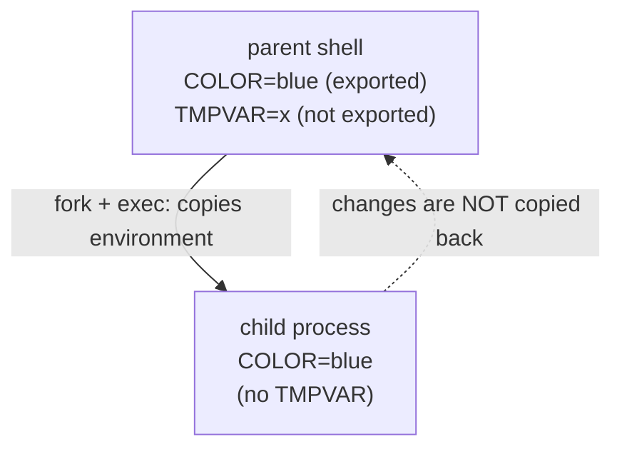
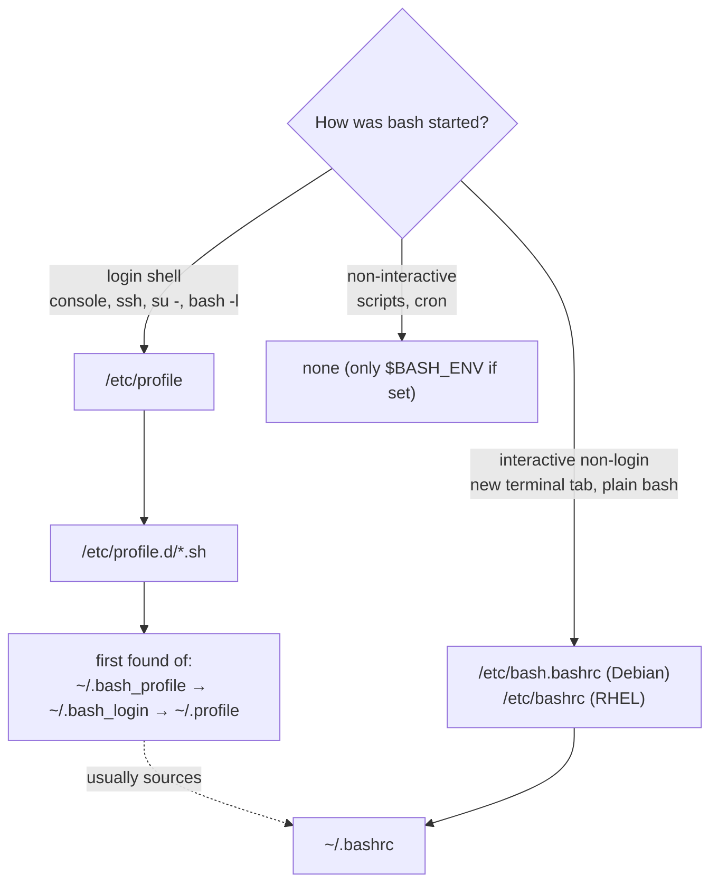

# The User Environment

<!-- nav:start -->
> **Module 01 · Foundations & Essential Commands** — lesson 5 of 6  
> [Module index](README.md) · [Course lesson (commands)](../../course/01-Foundations.md#lesson-5---the-user-environment-ch-3) · [Exercises for this lesson](../../exercises/01-foundations/05-user-environment.md)
<!-- nav:end -->

When you log in, the shell builds an **environment**: variables such as `PATH` and `HOME`, aliases, a prompt and options. In this lesson you will learn how the shell processes a command line, what variables are and how they are inherited, and which startup files run when – so you can make settings that apply to one user or to everyone, and that survive the next login.

## What you will learn

- Shell variables vs environment variables, and `export`
- Important standard variables (`PATH`, `HOME`, `USER`, `PS1`, `EDITOR`…)
- The order in which bash expands a command line, and how quoting changes it
- Aliases, functions and history
- Login vs non-login shells, and which startup files each one reads
- Where to put per-user and system-wide settings

---

## Key terms

| Term | Definition |
|------|-----------|
| **Shell** | The program that reads your commands and runs them. Default on most systems: **bash**. |
| **Shell variable** | A `NAME=value` pair that exists only in the current shell. |
| **Environment variable** | A variable marked with `export`; it is **copied to every child process**. |
| **Login shell** | The first shell after you authenticate (console login, `ssh`, `su -`). |
| **Interactive shell** | A shell attached to a terminal, reading what you type. |
| **Sourcing** | Running a script in the **current** shell (`. file` or `source file`) instead of a child. |
| **Alias** | A short name that expands to a longer command. |

---

## Variables

```console
$ GREETING="hello"          # create a shell variable (no spaces around =)
$ echo $GREETING
hello
$ echo "${GREETING}, world"  # braces separate the name from following text
hello, world
$ unset GREETING
```

### Shell vs environment variables

A child process (any command or script you start) receives a **copy** of the parent's *environment*, but **not** its plain shell variables.

```console
$ COLOR=blue
$ bash -c 'echo "child sees: $COLOR"'
child sees:
$ export COLOR
$ bash -c 'echo "child sees: $COLOR"'
child sees: blue
```



Two consequences you must remember:

1. A child can **never** change its parent's variables. A script that runs `export X=1` or `cd /tmp` has no effect on your shell – unless you **source** it: `source ./script.sh` or `. ./script.sh`.
2. A variable set only for one command: `LANG=C sort file` – sets `LANG` in that command's environment only.

### Inspecting the environment

```console
$ env | head -5          # environment variables
SHELL=/bin/bash
PWD=/home/alice
LOGNAME=alice
HOME=/home/alice
LANG=en_US.UTF-8
$ printenv PATH          # one variable
$ set | less             # ALL shell variables and functions
$ declare -p HOME        # how a variable is declared
declare -x HOME="/home/alice"        ← -x means exported
```

### Important variables

| Variable | Meaning |
|----------|---------|
| `PATH` | Directories searched for commands, in order, separated by `:` |
| `HOME` | Your home directory (`~` expands to it) |
| `USER`, `LOGNAME` | Your user name |
| `SHELL` | Your login shell |
| `PWD`, `OLDPWD` | Current and previous directory (`cd -` uses `OLDPWD`) |
| `PS1` | The prompt format |
| `EDITOR`, `VISUAL` | Editor used by `crontab -e`, `visudo`, `git commit`, `systemctl edit` |
| `LANG`, `LC_*` | Language and locale |
| `HISTSIZE`, `HISTFILE` | History length and file |
| `TZ` | Time zone override |
| `$?`, `$$`, `$!` | Last exit status, current shell PID, last background PID |

### Changing PATH

```console
$ echo $PATH
/usr/local/sbin:/usr/local/bin:/usr/sbin:/usr/bin:/sbin:/bin
$ export PATH="$PATH:$HOME/bin"     # append – keep the old value!
```

> **Warning:** `export PATH=/opt/tool/bin` (without `$PATH`) *replaces* the whole path – suddenly `ls` and `vi` are "command not found". Fix it in that shell with `export PATH=/usr/bin:/bin` and re-do it correctly.

The current directory (`.`) is deliberately **not** in `PATH`: run local scripts with `./script.sh`.

---

## How bash processes a command line

When you press Enter, bash transforms your text in a fixed order before running anything:

| Step | Example input | After the step |
|------|---------------|----------------|
| 1. Brace expansion | `mkdir dir{1..3}` | `mkdir dir1 dir2 dir3` |
| 2. Tilde expansion | `ls ~/docs` | `ls /home/alice/docs` |
| 3. Parameter / variable expansion | `echo $HOME` | `echo /home/alice` |
| 4. Command substitution | `echo $(hostname)` | `echo web01` |
| 5. Arithmetic expansion | `echo $((4*5))` | `echo 20` |
| 6. Word splitting | unquoted results split on spaces | |
| 7. Pathname (glob) expansion | `ls *.conf` | `ls a.conf b.conf` |
| 8. Quote removal, redirections, execution | | |

### Quoting controls expansion

| Quoting | What still expands | Example | Output |
|---------|--------------------|---------|--------|
| none | everything | `echo $HOME *` | `/home/alice file1 file2` |
| `"double"` | `$var`, `$(cmd)`, `` `cmd` ``, `\` | `echo "$HOME *"` | `/home/alice *` |
| `'single'` | **nothing** | `echo '$HOME *'` | `$HOME *` |
| `\` | escapes one character | `echo \$HOME` | `$HOME` |

> **Rule:** always put variables in double quotes: `rm "$file"`, not `rm $file`. An unquoted variable containing spaces becomes several arguments, and an empty one disappears entirely.

### Globs

| Glob | Matches |
|------|---------|
| `*` | any string (including empty), except a leading `.` |
| `?` | exactly one character |
| `[abc]`, `[0-9]` | one character from the set |
| `{a,b}` | brace expansion – generates both words even if no file exists |

---

## Aliases and functions

```console
$ alias ll='ls -alF'
$ alias                       # list aliases
$ unalias ll
$ \ls                         # bypass an alias once
```

Functions handle arguments, which aliases can't:

```bash
mkcd() { mkdir -p "$1" && cd "$1"; }
```

Aliases and functions exist only in the shell that defined them. To keep them, put them in a startup file (below).

---

## History

```console
$ history | tail -3
  501  systemctl status nginx
  502  sudo nginx -t
  503  history | tail -3
$ !502              # re-run command 502
$ !!                # re-run last command (e.g. sudo !!)
$ !$                # last argument of the previous command
$ Ctrl+R            # reverse incremental search – type part of a command
```

History is saved to `~/.bash_history` when the shell exits. `HISTSIZE`, `HISTFILESIZE` and `HISTCONTROL=ignoreboth` (skip duplicates and lines starting with a space) are set in `~/.bashrc`.

---

## Startup files

Which files bash reads depends on how it was started.



| File | Scope | Read by | Typical content |
|------|-------|---------|-----------------|
| `/etc/profile` | all users | login shells | system PATH, umask – **don't edit**, use profile.d |
| `/etc/profile.d/*.sh` | all users | login shells | **your system-wide variables** |
| `/etc/bash.bashrc` / `/etc/bashrc` | all users | interactive shells | system aliases, prompt |
| `~/.bash_profile` or `~/.profile` | one user | login shells | user variables; sources `~/.bashrc` |
| `~/.bashrc` | one user | interactive shells | user aliases, functions, prompt |
| `~/.bash_logout` | one user | login shell exit | cleanup |
| `/etc/environment` | all users | PAM at login (any shell) | simple `KEY=value` lines, no shell syntax |
| `/etc/skel/` | **new** users | copied by `useradd -m` | default dotfiles for new accounts |

`su user` keeps your environment (non-login); `su - user` starts a login shell with the target's environment. `sudo -i` is a root login shell.

### Example: a variable for every user

```console
$ echo 'export COMPANY=acme' | sudo tee /etc/profile.d/company.sh
$ sudo chmod 644 /etc/profile.d/company.sh
$ bash -l -c 'echo $COMPANY'        # test in a new login shell
acme
```

### Example: an alias for one user

```console
$ echo "alias ll='ls -alF'" >> ~/.bashrc
$ source ~/.bashrc                  # apply in the current shell
$ type ll
ll is aliased to `ls -alF'
```

> **Tip:** changes to startup files only apply to **new** shells. Either open a new session or `source` the file. To test a login shell: `bash -l`, `su - user`, or `ssh localhost`.

---

## Try it yourself

1. Set `X=1` without exporting, start `bash`, check `$X`, `exit`; then export it and repeat.
2. Write a script that runs `cd /tmp`; run it, then `source` it, and compare `pwd`.
3. Show the difference between `echo "$HOME *"` and `echo '$HOME *'` and `echo $HOME *`.
4. Make `EDITOR=vim` the default for all users via `/etc/profile.d/`.
5. Add a file `README.txt` to `/etc/skel`, create a new user with `useradd -m`, and check their home.

---

## Common mistakes

- `VAR = value` (spaces) – bash treats `VAR` as a command.
- Overwriting `PATH` instead of appending.
- Putting settings in `~/.bashrc` and testing with `ssh` on a system where `~/.bash_profile` doesn't source `~/.bashrc`.
- Editing `/etc/profile` directly (overwritten on package updates) instead of `/etc/profile.d/`.
- Expecting cron jobs to have your interactive environment – they run a non-interactive shell with a minimal `PATH`.

---

## Summary

- `export` makes a variable visible to children; children never change the parent.
- `source` runs a file in the current shell.
- Quote variables; single quotes stop all expansion.
- System-wide: `/etc/profile.d/*.sh` (login) and `/etc/bash.bashrc` or `/etc/bashrc` (interactive). Per user: `~/.bash_profile`/`~/.profile` and `~/.bashrc`. New users: `/etc/skel/`.

## Check yourself

1. Why does `./setenv.sh` (which contains `export DB=prod`) not set `DB` in your shell?
2. A user logs in via SSH. Which of `/etc/profile`, `~/.bashrc` and `/etc/profile.d/x.sh` run?
3. What will `echo '$((2+2))'` print?
4. Where do you put a file so every *future* user gets it in their home?

<details>
<summary>Answers</summary>

1. It runs in a child process; its environment is discarded when it exits. Use `source ./setenv.sh`.
2. `/etc/profile` and `/etc/profile.d/x.sh` (login shell); `~/.bashrc` too, if `~/.bash_profile`/`~/.profile` sources it (the default on most distros).
3. `$((2+2))` – single quotes prevent expansion.
4. `/etc/skel/`.

</details>

## Further reading

- `man 1 bash` (sections INVOCATION, EXPANSION, QUOTING), `man 7 environ`
- [GNU Bash manual – Bash Startup Files](https://www.gnu.org/software/bash/manual/html_node/Bash-Startup-Files.html) · [Shell Expansions](https://www.gnu.org/software/bash/manual/html_node/Shell-Expansions.html)
- [ArchWiki: Environment variables](https://wiki.archlinux.org/title/Environment_variables) · [Bash](https://wiki.archlinux.org/title/Bash)
- [explainshell.com](https://explainshell.com/)

---

<!-- footer:start -->
[← Redirection, Pipes and Archives](04-redirection-pipes-archives.md) · [Module index](README.md) · [Finding Help Offline →](06-finding-help.md)  
**Practice now:** [Exercises – The User Environment](../../exercises/01-foundations/05-user-environment.md)
<!-- footer:end -->
