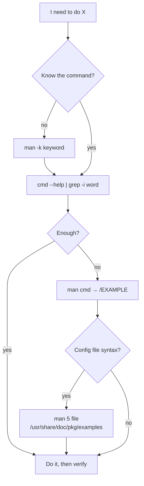

# Finding Help Offline

<!-- nav:start -->
> **Module 01 · Foundations & Essential Commands** — lesson 6 of 6  
> [Module index](README.md) · [Course lesson (commands)](../../course/01-Foundations.md#lesson-6---finding-help-offline) · [Exercises for this lesson](../../exercises/01-foundations/06-finding-help.md)
<!-- nav:end -->

The LFCS exam gives you a terminal and **no internet**. On real servers, too, you often can't browse while fixing an outage. Linux ships a large amount of documentation on the machine itself; this lesson teaches you to find the right page fast.

## What you will learn

- How manual pages are organized into **sections** and how to read one
- How to search the manual (`man -k`, `apropos`, `whatis`)
- `--help`, `info`, and `/usr/share/doc`
- Using example files and existing configuration as documentation

---

## Key terms

| Term | Definition |
|------|-----------|
| **Man page** | A reference page for a command, file format, system call, etc. Read with `man`. |
| **Section** | A numbered category of man pages (1 = commands, 5 = file formats, 8 = admin commands…). |
| **`mandb`** | Builds the index used by `man -k` / `apropos`. |
| **info** | GNU's hyperlinked documentation format, often more detailed than man pages for GNU tools. |
| **`/usr/share/doc`** | Per-package directory with READMEs, changelogs and **example configs**. |

---

## Manual sections

The same name can exist in several sections. `passwd` is both a command (section 1) and a file format (section 5).

| Section | Contents | Example |
|---------|----------|---------|
| **1** | User commands | `man 1 ls` |
| 2 | System calls | `man 2 open` |
| 3 | Library functions | `man 3 printf` |
| 4 | Special files (devices) | `man 4 null` |
| **5** | **File formats and configuration files** | `man 5 fstab`, `man 5 sshd_config`, `man 5 crontab` |
| 6 | Games | |
| **7** | **Overviews, conventions, protocols** | `man 7 regex`, `man 7 signal`, `man 7 hier` |
| **8** | **System administration commands** | `man 8 useradd`, `man 8 mount` |

```console
$ man passwd        # first match – section 1, the command
$ man 5 passwd      # the /etc/passwd file format
$ man -a passwd     # show every section in turn
$ man -f passwd     # = whatis: which sections exist?
passwd (1ssl)        - OpenSSL application commands
passwd (5)           - the password file
passwd (1)           - change user password
```

---

## Reading a man page

Typical structure: **NAME**, **SYNOPSIS**, **DESCRIPTION**, **OPTIONS**, **EXAMPLES**, **FILES**, **SEE ALSO**.

Reading the SYNOPSIS:

```text
useradd [options] LOGIN
cp [OPTION]... SOURCE... DIRECTORY
```

- `[ ]` – optional · `...` – may repeat · `a|b` – one or the other · UPPERCASE / underlined – replace with your value.

Navigation inside `man` (it uses `less`):

| Key | Action |
|-----|--------|
| `Space` / `b` | page down / up |
| `/word` | search forward; `n` next, `N` previous |
| `g` / `G` | top / bottom |
| `h` | help |
| `q` | quit |

> **Exam technique:** jump straight to examples with `/EXAMPLE` and to the relevant option with `/^ *-a` (search for an option at the start of a line).

---

## Searching for the right page

When you don't know the command name, search the one-line descriptions:

```console
$ man -k "logical volume" | head -4        # same as: apropos "logical volume"
lvcreate (8)         - Create a logical volume
lvdisplay (8)        - Display information about a logical volume
lvextend (8)         - Add space to a logical volume
lvreduce (8)         - Reduce the size of a logical volume

$ man -k -s 5 ssh                           # only section 5
ssh_config (5)       - OpenSSH client configuration file
sshd_config (5)      - OpenSSH daemon configuration file

$ apropos -r '^nmcli'                       # regex on names
```

If `man -k` prints `nothing appropriate`, the index hasn't been built: run `sudo mandb`.

Minimal container/cloud images sometimes omit man pages (`unminimize` on Ubuntu restores them; on RHEL install `man-db` and `man-pages`).

---

## `--help` and `-h`

Most commands print a short usage summary – often faster than the man page:

```console
$ nmcli connection modify --help 2>&1 | head
$ ip route help
$ firewall-cmd --help | grep -i forward
$ systemctl --help | grep -A3 "Unit Commands"
```

---

## info

GNU tools (`coreutils`, `tar`, `sed`, `grep`, `bash`) have fuller manuals in **info** format:

```console
$ info coreutils 'ls invocation'
$ info tar
```

Navigation: `Space` next page, `n`/`p` next/previous node, `Enter` follow link, `u` up, `q` quit.

---

## /usr/share/doc – examples and sample configs

```console
$ ls /usr/share/doc/ | wc -l
612
$ ls /usr/share/doc/chrony/
README  FAQ.gz  examples/
$ ls /usr/share/doc/chrony/examples/
chrony.conf.example1  chrony.conf.example2  chrony.conf.example3
$ zless /usr/share/doc/chrony/examples/chrony.conf.example3   # read compressed files
```

Where to find more examples on the system:

| Need | Look at |
|------|---------|
| Netplan YAML examples (Ubuntu) | `/usr/share/doc/netplan*/examples/` |
| A working systemd unit to copy | `systemctl cat sshd` / `systemctl cat cron` |
| Default config of a package | `rpm -qc pkg` / `dpkg -L pkg \| grep etc` |
| Original config before your edits | `/usr/share/doc/<pkg>/`, `*.rpmnew`, or reinstall to a temp dir |
| nmcli examples | `man 7 nmcli-examples` |
| firewalld rich rule syntax | `man 5 firewalld.richlanguage` |
| systemd options | `man systemd.directives` (index of every directive) |
| Kernel parameter docs | `/usr/share/doc/kernel-doc*/` (if installed), `man 5 sysctl.d` |

Configuration files themselves are documentation: most `/etc` files contain commented-out defaults with explanations (e.g. `/etc/ssh/sshd_config`, `/etc/login.defs`, `/etc/chrony.conf`).

---

## A help-finding workflow



---

## Try it yourself

1. Find which command creates a new LVM volume group – using only `man -k`.
2. Open `man 5 fstab` and find the meaning of the 6th field.
3. Open `man 5 crontab` and find the example with day-of-week ranges.
4. Locate example configs for any service installed on your VM under `/usr/share/doc`.
5. Find the systemd directive that limits memory for a service, using `man systemd.directives`.

---

## Summary

| Need | Command |
|------|---------|
| Read a page | `man cmd`, `man 5 file` |
| Search descriptions | `man -k word` / `apropos word` |
| Which sections exist | `man -f name` / `whatis name` |
| Rebuild the index | `sudo mandb` |
| Quick usage | `cmd --help` |
| GNU manuals | `info cmd` |
| Examples | `/usr/share/doc/<pkg>/`, `man 7 nmcli-examples`, `systemctl cat` |

## Check yourself

1. Which section documents `/etc/fstab`?
2. `man -k` returns nothing for every word. What do you do?
3. Where would you look for an example chrony configuration?

<details>
<summary>Answers</summary>

1. Section 5 – `man 5 fstab`.
2. Run `sudo mandb` to build the index (and install man pages if missing).
3. `/usr/share/doc/chrony/examples/` (or the commented defaults in `/etc/chrony.conf`).

</details>

## Further reading

- `man man`, `man 1 apropos`, `man 8 mandb`
- [man7.org Linux man-pages online](https://man7.org/linux/man-pages/)
- [tldr pages](https://tldr.sh/) – example-first summaries (online; also installable as `tldr`)

---

<!-- footer:start -->
[← The User Environment](05-user-environment.md) · [Module index](README.md)  
**Practice now:** [Exercises – Finding Help Offline](../../exercises/01-foundations/06-finding-help.md)
<!-- footer:end -->
