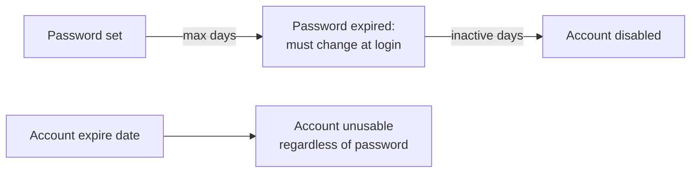

# User Accounts

<!-- nav:start -->
> **Module 02 · Users, Groups, Permissions & LDAP** — lesson 1 of 8  
> [Module index](README.md) · [Course lesson (commands)](../../course/02-Users-Groups-Permissions.md#lesson-1---user-accounts-ch-4) · [Exercises for this lesson](../../exercises/02-users-groups-permissions/01-user-accounts.md)
<!-- nav:end -->

Linux is a multi-user system: every process and every file belongs to a user. In this lesson you will learn what a user account really is, where account information is stored, and how to create, modify, lock, expire and delete accounts with the standard tools.

## What you will learn

- What UIDs are and why the kernel only cares about numbers
- The structure of `/etc/passwd` and `/etc/shadow`
- System accounts vs regular accounts
- Creating users with `useradd` (and `adduser` on Debian/Ubuntu)
- Setting and managing passwords with `passwd`
- Password aging and account expiry with `chage`
- Modifying, locking and deleting accounts with `usermod` and `userdel`

---

## Key terms

| Term | Definition |
|------|-----------|
| **User account** | An identity on the system: a name, a numeric **UID**, a primary group, a home directory and a login shell. |
| **UID** | *User ID*, the number the kernel uses for permission checks. `0` is **root**. |
| **GID** | *Group ID*: the number of a group. Every user has one **primary** group. |
| **System account** | An account for a service (e.g. `www-data`, `sshd`), usually without a login shell or password. |
| **Home directory** | The user's personal directory, normally `/home/<name>`. |
| **Login shell** | The program started when the user logs in (`/bin/bash`), or `/usr/sbin/nologin` to forbid interactive login. |
| **Password hash** | A one-way transformation of the password stored in `/etc/shadow`; the password itself is never stored. |
| **Password aging** | Rules forcing password changes after some days. |
| **Account expiry** | A date after which the account can no longer be used at all. |

---

## Users are numbers

The kernel doesn't know names like `alice`. Every process carries a **UID**, and every file stores an owner UID. Names are translated to numbers (and back) by looking up the account database.

```console
$ id alice
uid=1001(alice) gid=1001(alice) groups=1001(alice),27(sudo),1005(developers)
$ ls -ln /home/alice/notes.txt          # -n shows numbers instead of names
-rw-r--r-- 1 1001 1001 120 Oct 21 09:00 /home/alice/notes.txt
```

| UID range | Used for |
|-----------|----------|
| `0` | root – the superuser, bypasses most permission checks |
| `1` – `999` | system accounts (services) |
| `1000` + | regular (human) users |
| `65534` | `nobody` – an unprivileged placeholder |

The ranges come from `UID_MIN`, `UID_MAX`, `SYS_UID_MIN`, `SYS_UID_MAX` in `/etc/login.defs`.

> **Why it matters:** if you delete user `bob` (UID 1002) but keep his files, they show up as owned by `1002`. The next user created with UID 1002 silently becomes their owner.

---

## Where accounts are stored

### `/etc/passwd`

Readable by everyone. One line per account, seven fields separated by `:`.

```console
$ grep alice /etc/passwd
alice:x:1001:1001:Alice Smith,,,:/home/alice:/bin/bash
```

| # | Field | Example | Meaning |
|---|-------|---------|---------|
| 1 | name | `alice` | login name |
| 2 | password | `x` | `x` = the hash is in `/etc/shadow` |
| 3 | UID | `1001` | user ID |
| 4 | GID | `1001` | **primary** group ID |
| 5 | GECOS | `Alice Smith,,,` | full name / comment |
| 6 | home | `/home/alice` | home directory |
| 7 | shell | `/bin/bash` | login shell |

### `/etc/shadow`

Readable **only by root**. Holds the password hash and aging information.

```console
$ sudo grep alice /etc/shadow
alice:$y$j9T$Qm8…$Xp2…:20380:0:99999:7:::
```

| # | Field | Example | Meaning |
|---|-------|---------|---------|
| 1 | name | `alice` | |
| 2 | hash | `$y$j9T$…` | `$y$` yescrypt, `$6$` SHA-512. `!` or `*` prefix = locked/no password |
| 3 | last change | `20380` | days since 1970-01-01 of last password change (`0` = must change at next login) |
| 4 | min | `0` | days before the password may be changed again |
| 5 | max | `99999` | days after which the password must be changed |
| 6 | warn | `7` | days of warning before it expires |
| 7 | inactive | (empty) | days after expiry before the account is disabled |
| 8 | expire | (empty) | absolute account expiry date (days since 1970) |
| 9 | reserved | | |

> **Why two files?** `/etc/passwd` must be world-readable so that `ls -l` can show owner names. Keeping hashes there would let anyone copy them and try to crack them offline – so they live in the root-only `/etc/shadow`.

Use `getent` to query accounts: it follows `/etc/nsswitch.conf`, so it also finds users from LDAP (see [LDAP Clients](08-ldap-clients.md)).

```console
$ getent passwd alice
alice:x:1001:1001:Alice Smith,,,:/home/alice:/bin/bash
```

> **Never edit these files with a normal editor** while the system is in use. Use the commands below, or `vipw` / `vipw -s`, which lock the files and check syntax.

---

## Defaults for new accounts

| File | Controls |
|------|----------|
| `/etc/login.defs` | UID/GID ranges, `PASS_MAX_DAYS`, `PASS_MIN_DAYS`, `PASS_WARN_AGE`, `CREATE_HOME`, `UMASK`, `ENCRYPT_METHOD` |
| `/etc/default/useradd` | default shell, home base (`/home`), skeleton directory, `INACTIVE`, `EXPIRE` (`useradd -D` shows it) |
| `/etc/skel/` | files copied into every **new** home directory (`.bashrc`, `.profile`…) |

```console
$ useradd -D
GROUP=100
HOME=/home
INACTIVE=-1
EXPIRE=
SHELL=/bin/sh
SKEL=/etc/skel
CREATE_MAIL_SPOOL=no
```

Note: `PASS_MAX_DAYS` in `login.defs` applies only to accounts created **after** you change it.

---

## Creating users

### `useradd` (all distributions)

```console
$ sudo useradd -m -s /bin/bash -c "Alice Smith" alice
$ sudo passwd alice
New password:
Retype new password:
passwd: password updated successfully
```

| Option | Meaning |
|--------|---------|
| `-m` | create the home directory (copy `/etc/skel`) |
| `-M` | do **not** create a home directory |
| `-d DIR` | home directory path |
| `-s SHELL` | login shell |
| `-c "TEXT"` | comment / full name (GECOS) |
| `-u UID` | specific UID |
| `-g GROUP` | **primary** group (must exist) |
| `-G g1,g2` | **supplementary** groups |
| `-e YYYY-MM-DD` | account expiry date |
| `-r` | system account (UID from the system range, no home by default) |
| `-k DIR` | alternative skeleton directory |

```console
# regular user with fixed UID, extra groups and expiry date
$ sudo useradd -m -u 1500 -G developers,docker -e 2026-12-31 -s /bin/bash bob

# service account: system UID, no home, cannot log in
$ sudo useradd -r -s /usr/sbin/nologin -d /opt/myapp -M svc_myapp
```

> **Distribution differences:** on RHEL `useradd` creates the home and uses `/bin/bash` by default (`CREATE_HOME yes`). On Debian/Ubuntu it does **neither** unless you pass `-m` and `-s /bin/bash`. Always pass them explicitly – then it works everywhere.

### `adduser` (Debian/Ubuntu)

A friendly interactive wrapper that creates the home, asks for the password and the full name:

```console
$ sudo adduser carol
Adding user `carol' ...
Adding new group `carol' (1003) ...
Adding new user `carol' (1003) with group `carol (1003)' ...
Creating home directory `/home/carol' ...
Copying files from `/etc/skel' ...
New password:
```

On RHEL, `adduser` is just a link to `useradd`.

### Setting a password non-interactively

```console
$ echo 'alice:S3cure!Pass' | sudo chpasswd
$ sudo passwd -e alice          # expire it: user must choose a new one at first login
```

---

## Password aging and account expiry

`chage` (*change age*) manages the aging fields of `/etc/shadow`.

```console
$ sudo chage -l alice
Last password change                                    : Oct 21, 2026
Password expires                                        : never
Password inactive                                       : never
Account expires                                         : never
Minimum number of days between password change          : 0
Maximum number of days between password change          : 99999
Number of days of warning before password expires       : 7
```

| Command | Effect |
|---------|--------|
| `chage -M 90 alice` | password valid for at most 90 days |
| `chage -m 1 alice` | must wait 1 day between changes |
| `chage -W 7 alice` | warn 7 days before expiry |
| `chage -I 14 alice` | disable account 14 days after the password expired |
| `chage -E 2026-12-31 alice` | **account** expires on that date |
| `chage -E -1 alice` | remove account expiry |
| `chage -d 0 alice` | force password change at next login |
| `chage alice` | interactive mode |



> **Password expiry vs account expiry:** an expired *password* still lets the user log in to set a new one. An expired *account* cannot log in at all.

---

## Modifying accounts

`usermod` changes existing accounts. It uses the same options as `useradd`, plus a few more.

```console
$ sudo usermod -c "Alice Smith (Ops)" alice   # comment
$ sudo usermod -s /bin/zsh alice              # shell
$ sudo usermod -aG docker alice               # ADD a supplementary group
$ sudo usermod -g developers alice            # change primary group
$ sudo usermod -d /srv/home/alice -m alice    # move the home directory
$ sudo usermod -l alicia alice                # rename login (home dir is NOT renamed)
$ sudo usermod -u 2001 alice                  # change UID (files in home are updated)
$ sudo usermod -e 2026-06-30 alice            # account expiry
```

> **The most common mistake:** `usermod -G docker alice` **replaces** all of Alice's supplementary groups with just `docker`. Always use `-aG` (append).

Group changes take effect at the **next login** – running sessions keep their old group list. The user can check with `id` after logging in again (or use `newgrp`).

---

## Locking and disabling accounts

| Goal | Command | What it does |
|------|---------|--------------|
| Lock password | `usermod -L alice` / `passwd -l alice` | prefixes the hash with `!` |
| Unlock | `usermod -U alice` / `passwd -u alice` | removes the `!` |
| Disable account completely | `usermod -e 1 alice` or `chage -E 0 alice` | account expired in 1970 |
| Forbid shell login | `usermod -s /usr/sbin/nologin alice` | login prints a message and exits |
| Check status | `passwd -S alice` | `alice L 10/21/2026 0 99999 7 -1` (L = locked, P = usable password) |

> **Warning:** a locked password does **not** stop SSH **key** authentication. To really block a user, expire the account (`chage -E 0`) or change the shell to `nologin`.

---

## Deleting accounts

```console
$ sudo userdel bob          # removes the account, KEEPS /home/bob and mail
$ sudo userdel -r bob       # also removes home directory and mail spool
$ sudo find / -nouser 2>/dev/null   # files left behind elsewhere
```

`userdel` refuses if the user is logged in (`-f` forces it). Kill their processes first: `pkill -u bob`.

---

## Who is logged in?

```console
$ who                 # users logged in now
$ w                   # who + what they are doing
$ last -5             # recent logins (from /var/log/wtmp)
$ lastlog -u alice    # last login of a user
$ sudo lastb | head   # failed logins
```

---

## Try it yourself

1. Create `dev1` with home, bash shell and comment "Developer One"; set a password.
2. Look at the new lines in `/etc/passwd` and `/etc/shadow`; identify each field.
3. Force `dev1` to change the password at next login and set max age 60 days. Check with `chage -l`.
4. Lock the account and check `passwd -S`. Unlock it.
5. Delete the account with its home.

---

## Common mistakes

- `usermod -G` without `-a`.
- Forgetting `-m` and `-s /bin/bash` on Debian/Ubuntu.
- Believing `passwd -l` blocks SSH keys.
- Editing `/etc/shadow` by hand and breaking the format.
- Deleting a user without `-r` and leaving orphaned files.

---

## Summary

| Task | Command |
|------|---------|
| Create | `useradd -m -s /bin/bash -c "Name" user` |
| Set password | `passwd user` / `chpasswd` |
| Show identity | `id user`, `getent passwd user` |
| Aging | `chage -l`, `-M`, `-m`, `-W`, `-I`, `-d 0` |
| Account expiry | `chage -E YYYY-MM-DD` / `useradd -e` / `usermod -e` |
| Add to group | `usermod -aG group user` |
| Lock / unlock | `usermod -L` / `-U` |
| Delete | `userdel -r user` |

## Check yourself

1. Which field of `/etc/passwd` holds the primary group?
2. What does `!` at the start of the hash in `/etc/shadow` mean?
3. A user's password expired. Can they still log in?
4. What is the difference between `usermod -G` and `usermod -aG`?
5. Which command forces a password change at next login?

<details>
<summary>Answers</summary>

1. Field 4 (GID).
2. The password is locked – password authentication is impossible.
3. Yes, but they must set a new password immediately (unless the inactive period has also passed).
4. `-G` replaces the list of supplementary groups; `-aG` appends to it.
5. `chage -d 0 user` (or `passwd -e user`).

</details>

## Further reading

- `man 5 passwd`, `man 5 shadow`, `man 8 useradd`, `man 8 usermod`, `man 1 chage`, `man 5 login.defs`
- [Ubuntu Server: User management](https://documentation.ubuntu.com/server/how-to/security/user-management/)
- [Red Hat: Managing user and group accounts (RHEL 9)](https://docs.redhat.com/en/documentation/red_hat_enterprise_linux/9/html/configuring_basic_system_settings/managing-users-and-groups_configuring-basic-system-settings)
- [ArchWiki: Users and groups](https://wiki.archlinux.org/title/Users_and_groups)

---

<!-- footer:start -->
[Module index](README.md) · [Groups →](02-groups.md)  
**Practice now:** [Exercises – User Accounts](../../exercises/02-users-groups-permissions/01-user-accounts.md)
<!-- footer:end -->
