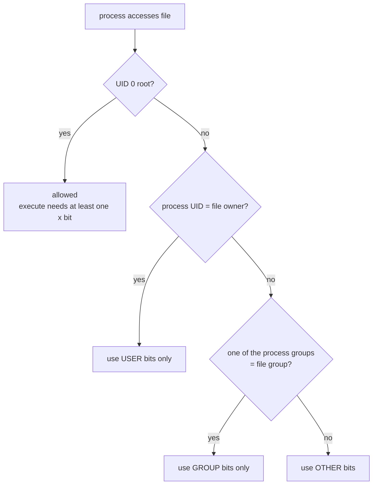

# File Permissions and Ownership

<!-- nav:start -->
> **Module 02 · Users, Groups, Permissions & LDAP** — lesson 4 of 8  
> [Module index](README.md) · [Course lesson (commands)](../../course/02-Users-Groups-Permissions.md#lesson-4---permissions--ownership-ch-6) · [Exercises for this lesson](../../exercises/02-users-groups-permissions/04-permissions-ownership.md)
<!-- nav:end -->

Every file and directory on Linux has an **owner**, a **group** and a set of **permission bits** that decide who can read, write or execute it. This is the foundation of Linux security. In this lesson you will learn to read permissions, change them in symbolic and octal notation, understand what they mean on directories, use the special bits (SUID, SGID, sticky), control default permissions with `umask`, and protect files with attributes.

## What you will learn

- The three permission classes (user, group, other) and three permissions (r, w, x)
- How the kernel decides which class applies to you
- What r, w and x mean on **directories** (very different from files)
- `chmod` in symbolic and octal notation; `chown` and `chgrp`
- SUID, SGID and the sticky bit
- `umask` and default permissions
- File attributes with `chattr` / `lsattr`

---

## Key terms

| Term | Definition |
|------|-----------|
| **Owner (user, u)** | The user who owns the file; usually its creator. |
| **Group (g)** | The group the file belongs to. |
| **Other (o)** | Everyone who is neither the owner nor in the group. |
| **Mode** | The permission bits of a file, e.g. `rwxr-x---` or `750`. |
| **Octal notation** | Mode written as digits where r=4, w=2, x=1. |
| **Symbolic notation** | Mode changes written like `u+x`, `go-w`, `a=r`. |
| **Special bits** | SUID (4000), SGID (2000), sticky (1000). |
| **umask** | A mask that removes permissions from newly created files. |
| **DAC** | *Discretionary Access Control*: the owner decides the permissions. |

---

## Reading permissions

```console
$ ls -l /etc/shadow /usr/bin/passwd /tmp
-rw-r-----  1 root shadow   1294 Oct 21 09:00 /etc/shadow
-rwsr-xr-x  1 root root    59976 Feb  6  2026 /usr/bin/passwd
drwxrwxrwt 18 root root     4096 Oct 21 10:02 /tmp
```

```text
 -   rw-   r--   ---      root   shadow
 │   ─┬─   ─┬─   ─┬─      ─┬──   ──┬───
type user group other     owner  group
```

For `/etc/shadow`: the owner `root` can read and write; members of group `shadow` can read; others have no access.

---

## How the kernel chooses the class

For each access, exactly **one** class is used, checked in this order:



Classes do **not** add up. If a file is `----rw-rw-` and you are the owner, you get **no** access, even though "others" can read it.

---

## What r, w, x mean

| | On a file | On a directory |
|--|-----------|----------------|
| **r** (4) | read the content | **list** the names inside (`ls`) |
| **w** (2) | modify the content | **create, delete, rename** entries inside |
| **x** (1) | run it as a program | **enter / traverse** it (`cd`, access files by name) |

Important consequences:

- **Deleting a file needs `w` on the directory**, not on the file. You can delete a read-only file in your own directory (`rm` asks for confirmation).
- To open `/srv/app/conf/settings.ini` you need `x` on `/`, `/srv`, `/srv/app` and `/srv/app/conf`, plus `r` on the file. `namei -l <path>` shows every step.
- A directory with `r` but no `x` lets you see names but not open anything; with `x` but no `r` you can open files only if you know their exact names.

```console
$ namei -l /srv/app/conf/settings.ini
f: /srv/app/conf/settings.ini
drwxr-xr-x root root  /
drwxr-xr-x root root  srv
drwxr-x--- app  app   app          ← "other" users stop here: no x
drwxr-xr-x app  app   conf
-rw-r--r-- app  app   settings.ini
```

---

## Changing permissions: chmod

### Octal notation

Each digit is the sum r=4 + w=2 + x=1 for user, group, other.

| Octal | Bits | Typical use |
|-------|------|-------------|
| `7` | `rwx` | |
| `6` | `rw-` | |
| `5` | `r-x` | |
| `4` | `r--` | |
| `0` | `---` | |
| `644` | `rw-r--r--` | normal files |
| `600` | `rw-------` | private files, SSH keys |
| `640` | `rw-r-----` | config files with secrets readable by a service group |
| `755` | `rwxr-xr-x` | directories, programs |
| `750` | `rwxr-x---` | private directories shared with a group |
| `700` | `rwx------` | `~/.ssh` |

```console
$ chmod 640 app.conf
$ chmod 750 /srv/app
```

### Symbolic notation

`[ugoa][+-=][rwxXst]`

```console
$ chmod u+x script.sh            # add execute for the owner
$ chmod go-w file                # remove write from group and other
$ chmod a=r file                 # everyone read only (a = all)
$ chmod u=rwx,g=rx,o= dir        # same as 750
$ chmod -R g+rX /srv/project     # recursive; X = execute only on dirs (and files already executable)
```

Symbolic mode is ideal when you want to change **one** bit and keep the rest; octal sets everything at once.

> **Tip:** `chmod -R 755 dir` makes every *file* executable too. Use `X` or `find`:
> `find dir -type d -exec chmod 755 {} +; find dir -type f -exec chmod 644 {} +`

---

## Changing ownership: chown and chgrp

Only **root** can change a file's owner. The owner can change the group to any group they belong to.

```console
$ sudo chown alice report.txt            # owner
$ sudo chown alice:developers report.txt # owner and group
$ sudo chown :developers report.txt      # group only (= chgrp)
$ sudo chgrp developers report.txt
$ sudo chown -R www-data:www-data /var/www/site   # recursive
$ sudo chown --reference=a.txt b.txt     # copy ownership from another file
```

---

## Special permission bits

| Bit | Octal | Shown as | On an executable file | On a directory |
|-----|-------|----------|----------------------|----------------|
| **SUID** | `4000` | `s` in user x position | runs with the **file owner's** UID | (no effect on Linux) |
| **SGID** | `2000` | `s` in group x position | runs with the **file's group** | new files **inherit the directory's group**; subdirectories inherit SGID |
| **Sticky** | `1000` | `t` in other x position | (no effect) | only the file's owner, the directory owner or root can **delete/rename** files |

A **capital** `S` or `T` means the special bit is set but the underlying `x` is not – usually a mistake.

### SUID example – `passwd`

`/usr/bin/passwd` is `-rwsr-xr-x root root`. When Alice runs it, the process runs as **root**, which is why it can write `/etc/shadow`. SUID programs are security-sensitive: audit them with `find / -perm -4000`.

### SGID directory example – team folder

```console
$ sudo mkdir /srv/team && sudo chgrp developers /srv/team
$ sudo chmod 2770 /srv/team
$ ls -ld /srv/team
drwxrws--- 2 root developers 4096 Oct 21 11:00 /srv/team
alice$ touch /srv/team/plan.txt; ls -l /srv/team/plan.txt
-rw-rw-r-- 1 alice developers 0 Oct 21 11:01 /srv/team/plan.txt     ← group = developers, not alice
```

Without SGID the file would belong to Alice's private group and Bob couldn't edit it.

### Sticky bit example – `/tmp`

```console
$ ls -ld /tmp
drwxrwxrwt 18 root root 4096 Oct 21 10:02 /tmp
bob$ rm /tmp/alice-file
rm: cannot remove '/tmp/alice-file': Operation not permitted
$ sudo chmod +t /srv/dropbox       # or chmod 1777
```

### Setting special bits

```console
$ chmod u+s file    $ chmod 4755 file     # SUID
$ chmod g+s dir     $ chmod 2775 dir      # SGID
$ chmod +t dir      $ chmod 1777 dir      # sticky
$ chmod 0755 file                         # leading 0 clears special bits (on files)
```

---

## Default permissions: umask

New files start from a **base** mode – `666` for files (never executable automatically), `777` for directories – and the **umask** removes bits.

| umask | New file | New directory | Typical use |
|-------|----------|---------------|-------------|
| `022` | `644` rw-r--r-- | `755` rwxr-xr-x | system default (root, many distros) |
| `002` | `664` rw-rw-r-- | `775` rwxrwxr-x | UPG systems for regular users |
| `027` | `640` rw-r----- | `750` rwxr-x--- | more private |
| `077` | `600` rw------- | `700` rwx------ | very private |

It is a **mask** (bitwise "and not"), not a subtraction: umask `033` gives files `644` (not `633`).

```console
$ umask
0022
$ umask -S
u=rwx,g=rx,o=rx
$ umask 027; touch f; mkdir d; ls -ld f d
-rw-r----- 1 alice alice    0 Oct 21 11:10 f
drwxr-x--- 2 alice alice 4096 Oct 21 11:10 d
```

`umask` affects only the current shell and its children. To make it persistent: `~/.bashrc` (one user), `/etc/profile.d/umask.sh` (all users), or `UMASK` in `/etc/login.defs`. Services use `UMask=` in their systemd unit.

---

## File attributes

Beyond permissions, ext4 and XFS support **attributes** that even root must remove before acting:

```console
$ sudo chattr +i /etc/resolv.conf     # immutable: no write, delete, rename, link – even by root
$ sudo rm /etc/resolv.conf
rm: cannot remove '/etc/resolv.conf': Operation not permitted
$ lsattr /etc/resolv.conf
----i---------e------- /etc/resolv.conf
$ sudo chattr -i /etc/resolv.conf
$ sudo chattr +a /var/log/audit.log   # append-only: can only add data
```

If root "can't delete a file", check `lsattr` before anything else.

---

## Try it yourself

1. Create a file and set it to `rw-r-----` with octal, then with symbolic notation.
2. Make a directory where you have `r` but not `x`; try `ls` and `cat dir/file`.
3. Build a team directory with SGID; create a file as two different users and compare group ownership.
4. Set `umask 077`, create a file and a directory, check their modes.
5. Make a file immutable and try to delete it as root.

---

## Common mistakes

- `chmod 777` to "fix" permission problems – find the real cause (`namei -l`, owner, group).
- `chmod -R 755` on a tree of files.
- Forgetting `x` on parent directories.
- Expecting `umask` to add permissions – it only removes.
- Being surprised by `S` / `T` (special bit without `x`).

---

## Summary

| Need | Command |
|------|---------|
| Read permissions | `ls -l`, `stat -c '%A %a %U %G' file`, `namei -l path` |
| Set exact mode | `chmod 640 file` |
| Change one bit | `chmod g+w file` |
| Change owner/group | `chown user:group file`, `chgrp group file` |
| Team directory | `chgrp team dir; chmod 2770 dir` |
| Shared drop directory | `chmod 1777 dir` |
| Default mode | `umask 027` (+ persist in a profile file) |
| Immutable | `chattr +i`, `lsattr` |

## Check yourself

1. What does `chmod 2750 dir` set?
2. A user has `w` on a file but not on its directory. Can they delete the file? Can they empty it?
3. With umask `026`, what modes do new files and directories get?
4. Why does `-rwSr--r--` show a capital S?

<details>
<summary>Answers</summary>

1. SGID + `rwxr-x---`: owner full, group read/enter, others nothing; new files inherit the directory group.
2. They cannot delete it (needs `w` on the directory), but they can truncate/modify it (`> file`).
3. Files `640` (`666` & ~`026`), directories `751`.
4. SUID is set but the owner has no `x` – the special bit has no useful effect.

</details>

## Further reading

- `man 1 chmod`, `man 1 chown`, `man 1 chattr`, `man 7 path_resolution`
- [Ubuntu Server: User management – file permissions](https://documentation.ubuntu.com/server/how-to/security/user-management/)
- [ArchWiki: File permissions and attributes](https://wiki.archlinux.org/title/File_permissions_and_attributes)
- [Red Hat: Configuring basic system settings (RHEL 9) – see “Managing file system permissions”](https://docs.redhat.com/en/documentation/red_hat_enterprise_linux/9/html/configuring_basic_system_settings/index)

---

<!-- footer:start -->
[← Privilege Escalation with sudo and su](03-sudo.md) · [Module index](README.md) · [Access Control Lists (ACLs) →](05-acls.md)  
**Practice now:** [Exercises – File Permissions and Ownership](../../exercises/02-users-groups-permissions/04-permissions-ownership.md)
<!-- footer:end -->
