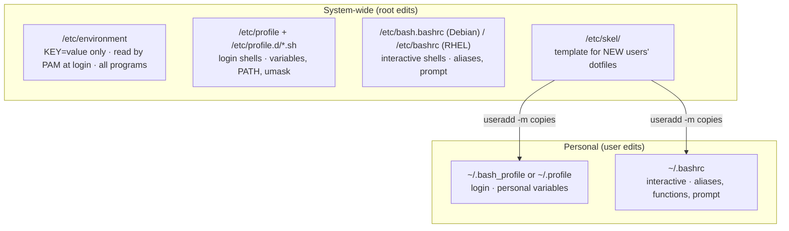

# Personal and System-Wide Environment Profiles

<!-- nav:start -->
> **Module 02 · Users, Groups, Permissions & LDAP** — lesson 6 of 8  
> [Module index](README.md) · [Course lesson (commands)](../../course/02-Users-Groups-Permissions.md#lesson-6---environment-profiles-gap) · [Exercises for this lesson](../../exercises/02-users-groups-permissions/06-environment-profiles.md)
<!-- nav:end -->

The LFCS objective *"Manage personal and system-wide environment profiles"* is about deciding **where** a setting must live so that it applies to the right users, at the right time, and survives logouts and package upgrades. This lesson builds on [The User Environment](../01-foundations/05-user-environment.md) and focuses on the administrator's point of view.

## What you will learn

- The difference between a **profile** (login) and an **rc** file (interactive)
- Every system-wide and per-user location, and what belongs in each
- How to set variables, aliases, umask and PATH for one user, a group of users, or everybody
- `/etc/skel` for future users, and `/etc/environment` for non-shell programs
- How to test your changes

---

## Key terms

| Term | Definition |
|------|-----------|
| **Profile** | A startup file read by **login** shells (`/etc/profile`, `~/.profile`, `~/.bash_profile`). Runs once per login. |
| **rc file** | A startup file read by every **interactive** shell (`~/.bashrc`, `/etc/bash.bashrc`). "rc" = *run commands*. |
| **System-wide** | Applies to all users (files under `/etc`). |
| **Personal** | Applies to one user (dotfiles in the home directory). |
| **Skeleton directory** | `/etc/skel`, copied into the home of every new user. |
| **PAM environment** | Variables set at login by the `pam_env` module from `/etc/environment` – independent of the shell. |

---

## The map of files



| Want to set… | For everyone | For one user |
|--------------|-------------|--------------|
| Environment variable (exported) | `/etc/profile.d/<name>.sh` (or `/etc/environment`) | `~/.bash_profile` / `~/.profile` (or `~/.bashrc`) |
| Alias / function | `/etc/bash.bashrc` (Debian) or `/etc/profile.d/<name>.sh` | `~/.bashrc` |
| PATH addition | `/etc/profile.d/<name>.sh` | `~/.profile` / `~/.bashrc` |
| umask | `/etc/profile.d/<name>.sh` or `UMASK` in `/etc/login.defs` | `~/.bashrc` |
| Default files for future users | `/etc/skel/` | – |

### Why `/etc/profile.d/` and not `/etc/profile`?

`/etc/profile` belongs to a package and may be replaced on upgrade. It already contains a loop that sources every `/etc/profile.d/*.sh`, so a separate file is cleaner, survives updates and is easy to remove.

```console
$ grep -A4 profile.d /etc/profile
if [ -d /etc/profile.d ]; then
  for i in /etc/profile.d/*.sh; do
    if [ -r $i ]; then
      . $i
```

Files in `profile.d` must end in **`.sh`** and be readable; they do not need to be executable (they are *sourced*).

---

## /etc/environment

A plain list of `KEY=value` lines read by **PAM** at login, so it applies even to programs that never start a shell (graphical sessions, some SSH commands).

```text
# /etc/environment
LANG=en_US.UTF-8
HTTP_PROXY=http://proxy.example.lab:3128
```

Limitations: **no shell syntax** – no `export`, no `$VAR` expansion, no commands. For `PATH=$PATH:/opt/bin` use `profile.d` instead.

---

## Examples

### A variable for every user

```console
$ sudo tee /etc/profile.d/company.sh << 'EOF'
export COMPANY=acme
export HISTTIMEFORMAT="%F %T "
EOF
```

### Extend PATH for everyone

```console
$ echo 'export PATH="$PATH:/opt/tools/bin"' | sudo tee /etc/profile.d/tools-path.sh
```

### Apply a setting only to members of a group

Profile scripts are just shell code, so they can test conditions:

```bash
# /etc/profile.d/devs.sh
if id -nG | grep -qw developers; then
    export JAVA_HOME=/usr/lib/jvm/java-21
    umask 002
fi
```

### Personal settings for one user

```console
$ sudo -u alice tee -a /home/alice/.bashrc << 'EOF'
alias k='kubectl'
export EDITOR=vim
EOF
```

### Defaults for future users

```console
$ sudo cp /root/company-readme.txt /etc/skel/README.txt
$ echo "alias ll='ls -alF'" | sudo tee -a /etc/skel/.bashrc
```

`/etc/skel` only affects accounts created **afterwards** with `useradd -m` / `adduser`. Existing users must be updated individually.

### Restricting a variable from being changed

```bash
# /etc/profile.d/tmout.sh – log idle root shells out after 15 minutes
TMOUT=900
readonly TMOUT
export TMOUT
```

`readonly` stops users from unsetting it in that shell.

---

## Other shells

| Shell | System-wide | Personal |
|-------|------------|----------|
| bash | `/etc/profile`, `/etc/profile.d/`, `/etc/bash.bashrc` or `/etc/bashrc` | `~/.bash_profile`, `~/.profile`, `~/.bashrc` |
| sh / dash | `/etc/profile`, `/etc/profile.d/` | `~/.profile` |
| zsh | `/etc/zsh/zshenv`, `zprofile`, `zshrc` | `~/.zshenv`, `~/.zprofile`, `~/.zshrc` |

Files in `/etc/profile.d/` with POSIX syntax work for bash, sh and (via emulation) most other login shells.

---

## Testing your changes

Startup files are read only when a shell starts. Test without logging out:

```console
$ bash -l -c 'echo $COMPANY'          # new login shell as yourself
$ sudo -i -u alice bash -c 'echo $EDITOR'   # login shell as alice
$ su - alice -c 'alias'               # login shell, show aliases (if ~/.bashrc is sourced)
$ ssh alice@localhost 'echo $PATH'    # non-interactive SSH: reads ~/.bashrc on Debian/Ubuntu
$ env -i bash -l -c env               # completely clean login environment
```

Syntax-check a file before it breaks everyone's login: `bash -n /etc/profile.d/company.sh`.

---

## Try it yourself

1. Make `TZ=UTC` apply to every user's login shell.
2. Make an alias `cls=clear` available to every interactive bash on your distribution.
3. Make the `PATH` of user `alice` include `/opt/alice/bin`.
4. Make every **new** user get a `~/.vimrc` with `set number`.
5. Verify each change with a login shell for a different user.

---

## Common mistakes

- Editing `/etc/profile` instead of adding a file to `/etc/profile.d/`.
- Naming a profile.d file without `.sh` (ignored).
- Using `$PATH` in `/etc/environment` (not expanded).
- Expecting `/etc/skel` changes to update existing users.
- A syntax error in a profile.d script – every login prints errors. Check with `bash -n`.

---

## Summary

- **Everyone:** `/etc/profile.d/*.sh` (login), `/etc/bash.bashrc` or `/etc/bashrc` (interactive), `/etc/environment` (simple variables, PAM).
- **One user:** `~/.bash_profile`/`~/.profile` (login), `~/.bashrc` (interactive).
- **Future users:** `/etc/skel/`.
- Test with `bash -l`, `su - user`, `sudo -i -u user`.

## Check yourself

1. A variable must be visible to cron jobs and SSH remote commands for all users. Which file is the safest choice?
2. Why can't you write `PATH=$PATH:/opt/bin` in `/etc/environment`?
3. What must the name of a file in `/etc/profile.d/` end with?

<details>
<summary>Answers</summary>

1. `/etc/environment` is read by PAM for sessions; for cron specifically, also define it in the crontab or the script, since cron doesn't read shell profiles.
2. `/etc/environment` is not a shell script – variables are not expanded.
3. `.sh`.

</details>

## Further reading

- `man 1 bash` (INVOCATION), `man 8 pam_env`, `man 5 environment`
- [ArchWiki: Environment variables](https://wiki.archlinux.org/title/Environment_variables)

---

<!-- footer:start -->
[← Access Control Lists (ACLs)](05-acls.md) · [Module index](README.md) · [User Resource Limits →](07-resource-limits.md)  
**Practice now:** [Exercises – Personal and System-Wide Environment Profiles](../../exercises/02-users-groups-permissions/06-environment-profiles.md)
<!-- footer:end -->
