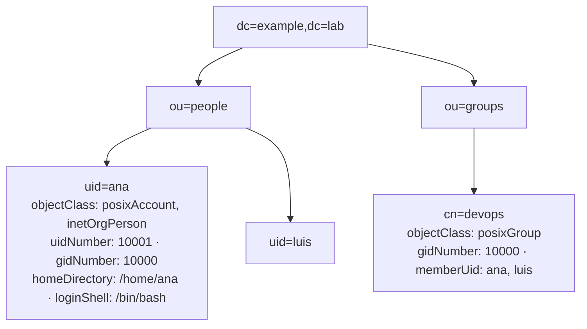
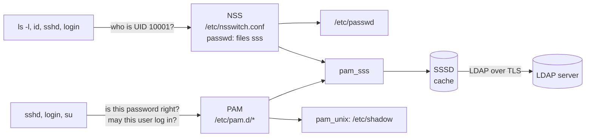

# Using LDAP for Users and Groups

<!-- nav:start -->
> **Module 02 · Users, Groups, Permissions & LDAP** — lesson 8 of 8  
> [Module index](README.md) · [Course lesson (commands)](../../course/02-Users-Groups-Permissions.md#lesson-8---ldap-clients-ch-29) · [Exercises for this lesson](../../exercises/02-users-groups-permissions/08-ldap-clients.md)
<!-- nav:end -->

In an organization with hundreds of servers, creating every user on every machine is impossible to manage. Instead, accounts are kept in a central **directory** – LDAP, FreeIPA or Active Directory – and each Linux machine is configured as a **client** that looks users up there. In this lesson you will learn what LDAP is, how Linux finds users through NSS and PAM, and how to configure SSSD so that directory users can log in.

## What you will learn

- What a directory service and LDAP are
- The LDAP data model: entries, DNs, attributes, object classes
- How Linux resolves users (NSS) and authenticates them (PAM)
- The role of **SSSD**
- Configuring an SSSD LDAP client on Ubuntu and RHEL
- Creating home directories automatically
- Testing and troubleshooting with `getent`, `id`, `ldapsearch`, `sssctl`

---

## Key terms

| Term | Definition |
|------|-----------|
| **Directory service** | A central database optimized for lookups of users, groups, hosts, etc. |
| **LDAP** | *Lightweight Directory Access Protocol* – the standard protocol to query and modify a directory. Port **389** (plain/StartTLS), **636** (LDAPS). |
| **Entry** | One object in the directory (a user, a group…). |
| **DN** | *Distinguished Name* – the unique path of an entry, e.g. `uid=ana,ou=people,dc=example,dc=lab`. |
| **Base DN / search base** | The DN where searches start, usually the domain: `dc=example,dc=lab`. |
| **Attribute** | A named value of an entry (`uid`, `cn`, `uidNumber`, `homeDirectory`). |
| **objectClass** | Defines which attributes an entry must/may have (`posixAccount`, `posixGroup`, `inetOrgPerson`). |
| **Bind** | Authenticating to the LDAP server (anonymous or with a DN + password). |
| **NSS** | *Name Service Switch* – how programs translate names ↔ IDs (`/etc/nsswitch.conf`). |
| **PAM** | *Pluggable Authentication Modules* – how programs check passwords and set up sessions. |
| **SSSD** | *System Security Services Daemon* – the client that talks to LDAP/AD/IPA, caches results and plugs into NSS and PAM. |

---

## The LDAP data model

A directory is a **tree** (the *DIT*, Directory Information Tree):



Reading a DN from left to right goes from the entry up to the root:

```text
uid=ana , ou=people , dc=example , dc=lab
└─ RDN ─┘ └─ parent ┘ └───── base DN ──────┘
```

| Abbreviation | Meaning |
|--------------|---------|
| `dc` | domain component |
| `ou` | organizational unit (a folder) |
| `cn` | common name |
| `uid` | user id (login name) |

An entry in **LDIF** (the text format of LDAP):

```text
dn: uid=ana,ou=people,dc=example,dc=lab
objectClass: inetOrgPerson
objectClass: posixAccount
uid: ana
cn: Ana Garcia
sn: Garcia
uidNumber: 10001
gidNumber: 10000
homeDirectory: /home/ana
loginShell: /bin/bash
userPassword: {SSHA}…
```

The `posixAccount` object class carries exactly the fields of a line in `/etc/passwd`.

---

## How Linux finds and authenticates users

Two independent frameworks are involved:



1. **NSS** answers *"who is this user?"* – name ↔ UID, groups, home, shell. `/etc/nsswitch.conf` lists sources in order:
   ```text
   passwd:  files sss
   group:   files sss
   shadow:  files sss
   ```
   `files` = local files, `sss` = ask SSSD.
2. **PAM** answers *"may this user log in, and is the password right?"* and prepares the session (home directory, limits).

`getent` uses NSS exactly like real programs do – so it's the main test tool.

---

## Why SSSD?

- **One daemon** for LDAP, Kerberos, Active Directory and FreeIPA.
- **Caching**: users can log in even if the LDAP server is temporarily down (`cache_credentials`).
- **Security**: refuses to send passwords over unencrypted connections by default.
- Replaces older tools (`nslcd`, `nss_ldap`, `pam_ldap`).

---

## Configuring an LDAP client with SSSD

Assumptions: LDAP server `ldap.example.lab`, base `dc=example,dc=lab`, users in `ou=people`, groups in `ou=groups`, server certificate signed by a CA you have as `/etc/ssl/certs/lab-ca.crt` (RHEL: `/etc/pki/tls/certs/lab-ca.crt`).

### 1. Install packages

```console
# Debian/Ubuntu
$ sudo apt install sssd-ldap ldap-utils libnss-sss libpam-sss
# RHEL family
$ sudo dnf install sssd sssd-ldap openldap-clients oddjob-mkhomedir
```

### 2. Write `/etc/sssd/sssd.conf`

```ini
[sssd]
services = nss, pam
domains = example.lab

[domain/example.lab]
id_provider = ldap
auth_provider = ldap
ldap_uri = ldap://ldap.example.lab
ldap_search_base = dc=example,dc=lab
ldap_user_search_base = ou=people,dc=example,dc=lab
ldap_group_search_base = ou=groups,dc=example,dc=lab
ldap_id_use_start_tls = true
ldap_tls_reqcert = demand
ldap_tls_cacert = /etc/ssl/certs/lab-ca.crt
cache_credentials = true
enumerate = false
```

| Option | Meaning |
|--------|---------|
| `id_provider = ldap` | where user/group **information** comes from |
| `auth_provider = ldap` | where **passwords** are checked |
| `ldap_uri` | server URL (`ldap://` + StartTLS, or `ldaps://`) |
| `ldap_search_base` | base DN |
| `ldap_id_use_start_tls` | upgrade the connection to TLS |
| `ldap_tls_reqcert = demand` | require a valid server certificate |
| `ldap_default_bind_dn` / `ldap_default_authtok` | use these if anonymous search is not allowed |

### 3. Permissions – SSSD refuses to start otherwise

```console
$ sudo chown root:root /etc/sssd/sssd.conf
$ sudo chmod 600 /etc/sssd/sssd.conf
```

### 4. Enable NSS/PAM integration and home directory creation

```console
# RHEL family
$ sudo authselect select sssd with-mkhomedir --force
$ sudo systemctl enable --now oddjobd
# Debian/Ubuntu (libnss-sss and libpam-sss already updated nsswitch/PAM)
$ sudo pam-auth-update --enable mkhomedir
```

### 5. Start SSSD

```console
$ sudo systemctl enable --now sssd
$ systemctl status sssd
```

---

## Testing

```console
$ getent passwd ana
ana:*:10001:10000:Ana Garcia:/home/ana:/bin/bash
$ id ana
uid=10001(ana) gid=10000(devops) groups=10000(devops)
$ getent group devops
devops:*:10000:ana,luis
$ su - ana                 # or: ssh ana@localhost
Creating directory '/home/ana'.
ana@client:~$
```

Query the server directly (bypasses SSSD – useful to tell server problems from client problems):

```console
$ ldapsearch -x -H ldap://ldap.example.lab -ZZ -b "dc=example,dc=lab" "(uid=ana)" uidNumber homeDirectory
# ana, people, example.lab
dn: uid=ana,ou=people,dc=example,dc=lab
uidNumber: 10001
homeDirectory: /home/ana
```

`-x` simple auth, `-H` URI, `-ZZ` require StartTLS, `-b` base, then a **filter** and the attributes to show.

---

## Troubleshooting

| Symptom | Check |
|---------|-------|
| `sssd` won't start | `journalctl -u sssd` – usually wrong permissions on `sssd.conf` or a typo |
| `getent passwd ana` returns nothing | `ldapsearch` works? `nsswitch.conf` contains `sss`? search base correct? |
| user found but can't log in | TLS/certificate problems, `auth_provider`, `journalctl -u sssd`, `/var/log/secure` or `auth.log` |
| no home directory | mkhomedir not enabled (`authselect current`, `pam-auth-update`) |
| stale data after server changes | clear cache: `sudo sss_cache -E` or `sudo sssctl cache-remove` |

```console
$ sudo sssctl domain-status example.lab
Online status: Online
$ sudo sssctl user-checks ana
```

Increase logging by adding `debug_level = 6` in the `[domain/…]` section; logs go to `/var/log/sssd/`.

---

## Practice environment

You can run a test LDAP server in a container on one VM (for example the `bitnami/openldap` or `osixia/openldap` images) and point the other VM at it – see the [exercises](../../exercises/02-users-groups-permissions/08-ldap-clients.md).

---

## Common mistakes

- `sssd.conf` not mode 600 → SSSD refuses to start.
- Using `ldap://` without StartTLS – SSSD refuses password authentication over clear text.
- Wrong search base (typo in `dc=`).
- Forgetting mkhomedir → login succeeds but "Could not chdir to home directory".
- Testing with `grep ana /etc/passwd` – LDAP users are **not** in local files; use `getent`.

---

## Summary

| Step | Command / file |
|------|----------------|
| Install | `sssd-ldap ldap-utils libnss-sss libpam-sss` / `sssd sssd-ldap openldap-clients oddjob-mkhomedir` |
| Configure | `/etc/sssd/sssd.conf` (600, root) |
| Integrate | `authselect select sssd with-mkhomedir` / `pam-auth-update --enable mkhomedir` |
| Start | `systemctl enable --now sssd` |
| Test | `getent passwd user`, `id user`, `su - user`, `ldapsearch -x …` |
| Clear cache | `sss_cache -E` |

## Check yourself

1. What does the DN `cn=admins,ou=groups,dc=corp,dc=com` describe?
2. Which file tells programs to ask SSSD for users?
3. `ldapsearch` finds the user but `getent passwd` doesn't. Where is the problem?
4. Why use `getent` rather than `grep /etc/passwd` to test?

<details>
<summary>Answers</summary>

1. A group (or entry) named `admins` in the `groups` OU of the `corp.com` domain.
2. `/etc/nsswitch.conf` (`passwd: files sss`).
3. On the client: SSSD configuration, nsswitch, cache or TLS – the server is fine.
4. `getent` follows NSS, so it shows users from every source (files, SSSD/LDAP), exactly like `login` and `ls` see them.

</details>

## Further reading

- `man 5 sssd.conf`, `man 5 sssd-ldap`, `man 5 nsswitch.conf`, `man 1 ldapsearch`, `man 8 authselect`
- [SSSD documentation](https://sssd.io/docs/introduction.html)
- [Ubuntu Server: SSSD with LDAP](https://documentation.ubuntu.com/server/how-to/sssd/with-ldap/)
- [Red Hat: Configuring authentication and authorization in RHEL 9](https://docs.redhat.com/en/documentation/red_hat_enterprise_linux/9/html/configuring_authentication_and_authorization_in_rhel/index)
- [LDAP.com: Basic LDAP concepts](https://ldap.com/basic-ldap-concepts/)

---

<!-- footer:start -->
[← User Resource Limits](07-resource-limits.md) · [Module index](README.md)  
**Practice now:** [Exercises – Using LDAP for Users and Groups](../../exercises/02-users-groups-permissions/08-ldap-clients.md)
<!-- footer:end -->
