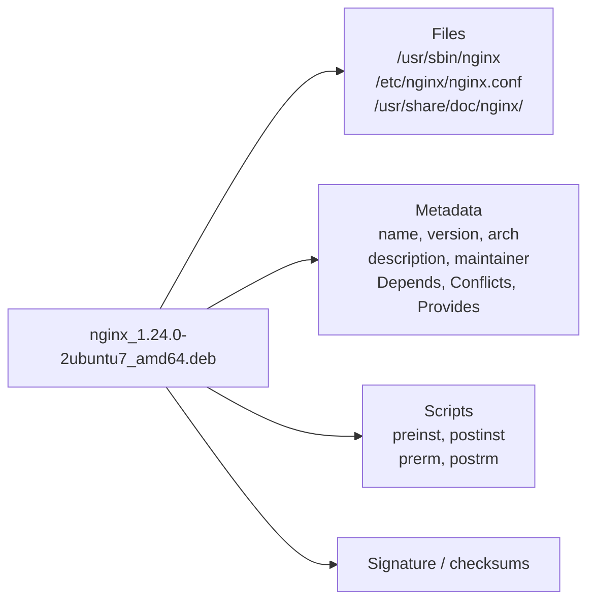
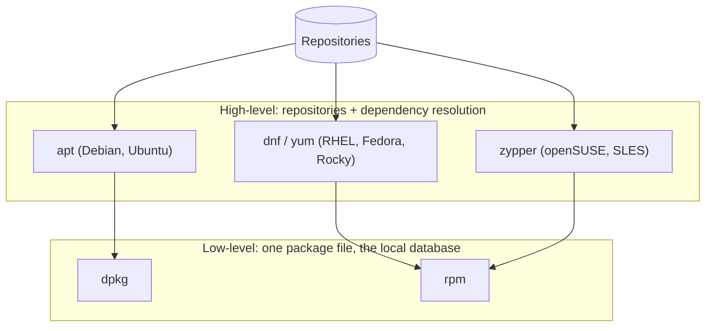

# Package Management Concepts

<!-- nav:start -->
> **Module 03 · Package Management & Git** — lesson 1 of 5  
> [Module index](README.md) · [Course lesson (commands)](../../course/03-Packages-and-Git.md#lesson-1---package-management-concepts-ch-7) · [Exercises for this lesson](../../exercises/03-packages-git/01-package-management-concepts.md)
<!-- nav:end -->

Almost all software on a Linux server is installed from **packages**. Before learning the commands of each family (`apt`, `dnf`, `zypper`), you need a clear picture of what a package is, what a repository is, how dependencies are resolved and how the system trusts what it downloads. With that model, every package tool becomes "the same ideas with different flags".

## What you will learn

- Why package managers exist and what problems they solve
- What a package contains (files, metadata, scripts, signature)
- The two tool layers: **low-level** (`dpkg`, `rpm`) and **high-level** (`apt`, `dnf`, `zypper`)
- Repositories, metadata and mirrors
- Dependencies and how they are resolved
- Package signing and trust
- Package naming and versions
- Other formats: source installs, Snap, Flatpak, containers

---

## Key terms

| Term | Definition |
|------|-----------|
| **Package** | An archive containing software files plus metadata describing them. `.deb` (Debian family) or `.rpm` (Red Hat, SUSE). |
| **Package manager** | Software that installs, upgrades, removes and queries packages, keeping a database of what is installed. |
| **Package database** | Record of every installed package and file: `/var/lib/dpkg/` or `/var/lib/rpm/`. |
| **Repository (repo)** | A server or directory hosting packages plus an index (metadata). |
| **Metadata** | The repository index: names, versions, dependencies, checksums of every package. |
| **Dependency** | Another package (or capability) a package needs in order to work. |
| **Dependency resolution** | Computing the full set of packages to install/remove so all dependencies are satisfied. |
| **GPG signature** | A cryptographic signature proving who built a package/repository, and that it wasn't modified. |
| **Upstream** | The original authors of the software, as opposed to the distribution that packages it. |

---

## Why package managers?

Installing software by hand (`./configure && make && make install`) works, but:

| Problem with manual installs | How packages solve it |
|------------------------------|-----------------------|
| Which files belong to which program? | the database records every file of every package |
| Clean removal is nearly impossible | `remove` deletes exactly the package's files |
| Missing libraries discovered at runtime | dependencies are declared and installed automatically |
| Security updates must be tracked manually | one command upgrades everything from the distribution |
| Was this binary tampered with? | signatures and checksums; `rpm -V` / `dpkg -V` verify installed files |
| Different versions on every server | repositories give every server the same tested versions |

---

## What is inside a package



- **Files** with their target paths, owners and permissions.
- **Metadata**, including the dependency list.
- **Maintainer scripts** that run during installation or removal: creating a system user, enabling a service, updating caches.
- **Configuration files** are marked specially, so upgrades don't overwrite your changes.

---

## Low-level and high-level tools



| | Debian / Ubuntu | RHEL / Fedora / Rocky | openSUSE / SLES |
|--|-----------------|----------------------|-----------------|
| Package format | `.deb` | `.rpm` | `.rpm` |
| Low-level tool | `dpkg` | `rpm` | `rpm` |
| High-level tool | `apt` (`apt-get`, `apt-cache`) | `dnf` (`yum` is an alias) | `zypper` |
| Repository config | `/etc/apt/sources.list.d/` | `/etc/yum.repos.d/` | `/etc/zypp/repos.d/` |
| Database | `/var/lib/dpkg/` | `/var/lib/rpm/` | `/var/lib/rpm/` |
| Cache of downloads | `/var/cache/apt/archives/` | `/var/cache/dnf/` | `/var/cache/zypp/` |

**Low-level tools** work with a single package file and the local database. They install exactly what you give them and **fail if a dependency is missing**. They are perfect for *queries*: "which package owns this file?", "which files does this package contain?", "were files modified?".

**High-level tools** talk to repositories, compute dependencies, download everything needed and then call the low-level tool.

```console
$ sudo dpkg -i ./mytool_1.0_amd64.deb
dpkg: dependency problems prevent configuration of mytool:
 mytool depends on libfoo2; however:
  Package libfoo2 is not installed.

$ sudo apt install ./mytool_1.0_amd64.deb      # resolves and installs libfoo2 too
```

---

## Repositories and metadata

A repository is just files on a web server (or a local directory/DVD):

```text
https://archive.ubuntu.com/ubuntu/
├── dists/noble/main/binary-amd64/Packages.gz     ← metadata (index)
├── dists/noble/InRelease                         ← signed checksums of the index
└── pool/main/n/nginx/nginx_1.24.0-2ubuntu7_amd64.deb
```

The high-level tool keeps a **local copy of the metadata**. That is why:

- `apt update` (Debian) downloads fresh indexes. It **does not install or upgrade anything**. If you forget it on a fresh system, `apt install` says "Unable to locate package".
- `dnf` refreshes metadata automatically when it is older than `metadata_expire` (or with `dnf makecache` / `--refresh`).

### Repository types

| Distribution | Official repos | Extra |
|--------------|---------------|-------|
| Ubuntu | `main` (supported), `universe` (community), `restricted`, `multiverse`; suites `noble`, `noble-updates`, `noble-security` | PPAs, vendor repos |
| RHEL 9 | `BaseOS` (core OS), `AppStream` (applications, languages, databases), `CRB` (build deps) | **EPEL** (Extra Packages for Enterprise Linux), vendor repos |
| Fedora | `fedora`, `updates` | RPM Fusion, COPR |

---

## Dependencies

Packages declare relationships with other packages:

| Relationship | Meaning | Example |
|--------------|---------|---------|
| **Depends / Requires** | must be installed | `nginx` requires `libssl3` |
| **Recommends** (deb) / weak deps (rpm) | usually wanted, installed by default on apt | `vim` recommends `xxd` |
| **Suggests** | optional extras | |
| **Conflicts** | cannot be installed together | two mail servers |
| **Provides** | this package satisfies a *virtual* name or a file path | `postfix` provides `mail-transport-agent` |
| **Replaces / Obsoletes** | supersedes another package | |

Dependencies can be on **capabilities**, not just package names – e.g. an RPM requires `/usr/bin/python3` or `libc.so.6()(64bit)`. That's why you can ask "which package *provides* this file?" (`dnf provides`, `apt-file search`).

### Orphans

Packages installed only as dependencies are marked *automatic*. When nothing needs them any more, they become **orphans**: `apt autoremove` / `dnf autoremove` remove them.

---

## Trust: signatures

Anyone who controls a mirror (or the network path) could serve malicious packages. Package managers protect you with **GPG signatures**:

1. The distribution signs the repository metadata (and RPMs individually) with its **private key**.
2. Your system has the distribution's **public key** installed.
3. Before using metadata or packages, the tool verifies the signature and the checksums.

```console
$ ls /etc/apt/keyrings/ /usr/share/keyrings/ | head -3       # Debian/Ubuntu keys
$ rpm -q gpg-pubkey --qf '%{NAME}-%{VERSION}-%{RELEASE}\t%{SUMMARY}\n'   # RHEL keys
gpg-pubkey-fd431d51-4ae0493b    Red Hat, Inc. (release key 2) <security@redhat.com> public key
```

When you add a third-party repository, you also add **its key**, and you are trusting that vendor with root access to your machine (packages run scripts as root). Never disable signature checking (`gpgcheck=0`, `[trusted=yes]`) except in an isolated lab.

---

## Names, versions and architectures

```text
Debian:  nginx_1.24.0-2ubuntu7_amd64.deb
         │     │      │         └ architecture
         │     │      └ Debian/Ubuntu revision
         │     └ upstream version
         └ name

RPM:     nginx-1.20.1-14.el9_2.1.x86_64.rpm
         │     │      │            └ architecture
         │     │      └ release (el9 = RHEL 9)
         │     └ version
         └ name
```

Architectures: `amd64`/`x86_64`, `arm64`/`aarch64`, and `all`/`noarch` for architecture-independent packages (scripts, docs).

Distributions **backport** security fixes into the version they ship: RHEL 9's OpenSSH may be "8.7" while upstream is much newer, yet it contains recent security patches. Don't judge security by the upstream version number alone.

---

## Configuration files and upgrades

Package managers treat files under `/etc` specially:

- **Debian:** if you modified a config file and the new package also changed it, `dpkg` asks what to do (keep yours, take theirs, show a diff). `remove` keeps config files, `purge` deletes them.
- **RPM:** if you modified a config file, the new version is saved as `file.rpmnew` (yours kept), or your version is saved as `file.rpmsave` (new one installed), depending on how the package marks the file.

After upgrades: `find /etc -name "*.rpmnew" -o -name "*.dpkg-dist"`.

---

## Other ways to install software

| Method | When | Notes |
|--------|------|-------|
| Distribution packages | default for servers | tested, signed, updated with the OS |
| Vendor repository | newer versions (Docker, PostgreSQL, Nginx mainline) | add repo + key |
| Single `.deb`/`.rpm` file | vendor provides only a file | install with `apt install ./f.deb` / `dnf install ./f.rpm` to get dependencies |
| Snap (Ubuntu), Flatpak | desktop apps, self-contained | bundle dependencies, sandboxed, separate update mechanism |
| Containers | isolated application stacks | see [Containers](../08-security-vms-containers/06-containers.md) |
| From source | nothing else exists | install to `/usr/local` or `/opt`; no automatic updates |

---

## Try it yourself

1. Find the package database directory on both VMs.
2. Count installed packages (`dpkg -l | grep -c '^ii'` / `rpm -qa | wc -l`).
3. List the configured repositories (`apt policy` / `dnf repolist`).
4. List the trusted package signing keys on each VM.
5. Download a package without installing it (`apt download tree` / `dnf download tree`) and inspect it (`dpkg -c tree*.deb` / `rpm -qlp tree*.rpm`).

---

## Summary

- A package = files + metadata + scripts + signature.
- Low-level tools (`dpkg`, `rpm`) handle files and the local database; high-level tools (`apt`, `dnf`, `zypper`) handle repositories and dependencies.
- Metadata must be refreshed (`apt update`); signatures protect you from tampered packages.
- `Provides` lets you search for "the package that provides file X".

## Check yourself

1. Why does `dpkg -i` fail where `apt install ./file.deb` succeeds?
2. What does `apt update` change on the system?
3. What is an orphan package?
4. What happens to your edited `/etc/foo.conf` when an RPM upgrade ships a new version of it?

<details>
<summary>Answers</summary>

1. `dpkg` does not resolve or download dependencies; `apt` does.
2. Only the local copy of repository metadata – no software is installed or upgraded.
3. A package installed automatically as a dependency that no installed package needs any more.
4. Depending on the package, your file is kept and the new one saved as `foo.conf.rpmnew`, or the new one is installed and yours saved as `foo.conf.rpmsave`.

</details>

## Further reading

- [Debian Administrator's Handbook – Ch. 5 Packaging System](https://debian-handbook.info/browse/stable/packaging-system.html)
- [Ubuntu Server: Package management](https://documentation.ubuntu.com/server/how-to/software/package-management/)
- [Red Hat: Managing software with the DNF tool (RHEL 9)](https://docs.redhat.com/en/documentation/red_hat_enterprise_linux/9/html/managing_software_with_the_dnf_tool/index)
- [RPM.org documentation](https://rpm.org/documentation.html)

---

<!-- footer:start -->
[Module index](README.md) · [Debian Packages: dpkg and APT →](02-dpkg-apt.md)  
**Practice now:** [Exercises – Package Management Concepts](../../exercises/03-packages-git/01-package-management-concepts.md)
<!-- footer:end -->
