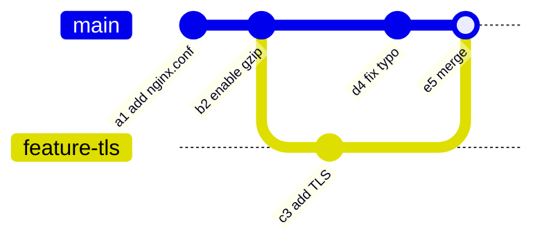
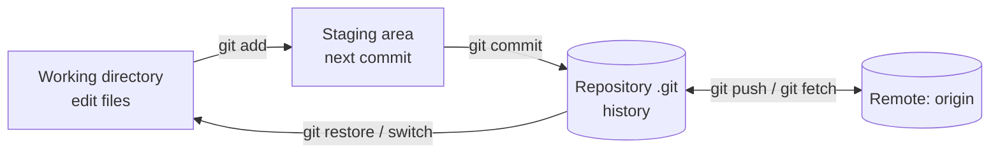

# Git Fundamentals

<!-- nav:start -->
> **Module 03 · Package Management & Git** — lesson 5 of 5  
> [Module index](README.md) · [Course lesson (commands)](../../course/03-Packages-and-Git.md#lesson-5---git-fundamentals-ch-13) · [Exercises for this lesson](../../exercises/03-packages-git/05-git-fundamentals.md)
<!-- nav:end -->

**Git** is a distributed version control system: it records the history of a set of files so you can see who changed what, return to earlier versions, work on changes in parallel and share them. System administrators use it for configuration files, scripts and infrastructure-as-code. The LFCS exam expects basic operations: create or clone a repository, commit, branch, merge and work with remotes.

## What you will learn

- What version control is and how Git stores history
- The three areas: working directory, staging area, repository
- Configuring Git; creating and cloning repositories
- Staging, committing, viewing history and differences
- Undoing changes
- Branches and merges (including conflicts)
- Remotes: bare repositories, push, fetch, pull
- Tags, stash and `.gitignore`

---

## Key terms

| Term | Definition |
|------|-----------|
| **Repository (repo)** | A directory tracked by Git, with its full history stored in `.git/`. |
| **Commit** | A snapshot of all tracked files at a point in time, with author, date, message and a pointer to its parent commit(s). Identified by a hash like `3f2a9c1`. |
| **Working directory** | The files you see and edit. |
| **Staging area (index)** | The set of changes prepared for the next commit (`git add`). |
| **Branch** | A movable name pointing to a commit; it advances when you commit. |
| **HEAD** | A pointer to the branch (or commit) you currently have checked out. |
| **Merge** | Combining the history of two branches. |
| **Remote** | Another copy of the repository (e.g. on a server), usually named `origin`. |
| **Bare repository** | A repository without a working directory, used as a shared central copy. |
| **Clone** | A full copy of a repository, including all history. |

---

## How Git thinks: snapshots

Git stores **snapshots**, not lists of changes. Each commit points to a complete tree of files (unchanged files are stored once and reused), and to its parent commit. History is a chain of commits:



Everything is identified by a hash of its content, so history cannot be silently altered.

### The three areas



| Command | Compares |
|---------|----------|
| `git status` | summarizes all three |
| `git diff` | working directory vs staging area (unstaged changes) |
| `git diff --staged` | staging area vs last commit (what will be committed) |
| `git diff HEAD` | working directory vs last commit |

---

## First-time setup

```console
$ git config --global user.name "Ana Garcia"
$ git config --global user.email ana@example.lab
$ git config --global init.defaultBranch main
$ git config --global core.editor vim
$ git config --list --show-origin
```

`--global` writes `~/.gitconfig`; without it, settings go to `.git/config` of the current repo; `--system` writes `/etc/gitconfig`. A commit fails with "Please tell me who you are" until name and email are set.

---

## Creating or cloning a repository

```console
$ git init /srv/scripts            # new repo in a directory
Initialized empty Git repository in /srv/scripts/.git/
$ git clone https://github.com/user/project.git              # over HTTPS
$ git clone git@github.com:user/project.git                  # over SSH
$ git clone /srv/git/app.git ~/app                           # local path
$ git clone ana@server1:/srv/git/app.git                     # SSH to another host
```

---

## The basic workflow

```console
$ cd /srv/scripts
$ echo '#!/bin/bash' > backup.sh
$ git status
On branch main
No commits yet
Untracked files:
        backup.sh

$ git add backup.sh                # stage it
$ git commit -m "Add backup script"
[main (root-commit) 3f2a9c1] Add backup script
 1 file changed, 1 insertion(+)

$ echo 'tar -czf /backup/etc.tgz /etc' >> backup.sh
$ git diff                         # see the unstaged change
$ git commit -am "Back up /etc"    # -a stages all MODIFIED tracked files (not new ones)
```

| Command | Effect |
|---------|--------|
| `git add file` / `git add .` | stage a file / everything in this directory |
| `git add -p` | choose hunks interactively |
| `git rm file` | delete and stage the deletion |
| `git mv a b` | rename and stage |
| `git commit -m "msg"` | commit staged changes |
| `git commit --amend` | change the last commit (message or content) – only if not pushed yet |

### Viewing history

```console
$ git log --oneline --graph --all
* e5d1a20 (HEAD -> main) Merge branch 'feature-tls'
|\
| * c3b7f01 (feature-tls) Add TLS
* | d4a9e32 Fix typo
|/
* b2c8d11 Enable gzip
* a1f0e9c Add nginx.conf
$ git log -p -2              # last 2 commits with diffs
$ git log --author=ana --since="1 week ago"
$ git show b2c8d11           # one commit in detail
$ git blame nginx.conf       # who last changed each line
```

---

## Undoing things

| Situation | Command |
|-----------|---------|
| Discard changes in a file (working dir) | `git restore file` |
| Unstage a file (keep the change) | `git restore --staged file` |
| Get a file back as it was in a commit | `git restore --source=b2c8d11 file` |
| Fix the last commit | `git commit --amend` |
| Undo a commit **safely** (new commit reversing it) | `git revert <hash>` |
| Move the branch back, keep changes unstaged | `git reset <hash>` |
| Move the branch back, **discard** changes | `git reset --hard <hash>` – destructive |

Use `revert` for commits already pushed to others; `reset` rewrites history.

---

## Branches

A branch is just a pointer. Creating one is instant and cheap, so use branches for every change.

```console
$ git branch                        # list (* = current)
$ git switch -c feature-tls         # create and switch  (old: git checkout -b)
$ git switch main                   # switch back        (old: git checkout main)
$ git branch -d feature-tls         # delete (only if merged)
$ git branch -D experiment          # force delete
```

### Merging

```console
$ git switch main
$ git merge feature-tls
```

Two outcomes:

- **Fast-forward**: `main` had no new commits since the branch was created, so Git just moves `main` forward. No merge commit.
- **Three-way merge**: both branches have new commits; Git creates a **merge commit** with two parents.

### Conflicts

If both branches changed the same lines, Git stops and marks the file:

```text
<<<<<<< HEAD
worker_processes 4;
=======
worker_processes auto;
>>>>>>> feature-tls
```

Resolve: edit the file to the correct content, remove the markers, then:

```console
$ git add nginx.conf
$ git commit                 # completes the merge
$ git merge --abort          # (alternative) give up and return to before the merge
```

---

## Remotes

```console
$ git remote -v
origin  /srv/git/app.git (fetch)
origin  /srv/git/app.git (push)
$ git remote add origin ana@server1:/srv/git/app.git
$ git push -u origin main          # first push; -u sets upstream so later just "git push"
$ git push origin feature-tls      # push a branch
$ git fetch                        # download new commits, don't touch your files
$ git pull                         # fetch + merge into the current branch
$ git branch -r                    # remote-tracking branches (origin/main)
```

`origin/main` is your local record of where `main` was on the remote at the last `fetch`.

### A shared repository on a server (bare repo)

Typical exam setup: a central repo that several users push to.

```console
$ sudo git init --bare /srv/git/app.git
$ sudo chown -R ana:developers /srv/git/app.git     # or use --shared=group
$ git clone /srv/git/app.git ~/app
warning: You appear to have cloned an empty repository.
$ cd ~/app; echo "v1" > VERSION; git add VERSION; git commit -m "Initial"
$ git push -u origin main
```

A bare repo has no working files – only the contents of `.git/`. You push to it but never edit in it. Pushing to a **non-bare** repo's checked-out branch is refused.

`git push` rejected with "Updates were rejected because the remote contains work that you do not have locally" → `git pull` first, resolve conflicts, then push.

---

## Tags, stash and .gitignore

```console
$ git tag v1.0                       # lightweight tag on HEAD
$ git tag -a v1.1 -m "Release 1.1"   # annotated tag
$ git push origin --tags

$ git stash                          # put uncommitted changes aside
$ git stash list
$ git stash pop                      # bring them back

$ cat .gitignore
*.log
*.swp
secrets/
```

Never commit passwords or private keys: history keeps them even after you delete the file.

---

## Try it yourself

1. Configure your name and email; create a repo `~/etc-notes`; commit two files.
2. Change a file, look at `git diff`, stage it, look at `git diff --staged`, commit.
3. Create branch `experiment`, commit there, switch to `main`, commit a different change to the same line, merge, resolve the conflict.
4. Create a bare repo in `/srv/git/lab.git`, add it as `origin`, push `main`, clone it into another directory and pull a new change.

---

## Common mistakes

- Committing without staging (or forgetting new files with `commit -a`).
- `git reset --hard` with uncommitted work you wanted.
- Rewriting (`--amend`, `reset`) commits that were already pushed.
- Pushing to a non-bare repository.
- Forgetting `-u` on the first push, then `git push` asks for an upstream.

---

## Summary

| Task | Command |
|------|---------|
| Setup | `git config --global user.name/user.email` |
| Create / copy | `git init`, `git init --bare`, `git clone` |
| Record | `git add`, `git commit -m` |
| Inspect | `git status`, `git diff`, `git log --oneline --graph`, `git show` |
| Undo | `git restore`, `git restore --staged`, `git revert`, `git reset` |
| Branch | `git switch -c`, `git branch`, `git merge`, `git branch -d` |
| Share | `git remote add`, `git push -u`, `git fetch`, `git pull` |

## Check yourself

1. What's the difference between `git diff` and `git diff --staged`?
2. When does `git merge` fast-forward?
3. Why do shared central repositories use `git init --bare`?
4. Which is safer for an already-pushed commit, `git revert` or `git reset --hard`? Why?

<details>
<summary>Answers</summary>

1. `git diff` shows unstaged changes; `--staged` shows what is staged for the next commit.
2. When the current branch has no commits that the other branch lacks, so Git can simply move the pointer forward.
3. A bare repo has no working directory, so pushes can update any branch without conflicting with checked-out files.
4. `git revert` – it adds a new commit and doesn't rewrite history others already have.

</details>

## Further reading

- `man git`, `git help tutorial`, `git help everyday`, `man gitglossary`
- [Pro Git book (free)](https://git-scm.com/book/en/v2) – chapters 1–3, 4.2 (Git on the server)
- [Learn Git Branching](https://learngitbranching.js.org/) – interactive visual practice
- [Oh Shit, Git!?!](https://ohshitgit.com/) – fixing common mistakes

---

<!-- footer:start -->
[← SUSE Packages: zypper](04-zypper.md) · [Module index](README.md)  
**Practice now:** [Exercises – Git Fundamentals](../../exercises/03-packages-git/05-git-fundamentals.md)
<!-- footer:end -->
