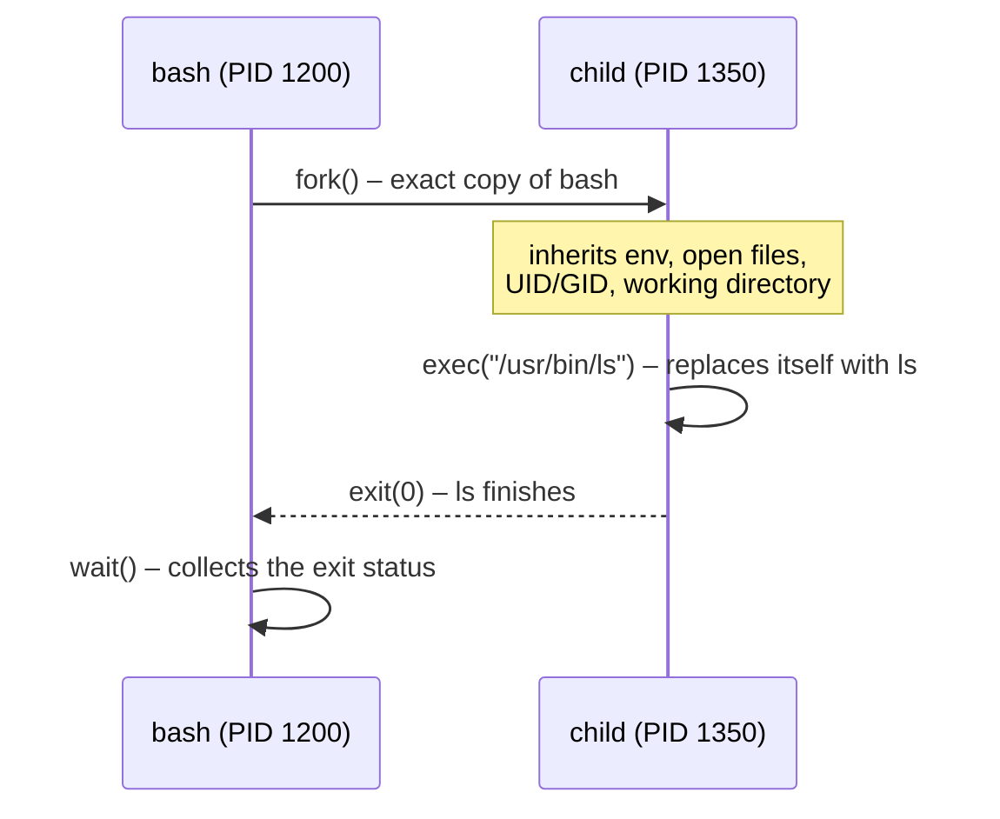

# Processes

<!-- nav:start -->
> **Module 04 · Processes, Services, Scheduling & Performance** — lesson 1 of 6  
> [Module index](README.md) · [Course lesson (commands)](../../course/04-Processes-Services-Performance.md#lesson-1---processes-ch-14) · [Exercises for this lesson](../../exercises/04-processes-services/01-processes.md)
<!-- nav:end -->

Everything that runs on Linux – your shell, the SSH server, a backup script – is a **process**. Administering a system means being able to see processes, understand their state, change their priority and stop them cleanly. In this lesson you will learn what a process is, how processes are created, what their states and signals mean, and how to control them from the shell.

## What you will learn

- Programs vs processes vs threads; PID and PPID
- How processes are created (`fork` + `exec`) and why that matters
- Process states (R, S, D, T, Z) and zombies/orphans
- Listing and finding processes (`ps`, `pgrep`, `pstree`, `top`)
- Signals and `kill`, `pkill`, `killall`
- Priorities: `nice` and `renice`
- Job control: background, foreground, `nohup`

---

## Key terms

| Term | Definition |
|------|-----------|
| **Program** | An executable file on disk (`/usr/bin/sleep`). |
| **Process** | A running instance of a program, with its own memory, open files, credentials and environment. |
| **Thread** | A unit of execution inside a process; threads of one process share its memory. |
| **PID** | *Process ID*, a unique number for each running process. |
| **PPID** | The PID of the **parent** process that started it. |
| **PID 1** | The first process (`systemd`), ancestor of all others. |
| **Signal** | A short asynchronous message sent to a process (e.g. "terminate", "reload"). |
| **Nice value** | A priority hint from -20 (most favored) to 19 (least favored). |
| **Job** | A process (or pipeline) started from your shell, managed with job control. |
| **Daemon** | A background service process without a terminal (`sshd`, `crond`). |

---

## How processes are born

Every process (except PID 1) is created by another process using two system calls:



Why this matters:

- **Inheritance**: environment variables, the current directory, open files (redirections!) and limits all come from the parent.
- **Exit status**: the parent collects it with `wait()` – that's how `$?` works.
- The tree of parents and children is visible with `pstree`:

```console
$ pstree -p | head
systemd(1)─┬─sshd(812)───sshd(1190)───sshd(1199)───bash(1200)───pstree(1351)
           ├─cron(640)
           ├─systemd-journal(301)
           └─nginx(905)─┬─nginx(906)
                        └─nginx(907)
```

---

## Process states

| STAT | State | Meaning |
|------|-------|---------|
| `R` | Running / runnable | on a CPU or waiting in the run queue |
| `S` | Interruptible sleep | waiting for an event (input, timer, network) – most processes |
| `D` | Uninterruptible sleep | waiting for I/O (disk, NFS); cannot be killed until the I/O completes |
| `T` | Stopped | paused by `Ctrl+Z` or `SIGSTOP` |
| `t` | Traced | stopped by a debugger |
| `Z` | Zombie | finished, but the parent hasn't collected the exit status |
| `I` | Idle | idle kernel thread |

Extra characters in `ps aux` STAT: `s` session leader, `+` foreground process group, `<` high priority, `N` low priority (niced), `l` multi-threaded.

### Zombies and orphans

- A **zombie** has already exited; it uses no CPU or memory, only a slot in the process table. You **cannot kill** a zombie (it's already dead). The fix is to make its **parent** call `wait()` – usually by restarting or killing the parent. Then PID 1 adopts and reaps it.
- An **orphan** is a process whose parent died; it is adopted by PID 1 (or a "subreaper") and keeps running normally.

> Many processes in state `D` = a storage problem (slow disk, dead NFS server), not a CPU problem.

---

## Listing processes with ps

`ps` takes two option styles: BSD (`ps aux`, no dash) and UNIX (`ps -ef`, with dash).

```console
$ ps aux | head -4
USER   PID %CPU %MEM    VSZ   RSS TTY   STAT START   TIME COMMAND
root     1  0.0  0.6 168820 12704 ?     Ss   08:01   0:02 /sbin/init
root   301  0.0  0.9  48496 19020 ?     Ss   08:01   0:00 /usr/lib/systemd/systemd-journald
root   812  0.0  0.4  15436  9120 ?     Ss   08:01   0:00 sshd: /usr/sbin/sshd -D

$ ps -ef --forest | tail -3       # UNIX style with tree
alice  1200  1199  0 09:00 pts/0  00:00:00 -bash
alice  1351  1200  0 09:05 pts/0  00:00:00  \_ ps -ef --forest
```

| Column | Meaning |
|--------|---------|
| `%CPU` | CPU usage averaged over the process lifetime |
| `%MEM` | share of physical RAM |
| `VSZ` | virtual memory size (KiB) – mostly irrelevant |
| `RSS` | *resident set size*: physical RAM actually used (KiB) |
| `TTY` | controlling terminal (`?` = none, i.e. a daemon) |
| `TIME` | total CPU time consumed |

### Choosing columns and sorting

```console
$ ps -eo pid,ppid,user,ni,stat,%cpu,%mem,cmd --sort=-%cpu | head -5
$ ps -eo pid,user,rss,cmd --sort=-rss | head -4        # top memory users
$ ps -u alice                                         # processes of a user
$ ps -C nginx -o pid,cmd                              # by command name
$ ps -p 812 -o pid,etime,cmd                          # elapsed time of PID 812
```

### Finding PIDs

```console
$ pgrep sshd
812
$ pgrep -a nginx            # with command line
905 nginx: master process /usr/sbin/nginx
$ pgrep -u alice bash
$ pidof nginx
907 906 905
```

---

## Signals

A signal asks a process to do something. A program can **catch** most signals (run its own handler), **ignore** them, or accept the **default action**. `SIGKILL` and `SIGSTOP` can be neither caught nor ignored.

| Signal | No. | Default action | Typical use |
|--------|-----|----------------|-------------|
| `SIGHUP` | 1 | terminate | terminal hung up; many daemons **reload their config** |
| `SIGINT` | 2 | terminate | `Ctrl+C` |
| `SIGQUIT` | 3 | core dump | `Ctrl+\` |
| `SIGKILL` | 9 | terminate (forced) | last resort – no cleanup possible |
| `SIGTERM` | 15 | terminate | **default of `kill`** – polite request to exit cleanly |
| `SIGCONT` | 18 | continue | resume a stopped process |
| `SIGSTOP` | 19 | stop (forced) | pause |
| `SIGTSTP` | 20 | stop | `Ctrl+Z` |
| `SIGUSR1/2` | 10/12 | terminate | application-defined (e.g. reopen logs) |

`kill -l` lists all signals; `man 7 signal` documents them.

```console
$ kill 4321               # SIGTERM
$ kill -TERM 4321         # same, by name
$ kill -15 4321           # same, by number
$ kill -HUP 905           # ask nginx master to reload config
$ kill -9 4321            # SIGKILL – only if SIGTERM didn't work
$ kill -0 4321 && echo alive    # signal 0 = just test if the process exists

$ pkill -u bob            # SIGTERM to all of bob's processes
$ pkill -HUP -x rsyslogd  # -x exact name match
$ killall nginx           # by name (all processes called nginx)
```

> **Best practice:** send `SIGTERM`, wait a few seconds, check (`ps -p PID`), and only then use `SIGKILL`. `SIGKILL` gives the program no chance to save data, release locks or remove temporary files. For services, use `systemctl stop` / `reload` instead of signals.

---

## Priorities: nice and renice

The Linux scheduler shares CPU time between runnable processes. The **nice** value influences that share:

```text
-20 ─────────────── 0 ─────────────── 19
highest priority   default        lowest priority ("nicest" to others)
```

- Only **root** can set negative nice values or decrease an existing nice value.
- Normal users can only make their processes **nicer** (raise the value).
- `ps -o ni` or the `NI` column in `top` shows it; `PR` in `top` is the derived kernel priority.

```console
$ nice -n 10 tar -czf /backup/home.tgz /home &        # start with nice 10
$ nice tar ...                                         # default +10
$ sudo nice -n -5 ./important-job                      # negative: root only
$ renice -n 15 -p 4321                                 # change a running process
4321 (process ID) old priority 10, new priority 15
$ sudo renice -n 5 -u bob                              # all of bob's processes
$ ps -o pid,ni,cmd -p 4321
```

For disk-heavy jobs, also lower the **I/O** priority: `ionice -c3 cmd` (idle class) or `ionice -c2 -n7 -p PID`.

---

## Job control

Job control lets you run several programs from one shell.

```console
$ sleep 600 &                # start in the background
[1] 4400
$ jobs                       # list jobs of this shell
[1]+  Running                 sleep 600 &
$ fg %1                      # bring job 1 to the foreground
sleep 600
^Z                           # Ctrl+Z: stop (pause) it
[1]+  Stopped                 sleep 600
$ bg %1                      # continue it in the background
$ kill %1                    # signal a job by its job number
```

Background jobs normally die when you log out (they receive `SIGHUP`). To keep a command running after logout:

```console
$ nohup ./long-task.sh > task.log 2>&1 &     # ignore SIGHUP, output to a file
$ disown %1                                  # detach an existing job from the shell
$ systemd-run --unit=mytask ./long-task.sh   # run as a transient systemd service (best)
```

`tmux` or `screen` let you detach a whole terminal session and reattach later.

---

## Looking inside a process: /proc/PID

```console
$ cat /proc/905/status | grep -E 'Name|State|PPid|Uid|VmRSS|Threads'
Name:   nginx
State:  S (sleeping)
PPid:   1
Uid:    0       0       0       0
VmRSS:      5120 kB
Threads:        1
$ ls -l /proc/905/cwd /proc/905/exe
$ ls -l /proc/905/fd | head        # open files
$ tr '\0' ' ' < /proc/905/cmdline; echo
$ tr '\0' '\n' < /proc/905/environ | head -3
```

---

## Try it yourself

1. Find the PID and PPID of your shell (`echo $$`, `ps -o ppid= -p $$`).
2. Run `sleep 1000 &`, find it with `pgrep`, look at `/proc/<pid>/status`, then stop it with `SIGTERM`.
3. Start `sleep 1000` with nice 15, renice it to 5 as root; try renicing it back to 0 as a normal user.
4. Start `yes > /dev/null` twice and compare CPU usage in `top` after renicing one to 19.
5. Start `sleep 300`, press `Ctrl+Z`, look at its state in `ps`, resume it in the background.

---

## Common mistakes

- Using `kill -9` first.
- Trying to kill a zombie instead of dealing with its parent.
- Trying to kill a `D`-state process – fix the I/O problem (e.g. bring back the NFS server).
- Confusing nice values: a **higher** number means **lower** priority.
- Forgetting that background jobs die at logout without `nohup`/`disown`.

---

## Summary

| Task | Command |
|------|---------|
| List all | `ps aux`, `ps -ef --forest`, `pstree -p` |
| Custom columns / sort | `ps -eo pid,user,%cpu,%mem,cmd --sort=-%cpu` |
| Find PIDs | `pgrep -a name`, `pidof name` |
| Graceful stop / reload / force | `kill PID`, `kill -HUP PID`, `kill -9 PID` |
| By name / user | `pkill name`, `pkill -u user`, `killall name` |
| Priority | `nice -n 10 cmd`, `renice -n 5 -p PID` |
| Jobs | `cmd &`, `jobs`, `fg`, `bg`, `Ctrl+Z`, `nohup` |

## Check yourself

1. Which signal does `kill PID` send by default?
2. A process is in state `Z`. How do you get rid of it?
3. Can a normal user change a process's nice value from 10 to 5?
4. What is the difference between `RSS` and `VSZ`?

<details>
<summary>Answers</summary>

1. `SIGTERM` (15).
2. Make the parent reap it: signal or restart the parent; if the parent dies, PID 1 reaps the zombie.
3. No – lowering nice (raising priority) requires root.
4. RSS is the physical memory actually used; VSZ is the total virtual address space reserved, much of which may never be used.

</details>

## Further reading

- `man 1 ps`, `man 1 kill`, `man 7 signal`, `man 1 nice`, `man 1 renice`, `man 5 proc`
- [The Linux Command Line – Chapter 10: Processes](https://linuxcommand.org/tlcl.php)
- [ArchWiki: Core utilities](https://wiki.archlinux.org/title/Core_utilities)

---

<!-- footer:start -->
[Module index](README.md) · [Monitoring System Performance →](02-monitoring.md)  
**Practice now:** [Exercises – Processes](../../exercises/04-processes-services/01-processes.md)
<!-- footer:end -->
