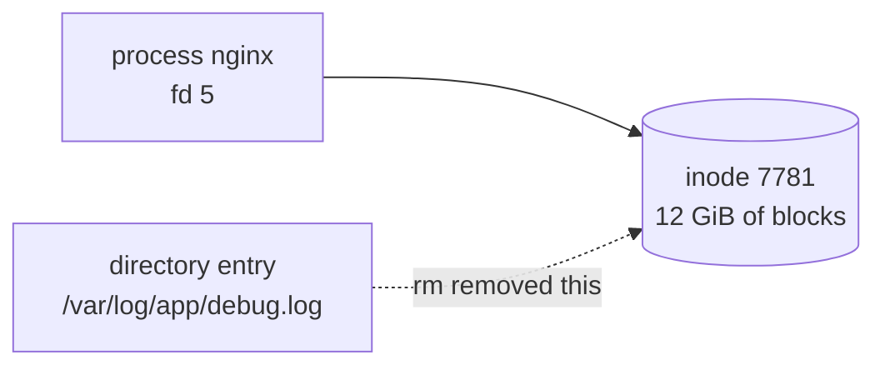

# Troubleshooting Disk Space

<!-- nav:start -->
> **Module 04 · Processes, Services, Scheduling & Performance** — lesson 3 of 6  
> [Module index](README.md) · [Course lesson (commands)](../../course/04-Processes-Services-Performance.md#lesson-3---troubleshooting-disk-space-gap) · [Exercises for this lesson](../../exercises/04-processes-services/03-disk-space.md)
<!-- nav:end -->

A full filesystem breaks things in surprising ways: databases stop, logins fail, services can't write PID files, package updates abort. In this lesson you will learn how disk space is accounted for, how to find what is using it, and how to deal with the tricky cases where `df` and `du` disagree.

## What you will learn

- How `df` and `du` measure space, and why they can disagree
- Finding large directories and files quickly
- **Inode** exhaustion
- Deleted-but-open files and how to reclaim their space
- Reserved blocks, hidden files under mount points
- Cleaning logs, journals, package caches and old kernels safely

---

## Key terms

| Term | Definition |
|------|-----------|
| **Block** | The unit of allocation of a filesystem (usually 4 KiB). |
| **Inode** | The metadata record of a file; each file uses one. Filesystems have a finite number. |
| **`df`** | Reports space used/free **per filesystem** from filesystem metadata. |
| **`du`** | Adds up the sizes of **files it can see** by walking directories. |
| **Deleted-but-open file** | A file removed from its directory but still held open by a process; its blocks are freed only when the process closes it. |
| **Reserved blocks** | Space (5% by default on ext4) usable only by root, so the system keeps working when users fill the disk. |
| **Sparse file** | A file with "holes" that occupy no blocks (apparent size > disk usage). |

---

## Step 1 – Which filesystem is full?

```console
$ df -h
Filesystem                 Size  Used Avail Use% Mounted on
/dev/mapper/ubuntu--vg-root  19G   19G     0 100% /
/dev/vda2                  1.8G  130M  1.5G   9% /boot
tmpfs                      982M   12M  970M   2% /run

$ df -h /var/log           # which filesystem holds this path
$ df -i                    # inode usage
Filesystem                  Inodes  IUsed   IFree IUse% Mounted on
/dev/mapper/ubuntu--vg-root 1245184 312044  933140   26% /
```

Always check **both** `df -h` (space) and `df -i` (inodes). "No space left on device" can mean either.

---

## Step 2 – Where is the space used?

Walk down from the full mount point, one level at a time. Use `-x` (stay on one filesystem) so you don't count other mounts.

```console
$ sudo du -xh --max-depth=1 / 2>/dev/null | sort -h | tail -5
1.1G    /usr
2.3G    /home
14G     /var
19G     /
$ sudo du -xh --max-depth=1 /var | sort -h | tail -3
800M    /var/lib
13G     /var/log
14G     /var
$ sudo du -sh /var/log/* | sort -h | tail -3
120M    /var/log/journal
12G     /var/log/app
```

Find big files directly:

```console
$ sudo find / -xdev -type f -size +500M -exec ls -lh {} + 2>/dev/null
-rw-r--r-- 1 app app 12G Oct 21 10:20 /var/log/app/debug.log
$ sudo find /var -xdev -type f -mtime -1 -size +100M     # big AND recently changed
```

Interactive alternative: `ncdu -x /` (package `ncdu`).

---

## Step 3 – Fix it safely

| Cause | Safe action |
|-------|-------------|
| Huge application log | **truncate** it (`truncate -s 0 file` or `: > file`) rather than delete if the app keeps it open; then fix log rotation |
| Old rotated logs | `rm /var/log/app/*.gz` (older than N days: `find … -mtime +30 -delete`) |
| systemd journal | `journalctl --disk-usage`; `journalctl --vacuum-size=200M` or `--vacuum-time=7d`; limit with `SystemMaxUse=` in `/etc/systemd/journald.conf` |
| Package cache | `apt clean` / `dnf clean all` |
| Old kernels | `apt autoremove` / `dnf remove --oldinstallonly` (keep the running one!) |
| Core dumps | `/var/lib/systemd/coredump/`, `coredumpctl list` |
| Container images | `docker system prune` / `podman system prune` |
| User data | talk to the owner; `find /home -size +1G` |

### Log rotation

`logrotate` (run daily by a timer/cron) rotates, compresses and deletes old logs according to `/etc/logrotate.conf` and `/etc/logrotate.d/*`:

```text
# /etc/logrotate.d/app
/var/log/app/*.log {
    daily
    rotate 7
    compress
    missingok
    notifempty
    copytruncate
}
```

`copytruncate` copies the log and then truncates the original – useful for programs that never reopen their log file. Test with `logrotate -d /etc/logrotate.d/app` (debug, no changes) and force with `logrotate -f`.

---

## Tricky case 1: `df` says full, `du` says much less

The most common reason: a **deleted file that is still open**.



`rm` removes the *name*; the inode and its blocks stay allocated as long as a process has the file open. `du` can't see it (no name), but `df` still counts the blocks.

```console
$ sudo rm /var/log/app/debug.log      # space NOT freed
$ df -h /                              # still 100%
$ sudo lsof +L1                        # open files with link count < 1 (deleted)
COMMAND  PID USER  FD   TYPE DEVICE    SIZE/OFF NLINK   NODE NAME
app     2210  app   5w   REG  253,0 12884901888     0   7781 /var/log/app/debug.log (deleted)
```

Fix (choose one):

1. **Restart** the process (`systemctl restart app`) – it closes the file and the space is freed.
2. If you cannot restart, truncate the file through the process's file descriptor:
   ```console
   $ sudo truncate -s 0 /proc/2210/fd/5
   ```

Lesson: to empty a log that is in use, **truncate** it instead of deleting it.

### Other reasons for a df/du mismatch

- **Files hidden under a mount point**: files written to `/data` *before* a disk was mounted on `/data` are invisible to `du` but use space on the parent filesystem. Check with a bind mount:
  ```console
  $ sudo mount --bind / /mnt/rootonly && sudo du -sh /mnt/rootonly/data && sudo umount /mnt/rootonly
  ```
- **Reserved blocks** (ext4): `Size - Used ≠ Avail` because 5% is reserved for root. See/adjust with `tune2fs -l /dev/X | grep -i reserved` and `tune2fs -m 1 /dev/X`.
- **Sparse files**: `du` shows real usage; `ls -l` shows apparent size. Compare `du -h --apparent-size`.
- **Snapshots** (LVM, Btrfs) holding old data.

---

## Tricky case 2: inodes exhausted

```console
$ touch /var/spool/test
touch: cannot touch '/var/spool/test': No space left on device
$ df -h /var          # 40% used
$ df -i /var          # IUse% 100%
```

Find the directory with millions of small files:

```console
$ sudo du --inodes -x --max-depth=2 /var 2>/dev/null | sort -n | tail -3
1250000 /var/spool/postfix/maildrop
$ sudo find /var/spool/postfix/maildrop -type f | wc -l
```

Fix by removing the files (beware: `rm *` may fail with "Argument list too long" – use `find … -delete`) and stopping whatever creates them (a mail loop, a session directory never cleaned, cache files). The inode count of ext4 is fixed at `mkfs` time; XFS allocates inodes dynamically.

---

## Prevention

- Put fast-growing data on separate filesystems/LVs (`/var/log`, `/var/lib/docker`, `/home`), so one cannot fill `/`.
- Configure log rotation and journal limits.
- Monitor usage (`df` alerts at 80/90%).
- Use quotas for user data (`xfs_quota`, `quotaon`).

---

## Try it yourself

1. Find the three biggest directories under `/usr` and `/var`.
2. Create a 500 MiB file with `fallocate -l 500M /tmp/big`; keep it open with `tail -f /tmp/big > /dev/null &`; delete it; prove with `df` and `lsof +L1` that space is still used; free it without killing `tail` (truncate via `/proc`).
3. Check how much space the journal uses and reduce it to 100 MiB.
4. Find out how many blocks are reserved on your root filesystem (ext4).

---

## Summary

| Need | Command |
|------|---------|
| Which FS is full | `df -h`, `df -i` |
| Biggest directories | `du -xh --max-depth=1 DIR \| sort -h` |
| Biggest files | `find / -xdev -type f -size +500M` |
| Deleted-but-open files | `lsof +L1` → restart process or `truncate -s 0 /proc/PID/fd/N` |
| Journal | `journalctl --disk-usage`, `--vacuum-size=`, `SystemMaxUse=` |
| Logs | `logrotate`, `truncate -s 0 file` |
| Inode hogs | `du --inodes -x --max-depth=2 DIR \| sort -n` |

## Check yourself

1. `df` shows 100% but `du -sh /` shows 60%. Name two possible causes.
2. Why is `truncate -s 0 logfile` safer than `rm logfile` for a running service?
3. How do you limit the systemd journal to 500 MiB permanently?

<details>
<summary>Answers</summary>

1. A deleted file still held open by a process; files hidden under a mount point (also: snapshots, reserved blocks).
2. The service keeps writing to the same inode; truncating frees the space immediately, while `rm` leaves the blocks allocated until the process closes the file.
3. `SystemMaxUse=500M` in `/etc/systemd/journald.conf` (or a drop-in in `journald.conf.d/`), then `systemctl restart systemd-journald`.

</details>

## Further reading

- `man 1 df`, `man 1 du`, `man 8 lsof`, `man 8 logrotate`, `man 5 journald.conf`
- [ArchWiki: Systemd/Journal – Journal size limit](https://wiki.archlinux.org/title/Systemd/Journal#Journal_size_limit)
- [ArchWiki: Logrotate](https://wiki.archlinux.org/title/Logrotate)

---

<!-- footer:start -->
[← Monitoring System Performance](02-monitoring.md) · [Module index](README.md) · [Managing Services with systemd →](04-systemd.md)  
**Practice now:** [Exercises – Troubleshooting Disk Space](../../exercises/04-processes-services/03-disk-space.md)
<!-- footer:end -->
