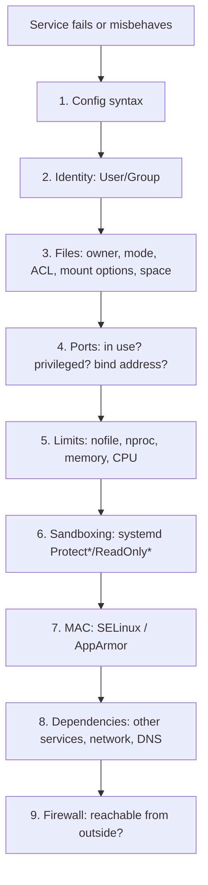

# Application and Service Constraints

<!-- nav:start -->
> **Module 04 · Processes, Services, Scheduling & Performance** — lesson 5 of 6  
> [Module index](README.md) · [Course lesson (commands)](../../course/04-Processes-Services-Performance.md#lesson-5---service-constraints-gap) · [Exercises for this lesson](../../exercises/04-processes-services/05-service-constraints.md)
<!-- nav:end -->

The LFCS competency *"Determine application and service specific constraints"* is about understanding everything that can stop a service from running correctly besides its own code: the user it runs as, file permissions, ports, resource limits, security policies, dependencies and the firewall. In this lesson you will learn a systematic way to find which constraint is blocking a service.

## What you will learn

- The categories of constraints that affect a service
- How to read a service's identity, limits and sandboxing from systemd
- Ports: privileged ports, conflicts, bind addresses
- Filesystem constraints: ownership, permissions, read-only mounts, `noexec`, full disks
- MAC constraints (SELinux, AppArmor)
- Configuration validation tools
- A step-by-step troubleshooting checklist

---

## Key terms

| Term | Definition |
|------|-----------|
| **Constraint** | Any condition outside the application's code that limits what it can do. |
| **Service account** | The unprivileged user a service runs as (`www-data`, `nginx`, `postgres`). |
| **Privileged port** | TCP/UDP port below 1024; binding requires root or the `CAP_NET_BIND_SERVICE` capability. |
| **Bind address** | The local IP a server listens on: `127.0.0.1` (local only), `0.0.0.0` / `::` (all interfaces). |
| **Capability** | A piece of root's power that can be granted individually (`CAP_NET_BIND_SERVICE`, `CAP_NET_ADMIN`). |
| **Sandboxing** | systemd options that restrict a service (`ProtectSystem=`, `PrivateTmp=`, `ReadWritePaths=`). |
| **MAC** | Mandatory Access Control (SELinux/AppArmor): policy that confines services even if file permissions allow access. |

---

## The constraint layers



Always start by **reading the error**: `systemctl status` and `journalctl -u <unit>` usually name the failing layer.

---

## 1. Configuration syntax

Most daemons have a built-in checker. Run it **before** every restart:

| Service | Check command |
|---------|---------------|
| nginx | `nginx -t` |
| Apache | `apachectl configtest` (`httpd -t`) |
| OpenSSH | `sshd -t` |
| sudo | `visudo -c` |
| BIND | `named-checkconf`, `named-checkzone` |
| Postfix | `postfix check` |
| HAProxy | `haproxy -c -f /etc/haproxy/haproxy.cfg` |
| systemd unit | `systemd-analyze verify unit.service` |
| fstab | `findmnt --verify` |
| Netplan | `netplan generate` / `netplan try` |

```console
$ sudo nginx -t
nginx: [emerg] unknown directive "server_nmae" in /etc/nginx/conf.d/app.conf:3
nginx: configuration file /etc/nginx/nginx.conf test failed
```

---

## 2. Identity

```console
$ systemctl show nginx -p User -p Group -p MainPID
$ ps -o user,group,pid,cmd -C nginx
USER     GROUP    PID CMD
root     root     905 nginx: master process /usr/sbin/nginx
www-data www-data 906 nginx: worker process
```

Typical problems: the `User=` account doesn't exist; the account has no access to its data directory; a supplementary group was added but the service wasn't restarted.

---

## 3. Files and directories

Test access **as the service user**:

```console
$ sudo -u www-data cat /srv/site/index.html
cat: /srv/site/index.html: Permission denied
$ namei -l /srv/site/index.html          # find the directory without x
$ getfacl /srv/site
$ findmnt -no OPTIONS /srv               # ro? noexec? nosuid?
$ df -h /var/lib/app; df -i /var/lib/app # full?
$ lsattr /etc/app.conf                   # immutable?
```

| Symptom | Constraint |
|---------|-----------|
| "Permission denied" reading a file | owner/mode/ACL, a parent directory without `x`, or MAC |
| "Read-only file system" | filesystem mounted `ro` (or remounted ro after errors), or systemd `ProtectSystem=` |
| Script "Permission denied" although `x` is set | mount option `noexec` |
| "No space left on device" | full filesystem or inodes – see [Disk Space](03-disk-space.md) |

---

## 4. Ports

```console
$ sudo ss -tulpn | grep -E ':80|:443'
tcp LISTEN 0 511 0.0.0.0:80   0.0.0.0:*  users:(("apache2",pid=1201,fd=4))
```

| Error | Meaning | Fix |
|-------|---------|-----|
| `bind() to 0.0.0.0:80 failed (98: Address already in use)` | another process listens on that port | find it with `ss -tulpn` / `lsof -i :80`; stop it or change the port |
| `bind() … (13: Permission denied)` on a port < 1024 | non-root process, or SELinux port label | run as root then drop privileges, grant `AmbientCapabilities=CAP_NET_BIND_SERVICE`, or label the port (`semanage port`) |
| Works locally, not from other hosts | listening on `127.0.0.1`, or firewall | change the bind address (`listen 0.0.0.0:80;`), open the firewall |

The `Local Address` column tells you the bind address: `127.0.0.1:3306` is reachable only from the host itself, no matter what the firewall says.

---

## 5. Resource limits

```console
$ systemctl show app -p LimitNOFILE -p LimitNPROC -p MemoryMax -p TasksMax -p CPUQuotaPerSecUSec
$ cat /proc/$(systemctl show -p MainPID --value app)/limits
$ journalctl -u app | grep -i "too many open files"
$ systemd-cgtop                      # live cgroup usage
```

Raise them with a drop-in (`systemctl edit app` → `LimitNOFILE=65536`). Remember that `/etc/security/limits.conf` does not apply to services. Details: [Resource Limits](../02-users-groups-permissions/07-resource-limits.md).

---

## 6. systemd sandboxing

Many vendor units restrict their service. If an application can't write somewhere it seems allowed to, check:

```console
$ systemctl show app -p ProtectSystem -p ProtectHome -p ReadWritePaths -p PrivateTmp -p NoNewPrivileges
ProtectSystem=strict
ProtectHome=yes
ReadWritePaths=/var/lib/app
PrivateTmp=yes
```

| Option | Effect |
|--------|--------|
| `ProtectSystem=full/strict` | `/usr`, `/etc` (and with `strict` everything) read-only for the service |
| `ProtectHome=yes` | `/home`, `/root` inaccessible |
| `ReadWritePaths=` | exceptions that remain writable |
| `PrivateTmp=yes` | the service gets its own `/tmp` – files it writes there are not in the real `/tmp` |
| `NoNewPrivileges=yes` | setuid programs won't gain privileges |

Add an exception with a drop-in (`ReadWritePaths=/srv/uploads`). `systemd-analyze security app` rates a unit's exposure.

---

## 7. SELinux and AppArmor

If permissions look correct but access is still denied, suspect MAC:

```console
# RHEL family
$ getenforce
Enforcing
$ sudo ausearch -m AVC -ts recent
type=AVC msg=audit(…): avc:  denied  { read } for  pid=906 comm="nginx" name="index.html" scontext=system_u:system_r:httpd_t:s0 tcontext=unconfined_u:object_r:user_home_t:s0 tclass=file
# Ubuntu
$ sudo journalctl -k | grep -i 'apparmor="DENIED"'
```

Typical fixes: correct file labels (`semanage fcontext` + `restorecon`), label a non-standard port (`semanage port -a`), or enable a boolean (`setsebool -P httpd_can_network_connect on`). See [SELinux](../08-security-vms-containers/02-selinux.md) and [AppArmor](../08-security-vms-containers/03-apparmor.md).

---

## 8. Dependencies

```console
$ systemctl list-dependencies app
$ systemctl status postgresql          # is the backend up?
$ getent hosts db.example.lab          # can it resolve its database host?
$ nc -zv db.example.lab 5432           # can it reach it?
```

A service that starts too early (before the network or its database) needs `After=` + `Wants=` (`network-online.target`, `postgresql.service`).

---

## 9. Firewall

The service may be healthy and simply unreachable:

```console
$ curl -I http://localhost           # works locally?
$ sudo firewall-cmd --list-all       # RHEL
$ sudo ufw status verbose            # Ubuntu
$ sudo nft list ruleset
```

---

## The checklist

1. `systemctl status app` and `journalctl -xeu app` – read the actual error.
2. Validate the configuration (`nginx -t`, `sshd -t`, …).
3. Is it running? As which user? `ps -o user,cmd -C app`.
4. Can that user access its files? `sudo -u user test -r file && echo ok`, `namei -l`.
5. Is the port free / listening on the right address? `ss -tulpn`.
6. Limits reached? `/proc/PID/limits`, journal messages.
7. Sandboxing? `systemctl show -p Protect*`.
8. MAC denials? `ausearch -m AVC`, AppArmor in kernel log.
9. Dependencies reachable? DNS, backend ports.
10. Firewall open? Test from another host.

---

## Try it yourself

1. Start a second web server on port 80 while nginx runs; read the error and identify the conflicting process.
2. Make nginx listen on `127.0.0.1:8080` only; prove with `ss` and `curl` from the other VM that it's local only.
3. Move a web page into a directory without `x` for others; diagnose with `namei -l`.
4. Add `ProtectHome=yes` and point nginx's root to `/home/alice/site`; diagnose.
5. On RHEL, configure nginx on port 8099 and read the SELinux denial.

---

## Summary

| Constraint | How to check |
|------------|--------------|
| Config | built-in `-t` checkers |
| Identity | `systemctl show -p User`, `ps -o user` |
| Files | `sudo -u user …`, `namei -l`, `findmnt -o OPTIONS`, `df` |
| Ports | `ss -tulpn`, `lsof -i :PORT` |
| Limits | `/proc/PID/limits`, `systemctl show -p Limit*` |
| Sandbox | `systemctl show -p Protect*,ReadWritePaths` |
| MAC | `ausearch -m AVC`, `journalctl -k \| grep apparmor` |
| Deps / network | `systemctl list-dependencies`, `getent hosts`, `nc -zv` |
| Firewall | `firewall-cmd --list-all`, `ufw status`, `nft list ruleset` |

## Check yourself

1. nginx fails with `Address already in use`. Which command finds the culprit?
2. A service works with `curl localhost` but not from other hosts, and the firewall is open. What do you check?
3. A service can't write to `/srv/data` although the directory is owned by its user. Name two possible constraints.

<details>
<summary>Answers</summary>

1. `ss -tulpn | grep :80` (or `lsof -i :80`).
2. The bind address in `ss -tulpn` – it is probably listening on `127.0.0.1`.
3. systemd sandboxing (`ProtectSystem=strict` without `ReadWritePaths=/srv/data`), SELinux labels, a read-only mount, or a full filesystem.

</details>

## Further reading

- `man 5 systemd.exec` (sandboxing), `man 7 capabilities`, `man 8 ss`
- [ArchWiki: systemd – Sandboxing](https://wiki.archlinux.org/title/Systemd/Sandboxing)
- [Red Hat: Troubleshooting problems related to SELinux (RHEL 9)](https://docs.redhat.com/en/documentation/red_hat_enterprise_linux/9/html/using_selinux/troubleshooting-problems-related-to-selinux_using-selinux)

---

<!-- footer:start -->
[← Managing Services with systemd](04-systemd.md) · [Module index](README.md) · [Scheduling Jobs: cron, at and systemd Timers →](06-scheduling-jobs.md)  
**Practice now:** [Exercises – Application and Service Constraints](../../exercises/04-processes-services/05-service-constraints.md)
<!-- footer:end -->
