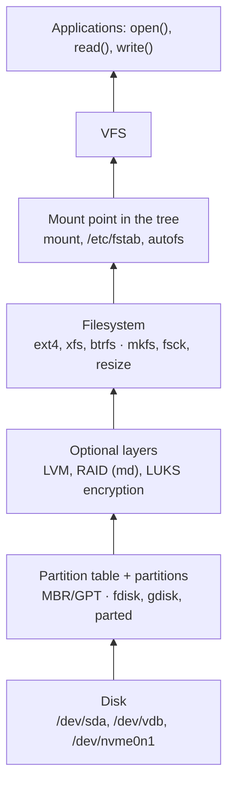
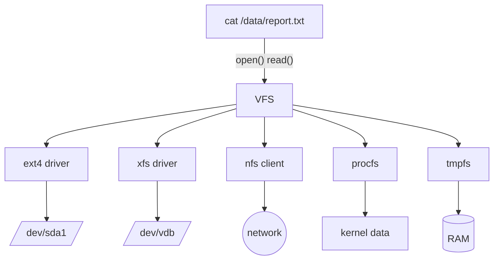

# The VFS and Filesystem Types

<!-- nav:start -->
> **Module 05 · Storage** — lesson 1 of 9  
> [Module index](README.md) · [Course lesson (commands)](../../course/05-Storage.md#lesson-1---the-vfs--filesystem-types-ch-19) · [Exercises for this lesson](../../exercises/05-storage/01-vfs-filesystem-types.md)
<!-- nav:end -->

Linux supports dozens of filesystems – ext4, XFS, Btrfs, NFS, tmpfs, vfat – yet every program uses the same `open()`, `read()` and `write()` calls on all of them. The layer that makes this possible is the **Virtual File System (VFS)**. In this lesson you will learn the storage stack, what a filesystem actually does, how the VFS unifies them, and the strengths and limits of the filesystems you will meet.

## What you will learn

- The layers of the Linux storage stack
- What a filesystem is: superblock, inodes, data blocks, directories, journal
- The role of the VFS and how mounting fits in
- Disk-based, network and virtual filesystems
- Comparing ext4, XFS, Btrfs, vfat, tmpfs
- Tools to see which filesystems are in use

---

## Key terms

| Term | Definition |
|------|-----------|
| **Block device** | Storage accessed in fixed-size blocks: a disk (`/dev/sda`), partition (`/dev/sda1`), LV (`/dev/vg/lv`). |
| **Filesystem** | The on-disk structure that organizes a block device into files and directories. |
| **VFS** | *Virtual File System*: the kernel layer that provides one interface for all filesystem types. |
| **Superblock** | The header of a filesystem: size, block size, number of inodes, state, features. |
| **Inode** | The record describing one file (metadata + location of its data). |
| **Block** | The allocation unit of a filesystem (typically 4 KiB). |
| **Extent** | A contiguous range of blocks described as "start + length" – more efficient than listing every block. |
| **Journal** | A log of pending metadata changes used to recover quickly after a crash. |
| **Mount** | Attaching a filesystem to a directory of the tree. |
| **Pseudo filesystem** | A filesystem with no storage behind it (`proc`, `sysfs`). |

---

## The storage stack

Every storage task touches one of these layers. Identifying the layer tells you which tools to use.



```console
$ lsblk -f
NAME                FSTYPE      LABEL UUID                                 MOUNTPOINTS
vda
├─vda1              vfat              6A2B-91C3                            /boot/efi
├─vda2              ext4              8f3c…                                /boot
└─vda3              LVM2_member       Yk2v…
  └─ubuntu--vg-root ext4              3f1c…                                /
vdb                 xfs         DATA  9a2b…                                /data
```

`lsblk -f` shows the whole stack in one view: devices, partitions, LVM, filesystem types, labels, UUIDs and mount points.

---

## What a filesystem does

A filesystem turns a big array of blocks into named files:

```text
┌────────────┬─────────────┬────────────┬───────────┬──────────────────────────┐
│ Superblock │ Group/alloc │ Inode      │ Journal   │ Data blocks              │
│ (+backups) │ bitmaps     │ table      │           │ (file contents, dirs)    │
└────────────┴─────────────┴────────────┴───────────┴──────────────────────────┘
```

- **Superblock** – global information. Ext4 keeps backup copies, so a damaged superblock can be repaired (`e2fsck -b 32768`).
- **Allocation maps** – which blocks and inodes are free.
- **Inodes** – one per file: type, permissions, owner, timestamps, size, and pointers/extents to data.
- **Directories** – special files containing `name → inode number` entries.
- **Journal** – see below.

### Journaling

Creating a file changes several structures (inode table, bitmap, directory). If the power fails half-way, they become inconsistent. A **journaling** filesystem first writes a description of the change to the journal, then applies it. After a crash, only the journal is replayed: recovery takes seconds instead of a full scan of the disk.

| ext4 journal mode | Journals | Trade-off |
|-------------------|----------|-----------|
| `data=ordered` (default) | metadata; data is written before the metadata that points to it | good safety and speed |
| `data=writeback` | metadata only | fastest; old data may appear in files after a crash |
| `data=journal` | metadata and data | safest, slowest |

---

## The VFS

The VFS defines common objects – **superblock**, **inode**, **dentry** (directory entry), **file** – and each filesystem driver implements them. Programs only talk to the VFS.



The VFS also keeps caches – the **dentry cache** and **inode cache** – and the **page cache** of file contents, which is why the second read of a file is much faster.

```console
$ cat /proc/filesystems        # filesystem types the running kernel supports
nodev   sysfs
nodev   tmpfs
nodev   proc
        ext4
        xfs
        vfat
nodev   nfs4
```

`nodev` marks filesystems that don't need a block device.

---

## Kinds of filesystems

| Kind | Examples | Backed by |
|------|----------|-----------|
| Disk-based | ext4, XFS, Btrfs, vfat/exFAT, NTFS | a block device |
| Network | NFS, SMB/CIFS, sshfs | a remote server |
| Virtual / pseudo | proc, sysfs, devtmpfs, cgroup2, debugfs | kernel data structures |
| Memory | tmpfs, ramfs | RAM (+ swap for tmpfs) |
| Overlay / union | overlayfs | layers of other filesystems (containers) |
| Read-only images | squashfs, iso9660 | compressed images, CDs (snaps, live ISOs) |

---

## Comparing the common disk filesystems

| | **ext4** | **XFS** | **Btrfs** | **vfat (FAT32)** |
|--|----------|---------|-----------|------------------|
| Default on | Debian, Ubuntu | RHEL, Rocky, Alma | Fedora Workstation, openSUSE | EFI system partition, USB |
| Max file / FS size | 16 TiB / 1 EiB | 8 EiB / 8 EiB | 16 EiB | 4 GiB / 2 TiB |
| Grow | online & offline (`resize2fs`) | **online only** (`xfs_growfs`) | online | – |
| Shrink | **offline** (`resize2fs`) | **not possible** | online | – |
| Journal | yes | yes (metadata) | copy-on-write instead | no |
| Snapshots | no (use LVM) | no (use LVM) | yes (subvolumes) | no |
| Checksums | metadata | metadata | data + metadata | no |
| Repair tool | `e2fsck` | `xfs_repair` | `btrfs check` | `fsck.vfat` |
| Unix permissions | yes | yes | yes | no (mount options emulate them) |
| Inodes | fixed at `mkfs` | dynamic | dynamic | n/a |

Choosing:

- **ext4** – the safe general-purpose choice; can shrink.
- **XFS** – excellent with large files and parallel I/O; RHEL default; remember it **cannot shrink**.
- **Btrfs** – snapshots, compression, checksums, built-in RAID; more complex.
- **vfat** – compatibility with firmware and other OSes.
- **tmpfs** – fast scratch space in RAM (`/run`, `/dev/shm`).

---

## Examples

### Which filesystem is a path on?

```console
$ df -T /var/log
Filesystem                  Type 1K-blocks    Used Available Use% Mounted on
/dev/mapper/ubuntu--vg-root ext4  19475088 5212344  13250412  29% /
$ findmnt -T /var/log
TARGET SOURCE                      FSTYPE OPTIONS
/      /dev/mapper/ubuntu--vg-root ext4   rw,relatime
$ stat -f /var/log
  File: "/var/log"
    ID: 8c1f3b2a…  Namelen: 255     Type: ext2/ext3
Block size: 4096
```

### What's on a device that isn't mounted?

```console
$ sudo blkid /dev/vdb
/dev/vdb: LABEL="DATA" UUID="9a2b…" BLOCK_SIZE="512" TYPE="xfs"
$ sudo file -s /dev/vdb
/dev/vdb: SGI XFS filesystem data (blksz 4096, inosz 512, v2 dirs)
```

### A tmpfs in RAM

```console
$ sudo mount -t tmpfs -o size=256M tmpfs /mnt/ram
$ df -h /mnt/ram
tmpfs  256M     0  256M   0% /mnt/ram
```

---

## Try it yourself

1. Run `lsblk -f` and draw the stack (disk → partitions → LVM → filesystem → mount point) of your VM.
2. List the filesystem types your kernel supports, and which are actually mounted (`findmnt -o FSTYPE | sort -u`).
3. Find the filesystem type and block size of `/` and `/boot`.
4. Mount a 100 MiB tmpfs, copy files into it, unmount it – what happens to the files?

---

## Summary

- Storage stack: disk → partition → (LVM/RAID/LUKS) → filesystem → mount → VFS → apps.
- A filesystem = superblock + allocation maps + inodes + directories + data (+ journal).
- The VFS gives every filesystem the same interface and caches.
- ext4 can shrink, XFS cannot; Btrfs adds snapshots and checksums; tmpfs lives in RAM.

## Check yourself

1. What problem does a journal solve?
2. Why can the same `cat` command read files on ext4, NFS and `/proc`?
3. Which common filesystem cannot be shrunk?
4. What does `nodev` mean in `/proc/filesystems`?

<details>
<summary>Answers</summary>

1. Inconsistent metadata after a crash; with a journal, recovery replays the log instead of scanning the whole filesystem.
2. All of them are accessed through the VFS, which provides one common interface.
3. XFS.
4. The filesystem doesn't need a block device (virtual, memory or network filesystems).

</details>

## Further reading

- `man 5 filesystems`, `man 5 ext4`, `man 5 xfs`, `man 5 tmpfs`, `man 8 lsblk`
- [Linux kernel: Overview of the VFS](https://docs.kernel.org/filesystems/vfs.html)
- [ArchWiki: File systems](https://wiki.archlinux.org/title/File_systems)
- [Red Hat: Overview of available file systems (RHEL 9)](https://docs.redhat.com/en/documentation/red_hat_enterprise_linux/9/html/managing_file_systems/overview-of-available-file-systems_managing-file-systems)

---

<!-- footer:start -->
[Module index](README.md) · [Disk Partitioning →](02-partitioning.md)  
**Practice now:** [Exercises – The VFS and Filesystem Types](../../exercises/05-storage/01-vfs-filesystem-types.md)
<!-- footer:end -->
