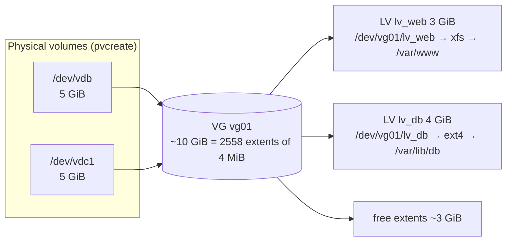
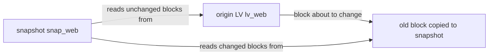

# Logical Volume Management (LVM)

<!-- nav:start -->
> **Module 05 · Storage** — lesson 4 of 9  
> [Module index](README.md) · [Course lesson (commands)](../../course/05-Storage.md#lesson-4---lvm-ch-23) · [Exercises for this lesson](../../exercises/05-storage/04-lvm.md)
<!-- nav:end -->

With plain partitions, storage is rigid: growing a full partition means moving the ones after it, and a filesystem can't span two disks. **LVM** adds a flexible layer between disks and filesystems: disks are pooled, and you carve **logical volumes** out of the pool that can be resized, moved between disks and snapshotted – often without downtime. In this lesson you will learn LVM's concepts and the full lifecycle of LVM storage.

## What you will learn

- Physical volumes, volume groups, logical volumes and extents
- Creating PVs, VGs and LVs; putting filesystems on them
- Inspecting LVM (`pvs`, `vgs`, `lvs` and `display` variants)
- Extending a VG with a new disk
- Growing an LV and its filesystem online (`lvextend -r`)
- Shrinking (ext4 only)
- Moving data off a disk (`pvmove`) and removing it
- Snapshots
- Renaming, removing, activating; device names
- Thin provisioning and other LV types (overview)

---

## Key terms

| Term | Definition |
|------|-----------|
| **PV** (*Physical Volume*) | A disk or partition initialized for LVM with `pvcreate`. |
| **VG** (*Volume Group*) | A pool of storage made of one or more PVs. |
| **LV** (*Logical Volume*) | A virtual block device carved from a VG; you put a filesystem (or swap) on it. |
| **PE** (*Physical Extent*) | The allocation unit of a VG (default 4 MiB). LVs are made of extents. |
| **LE** (*Logical Extent*) | An extent as seen by the LV; mapped to a PE on some PV. |
| **Device mapper** | The kernel framework LVM uses to create the virtual devices (`/dev/dm-N`). |
| **Snapshot** | A point-in-time copy-on-write view of an LV. |
| **Thin pool** | An LV that hands out space on demand to thin LVs (over-provisioning). |

---

## The LVM model



An LV is simply a **map** from logical extents to physical extents. That map can:

- span several PVs (an LV larger than any single disk),
- grow by adding free extents from anywhere in the VG,
- be moved to other PVs while the LV is in use (`pvmove`).

### Device names

| Path | Notes |
|------|-------|
| `/dev/vg01/lv_web` | symlink, the friendly name |
| `/dev/mapper/vg01-lv_web` | device-mapper name (a `-` inside a VG/LV name is doubled: `my-vg` → `my--vg`) |
| `/dev/dm-3` | the real kernel device – number may change, don't use it |

All three refer to the same device and are **stable**; LVM paths are safe in `/etc/fstab` (UUIDs work too).

---

## Building LVM storage

### 1. Physical volumes

Use whole disks or partitions (type "Linux LVM" by convention).

```console
$ sudo pvcreate /dev/vdb /dev/vdc1
  Physical volume "/dev/vdb" successfully created.
  Physical volume "/dev/vdc1" successfully created.
$ sudo pvs
  PV         VG Fmt  Attr PSize PFree
  /dev/vdb      lvm2 ---  5.00g 5.00g
  /dev/vdc1     lvm2 ---  5.00g 5.00g
```

### 2. Volume group

```console
$ sudo vgcreate vg01 /dev/vdb             # -s 8M to change the extent size
  Volume group "vg01" successfully created
$ sudo vgs
  VG   #PV #LV #SN Attr   VSize  VFree
  vg01   1   0   0 wz--n- <5.00g <5.00g
$ sudo vgextend vg01 /dev/vdc1            # add the second PV to the pool
```

### 3. Logical volumes

```console
$ sudo lvcreate -n lv_web -L 3G vg01          # by size
  Logical volume "lv_web" created.
$ sudo lvcreate -n lv_db -l 1000 vg01         # by number of extents
$ sudo lvcreate -n lv_logs -l 50%FREE vg01    # half of the remaining free space
$ sudo lvcreate -n lv_rest -l 100%FREE vg01   # everything left
$ sudo lvs
  LV      VG   Attr       LSize   Pool Origin Data%  Meta%
  lv_db   vg01 -wi-a-----  <3.91g
  lv_web  vg01 -wi-a-----   3.00g
```

| `-L` | absolute size: `500M`, `3G` |
| `-l` | extents, or percentages: `100%FREE`, `50%VG`, `20%PVS` |

### 4. Filesystem and mount

```console
$ sudo mkfs.xfs /dev/vg01/lv_web
$ sudo mkdir -p /var/www
$ echo '/dev/vg01/lv_web /var/www xfs defaults 0 0' | sudo tee -a /etc/fstab
$ sudo systemctl daemon-reload && sudo mount -a
$ df -h /var/www
/dev/mapper/vg01-lv_web  3.0G   54M  3.0G   2% /var/www
```

---

## Inspecting LVM

| Short report | Detailed | Shows |
|--------------|----------|-------|
| `pvs` | `pvdisplay` | PVs, their VG, size, free |
| `vgs` | `vgdisplay` | VGs: size, free, number of PVs/LVs, extent size |
| `lvs` | `lvdisplay` | LVs: size, attributes, snapshot usage |

```console
$ sudo vgdisplay vg01 | grep -E 'PE Size|Total PE|Free  PE'
  PE Size               4.00 MiB
  Total PE              2558
  Free  PE / Size       1279 / <5.00 GiB
$ sudo lvs -o +devices                  # which PVs each LV lives on
  LV     VG   Attr       LSize Devices
  lv_web vg01 -wi-ao---- 3.00g /dev/vdb(0)
$ sudo pvs -o +pv_used
$ lsblk                                 # the tree including LVs
```

LVM metadata backups are kept automatically in `/etc/lvm/backup/` and `/etc/lvm/archive/` (restore with `vgcfgrestore`).

---

## Growing

The most common LVM task: a filesystem is full and the VG (or a new disk) has free space.

```console
$ sudo vgs vg01                                 # 1. enough free space in the VG?
$ sudo lvextend -r -L +1G /dev/vg01/lv_web      # 2. grow LV by 1 GiB AND resize the FS (-r)
  Size of logical volume vg01/lv_web changed from 3.00 GiB to 4.00 GiB.
  Logical volume vg01/lv_web successfully resized.
meta-data=/dev/mapper/vg01-lv_web …
data blocks changed from 786432 to 1048576
$ df -h /var/www                                # 3. verify
```

| Form | Meaning |
|------|---------|
| `-L +1G` | add 1 GiB |
| `-L 5G` | make it exactly 5 GiB |
| `-l +100%FREE` | use all free space in the VG |
| `-r` / `--resizefs` | also resize the filesystem (calls `xfs_growfs` / `resize2fs`) |

Without `-r`, grow the filesystem yourself – **otherwise `df` shows no change**:

```console
$ sudo lvextend -L +1G /dev/vg01/lv_web
$ sudo xfs_growfs /var/www              # XFS: give the MOUNT POINT; must be mounted
$ sudo resize2fs /dev/vg01/lv_db        # ext4: give the device; online or offline
```

### Out of space in the VG? Add a disk

```console
$ sudo pvcreate /dev/vdd
$ sudo vgextend vg01 /dev/vdd
$ sudo lvextend -r -l +100%FREE /dev/vg01/lv_web
```

---

## Shrinking (ext4 only)

XFS **cannot** be shrunk. ext4 can, but only **offline** and in the right order: first the filesystem, then the LV. `lvreduce -r` does both in the right order.

```console
$ sudo umount /var/lib/db
$ sudo lvreduce -r -L 2G /dev/vg01/lv_db        # runs e2fsck, resize2fs, then reduces the LV
Do you want to unmount "/var/lib/db" ? [Y|n] …
$ sudo mount /var/lib/db
```

Manual order (if you must): `e2fsck -f` → `resize2fs /dev/vg01/lv_db 2G` → `lvreduce -L 2G /dev/vg01/lv_db`. Reducing the LV **below** the filesystem size destroys data.

---

## Moving data and removing a disk

`pvmove` relocates extents from one PV to others in the same VG **while LVs stay online**:

```console
$ sudo pvmove /dev/vdb                 # move everything off vdb (needs enough free space elsewhere)
  /dev/vdb: Moved: 100.00%
$ sudo vgreduce vg01 /dev/vdb          # remove the PV from the VG
$ sudo pvremove /dev/vdb               # wipe the LVM label
```

This is how you replace a failing disk or migrate to new storage without downtime.

---

## Snapshots

A snapshot is a **copy-on-write** view of an LV at a moment in time. Initially it contains nothing: when a block of the origin is about to change, the old block is copied into the snapshot first.



```console
$ sudo lvcreate -s -n snap_web -L 500M /dev/vg01/lv_web    # 500 MiB to store changes
$ sudo lvs
  LV       VG   Attr       LSize Origin Data%
  lv_web   vg01 owi-aos--- 4.00g
  snap_web vg01 swi-a-s--- 500m  lv_web 0.01
$ sudo mount -o ro,nouuid /dev/vg01/snap_web /mnt/snap      # nouuid needed for XFS
$ sudo tar -czf /backup/web.tgz -C /mnt/snap .              # consistent backup
$ sudo umount /mnt/snap && sudo lvremove /dev/vg01/snap_web
```

- Watch `Data%`: if the snapshot fills up (more changes than its size), it becomes **invalid**.
- Roll the origin back to the snapshot: `lvconvert --merge /dev/vg01/snap_web` (applied at next activation if the origin is in use).
- A snapshot is **not a backup** – it lives on the same disks. Use it to take a consistent backup.

---

## Other operations

```console
$ sudo lvrename vg01 lv_logs lv_applogs       # rename LV
$ sudo vgrename vg01 vgdata                   # rename VG (update fstab!)
$ sudo lvremove /dev/vg01/lv_rest             # delete an LV (unmount first)
$ sudo vgremove vg01                          # delete a VG (all LVs removed first)
$ sudo vgchange -an vg01                      # deactivate all LVs of a VG
$ sudo vgchange -ay                           # activate all VGs (e.g. in a rescue system)
$ sudo pvscan; sudo vgscan; sudo lvscan       # rescan devices
```

### Thin provisioning (overview)

```console
$ sudo lvcreate -L 4G --thinpool tpool vg01
$ sudo lvcreate -V 10G --thin -n thin1 vg01/tpool     # 10 GiB "virtual" from a 4 GiB pool
```

Thin LVs allocate space only when written; you can promise more than you have – and **must monitor** the pool (`lvs` `Data%`), because a full pool stops writes.

Other LV types: `--type raid1/raid5` (mirroring/parity inside LVM), `--type cache` / `writecache`, VDO (deduplication, RHEL).

---

## Try it yourself

1. Turn both extra disks into PVs, create VG `vgapp` with the first one, and LV `lvweb` (1 GiB, XFS) mounted persistently at `/var/www`.
2. Extend `lvweb` by 500 MiB online and check `df`.
3. Add the second disk to the VG and grow `lvweb` to use all free space.
4. Create an ext4 LV `lvdata` of 2 GiB, put files on it, then shrink it to 1 GiB without losing them.
5. Take a snapshot of `lvdata`, delete a file on the origin, recover it from the snapshot.
6. Move all data off the first disk with `pvmove` and remove it from the VG.

---

## Common mistakes

- Extending the LV and forgetting the filesystem (use `-r`).
- Trying to shrink XFS.
- Shrinking the LV before the filesystem (data loss).
- Giving `xfs_growfs` the device instead of the mount point on older versions (both work on current versions, the mount point always works).
- A snapshot too small for the amount of change → invalid snapshot.
- Removing a PV with `pvremove` before `pvmove`/`vgreduce`.

---

## Summary

| Task | Command |
|------|---------|
| Init disk | `pvcreate /dev/X` |
| Pool | `vgcreate vg /dev/X`, `vgextend vg /dev/Y` |
| Volume | `lvcreate -n lv -L 2G vg`, `-l 100%FREE` |
| Inspect | `pvs`, `vgs`, `lvs`, `*display`, `lsblk` |
| Grow | `lvextend -r -L +1G /dev/vg/lv` |
| Shrink (ext4) | `lvreduce -r -L 2G /dev/vg/lv` (unmounted) |
| Remove a disk | `pvmove /dev/X`, `vgreduce vg /dev/X`, `pvremove /dev/X` |
| Snapshot | `lvcreate -s -n snap -L 500M /dev/vg/lv`; merge with `lvconvert --merge` |
| Delete | `lvremove`, `vgremove`, `pvremove` |

## Check yourself

1. What is a physical extent, and why does it matter?
2. You ran `lvextend -L +2G /dev/vg01/lv_web` but `df` shows the old size. Why?
3. Can you shrink an XFS LV? An ext4 LV while mounted?
4. What happens to a snapshot when more data changes on the origin than the snapshot can hold?
5. How do you remove a disk from a VG that still holds data?

<details>
<summary>Answers</summary>

1. The allocation unit of a VG; LVs are built from extents, which is what lets them span and move between PVs.
2. Only the LV was grown; the filesystem must be grown too (`xfs_growfs` / `resize2fs`, or use `-r`).
3. XFS: no. ext4: only unmounted (offline).
4. It becomes invalid and unusable.
5. `pvmove` its extents to other PVs, then `vgreduce` and `pvremove`.

</details>

## Further reading

- `man 7 lvm`, `man 8 lvcreate`, `man 8 lvextend`, `man 8 pvmove`, `man 7 lvmthin`
- [Red Hat: Configuring and managing logical volumes (RHEL 9)](https://docs.redhat.com/en/documentation/red_hat_enterprise_linux/9/html/configuring_and_managing_logical_volumes/index)
- [ArchWiki: LVM](https://wiki.archlinux.org/title/LVM)
- [Ubuntu Server: How to manage logical volumes](https://documentation.ubuntu.com/server/how-to/storage/manage-logical-volumes/)

---

<!-- footer:start -->
[← Creating, Mounting and Repairing Filesystems](03-filesystems-mounting.md) · [Module index](README.md) · [Swap Space →](05-swap.md)  
**Practice now:** [Exercises – Logical Volume Management (LVM)](../../exercises/05-storage/04-lvm.md)
<!-- footer:end -->
