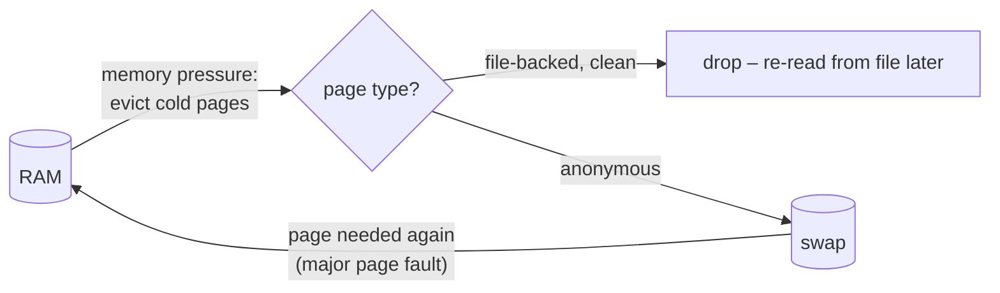

# Swap Space

<!-- nav:start -->
> **Module 05 · Storage** — lesson 5 of 9  
> [Module index](README.md) · [Course lesson (commands)](../../course/05-Storage.md#lesson-5---swap-ch-16) · [Exercises for this lesson](../../exercises/05-storage/05-swap.md)
<!-- nav:end -->

**Swap** is disk space the kernel uses as an extension of RAM. When memory gets tight, rarely used memory pages are moved to swap so that RAM is available for active work. In this lesson you will learn how swap fits into Linux memory management, how to create swap on a partition, an LV or a file, how to make it permanent, and how to tune and monitor it.

## What you will learn

- Virtual memory, pages, anonymous vs file-backed memory
- What swap is for – and what it is not
- Creating swap on a partition, LV and file
- Activating swap at boot via `/etc/fstab`; priorities
- `vm.swappiness` and other tuning
- Monitoring swap usage and activity
- zram and zswap

---

## Key terms

| Term | Definition |
|------|-----------|
| **Virtual memory** | Each process sees its own address space; the kernel maps it to physical RAM pages on demand. |
| **Page** | The unit of memory management, usually 4 KiB. |
| **Anonymous memory** | Memory not backed by a file (heap, stack). The only kind that can be **swapped**. |
| **File-backed memory / page cache** | Memory holding file contents; it can simply be dropped and re-read from the file. |
| **Swap space** | A partition, LV or file where anonymous pages are stored when evicted from RAM. |
| **Swapping out / in** | Writing pages to swap / reading them back when needed. |
| **Swappiness** | Kernel tunable (`vm.swappiness`) controlling how eagerly anonymous memory is swapped vs page cache dropped. |
| **OOM killer** | Kernel mechanism that kills a process when RAM and swap are exhausted. |

---

## How the kernel uses swap



- Swap lets the kernel move **idle** memory (e.g. a daemon that rarely runs) out of RAM, keeping RAM for active programs and for cache.
- Swap is ~1000× slower than RAM. A system that is **constantly** swapping in and out (*thrashing*) is very slow – the fix is more RAM or less load, not more swap.
- Without any swap, when RAM is full, the kernel can only drop cache and then call the OOM killer.
- **Hibernation** (suspend to disk) needs swap at least as large as RAM.

### How much swap?

There is no single rule. Common guidance:

| RAM | Swap (no hibernation) |
|-----|-----------------------|
| ≤ 2 GiB | 2× RAM |
| 2–8 GiB | = RAM |
| 8–64 GiB | ≥ 4 GiB, often 0.5× RAM |
| > 64 GiB | ≥ 4 GiB, workload dependent |

---

## Inspecting swap

```console
$ swapon --show
NAME      TYPE      SIZE USED PRIO
/dev/dm-1 partition   2G  68M   -2
/swapfile file        1G   0B   -3
$ free -h
               total        used        free      shared  buff/cache   available
Mem:           1.9Gi       1.2Gi       112Mi        12Mi       648Mi       560Mi
Swap:          3.0Gi        68Mi       2.9Gi
$ cat /proc/swaps
```

---

## Creating swap

### On a partition

Create a partition (type "Linux swap", see [Partitioning](02-partitioning.md)), then:

```console
$ sudo mkswap -L swap2 /dev/vdb2
Setting up swapspace version 1, size = 512 MiB (536866816 bytes)
LABEL=swap2, UUID=7c1e…
$ sudo swapon /dev/vdb2
```

### On an LVM logical volume

```console
$ sudo lvcreate -n lv_swap -L 1G vg01
$ sudo mkswap /dev/vg01/lv_swap
$ sudo swapon /dev/vg01/lv_swap
```

Swap on LVM is easy to resize: `swapoff`, `lvextend`, `mkswap`, `swapon`.

### As a file

```console
$ sudo fallocate -l 1G /swapfile            # or: sudo dd if=/dev/zero of=/swapfile bs=1M count=1024
$ sudo chmod 600 /swapfile                  # only root may read it – it may contain secrets
$ sudo mkswap /swapfile
$ sudo swapon /swapfile
```

Notes:

- `fallocate` is fast but some filesystems don't support swap files created this way (older XFS kernels, files with holes). If `swapon` complains "swapfile has holes", recreate it with `dd`.
- On **Btrfs**, use `btrfs filesystem mkswapfile --size 1G /swapfile` (needs no CoW and no compression).
- `swapon` refuses files with insecure permissions (warning) – always `chmod 600`.

---

## Making swap permanent

Add a line to `/etc/fstab` – the mount point is `none` and the type `swap`:

```text
UUID=7c1e…               none  swap  defaults        0 0
/dev/vg01/lv_swap        none  swap  defaults,pri=10 0 0
/swapfile                none  swap  defaults        0 0
```

Test without rebooting:

```console
$ sudo swapoff -a          # disable all swap
$ sudo swapon -a           # enable everything in fstab – errors appear now
$ swapon --show
```

(systemd also generates a `.swap` unit per entry, e.g. `dev-vg01-lv_swap.swap`.)

### Priorities

When several swap areas exist, the one with the **highest priority** is used first; areas with equal priority are used round-robin (striping, faster on separate disks).

```console
$ sudo swapon -p 10 /dev/vg01/lv_swap      # or pri=10 in fstab
```

---

## Removing swap

```console
$ sudo swapoff /swapfile                   # pages are moved back to RAM – needs free memory!
$ sudo sed -i '/\/swapfile/d' /etc/fstab
$ sudo rm /swapfile
```

---

## Tuning: swappiness

`vm.swappiness` (0–200, default 60) sets the balance between swapping anonymous memory and dropping page cache:

- **low** (e.g. 10): prefer keeping application memory in RAM, drop cache first – common for databases.
- **high** (e.g. 100+): swap idle application memory more readily, keep more cache – useful with fast swap like zram.
- **0**: avoid swapping as long as possible (but not disabled).

```console
$ cat /proc/sys/vm/swappiness
60
$ sudo sysctl -w vm.swappiness=10                                   # now
$ echo 'vm.swappiness = 10' | sudo tee /etc/sysctl.d/90-swap.conf  # persistent
$ sudo sysctl --system
```

More on kernel tunables in [sysctl](../06-kernel-devices/02-sysctl.md). Related: `vm.vfs_cache_pressure`, `vm.min_free_kbytes`.

---

## Monitoring swap activity

Swap **usage** (how much is in swap) matters less than swap **activity** (how much moves in and out right now):

```console
$ vmstat 1 5
procs -----------memory---------- ---swap-- -----io----
 r  b   swpd   free   buff  cache   si   so    bi    bo
 1  0  69432 115120  20480 643000    0    0     4    12     ← si/so ≈ 0: fine
 2  3 912340  20112   1024  50112 1820 2410  2100  2500     ← heavy swapping: thrashing
$ sar -W 1 5                   # pswpin/s pswpout/s
$ for p in /proc/[0-9]*; do awk '/VmSwap/{print $2, FILENAME}' $p/status 2>/dev/null; done | sort -rn | head -5
```

The last command lists processes by swap usage (also visible with `top`: press `f` and enable the SWAP column, or `smem`).

---

## zram and zswap

| | zram | zswap |
|--|------|-------|
| What | a **compressed RAM disk** used as a swap device | a compressed **cache in front of** a disk swap device |
| Needs disk swap | no | yes |
| Default on | Fedora (`zram-generator`), many desktops | some distributions |
| Shows in `swapon` | as `/dev/zram0` | no (only the disk swap) |

You may see `/dev/zram0` in `swapon --show` on Fedora systems – it is normal.

---

## Try it yourself

1. Check current swap with `swapon --show` and `free -h`.
2. Create a 512 MiB swap partition on an extra disk and enable it permanently by UUID.
3. Create a 256 MiB swap LV with priority 10 and a 256 MiB swap file with priority 5; verify the order in `swapon --show`.
4. Set `vm.swappiness=10` persistently.
5. Disable and remove the swap file cleanly.

---

## Common mistakes

- Forgetting `mkswap` before `swapon`.
- Swap file not `chmod 600`.
- Wrong fstab line: mount point must be `none` (or `swap`) and type `swap`.
- Expecting swap to fix a system that is thrashing.
- `swapoff` on a system without enough free RAM – it can trigger the OOM killer.

---

## Summary

| Task | Command |
|------|---------|
| Show | `swapon --show`, `free -h`, `/proc/swaps` |
| Partition / LV | `mkswap /dev/X` → `swapon /dev/X` |
| File | `fallocate -l 1G /swapfile` (or `dd`) → `chmod 600` → `mkswap` → `swapon` |
| Persistent | fstab: `UUID=… none swap defaults 0 0` → `swapon -a` |
| Priority | `pri=N` in fstab, `swapon -p N` |
| Disable | `swapoff /dev/X`, `swapoff -a` |
| Tune | `vm.swappiness` in `/etc/sysctl.d/` |
| Activity | `vmstat 1` (`si`/`so`), `sar -W` |

## Check yourself

1. Which kind of memory can be swapped out?
2. What fstab mount point and type do you use for swap?
3. Two swap areas have priorities 10 and 5. Which is used first?
4. What's worse: 1 GiB of swap used but `si`/`so` = 0, or 100 MiB used with `si`/`so` in the thousands?

<details>
<summary>Answers</summary>

1. Anonymous memory (heap, stack, tmpfs); file-backed pages are just dropped.
2. Mount point `none`, type `swap`.
3. Priority 10 (higher first).
4. The second: constant swap traffic (thrashing) hurts performance; idle pages sitting in swap don't.

</details>

## Further reading

- `man 8 mkswap`, `man 8 swapon`, `man 5 fstab`, `man 5 proc` (`/proc/sys/vm/swappiness`)
- [ArchWiki: Swap](https://wiki.archlinux.org/title/Swap) · [zram](https://wiki.archlinux.org/title/Zram)
- [Red Hat: Getting started with swap (RHEL 9)](https://docs.redhat.com/en/documentation/red_hat_enterprise_linux/9/html/managing_storage_devices/getting-started-with-swap_managing-storage-devices)

---

<!-- footer:start -->
[← Logical Volume Management (LVM)](04-lvm.md) · [Module index](README.md) · [NFS: Network File System →](06-nfs.md)  
**Practice now:** [Exercises – Swap Space](../../exercises/05-storage/05-swap.md)
<!-- footer:end -->
