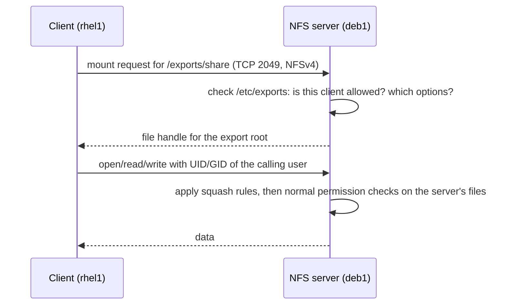

# NFS: Network File System

<!-- nav:start -->
> **Module 05 · Storage** — lesson 6 of 9  
> [Module index](README.md) · [Course lesson (commands)](../../course/05-Storage.md#lesson-6---nfs-gap) · [Exercises for this lesson](../../exercises/05-storage/06-nfs.md)
<!-- nav:end -->

**NFS** lets a server share directories over the network so that clients mount them like local filesystems. It's the standard way to share home directories, application data and installation trees between Linux machines. In this lesson you will learn how NFS works, how to export directories on a server, how to mount them on clients (temporarily and at boot), and how to secure and troubleshoot NFS.

## What you will learn

- File-level vs block-level network storage
- NFS versions, ports and the services involved
- Server: packages, `/etc/exports` syntax and options, `exportfs`
- `root_squash` and how NFS checks permissions (UIDs!)
- Client: `showmount`, `mount -t nfs`, fstab options (`_netdev`, `hard`/`soft`)
- Firewall and SELinux considerations
- Troubleshooting

---

## Key terms

| Term | Definition |
|------|-----------|
| **NFS** | *Network File System*: a protocol for accessing files on a remote server. |
| **Export** | A directory the server makes available to clients. |
| **`/etc/exports`** | Server file listing exports, allowed clients and options. |
| **NFSv3 / NFSv4** | Protocol versions. v4 (incl. 4.1, 4.2) uses a single TCP port and adds stateful locking and security improvements. |
| **rpcbind** | Port-mapper service used by NFSv3 (and `showmount`) to find dynamic RPC ports. Port 111. |
| **root_squash** | Export option mapping requests from client root (UID 0) to an anonymous user (`nobody`). Default. |
| **idmapping** | NFSv4 mapping of `user@domain` names to local UIDs (`/etc/idmapd.conf`). |
| **Hard / soft mount** | Behaviour when the server doesn't answer: retry forever (hard) or return an error after a timeout (soft). |

---

## File-level vs block-level

| | File-level (NAS) | Block-level (SAN) |
|--|------------------|-------------------|
| Protocols | **NFS**, SMB/CIFS | iSCSI, **NBD**, Fibre Channel |
| Client sees | a directory tree | a raw disk – you create a filesystem on it |
| Concurrent clients | many, safely | one (unless a cluster filesystem) |
| Who manages the filesystem | the server | the client |

This lesson covers NFS; block devices are in [Network Block Devices](07-network-block-devices.md).

---

## How NFS works



| Version | Ports | Notes |
|---------|-------|-------|
| NFSv3 | 2049 + rpcbind 111 + dynamic ports (mountd, statd, lockd) | stateless; still common |
| **NFSv4.x** | **2049/TCP only** | default on modern Linux; firewall-friendly |

Modern clients try v4.2 → v4.1 → v4.0 → v3 automatically. Force a version with `-o vers=4.2` or `nfsvers=3`.

---

## The server

### Packages and service

```console
# Debian/Ubuntu
$ sudo apt install nfs-kernel-server
# RHEL family
$ sudo dnf install nfs-utils
$ sudo systemctl enable --now nfs-server       # Debian: nfs-kernel-server (nfs-server is an alias)
```

### /etc/exports

Each line: **directory**, then one or more **client(options)** entries – with **no space** between client and `(`.

```text
# /etc/exports
/exports/share    192.168.56.0/24(rw,sync,no_subtree_check)
/exports/ro       *(ro,sync,no_subtree_check)
/exports/home     192.168.56.20(rw,sync,no_root_squash) 192.168.56.0/24(ro)
/exports/projects *.example.lab(rw,sync,all_squash,anonuid=3000,anongid=3000)
```

Client specifications: a single host (`192.168.56.20`, `rhel1.example.lab`), a network (`192.168.56.0/24`), wildcards (`*.example.lab`), or `*` (anyone).

| Option | Meaning |
|--------|---------|
| `rw` / `ro` | read-write / read-only |
| `sync` | reply only after data is on disk (safe, default) |
| `async` | reply before writing (fast, risk of data loss on server crash) |
| `root_squash` | **default**: client root → `nobody` |
| `no_root_squash` | client root is root on the export – dangerous |
| `all_squash` | every client user → anonymous user |
| `anonuid=`, `anongid=` | UID/GID used for squashed users |
| `no_subtree_check` | disable subtree checking (default and recommended) |
| `fsid=0` | marks the NFSv4 pseudo-root (rarely needed today) |

> **The space trap:** `/exports/share 192.168.56.0/24 (rw)` (with a space) means "192.168.56.0/24 with default options (read-only) **and** everyone (`(rw)`) read-write"! `exportfs` warns about it.

### Applying exports

```console
$ sudo mkdir -p /exports/share
$ sudo chown nobody:nogroup /exports/share      # RHEL: nobody:nobody – or a real owner
$ sudo exportfs -arv                            # re-export everything from /etc/exports
exporting 192.168.56.0/24:/exports/share
$ sudo exportfs -v                              # show active exports with all options
/exports/share  192.168.56.0/24(sync,wdelay,hide,no_subtree_check,sec=sys,rw,secure,root_squash,no_all_squash)
$ sudo exportfs -u 192.168.56.0/24:/exports/share   # unexport one
```

Drop-in files in `/etc/exports.d/*.exports` work too.

### Firewall and SELinux (RHEL)

```console
$ sudo firewall-cmd --permanent --add-service=nfs                    # 2049 – enough for NFSv4
$ sudo firewall-cmd --permanent --add-service={mountd,rpc-bind}      # NFSv3 and showmount
$ sudo firewall-cmd --reload
$ getsebool -a | grep nfs_export                                     # nfs_export_all_rw/ro (on by default)
```

On Ubuntu with ufw: `sudo ufw allow from 192.168.56.0/24 to any port nfs`.

---

## The client

```console
# Debian/Ubuntu
$ sudo apt install nfs-common
# RHEL family
$ sudo dnf install nfs-utils

$ showmount -e deb1                   # list exports (uses rpcbind/mountd → NFSv3 ports)
Export list for deb1:
/exports/ro    *
/exports/share 192.168.56.0/24

$ sudo mkdir -p /mnt/share
$ sudo mount -t nfs deb1:/exports/share /mnt/share
$ findmnt /mnt/share
TARGET     SOURCE              FSTYPE OPTIONS
/mnt/share deb1:/exports/share nfs4   rw,relatime,vers=4.2,rsize=262144,wsize=262144,hard,proto=tcp,sec=sys,clientaddr=192.168.56.20
$ nfsstat -m                          # mount details
```

### At boot: /etc/fstab

```text
deb1:/exports/share  /mnt/share  nfs  defaults,_netdev,nofail  0 0
```

- `_netdev` – this filesystem needs the network: mount after networking is up, unmount before it goes down.
- `nofail` – don't fail the boot if the server is unreachable.
- Even better for servers that may be down: **mount on demand** with `x-systemd.automount` or autofs – see [Automounters](08-automounters.md).

### Client mount options

| Option | Meaning |
|--------|---------|
| `vers=4.2` / `nfsvers=3` | protocol version |
| `hard` (default) | retry forever if the server stops responding – processes hang in `D` state but data is safe |
| `soft` | give up after `retrans`/`timeo` and return an I/O error – risk of corruption for writes |
| `timeo=`, `retrans=` | timeout (tenths of a second) and retries |
| `ro` / `rw` | access mode (can only restrict what the server allows) |
| `noexec`, `nosuid` | security |
| `rsize=`, `wsize=` | I/O block sizes (auto-negotiated) |

---

## Permissions: it's all about numbers

With the default `sec=sys`, the client sends the **numeric UID and GID** of the user; the server checks its own file permissions against those numbers.

```text
Client: ana has UID 1001   ──►   Server: UID 1001 is luis   →  ana gets luis's access!
```

- Keep UIDs/GIDs consistent across machines (central LDAP, or careful local creation with `useradd -u`).
- NFSv4 also sends names (`ana@example.lab`) for display; set the same `Domain =` in `/etc/idmapd.conf` on client and server, or `ls -l` shows `nobody`.
- **root_squash**: client root becomes `nobody` → root on a client typically **cannot** write to an export owned by another user. That's intentional.
- Kerberos (`sec=krb5`, `krb5i`, `krb5p`) provides real authentication and encryption – used in enterprise setups.

---

## Troubleshooting

| Symptom | Check |
|---------|-------|
| `mount.nfs: access denied by server` | client not matched in `/etc/exports`? `exportfs -v`; hostname vs IP |
| `mount.nfs: Connection timed out` / `No route to host` | firewall on server (2049); server running? `rpcinfo -p server` |
| `showmount` fails but mount works | NFSv4 only needs 2049; `showmount` needs rpcbind/mountd (open those ports) |
| Permission denied writing as root | `root_squash` (default) |
| Wrong owner names in `ls -l`, or `nobody` | UID mismatch or NFSv4 idmapping domain |
| Processes hang in `D` state | server unreachable with a `hard` mount – restore the server or `umount -f -l` |
| Boot hangs waiting for NFS | add `_netdev,nofail` or use automount |

```console
$ rpcinfo -p deb1                   # registered RPC services (NFSv3)
$ sudo exportfs -v                  # on the server
$ journalctl -u nfs-server          # server logs
$ sudo tcpdump -i eth1 port 2049    # is traffic arriving?
```

---

## Try it yourself

1. On `deb1`, export `/exports/share` read-write to the lab subnet and `/exports/ro` read-only to everyone.
2. On `rhel1`, list the exports and mount `/exports/share` on `/mnt/share`. Create a file as a normal user and as root; compare owners on the server.
3. Make the mount persistent with `_netdev,nofail`; reboot the client and verify.
4. Stop the NFS server and run `ls /mnt/share` on the client. What happens? Start it again.
5. Export a directory with `all_squash,anonuid=3000,anongid=3000` and check the owner of new files.

---

## Common mistakes

- A space between client and `(options)` in `/etc/exports`.
- Forgetting `exportfs -ra` after editing.
- Opening only port 2049 and wondering why `showmount` fails.
- `no_root_squash` on exports anyone can reach.
- No `_netdev`/`nofail` in fstab → slow or failed boots.
- Different UIDs for the same user on client and server.

---

## Summary

| Side | Task | Command / file |
|------|------|----------------|
| Server | install | `nfs-kernel-server` / `nfs-utils` |
| Server | define exports | `/etc/exports`: `/dir client(rw,sync)` |
| Server | apply / show | `exportfs -arv`, `exportfs -v` |
| Server | firewall | `firewall-cmd --add-service=nfs` (+ `mountd`, `rpc-bind`) |
| Client | install | `nfs-common` / `nfs-utils` |
| Client | list / mount | `showmount -e server`, `mount -t nfs server:/dir /mnt` |
| Client | persistent | fstab `server:/dir /mnt nfs defaults,_netdev,nofail 0 0` |

## Check yourself

1. What is the only port needed for NFSv4?
2. What does `root_squash` do and why is it the default?
3. Explain the difference between `/exports/a host(rw)` and `/exports/a host (rw)`.
4. Why might `ana` see files owned by `luis` on an NFS mount?

<details>
<summary>Answers</summary>

1. TCP 2049.
2. It maps the client's root user to an unprivileged anonymous user, so root on any client is not root on the server's files.
3. The first gives `host` read-write. The second gives `host` the default (read-only) options and **everyone** read-write.
4. NFS (with `sec=sys`) uses numeric UIDs; ana's UID on the client is luis's UID on the server.

</details>

## Further reading

- `man 5 exports`, `man 8 exportfs`, `man 5 nfs`, `man 8 showmount`, `man 5 idmapd.conf`
- [Ubuntu Server: Network File System (NFS)](https://documentation.ubuntu.com/server/how-to/networking/install-nfs/)
- [Red Hat: Deploying an NFS server (RHEL 9)](https://docs.redhat.com/en/documentation/red_hat_enterprise_linux/9/html/configuring_and_using_network_file_services/deploying-an-nfs-server_configuring-and-using-network-file-services)
- [ArchWiki: NFS](https://wiki.archlinux.org/title/NFS)

---

<!-- footer:start -->
[← Swap Space](05-swap.md) · [Module index](README.md) · [Network Block Devices and iSCSI →](07-network-block-devices.md)  
**Practice now:** [Exercises – NFS: Network File System](../../exercises/05-storage/06-nfs.md)
<!-- footer:end -->
