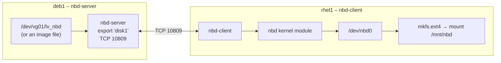
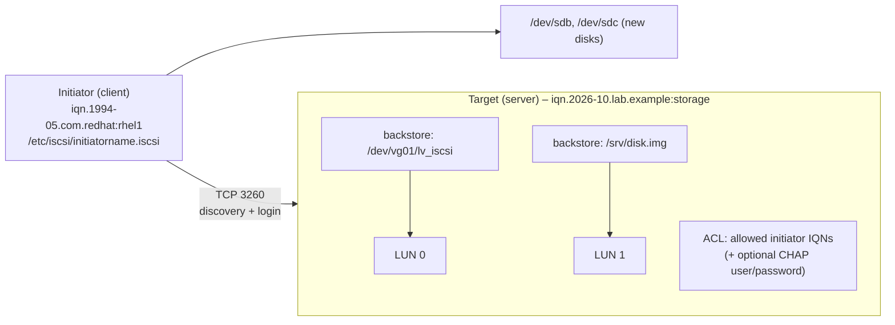

# Network Block Devices and iSCSI

<!-- nav:start -->
> **Module 05 · Storage** — lesson 7 of 9  
> [Module index](README.md) · [Course lesson (commands)](../../course/05-Storage.md#lesson-7---network-block-devices-gap) · [Exercises for this lesson](../../exercises/05-storage/07-network-block-devices.md)
<!-- nav:end -->

Sometimes a client needs a **disk**, not a shared folder: a database wants its own filesystem, a VM needs a virtual disk, a server boots from SAN storage. Block-level network storage exports a raw block device over the network; the client sees it as a local disk (`/dev/nbd0`, `/dev/sdb`) and puts its own filesystem on it. In this lesson you will learn the LFCS-relevant **NBD** (Network Block Device) in practice and the concepts of **iSCSI**, the enterprise standard.

## What you will learn

- When to use block-level instead of file-level storage
- NBD architecture: server, exports, client, kernel module
- Exporting a file, partition or LV with `nbd-server`
- Attaching, using and detaching it with `nbd-client`
- Making an NBD device persistent
- iSCSI concepts: targets, initiators, LUNs, IQNs; `iscsiadm` basics
- Safety rules for shared block devices

---

## Key terms

| Term | Definition |
|------|-----------|
| **Block device** | A device read and written in fixed-size blocks, with random access (a disk). |
| **NBD** | *Network Block Device*: a simple Linux protocol to use a remote block device. TCP port **10809**. |
| **Export** | A named block device (or image file) offered by the NBD server. |
| **`nbd` kernel module** | Provides the client devices `/dev/nbd0`, `/dev/nbd1`, … |
| **iSCSI** | SCSI commands carried over TCP/IP (port **3260**). Standard SAN protocol. |
| **Target** | The iSCSI **server** offering storage. |
| **Initiator** | The iSCSI **client**. |
| **LUN** | *Logical Unit Number*: one disk offered by a target. |
| **IQN** | *iSCSI Qualified Name*: unique name like `iqn.2026-10.lab.example:storage.disk1`. |

---

## File-level vs block-level

| | NFS (file-level) | NBD / iSCSI (block-level) |
|--|------------------|---------------------------|
| Client gets | a directory | a raw disk |
| Filesystem lives | on the server | on the **client** (client runs `mkfs`) |
| Multiple clients writing | yes | **no** – unless a cluster filesystem (GFS2, OCFS2) |
| Typical uses | shared data, home directories | databases, VM disks, diskless boot, SAN |

> **Never mount the same block device read-write on two machines at once** with a normal filesystem (ext4, XFS). Each kernel caches metadata independently, and the filesystem will be corrupted.

---

## NBD architecture



---

## Server side

### Install

```console
$ sudo apt install nbd-server            # Debian/Ubuntu
$ sudo dnf install nbd                   # Fedora; RHEL family: from EPEL
```

### Prepare something to export

Any block device or a regular file:

```console
$ sudo lvcreate -n lv_nbd -L 1G vg01                 # an LV
$ sudo truncate -s 1G /srv/nbd/disk2.img             # or a (sparse) image file
```

### Configure exports

`/etc/nbd-server/config` has a `[generic]` section and one section per export (the section name is the export name):

```ini
# /etc/nbd-server/config
[generic]
    user = nbd
    group = nbd
    includedir = /etc/nbd-server/conf.d
    allowlist = true            # let clients list exports (nbd-client -l)

[disk1]
    exportname = /dev/vg01/lv_nbd
    readonly = false
    authfile = /etc/nbd-server/allow   # optional: allowed client IPs/networks

[disk2]
    exportname = /srv/nbd/disk2.img
```

The `nbd` user must be able to read/write the exported device or file:

```console
$ sudo chown nbd:nbd /srv/nbd/disk2.img
$ sudo setfacl -m u:nbd:rw /dev/vg01/lv_nbd   # or run the server as root (user = root) in a lab
$ echo "192.168.56.0/24" | sudo tee /etc/nbd-server/allow
$ sudo systemctl restart nbd-server
$ sudo ss -tlnp | grep 10809
LISTEN 0 10 0.0.0.0:10809 0.0.0.0:* users:(("nbd-server",pid=3120,fd=3))
```

Open the firewall: `ufw allow 10809/tcp` or `firewall-cmd --permanent --add-port=10809/tcp && firewall-cmd --reload`.

> ACLs on device nodes under `/dev` don't survive reboot (udev recreates them). For a permanent setup use a udev rule (`OWNER="nbd"`) – see [Devices and udev](../06-kernel-devices/04-devices-udev.md) – or export image files.

---

## Client side

```console
$ sudo apt install nbd-client       # RHEL family: EPEL package "nbd"
$ sudo modprobe nbd                 # creates /dev/nbd0 … /dev/nbd15
$ ls /dev/nbd*
$ sudo nbd-client -l deb1           # list exports (needs allowlist = true)
Negotiation: ..
disk1
disk2
$ sudo nbd-client deb1 /dev/nbd0 -N disk1      # attach export "disk1" as /dev/nbd0
Negotiation: ..size = 1024MB
Connected /dev/nbd0
$ lsblk /dev/nbd0
NAME MAJ:MIN RM SIZE RO TYPE MOUNTPOINTS
nbd0  43:0    0   1G  0 disk
```

Now it is a normal disk: partition it, create a filesystem, mount it.

```console
$ sudo mkfs.ext4 /dev/nbd0
$ sudo mkdir -p /mnt/nbd && sudo mount /dev/nbd0 /mnt/nbd
$ df -h /mnt/nbd
/dev/nbd0  974M   24K  907M   1% /mnt/nbd
```

Detach cleanly:

```console
$ sudo umount /mnt/nbd
$ sudo nbd-client -d /dev/nbd0
$ sudo nbd-client -c /dev/nbd0 || echo "not connected"     # -c check: prints PID if connected
```

Module options: `modprobe nbd max_part=8` lets the kernel create partition devices (`/dev/nbd0p1`) if you partition the NBD disk; `nbds_max=` sets the number of devices. Make them persistent in `/etc/modprobe.d/` (see [Kernel Modules](../06-kernel-devices/03-kernel-modules.md)).

### Persistent NBD connections

On Debian/Ubuntu, `/etc/nbdtab` describes connections that the `nbd-client` service sets up at boot:

```text
# /etc/nbdtab
# device   host  export  options
nbd0       deb1  disk1   persist
```

Then in `/etc/fstab`, use `_netdev` (and `nofail`) for the filesystem on it:

```text
/dev/nbd0  /mnt/nbd  ext4  defaults,_netdev,nofail  0 0
```

Load the module at boot: `echo nbd | sudo tee /etc/modules-load.d/nbd.conf`.

---

## iSCSI concepts

iSCSI is the enterprise version of the same idea, supported by every storage array and hypervisor.



| Component | Linux tool |
|-----------|-----------|
| Target configuration | `targetcli` (LIO kernel target) |
| Initiator | `iscsiadm` (package `iscsi-initiator-utils` on RHEL, `open-iscsi` on Debian) |
| Initiator name | `/etc/iscsi/initiatorname.iscsi` |

### Initiator workflow

```console
$ sudo iscsiadm -m discovery -t sendtargets -p 192.168.56.10      # 1. discover targets
192.168.56.10:3260,1 iqn.2026-10.lab.example:storage
$ sudo iscsiadm -m node -T iqn.2026-10.lab.example:storage -p 192.168.56.10 --login   # 2. log in
Login to [iface: default, target: iqn.2026-10.lab.example:storage, portal: 192.168.56.10,3260] successful.
$ lsblk                                                           # 3. new disk appears (e.g. sdb)
$ sudo iscsiadm -m session                                        # active sessions
$ sudo iscsiadm -m node -T iqn.2026-10.lab.example:storage --logout
```

Logged-in nodes are remembered and logged in again at boot (`node.startup = automatic`). As with NBD, use `_netdev` in fstab for filesystems on iSCSI disks, and UUIDs (device names like `sdb` are not stable).

---

## NBD vs iSCSI

| | NBD | iSCSI |
|--|-----|-------|
| Complexity | very simple | more complex (targets, LUNs, ACLs, CHAP) |
| Support | Linux (and QEMU: `qemu-nbd`) | universal: arrays, VMware, Windows |
| Features | basic | multipath, authentication, many LUNs per target |
| Port | 10809 | 3260 |

`qemu-nbd` can also expose a VM image (qcow2) as `/dev/nbdX` on the local machine – handy to inspect or repair a VM disk: `qemu-nbd --connect=/dev/nbd0 vm1.qcow2`.

---

## Try it yourself

1. On `deb1`, create a 1 GiB LV and export it as `disk1` with nbd-server; allow only the lab subnet.
2. On the other VM, list the exports, attach `disk1` to `/dev/nbd0`, create an ext4 filesystem, mount it and write a file.
3. Detach, re-attach and verify the file is still there.
4. Make the attachment and mount persistent (nbdtab + fstab with `_netdev,nofail`), reboot, verify.
5. (Optional) With `targetcli` on one VM and `iscsiadm` on the other, set up an iSCSI LUN.

---

## Common mistakes

- Forgetting `modprobe nbd` → `/dev/nbd0` doesn't exist.
- Using the old port-based syntax (`nbd-client host 2000 /dev/nbd0`) with a modern named-export server – use `-N exportname`.
- The `nbd` user can't read the exported device → connection closes immediately (check `journalctl -u nbd-server`).
- Mounting the same block device on two clients.
- Missing `_netdev` in fstab → boot tries to mount before the network.

---

## Summary

| Task | Command |
|------|---------|
| Server install | `apt install nbd-server` |
| Exports | `/etc/nbd-server/config` (`[name]` + `exportname =`), `systemctl restart nbd-server` |
| Client module | `modprobe nbd` (`/etc/modules-load.d/nbd.conf`) |
| List / attach / detach | `nbd-client -l host`, `nbd-client host /dev/nbd0 -N name`, `nbd-client -d /dev/nbd0` |
| Persistent | `/etc/nbdtab` + fstab `_netdev,nofail` |
| iSCSI discovery / login | `iscsiadm -m discovery -t st -p IP`, `iscsiadm -m node -T IQN -p IP --login` |

## Check yourself

1. What does a client see with NFS, and what with NBD?
2. Why must a block device not be mounted read-write by two clients?
3. Which kernel module provides `/dev/nbd0`, and which TCP port does NBD use?
4. In iSCSI, which side is the target and which the initiator?

<details>
<summary>Answers</summary>

1. NFS: a directory tree. NBD: a raw disk on which the client creates its own filesystem.
2. Each client's kernel caches and writes metadata independently; without a cluster filesystem, they corrupt each other's changes.
3. `nbd`; TCP 10809.
4. Target = server offering storage; initiator = client using it.

</details>

## Further reading

- `man 8 nbd-client`, `man 1 nbd-server`, `man 5 nbd-server`, `man 5 nbdtab`, `man 8 iscsiadm`, `man 8 targetcli`
- [NBD project on GitHub](https://github.com/NetworkBlockDevice/nbd)
- [Linux kernel: Network Block Device](https://docs.kernel.org/admin-guide/blockdev/nbd.html)
- [Red Hat: Configuring an iSCSI target / initiator (RHEL 9)](https://docs.redhat.com/en/documentation/red_hat_enterprise_linux/9/html/managing_storage_devices/configuring-an-iscsi-target_managing-storage-devices)
- [Ubuntu Server: iSCSI initiator](https://documentation.ubuntu.com/server/how-to/storage/iscsi-initiator-or-client/)

---

<!-- footer:start -->
[← NFS: Network File System](06-nfs.md) · [Module index](README.md) · [Filesystem Automounters →](08-automounters.md)  
**Practice now:** [Exercises – Network Block Devices and iSCSI](../../exercises/05-storage/07-network-block-devices.md)
<!-- footer:end -->
