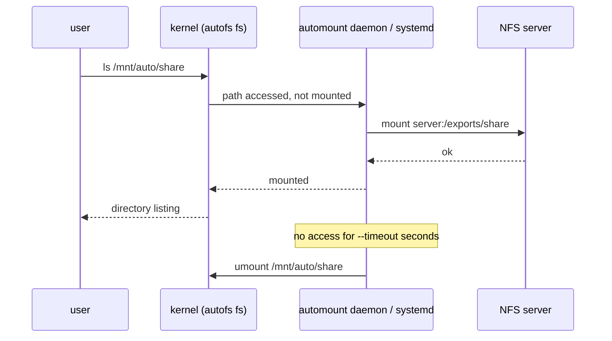

# Filesystem Automounters

<!-- nav:start -->
> **Module 05 · Storage** — lesson 8 of 9  
> [Module index](README.md) · [Course lesson (commands)](../../course/05-Storage.md#lesson-8---automounters-gap) · [Exercises for this lesson](../../exercises/05-storage/08-automounters.md)
<!-- nav:end -->

Mounting every network share at boot has drawbacks: boot slows down or fails when a server is unreachable, idle mounts consume resources, and hundreds of user home directories can't all be listed in `/etc/fstab`. **Automounters** solve this by mounting a filesystem only when someone accesses its path, and unmounting it after a period of inactivity. In this lesson you will learn the two automounters on modern Linux: **autofs** and **systemd automount**.

## What you will learn

- How automounting works (trigger → mount → idle timeout → unmount)
- autofs: master map, direct and indirect maps, options, wildcard maps
- Automounting NFS home directories
- systemd automount via fstab options or `.automount` units
- Troubleshooting and choosing between them

---

## Key terms

| Term | Definition |
|------|-----------|
| **Automounter** | A service that mounts a filesystem on first access and unmounts it when idle. |
| **autofs** | The classic Linux automounter (`automount` daemon + kernel autofs filesystem). |
| **Master map** | `/etc/auto.master` (+ `/etc/auto.master.d/*.autofs`): lists mount points and their map files. |
| **Map** | A file describing what to mount: keys, options and locations. |
| **Indirect map** | The master map names a **parent directory**; map keys become subdirectories (`/mnt/auto/share`). |
| **Direct map** | Map entries are **absolute paths** (`/-` in the master map). |
| **Wildcard map** | A map with `*` key and `&` substitution, matching any subdirectory name. |
| **Idle timeout** | Time without access after which the filesystem is unmounted. |

---

## How it works



The first access takes a moment; afterwards it behaves like a normal mount.

---

## autofs

### Install and enable

```console
$ sudo apt install autofs        # or: sudo dnf install autofs
$ sudo systemctl enable --now autofs
```

### The master map

```text
# /etc/auto.master  (or a file in /etc/auto.master.d/ ending in .autofs)
# mount point   map file          options
/mnt/auto       /etc/auto.nfs     --timeout=60
/home/remote    /etc/auto.home    --timeout=300
/-              /etc/auto.direct
```

Using drop-in files keeps your changes separate from the package's `auto.master`:

```console
$ echo "/mnt/auto /etc/auto.nfs --timeout=60" | sudo tee /etc/auto.master.d/nfs.autofs
```

### Indirect maps

The master map names the parent directory (`/mnt/auto`); **autofs creates and manages it** – don't create subdirectories yourself. Each map line is: **key**, **options**, **location**.

```text
# /etc/auto.nfs
# key     options                 location
share     -rw,sync                deb1:/exports/share
ro        -ro                     deb1:/exports/ro
iso       -fstype=iso9660,ro      :/srv/isos/rocky.iso
usb       -fstype=ext4            :/dev/disk/by-label/BACKUP
```

- `-fstype=nfs4`, `-fstype=ext4`… (NFS is the default).
- For local devices, the location starts with `:` (no host).

```console
$ sudo systemctl reload autofs
$ ls /mnt/auto                   # empty: nothing is mounted yet (keys appear only when accessed*)
$ ls /mnt/auto/share             # triggers the mount
report.txt  data/
$ findmnt /mnt/auto/share
TARGET          SOURCE              FSTYPE OPTIONS
/mnt/auto/share deb1:/exports/share nfs4   rw,relatime,vers=4.2,…
```

*Add `--ghost` (or `browse` in `/etc/autofs.conf`) to the master map line to show the keys as empty directories before they're mounted – friendlier for users with `ls`.

### Wildcard maps: home directories

One line can serve every user:

```text
# /etc/auto.master.d/home.autofs
/home/remote   /etc/auto.home   --timeout=300

# /etc/auto.home
*   -rw,sync   deb1:/exports/home/&
```

Accessing `/home/remote/ana` mounts `deb1:/exports/home/ana`; `&` is replaced by the key (`ana`). Combined with LDAP accounts whose home is `/home/remote/<user>`, this gives users their home directory on any machine.

### Direct maps

When the mount point must be a specific absolute path:

```text
# master: /-   /etc/auto.direct
# /etc/auto.direct
/srv/shared    -rw   deb1:/exports/share
```

### Inspecting and debugging

```console
$ sudo automount -m               # dump the maps autofs has loaded
$ journalctl -u autofs -f         # watch while accessing a path
$ sudo systemctl stop autofs; sudo automount -f -v    # run in foreground with verbose output
```

Global settings (timeouts, browse mode, logging): `/etc/autofs.conf`.

---

## systemd automount

systemd has a built-in automounter. The simplest way is two options in `/etc/fstab`:

```text
deb1:/exports/share  /mnt/share  nfs  noauto,x-systemd.automount,x-systemd.idle-timeout=60,_netdev  0 0
```

| Option | Meaning |
|--------|---------|
| `x-systemd.automount` | create an automount unit for this mount point |
| `noauto` | don't mount at boot – only on access |
| `x-systemd.idle-timeout=60` | unmount after 60 s idle |
| `x-systemd.mount-timeout=10` | give up if the mount takes too long |
| `_netdev` | network filesystem |

Apply:

```console
$ sudo systemctl daemon-reload
$ sudo systemctl restart remote-fs.target      # or: systemctl start mnt-share.automount
$ systemctl list-units --type=automount
UNIT               LOAD   ACTIVE SUB     DESCRIPTION
mnt-share.automount loaded active waiting /mnt/share
$ ls /mnt/share                                 # triggers mnt-share.mount
$ systemctl status mnt-share.mount
```

`findmnt /mnt/share` shows two entries once mounted: the `autofs` trigger and the real `nfs4` mount.

### Writing units by hand

The unit names must match the path (`systemd-escape -p /mnt/share` → `mnt-share`):

```ini
# /etc/systemd/system/mnt-share.mount
[Unit]
Description=Lab NFS share
[Mount]
What=deb1:/exports/share
Where=/mnt/share
Type=nfs
Options=_netdev
```

```ini
# /etc/systemd/system/mnt-share.automount
[Unit]
Description=Automount lab NFS share
[Automount]
Where=/mnt/share
TimeoutIdleSec=60
[Install]
WantedBy=multi-user.target
```

```console
$ sudo systemctl daemon-reload && sudo systemctl enable --now mnt-share.automount
```

Enable the **`.automount`**, not the `.mount`.

---

## autofs or systemd?

| | autofs | systemd automount |
|--|--------|-------------------|
| Extra package | yes (`autofs`) | no |
| Config | master map + map files | fstab options or units |
| Wildcard / many entries (`*` + `&`) | **yes** | no – one unit per path |
| Maps from LDAP/NIS | yes | no |
| Best for | home directories, many dynamic mounts | a few fixed mounts |

---

## Troubleshooting

| Symptom | Check |
|---------|-------|
| Path doesn't exist / no mount | autofs running? `systemctl status autofs`; master map line loaded (`automount -m`)? reloaded after edits? |
| "No such file or directory" for the key | typo in the key, or wildcard not configured |
| Mount fails | test the same mount manually (`mount -t nfs deb1:/exports/share /mnt/test`); then NFS troubleshooting |
| Created a directory under the autofs parent | not allowed – autofs owns that directory |
| systemd automount never triggers | `daemon-reload`; enabled the `.automount` unit; unit name matches path |

---

## Try it yourself

1. With autofs, make `deb1:/exports/share` available at `/mnt/auto/share` with a 60 s timeout. Access it, check `findmnt`, wait, and see it unmounted.
2. Add `--ghost` and compare `ls /mnt/auto` before access.
3. Create `/exports/home/ana` and `/exports/home/luis` on the server; configure a wildcard map at `/home/remote`.
4. Replace the first setup with a systemd automount line in `/etc/fstab` at `/mnt/share`.
5. Stop the NFS server and reboot the client – does it boot normally?

---

## Common mistakes

- Forgetting to reload autofs after editing maps.
- A master-map drop-in without the `.autofs` extension (ignored).
- Creating directories inside an autofs-managed parent.
- Enabling `mnt-share.mount` instead of `mnt-share.automount`.
- Missing `noauto` – the filesystem is then also mounted at boot.

---

## Summary

| Task | autofs | systemd |
|------|--------|---------|
| Define | `/etc/auto.master.d/x.autofs`: `/parent /etc/auto.x --timeout=60` | fstab: `noauto,x-systemd.automount,x-systemd.idle-timeout=60` |
| Map entry | `key -options server:/path` | – |
| Wildcard | `* -rw server:/exports/home/&` | – |
| Apply | `systemctl reload autofs` | `daemon-reload` + `restart remote-fs.target` |
| Check | `automount -m`, `findmnt`, `journalctl -u autofs` | `systemctl list-units --type=automount` |

## Check yourself

1. In an indirect map, what does the key become?
2. What does `&` mean in `* -rw server:/home/&`?
3. Which two fstab options create a systemd automount that does not mount at boot?
4. Why use an automounter for NFS home directories instead of fstab?

<details>
<summary>Answers</summary>

1. The name of a subdirectory under the parent mount point from the master map.
2. It's replaced by the key that was accessed (e.g. the user name).
3. `noauto` and `x-systemd.automount` (plus usually `x-systemd.idle-timeout=`).
4. One wildcard line covers every user, mounts happen only when needed, and an unreachable server doesn't block boot.

</details>

## Further reading

- `man 5 auto.master`, `man 5 autofs`, `man 8 automount`, `man 5 autofs.conf`, `man 5 systemd.automount`, `man 8 systemd-fstab-generator`
- [ArchWiki: Autofs](https://wiki.archlinux.org/title/Autofs) · [fstab – Automount with systemd](https://wiki.archlinux.org/title/Fstab#Automount_with_systemd)
- [Red Hat: Mounting file systems on demand (RHEL 9)](https://docs.redhat.com/en/documentation/red_hat_enterprise_linux/9/html/managing_file_systems/mounting-file-systems-on-demand_managing-file-systems)

---

<!-- footer:start -->
[← Network Block Devices and iSCSI](07-network-block-devices.md) · [Module index](README.md) · [Monitoring Storage Performance →](09-storage-performance.md)  
**Practice now:** [Exercises – Filesystem Automounters](../../exercises/05-storage/08-automounters.md)
<!-- footer:end -->
