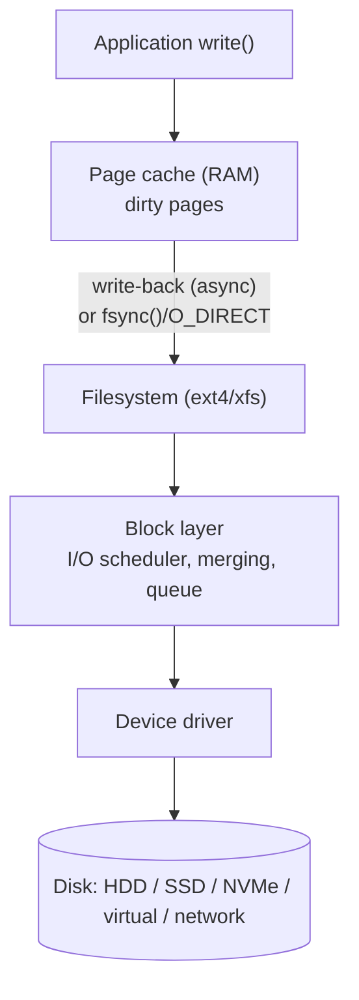

# Monitoring Storage Performance

<!-- nav:start -->
> **Module 05 · Storage** — lesson 9 of 9  
> [Module index](README.md) · [Course lesson (commands)](../../course/05-Storage.md#lesson-9---storage-performance-gap) · [Exercises for this lesson](../../exercises/05-storage/09-storage-performance.md)
<!-- nav:end -->

Storage is the slowest component in most servers, so it is often the real cause of "the system is slow". The LFCS objective *"Monitor storage performance"* asks you to measure how busy disks are, how long requests take, and which processes generate the load. In this lesson you will learn the metrics that matter, the tools to read them, and how the kernel's I/O path and schedulers affect performance.

## What you will learn

- The I/O path from an application to the disk
- Key metrics: IOPS, throughput, latency, queue depth, utilization
- `iostat`, `vmstat`, `iotop`, `pidstat`, `sar -d`, `/proc/diskstats`
- Finding the processes doing I/O
- I/O schedulers and `ionice`
- Measuring a disk with `dd` and `fio`
- A method to diagnose storage bottlenecks

---

## Key terms

| Term | Definition |
|------|-----------|
| **IOPS** | I/O operations per second (reads + writes). |
| **Throughput (bandwidth)** | Data transferred per second (MB/s). |
| **Latency** | Time to complete one I/O request; `await` in iostat (includes queue time). |
| **Queue depth** | Number of requests waiting or in flight (`aqu-sz`). |
| **Utilization (`%util`)** | Percentage of time the device had at least one request in progress. |
| **Sequential / random I/O** | Reading/writing contiguous blocks vs scattered blocks. Random I/O is much slower on HDDs. |
| **Page cache / write-back** | Writes go to RAM first and are flushed to disk later by the kernel. |
| **I/O scheduler** | Kernel component that orders and merges requests before sending them to the device. |
| **iowait** | CPU idle time while processes wait for I/O. |

---

## The I/O path



- Most writes return as soon as data is in the **page cache**; the kernel writes it later. That's why a `cp` finishes fast and then `sync` takes a while.
- Reads are served from the page cache when possible – the second read of a file is fast.
- Performance problems appear when the device can't keep up: requests **queue** in the block layer, **latency** rises, processes wait in `D` state, and **iowait** grows.

### Typical device characteristics

| Device | Random IOPS | Sequential MB/s | Latency |
|--------|------------|-----------------|---------|
| 7200 rpm HDD | 75–150 | 150–250 | 5–15 ms |
| SATA SSD | 50k–100k | ~550 | 0.05–0.2 ms |
| NVMe SSD | 200k–1M+ | 2000–7000+ | 0.02–0.1 ms |
| Network/cloud volume | provisioned limits | provisioned limits | 0.5–5 ms |

---

## iostat – the main tool

From the **sysstat** package.

```console
$ iostat -xz 1 3            # -x extended, -z hide idle devices, 1-second interval, 3 reports
avg-cpu:  %user %nice %system %iowait  %steal   %idle
           4.10  0.00    3.20   38.50    0.00   54.20

Device   r/s    w/s   rkB/s    wkB/s  rrqm/s wrqm/s r_await w_await aqu-sz rareq-sz wareq-sz  %util
vda     5.00 420.00   80.00 53760.00    0.00  12.00    0.80   46.30  19.45    16.00   128.00  99.60
vdb     0.00   2.00    0.00     8.00    0.00   0.00    0.00    0.50   0.00     0.00     4.00   0.20
```

The first report shows averages since boot – read the later ones.

| Column | Meaning | Look for |
|--------|---------|----------|
| `r/s`, `w/s` | read / write IOPS | compared to device capability |
| `rkB/s`, `wkB/s` | throughput | near device limit? |
| `rrqm/s`, `wrqm/s` | requests merged per second | sequential workloads merge a lot |
| `r_await`, `w_await` | average latency (ms), incl. queueing | **rising latency = saturation** |
| `aqu-sz` | average queue length | > 1 for a single HDD = waiting |
| `rareq-sz`, `wareq-sz` | average request size (KiB) | small = random I/O |
| `%util` | time busy | ~100% on an HDD = saturated (less meaningful for SSD/NVMe/RAID which work in parallel) |

Interpretation of the example: `vda` handles 420 writes/s of ~128 KiB, each waiting 46 ms with ~19 requests queued and 99.6% utilization – **saturated by writes**. CPU shows 38.5% iowait.

Other forms: `iostat -dx sda 2` (one device), `iostat -p ALL` (partitions), `iostat -N` (device-mapper names like `vg01-lv_web`), `iostat -m` (MB).

---

## Which process is doing I/O?

```console
$ sudo iotop -o -P               # -o only active, -P processes (not threads)
Total DISK READ:   0.00 B/s | Total DISK WRITE:  52.10 M/s
    PID  PRIO  USER   DISK READ  DISK WRITE  SWAPIN     IO>    COMMAND
   4410 be/4   root    0.00 B/s   51.90 M/s  0.00 %  97.12 %  tar -czf /backup/home.tgz /home
$ pidstat -d 1 3                 # kB_rd/s kB_wr/s per process (sysstat)
$ sudo cat /proc/4410/io         # cumulative read_bytes / write_bytes of a process
```

---

## Other views

```console
$ vmstat 1                       # b (blocked processes), bi/bo (blocks in/out), wa (iowait)
$ sar -d -p 1 3                  # like iostat, plus history: sar -d (today)
$ cat /proc/diskstats            # raw counters used by all these tools
$ cat /proc/pressure/io          # Pressure Stall Information: % time tasks stalled on I/O
some avg10=32.15 avg60=20.40 avg300=8.11 total=91827361
full avg10=25.02 avg60=15.30 avg300=6.02 total=70122918
$ ps -eo pid,stat,cmd | awk '$2 ~ /D/'     # processes stuck waiting for I/O
```

Look at the **filesystem level** too: a full filesystem or one with many small files (`df -h`, `df -i`) behaves badly.

---

## I/O schedulers

The block layer can reorder and merge requests. Each device has a scheduler:

```console
$ cat /sys/block/vda/queue/scheduler
[mq-deadline] kyber bfq none
```

| Scheduler | Best for |
|-----------|---------|
| `none` | NVMe and fast SSDs (device does its own scheduling); many VMs |
| `mq-deadline` | general default for SATA SSD/HDD, servers |
| `bfq` | desktops, fairness between processes; HDDs with mixed loads |
| `kyber` | fast devices, latency targets |

Change at runtime: `echo bfq | sudo tee /sys/block/vda/queue/scheduler`. Make it persistent with a udev rule, e.g.:

```text
# /etc/udev/rules.d/60-scheduler.rules
ACTION=="add|change", KERNEL=="sd[a-z]", ATTR{queue/rotational}=="1", ATTR{queue/scheduler}="bfq"
```

`/sys/block/<dev>/queue/rotational` = 1 means HDD, 0 SSD.

### ionice

Give a process a lower (or higher) I/O priority – respected by `bfq` (and partially others):

```console
$ ionice -c3 tar -czf /backup/home.tgz /home     # idle class: only uses the disk when no one else does
$ sudo ionice -c2 -n7 -p 4410                    # best-effort, lowest priority, for a running process
$ ionice -p 4410
best-effort: prio 7
```

---

## Measuring a disk

### Quick test with dd

```console
$ dd if=/dev/zero of=/data/test.img bs=1M count=1024 oflag=direct status=progress    # sequential write, bypass cache
1073741824 bytes (1.1 GB, 1.0 GiB) copied, 4.21 s, 255 MB/s
$ sync; echo 3 | sudo tee /proc/sys/vm/drop_caches
$ dd if=/data/test.img of=/dev/null bs=1M iflag=direct                               # sequential read
$ rm /data/test.img
```

Without `oflag=direct` you measure the page cache, not the disk.

### Realistic tests with fio

```console
$ sudo apt install fio     # or dnf install fio
$ fio --name=randread --filename=/data/fio.test --size=1G --rw=randread --bs=4k \
      --iodepth=32 --ioengine=libaio --direct=1 --runtime=30 --time_based --group_reporting
  read: IOPS=48.2k, BW=188MiB/s (198MB/s)
    clat percentiles (usec): 50.00th=[  594], 99.00th=[ 1336]
```

Never point write tests at a device that holds data (`--filename=/dev/sdb` overwrites it).

---

## A diagnosis method

1. **Is it storage?** `vmstat 1`: high `wa`, `b` > 0; `cat /proc/pressure/io`.
2. **Which device?** `iostat -xz 1`: latency (`await`) and queue (`aqu-sz`) high, `%util` near 100.
3. **Which process?** `iotop -o`, `pidstat -d 1`.
4. **What kind of I/O?** request size (`rareq-sz`/`wareq-sz`), reads vs writes, random vs sequential.
5. **Act**: reschedule or `ionice` the job, fix the application (e.g. excessive `fsync`, logging), move data to faster storage or spread it (LVM striping, separate disks), add RAM for caching.

---

## Try it yourself

1. Run `iostat -xz 1` while writing a 2 GiB file with `dd … oflag=direct`; note `w/s`, `wkB/s`, `w_await`, `%util`.
2. Identify the `dd` process in `iotop -o` and with `pidstat -d 1`.
3. Repeat the write with `ionice -c3` while a second `dd` read runs; compare.
4. Check which scheduler your disks use and whether they are rotational.
5. Compare `dd` write speed with and without `oflag=direct`.

---

## Summary

| Question | Tool / metric |
|----------|---------------|
| Is I/O the bottleneck? | `vmstat` (`wa`, `b`), `/proc/pressure/io`, `top` (`wa`) |
| Which disk, how bad? | `iostat -xz 1`: `await`, `aqu-sz`, `%util`, IOPS, kB/s |
| Which process? | `iotop -o`, `pidstat -d`, `/proc/PID/io` |
| History | `sar -d` |
| Scheduler | `/sys/block/DEV/queue/scheduler` |
| Lower a job's I/O priority | `ionice -c3`, `ionice -c2 -n7 -p PID` |
| Benchmark | `dd … oflag=direct`, `fio` |

## Check yourself

1. Which `iostat` columns show latency and queueing?
2. Why can `%util` = 100% be fine for an NVMe drive but bad for an HDD?
3. What does `oflag=direct` change in a `dd` test?
4. Which scheduler is usually best for NVMe devices?

<details>
<summary>Answers</summary>

1. `r_await`/`w_await` (latency) and `aqu-sz` (queue).
2. NVMe processes many requests in parallel, so "busy all the time" doesn't mean saturated; an HDD serves one request at a time.
3. It bypasses the page cache, so you measure the device instead of RAM.
4. `none`.

</details>

## Further reading

- `man 1 iostat`, `man 8 iotop`, `man 1 pidstat`, `man 1 ionice`, `man 1 fio`
- [Brendan Gregg: Linux Performance – disk I/O](https://www.brendangregg.com/linuxperf.html)
- [Linux kernel: Block layer / I/O schedulers](https://docs.kernel.org/block/index.html) · [PSI – Pressure Stall Information](https://docs.kernel.org/accounting/psi.html)
- [ArchWiki: Improving performance – Storage devices](https://wiki.archlinux.org/title/Improving_performance#Storage_devices)

---

<!-- footer:start -->
[← Filesystem Automounters](08-automounters.md) · [Module index](README.md)  
**Practice now:** [Exercises – Monitoring Storage Performance](../../exercises/05-storage/09-storage-performance.md)
<!-- footer:end -->
