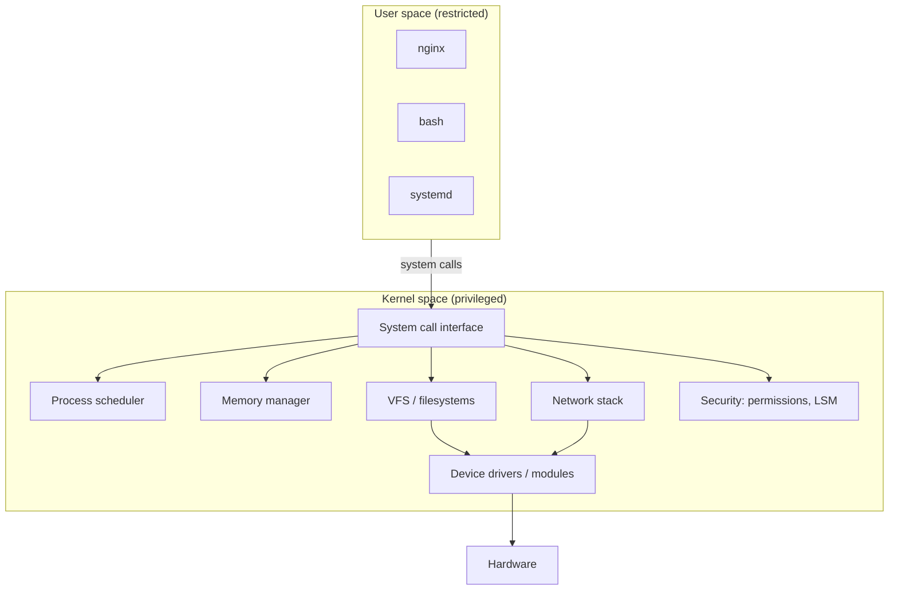

# The Kernel and Boot Parameters

<!-- nav:start -->
> **Module 06 · Kernel, Modules & Devices** — lesson 1 of 4  
> [Module index](README.md) · [Course lesson (commands)](../../course/06-Kernel-Modules-Devices.md#lesson-1---kernel-information--boot-parameters-ch-24) · [Exercises for this lesson](../../exercises/06-kernel-devices/01-kernel-boot-parameters.md)
<!-- nav:end -->

The **kernel** is the core of Linux: it manages the CPU, memory, devices, filesystems, networking and security, and every program depends on it. In this lesson you will learn what the kernel does, how it's packaged and booted, how to find information about the running kernel, and how to pass **boot parameters** to it – temporarily from the GRUB menu and permanently through GRUB configuration.

## What you will learn

- Kernel space vs user space and system calls
- Kernel versions and the files in `/boot`
- The role of the initramfs
- Reading kernel information (`uname`, `/proc`, `dmesg`, `journalctl -k`)
- Kernel command-line parameters: temporary and persistent changes
- `grubby` (RHEL) and `/etc/default/grub` + `update-grub`/`grub2-mkconfig`
- Managing installed kernels

---

## Key terms

| Term | Definition |
|------|-----------|
| **Kernel** | The privileged program that controls hardware and provides services (system calls) to all other programs. |
| **Kernel space / user space** | CPU privilege levels: the kernel runs with full access; programs run restricted. |
| **System call** | A request from a program to the kernel (`open`, `read`, `fork`, `socket`…). |
| **Monolithic, modular kernel** | Linux runs as one program in one address space, but most drivers are **loadable modules**. |
| **vmlinuz** | The compressed kernel image in `/boot`. |
| **initramfs / initrd** | A small initial filesystem loaded with the kernel, containing drivers and tools needed to mount the real root filesystem. |
| **Kernel command line** | Parameters passed by the bootloader to the kernel at boot (`root=`, `quiet`, `rd.break`…). |
| **GRUB2** | The bootloader on most Linux systems; it loads the kernel and initramfs and passes the command line. |
| **dmesg / kernel ring buffer** | The kernel's in-memory log of messages since boot. |

---

## Kernel space and user space



Even root's processes run in user space and must ask the kernel through system calls. A bug in a program crashes that program; a bug in the kernel (or a module) can crash the whole machine (**kernel panic** or **oops**).

---

## Kernel versions and files

```console
$ uname -r                       # running kernel release
5.14.0-503.14.1.el9_5.x86_64
$ uname -a                       # everything: name, host, release, build date, arch
$ cat /proc/version
$ hostnamectl | grep -i kernel
```

`6.8.0-45-generic` reads as upstream **6.8.0** + Ubuntu build **45** + flavour **generic**. `5.14.0-503.14.1.el9_5` is RHEL 9.5's build of upstream 5.14 (with many backported features and fixes).

```console
$ ls /boot
config-6.8.0-45-generic      initrd.img-6.8.0-45-generic   System.map-6.8.0-45-generic   vmlinuz-6.8.0-45-generic
config-6.8.0-41-generic      initrd.img-6.8.0-41-generic   System.map-6.8.0-41-generic   vmlinuz-6.8.0-41-generic
grub/   efi/
```

| File | Content |
|------|---------|
| `vmlinuz-<ver>` | compressed kernel |
| `initrd.img-<ver>` (Debian) / `initramfs-<ver>.img` (RHEL) | initial RAM filesystem |
| `config-<ver>` | the build configuration (`CONFIG_EXT4_FS=y` built in, `=m` module) |
| `System.map-<ver>` | kernel symbol table (debugging) |
| `/lib/modules/<ver>/` | the modules for that kernel |
| `/boot/grub/` or `/boot/grub2/` | GRUB files; `/boot/loader/entries/` on RHEL (BLS) |

Package managers keep **several kernels** installed (Ubuntu typically 2, RHEL `installonly_limit=3` in `dnf.conf`) so you can boot an older one from the GRUB menu if an update breaks something.

### Why an initramfs?

To mount the root filesystem, the kernel may need drivers (disk controller, NVMe, virtio), LVM, RAID or LUKS decryption – but those live **on** the root filesystem. The initramfs is a compressed cpio archive loaded into RAM by the bootloader with the kernel; it contains just enough to find and mount the real root, then hands over to `/sbin/init` (systemd).

```console
$ lsinitramfs /boot/initrd.img-$(uname -r) | head     # Debian/Ubuntu
$ lsinitrd | head                                     # RHEL (dracut)
$ sudo update-initramfs -u                            # rebuild (Debian)
$ sudo dracut -f                                      # rebuild for the running kernel (RHEL)
```

Rebuild it after changing storage drivers, module options needed at boot, `/etc/crypttab`, or a module blacklist that must apply early.

---

## Kernel messages

```console
$ sudo dmesg -T | tail -5               # ring buffer with human-readable timestamps
[Tue Oct 21 09:01:02 2026] virtio_net virtio0 enp1s0: renamed from eth0
[Tue Oct 21 09:01:05 2026] EXT4-fs (vda2): mounted filesystem with ordered data mode.
$ sudo dmesg -l err,warn                # only errors and warnings
$ sudo dmesg -w                         # follow
$ journalctl -k                         # kernel messages of this boot (persistent journal: also -b -1)
$ journalctl -k -p err
```

---

## The kernel command line

The bootloader passes parameters to the kernel. Some are for the kernel itself, some for the initramfs (`rd.*`), some for systemd (`systemd.*`).

```console
$ cat /proc/cmdline
BOOT_IMAGE=(hd0,gpt2)/vmlinuz-5.14.0-503.14.1.el9_5.x86_64 root=/dev/mapper/rl-root ro crashkernel=1G-4G:192M rd.lvm.lv=rl/root rd.lvm.lv=rl/swap rhgb quiet
```

### Useful parameters

| Parameter | Effect |
|-----------|--------|
| `root=` | root filesystem device |
| `ro` / `rw` | mount root read-only (then systemd remounts rw after fsck) / read-write |
| `quiet`, `rhgb`, `splash` | less output / graphical boot |
| `systemd.unit=rescue.target` | boot into rescue mode (also `emergency.target`, or just `single`, `1`) |
| `rd.break` | stop inside the initramfs before switching to the real root (RHEL password reset) |
| `init=/bin/bash` | run bash as PID 1 instead of systemd |
| `selinux=0`, `enforcing=0` | disable SELinux / boot permissive |
| `net.ifnames=0 biosdevname=0` | old-style `eth0` interface names |
| `nomodeset` | don't use kernel graphics drivers |
| `mem=2G` | limit usable RAM |
| `fsck.mode=force` | force filesystem checks at boot |
| `module.option=value` / `modprobe.blacklist=mod` | module options / blacklist at boot |
| `console=ttyS0,115200` | send console to a serial port |
| `crashkernel=` | reserve memory for kdump |

---

## Temporary changes: the GRUB menu

Perfect for rescue and testing – nothing is saved:

1. Reboot; when the GRUB menu appears (press `Esc` or hold `Shift` if it's hidden), select the entry.
2. Press **`e`** to edit.
3. Find the line starting with **`linux`** (or `linux16`/`linuxefi`) and append parameters at its end.
4. Press **`Ctrl+X`** (or `F10`) to boot.

```text
linux ($root)/vmlinuz-5.14.0-503… root=/dev/mapper/rl-root ro rhgb quiet systemd.unit=rescue.target
```

Rescue procedures that use this are in [System Rescue](../09-backup-rescue/04-system-rescue.md).

---

## Persistent changes

### RHEL family: grubby

RHEL 8+ uses **Boot Loader Specification** entries (`/boot/loader/entries/*.conf`), managed by `grubby`:

```console
$ sudo grubby --info=DEFAULT
index=0
kernel="/boot/vmlinuz-5.14.0-503.14.1.el9_5.x86_64"
args="ro crashkernel=1G-4G:192M rd.lvm.lv=rl/root rd.lvm.lv=rl/swap rhgb quiet"
root="/dev/mapper/rl-root"
$ sudo grubby --update-kernel=ALL --args="net.ifnames=0"          # add to all kernels
$ sudo grubby --update-kernel=ALL --remove-args="rhgb quiet"      # remove
$ sudo grubby --default-kernel                                     # which kernel boots by default
$ sudo grubby --set-default=/boot/vmlinuz-5.14.0-427.el9.x86_64   # change it
```

To also apply to **future** kernels, add the parameter to `GRUB_CMDLINE_LINUX` in `/etc/default/grub` as well (and on RHEL 9 run `grub2-mkconfig -o /boot/grub2/grub.cfg --update-bls-cmdline`).

### Debian/Ubuntu: /etc/default/grub + update-grub

```console
$ sudo vi /etc/default/grub
GRUB_DEFAULT=0
GRUB_TIMEOUT=5
GRUB_CMDLINE_LINUX_DEFAULT="quiet splash"       # normal boots only
GRUB_CMDLINE_LINUX="net.ifnames=0"              # all boots, including recovery
$ sudo update-grub                               # = grub-mkconfig -o /boot/grub/grub.cfg
Generating grub configuration file ...
Found linux image: /boot/vmlinuz-6.8.0-45-generic
done
```

| Variable | Meaning |
|----------|---------|
| `GRUB_DEFAULT` | default entry (`0`, a title, or `saved`) |
| `GRUB_TIMEOUT` | seconds the menu is shown |
| `GRUB_TIMEOUT_STYLE` | `menu`, `hidden`, `countdown` |
| `GRUB_CMDLINE_LINUX` | parameters for all entries |
| `GRUB_CMDLINE_LINUX_DEFAULT` | extra parameters for normal (non-recovery) entries |

On RHEL, the equivalent regeneration command is `grub2-mkconfig -o /boot/grub2/grub.cfg` (the same path on BIOS and UEFI since RHEL 9).

> Never edit `grub.cfg` directly – it's regenerated and your changes are lost.

Verify after a reboot with `cat /proc/cmdline`.

---

## Managing kernels

```console
# RHEL
$ rpm -q kernel                              # installed kernels
$ sudo dnf upgrade kernel                    # install the newest
$ sudo dnf remove --oldinstallonly           # remove old kernels (keeps the running one)
# Debian/Ubuntu
$ dpkg -l 'linux-image*' | grep ^ii
$ sudo apt autoremove                        # removes old kernels
```

A kernel update takes effect only after a **reboot** (`needs-restarting -r` on RHEL, `/var/run/reboot-required` on Ubuntu).

---

## Try it yourself

1. Record the running kernel version, the list of installed kernels and the current kernel command line.
2. List the contents of the initramfs of your running kernel and find the virtio or nvme driver in it.
3. Boot once with `systemd.unit=multi-user.target` added from the GRUB menu (temporary); verify with `cat /proc/cmdline`.
4. Persistently remove `quiet` from the command line on both distributions; reboot and verify.
5. Set the GRUB timeout to 10 seconds.

---

## Common mistakes

- Editing `/boot/grub*/grub.cfg` by hand.
- Changing `/etc/default/grub` and forgetting `update-grub` / `grub2-mkconfig`.
- On RHEL, editing `/etc/default/grub` only – existing kernels keep their BLS arguments (use `grubby`).
- Removing the running kernel.
- Expecting kernel parameters to change at runtime – most only take effect at boot (runtime tunables are `sysctl`, see the [next lesson](02-sysctl.md)).

---

## Summary

| Task | Command |
|------|---------|
| Running kernel | `uname -r`, `cat /proc/version` |
| Kernel messages | `dmesg -T`, `journalctl -k` |
| Current cmdline | `cat /proc/cmdline` |
| One-time parameter | GRUB menu → `e` → append to `linux` line → `Ctrl+X` |
| Persistent (RHEL) | `grubby --update-kernel=ALL --args="…"` |
| Persistent (Debian) | `/etc/default/grub` → `update-grub` |
| Rebuild initramfs | `dracut -f` / `update-initramfs -u` |

## Check yourself

1. Why does root still use system calls?
2. What problem does the initramfs solve?
3. How do you boot into rescue mode once, without changing configuration?
4. On RHEL, which command adds a parameter to every installed kernel?
5. Which GRUB variable on Ubuntu applies parameters also to recovery entries?

<details>
<summary>Answers</summary>

1. All programs, including root's, run in user space; only the kernel can access hardware directly.
2. It provides the drivers and tools needed to mount the root filesystem before the root filesystem is available.
3. In the GRUB menu, press `e`, append `systemd.unit=rescue.target` to the `linux` line and press `Ctrl+X`.
4. `grubby --update-kernel=ALL --args="…"`.
5. `GRUB_CMDLINE_LINUX`.

</details>

## Further reading

- `man 7 bootparam`, `man 8 grubby`, `man 8 dracut`, `man 8 update-initramfs`, `man 1 dmesg`, `man 7 bootup`
- [Kernel admin guide: kernel parameters](https://docs.kernel.org/admin-guide/kernel-parameters.html)
- [GNU GRUB manual – Simple configuration](https://www.gnu.org/software/grub/manual/grub/html_node/Simple-configuration.html)
- [Red Hat: Configuring kernel command-line parameters (RHEL 9)](https://docs.redhat.com/en/documentation/red_hat_enterprise_linux/9/html/managing_monitoring_and_updating_the_kernel/configuring-kernel-command-line-parameters_managing-monitoring-and-updating-the-kernel)
- [ArchWiki: Kernel parameters](https://wiki.archlinux.org/title/Kernel_parameters)

---

<!-- footer:start -->
[Module index](README.md) · [Kernel Parameters with sysctl →](02-sysctl.md)  
**Practice now:** [Exercises – The Kernel and Boot Parameters](../../exercises/06-kernel-devices/01-kernel-boot-parameters.md)
<!-- footer:end -->
