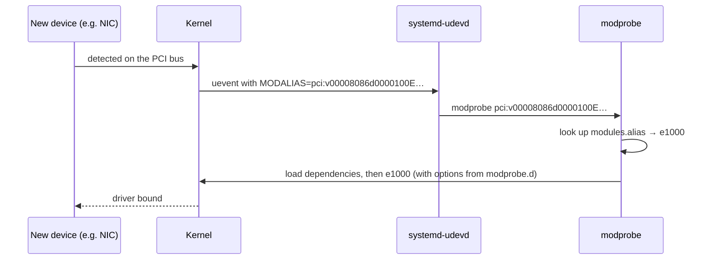

# Kernel Modules

<!-- nav:start -->
> **Module 06 · Kernel, Modules & Devices** — lesson 3 of 4  
> [Module index](README.md) · [Course lesson (commands)](../../course/06-Kernel-Modules-Devices.md#lesson-3---kernel-modules-ch-25) · [Exercises for this lesson](../../exercises/06-kernel-devices/03-kernel-modules.md)
<!-- nav:end -->

Most Linux drivers and many features (filesystems, network protocols, firewall components) are built as **loadable kernel modules**: pieces of code that can be added to and removed from the running kernel. In this lesson you will learn how modules are found and loaded automatically, how to list, inspect, load and unload them, how to pass options, and how to make module configuration permanent – including blacklisting modules you don't want.

## What you will learn

- What modules are and why Linux uses them
- Where modules live; dependencies (`modules.dep`, `depmod`)
- Automatic loading via udev and modaliases
- `lsmod`, `modinfo`, `modprobe`, `modprobe -r` (and why not `insmod`/`rmmod`)
- Module parameters: at load time, at runtime, persistent
- Loading modules at boot (`modules-load.d`)
- Blacklisting and hard-blocking modules (`modprobe.d`)
- Modules and the initramfs; DKMS and signed modules (overview)

---

## Key terms

| Term | Definition |
|------|-----------|
| **Kernel module** | An object file (`.ko`, often compressed `.ko.xz`/`.ko.zst`) that can be linked into the running kernel. |
| **Built-in** | Code compiled directly into the kernel image (`=y` in the config); cannot be unloaded. |
| **Dependency** | A module that must be loaded before another (e.g. `nfs` needs `sunrpc`). |
| **modalias** | An ID string a device announces (PCI vendor/device IDs…) used to find its driver. |
| **Module parameter** | An option that changes a module's behaviour (`max_part=8`). |
| **Blacklist** | Configuration that prevents a module from being loaded **automatically**. |
| **`modprobe`** | The tool that loads/unloads modules with their dependencies and configuration. |
| **DKMS** | *Dynamic Kernel Module Support*: rebuilds third-party modules for each new kernel. |

---

## Why modules?

- A distribution kernel must support thousands of devices; compiling all drivers in would waste memory. Modules are loaded only for hardware that is present.
- Drivers can be updated, reloaded with other options, or removed without rebooting.
- Third-party drivers (GPU, VirtualBox) can be added.

The trade-off: a module runs **in kernel space** with full privileges, so only root can load modules, and secure-boot systems require them to be **signed**.

---

## Where modules live

```console
$ ls /lib/modules/$(uname -r)/
build  kernel  modules.alias  modules.dep  modules.builtin  modules.order  …
$ find /lib/modules/$(uname -r)/kernel -name 'nbd*'
/lib/modules/6.8.0-45-generic/kernel/drivers/block/nbd.ko.zst
$ grep -E 'CONFIG_EXT4_FS=|CONFIG_NBD=' /boot/config-$(uname -r)
CONFIG_EXT4_FS=y                 ← built in
CONFIG_BLK_DEV_NBD=m             ← module
```

- `modules.dep` – dependency list, generated by **`depmod`** (runs automatically when kernels or modules are installed).
- `modules.alias` – maps modaliases to module names.
- `modules.builtin` – what is compiled in (can't be loaded or unloaded).

---

## How modules get loaded automatically



Modules are also loaded **on demand** by the kernel (e.g. mounting an XFS filesystem loads `xfs`, creating a bridge loads `bridge`), and at boot from `/etc/modules-load.d/`.

---

## Listing and inspecting

```console
$ lsmod | head -5
Module                  Size  Used by
nbd                    65536  0
xfs                  2449408  1
nf_tables             372736  245 nft_compat,nft_chain_nat
bridge                417792  1 br_netfilter
```

- **Used by**: count of users and dependent modules. A module with a count > 0 cannot be unloaded.
- `lsmod` reads `/proc/modules`.

```console
$ modinfo nbd
filename:       /lib/modules/6.8.0-45-generic/kernel/drivers/block/nbd.ko.zst
license:        GPL
description:    Network Block Device
depends:
intree:         Y
name:           nbd
parm:           nbds_max:number of network block devices to initialize (default: 16) (int)
parm:           max_part:number of partitions per device (default: 16) (int)
$ modinfo -p nbd              # parameters only
$ modinfo -F depends nfs      # one field
sunrpc,fscache,lockd,netfs
```

Which driver does a device use? `lspci -k`:

```console
$ lspci -k | grep -A3 Ethernet
00:03.0 Ethernet controller: Red Hat, Inc. Virtio network device
        Subsystem: Red Hat, Inc. Device 0001
        Kernel driver in use: virtio-pci
```

---

## Loading and unloading

```console
$ sudo modprobe nbd                       # load with dependencies
$ sudo modprobe nbd max_part=8 nbds_max=4 # with parameters
$ sudo modprobe -r nbd                    # unload (and unused dependencies)
modprobe: FATAL: Module nbd is in use.    ← still used (e.g. a connected device)
$ sudo modprobe -n -v nfs                 # dry run: show what would be loaded
insmod /lib/modules/…/sunrpc.ko.zst
insmod /lib/modules/…/nfs.ko.zst
```

`insmod file.ko` and `rmmod name` are low-level: no dependency resolution, no configuration files. Use **`modprobe`**.

---

## Module parameters

### At load time

`modprobe nbd max_part=8`.

### At runtime

Many parameters are visible – some even writable – under `/sys/module/<name>/parameters/`:

```console
$ cat /sys/module/nbd/parameters/max_part
8
$ ls /sys/module/kvm/parameters/
```

### Persistently: `/etc/modprobe.d/*.conf`

```text
# /etc/modprobe.d/nbd.conf
options nbd max_part=8 nbds_max=4
```

Applied every time the module is loaded (by you, by udev, or at boot). To apply a new option, reload the module (`modprobe -r nbd && modprobe nbd`) or reboot.

For built-in drivers, options must go on the kernel command line: `module.param=value` (e.g. `i915.modeset=0`).

---

## Loading modules at boot

Modules that nothing loads automatically (no hardware trigger) can be listed in **`/etc/modules-load.d/*.conf`**, one per line. `systemd-modules-load.service` loads them at boot.

```console
$ echo nbd | sudo tee /etc/modules-load.d/nbd.conf
$ systemctl status systemd-modules-load
```

(Debian's legacy `/etc/modules` file is also read.)

> **Remember the split:**
> `modules-load.d` → **which** modules to load at boot (names).
> `modprobe.d` → **how** to load them: options, blacklists, aliases.

---

## Blacklisting

Sometimes you want to prevent a module from loading: a buggy driver, a conflicting driver (e.g. `nouveau` vs NVIDIA's), or for security (unused protocols, USB storage).

```text
# /etc/modprobe.d/blacklist-local.conf
blacklist pcspkr
blacklist floppy
```

`blacklist` only stops **automatic** loading by **alias** (udev). It does **not** stop:

- a manual `modprobe pcspkr`,
- loading as a **dependency** of another module.

To block it completely, make `modprobe` run something harmless instead:

```text
install usb-storage /bin/false
install cramfs /bin/true
```

```console
$ sudo modprobe usb-storage
modprobe: ERROR: could not insert 'usb_storage': Operation not permitted
```

Boot-time alternative on the kernel command line: `modprobe.blacklist=floppy,pcspkr`.

### Don't forget the initramfs

If the module is included in the initramfs (storage, graphics drivers), it may load before `/etc/modprobe.d/` on the root filesystem is read. Rebuild the initramfs after blacklisting such a module:

```console
$ sudo dracut -f                # RHEL
$ sudo update-initramfs -u      # Debian/Ubuntu
```

### Check the effective configuration

```console
$ modprobe -c | grep -E '^(blacklist|install|options) ' | head
$ modprobe --showconfig | grep nbd
```

---

## DKMS and module signing (overview)

- Third-party modules (VirtualBox guest additions, some NIC/GPU drivers, ZFS) are often packaged with **DKMS**, which recompiles them automatically when a new kernel is installed: `dkms status`.
- With **UEFI Secure Boot**, the kernel only loads modules signed by a trusted key. Unsigned modules fail with `Key was rejected by service`; you must sign them and enroll the key (MOK).

---

## Try it yourself

1. List loaded modules and find the module with the most users.
2. Show the parameters of `nbd` and the description of `xfs`.
3. Load `nbd` with `max_part=4`, verify in `/sys/module/nbd/parameters/max_part`, unload it.
4. Make `nbd` load at boot with `max_part=4`; reboot and verify.
5. Blacklist `pcspkr` (or `floppy`); verify it's not loaded after a reboot; then try `modprobe pcspkr` – what happens? Hard-block it with `install … /bin/false`.

---

## Common mistakes

- Putting `options` lines in `modules-load.d` or module names in `modprobe.d`.
- Expecting `blacklist` to block manual or dependency loads.
- Using `rmmod`/`insmod` and fighting dependencies manually.
- Forgetting to rebuild the initramfs for early-loaded modules.
- Trying to unload a module that is in use (`Used by` > 0).

---

## Summary

| Task | Command / file |
|------|----------------|
| List | `lsmod` |
| Info / parameters | `modinfo mod`, `modinfo -p mod`, `/sys/module/mod/parameters/` |
| Driver of a device | `lspci -k`, `lsusb -t` |
| Load / unload | `modprobe mod [opt=val]`, `modprobe -r mod` |
| Load at boot | `/etc/modules-load.d/mod.conf` |
| Persistent options | `/etc/modprobe.d/mod.conf`: `options mod opt=val` |
| Prevent auto-load | `/etc/modprobe.d/x.conf`: `blacklist mod` |
| Block completely | `install mod /bin/false` |
| Early-boot modules | rebuild initramfs (`dracut -f`, `update-initramfs -u`) |

## Check yourself

1. What's the difference between `modules-load.d` and `modprobe.d`?
2. You blacklisted `foo`, but it is still loaded after boot. Give two possible reasons.
3. Why prefer `modprobe` over `insmod`?
4. Where can you read the current value of a module parameter?

<details>
<summary>Answers</summary>

1. `modules-load.d` lists modules to load at boot; `modprobe.d` configures how modules are loaded (options, blacklist, install commands).
2. It's a dependency of another module, or it is loaded from the initramfs which wasn't rebuilt (or something loads it explicitly).
3. `modprobe` resolves dependencies and applies the configuration in `modprobe.d`; `insmod` does neither.
4. `/sys/module/<module>/parameters/<param>`.

</details>

## Further reading

- `man 8 modprobe`, `man 5 modprobe.d`, `man 5 modules-load.d`, `man 8 lsmod`, `man 8 modinfo`, `man 8 depmod`
- [ArchWiki: Kernel module](https://wiki.archlinux.org/title/Kernel_module)
- [Red Hat: Managing kernel modules (RHEL 9)](https://docs.redhat.com/en/documentation/red_hat_enterprise_linux/9/html/managing_monitoring_and_updating_the_kernel/managing-kernel-modules_managing-monitoring-and-updating-the-kernel)

---

<!-- footer:start -->
[← Kernel Parameters with sysctl](02-sysctl.md) · [Module index](README.md) · [Devices and udev →](04-devices-udev.md)  
**Practice now:** [Exercises – Kernel Modules](../../exercises/06-kernel-devices/03-kernel-modules.md)
<!-- footer:end -->
