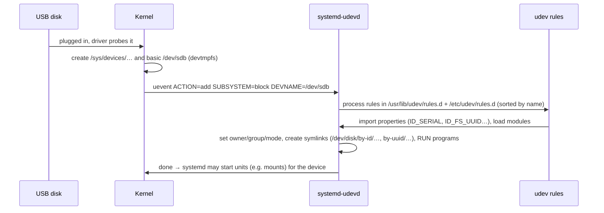

# Devices and udev

<!-- nav:start -->
> **Module 06 · Kernel, Modules & Devices** — lesson 4 of 4  
> [Module index](README.md) · [Course lesson (commands)](../../course/06-Kernel-Modules-Devices.md#lesson-4---devices--udev-ch-26) · [Exercises for this lesson](../../exercises/06-kernel-devices/04-devices-udev.md)
<!-- nav:end -->

Unix represents hardware as **device files** in `/dev`. On modern Linux those files are created dynamically by the kernel and **udev** as devices appear and disappear. udev also gives devices stable names, sets their permissions, loads drivers and can run programs when a device is plugged in. In this lesson you will learn how device files work, how udev processes events, how to inspect devices, and how to write your own udev rules.

## What you will learn

- Block vs character devices, major and minor numbers
- `/dev`, `/sys` and the kernel's device model
- The life of a hotplug event: kernel → uevent → udev → `/dev`
- Persistent names: `/dev/disk/by-*` and predictable network names
- Inspecting devices with `udevadm` and `ls*` tools
- Writing udev rules: match keys, assignment keys, operators
- Testing, reloading and triggering rules

---

## Key terms

| Term | Definition |
|------|-----------|
| **Device file / node** | A special file in `/dev` through which programs talk to a driver. |
| **Block device** | Random-access storage in blocks (disks): `b` in `ls -l`. |
| **Character device** | A byte stream (terminals, serial ports, `/dev/null`, `/dev/random`): `c`. |
| **Major number** | Identifies the driver handling the device. |
| **Minor number** | Identifies the specific device/instance for that driver. |
| **sysfs (`/sys`)** | The kernel's view of every device, bus, driver and their attributes. |
| **uevent** | A kernel notification that a device was added, removed or changed. |
| **udev (`systemd-udevd`)** | The user-space daemon that handles uevents, creates nodes/symlinks, sets permissions and runs rules. |
| **udev rule** | A line in a `.rules` file that matches devices and assigns properties or actions. |
| **devtmpfs** | Kernel filesystem mounted on `/dev`; the kernel creates basic nodes, udev refines them. |

---

## Device files

```console
$ ls -l /dev/vda /dev/vda1 /dev/null /dev/tty1 /dev/random
brw-rw---- 1 root disk 252, 0 Oct 21 09:00 /dev/vda
brw-rw---- 1 root disk 252, 1 Oct 21 09:00 /dev/vda1
crw-rw-rw- 1 root root   1, 3 Oct 21 09:00 /dev/null
crw--w---- 1 root tty    4, 1 Oct 21 09:00 /dev/tty1
crw-rw-rw- 1 root root   1, 8 Oct 21 09:00 /dev/random
```

- First character: `b` block, `c` character.
- Where the size normally is, you see **major, minor**: `252, 1` = virtio block driver, partition 1 of the first disk.
- The **name** doesn't matter to the kernel – only type + major + minor. `mknod /tmp/mynull c 1 3` creates another working `/dev/null`.
- Group ownership controls access: members of `disk` can read raw disks, `dialout` serial ports, `video` GPUs.

Registered majors: `cat /proc/devices`.

### Useful special devices

| Device | Purpose |
|--------|---------|
| `/dev/null` | discards everything written; reads return EOF |
| `/dev/zero` | endless zero bytes |
| `/dev/random`, `/dev/urandom` | random bytes |
| `/dev/tty`, `/dev/pts/N` | terminals |
| `/dev/loopN` | loop devices (files as disks) |
| `/dev/mapper/*` | device-mapper (LVM, LUKS) |
| `/dev/sr0` | CD/DVD |

---

## /sys: the device model

`/sys` organizes everything the kernel knows about hardware:

```console
$ ls /sys/class/            # devices by type
block  net  tty  input  scsi_host  …
$ ls /sys/class/net/
enp1s0  lo
$ cat /sys/class/net/enp1s0/address
52:54:00:3a:1f:9c
$ cat /sys/block/vda/size              # in 512-byte sectors
41943040
$ cat /sys/block/vda/queue/rotational  # 0 = SSD/virtual, 1 = spinning disk
0
$ readlink -f /sys/class/net/enp1s0    # the real device path in the bus hierarchy
/sys/devices/pci0000:00/0000:00:01.0/0000:01:00.0/virtio0/net/enp1s0
```

udev rules match on these **attributes**.

---

## The life of a hotplug event



Watch it live:

```console
$ udevadm monitor --udev --property
monitor will print the received events for:
UDEV - the event which udev sends out after rule processing
UDEV  [1820.3] add      /devices/pci0000:00/…/block/sdb (block)
ACTION=add
DEVNAME=/dev/sdb
ID_BUS=usb
ID_SERIAL=SanDisk_Ultra_4C531001
ID_FS_TYPE=vfat
…
```

---

## Persistent device names

Kernel names like `sdb` depend on detection order. udev creates **stable symlinks**:

```console
$ ls -l /dev/disk/by-id/ | head -3
lrwxrwxrwx 1 root root  9 Oct 21 09:00 virtio-data01 -> ../../vdb
lrwxrwxrwx 1 root root  9 Oct 21 09:00 ata-QEMU_HARDDISK_QM00001 -> ../../sda
$ ls /dev/disk/
by-diskseq  by-id  by-label  by-partlabel  by-partuuid  by-path  by-uuid
```

| Directory | Based on | Stable when |
|-----------|----------|-------------|
| `by-uuid` | filesystem UUID | until re-formatted |
| `by-label` | filesystem label | label unchanged |
| `by-partuuid`, `by-partlabel` | GPT partition GUID / name | partition table unchanged |
| `by-id` | model + serial number | always for that physical disk |
| `by-path` | physical connection (bus/port) | disk in the same slot |

### Network interface names

udev names NICs predictably from firmware and topology:

| Name | Meaning |
|------|---------|
| `eno1` | onboard device index 1 (firmware) |
| `ens3` | PCI Express hotplug slot 3 |
| `enp1s0` | PCI bus 1, slot 0 |
| `enx52540…` | MAC address based |
| `wlp2s0` | wireless, PCI bus 2 slot 0 |

Disable with kernel parameters `net.ifnames=0 biosdevname=0` (back to `eth0`), or rename with a `.link` file / udev rule.

---

## Inspecting devices

```console
$ udevadm info --query=all --name=/dev/vdb      # properties udev knows (E: lines)
P: /devices/pci0000:00/0000:00:08.0/virtio5/block/vdb
N: vdb
S: disk/by-id/virtio-data01
E: DEVNAME=/dev/vdb
E: SUBSYSTEM=block
E: DEVTYPE=disk
E: ID_SERIAL=data01
E: ID_PATH=pci-0000:00:08.0

$ udevadm info --attribute-walk --name=/dev/vdb  # sysfs ATTRS of the device AND all its parents
  looking at device '/devices/pci0000:00/0000:00:08.0/virtio5/block/vdb':
    KERNEL=="vdb"
    SUBSYSTEM=="block"
    ATTR{size}=="10485760"
    ATTR{removable}=="0"
  looking at parent device '/devices/pci0000:00/0000:00:08.0/virtio5':
    KERNELS=="virtio5"
    SUBSYSTEMS=="virtio"
    DRIVERS=="virtio_blk"
    ATTRS{device}=="0x0002"
```

Other inventory tools: `lsblk`, `lspci -nnk`, `lsusb -tv`, `lscpu`, `lsmem`, `dmidecode` (firmware tables), `hwinfo`/`lshw` (if installed).

---

## udev rules

### Where rules live

| Directory | Owner |
|-----------|-------|
| `/usr/lib/udev/rules.d/` (Debian also `/lib/udev/rules.d/`) | packages – don't edit |
| `/etc/udev/rules.d/` | **you** – a file with the same name overrides the vendor one |
| `/run/udev/rules.d/` | runtime |

All files are processed together in **lexical order of their names**. Name your file with a number: lower runs earlier, higher later. Most local rules use `99-` (or `60-`–`90-` when they must run before certain vendor rules). Files must end in **`.rules`**.

### Syntax

One rule per line (continue with `\`), a comma-separated list of **key-operator-value**:

```text
SUBSYSTEM=="block", ENV{ID_SERIAL}=="data01", SYMLINK+="datadisk", GROUP="disk", MODE="0660"
└──────── match keys (==, !=) ────────────┘   └──────── assignment keys (=, +=, :=) ────────┘
```

| Operator | Meaning |
|----------|---------|
| `==` | match equal (glob patterns allowed: `sd*`, `sd[a-z]`) |
| `!=` | match not equal |
| `=` | assign (replace) |
| `+=` | add to a list (SYMLINK, RUN) |
| `-=` | remove from a list |
| `:=` | assign and lock (no later rule may change it) |

### Common match keys

| Key | Matches |
|-----|---------|
| `ACTION` | `add`, `remove`, `change`, `bind` |
| `KERNEL` | kernel name (`sdb`, `vd*`, `ttyUSB0`) |
| `SUBSYSTEM` | `block`, `net`, `tty`, `usb`… |
| `ATTR{file}` | a sysfs attribute of the device itself |
| `KERNELS`, `SUBSYSTEMS`, `DRIVERS`, `ATTRS{file}` | the device **or any parent** – all from the **same** parent within one rule |
| `ENV{KEY}` | a udev property (from `udevadm info` `E:` lines) |

### Common assignment keys

| Key | Effect |
|-----|--------|
| `NAME` | rename (network interfaces only) |
| `SYMLINK+=` | add a symlink in `/dev` |
| `OWNER`, `GROUP`, `MODE` | permissions of the device node |
| `ENV{KEY}=` | set a property (e.g. `ENV{UDISKS_IGNORE}="1"`) |
| `ATTR{file}=` | write a sysfs attribute (e.g. I/O scheduler) |
| `RUN+=` | run a program after processing (must be short; absolute path) |
| `TAG+="systemd"`, `ENV{SYSTEMD_WANTS}=` | let systemd start a unit for the device |

### Examples

```text
# /etc/udev/rules.d/99-local.rules

# 1. A stable name and permissions for a data disk identified by its serial
SUBSYSTEM=="block", ENV{DEVTYPE}=="disk", ENV{ID_SERIAL}=="data01", SYMLINK+="backupdisk", GROUP="backup", MODE="0660"

# 2. Give a USB serial adapter a fixed name and let dialout use it
SUBSYSTEM=="tty", ATTRS{idVendor}=="0403", ATTRS{idProduct}=="6001", SYMLINK+="ttyConsole", GROUP="dialout", MODE="0660"

# 3. Rename a NIC by MAC address
SUBSYSTEM=="net", ACTION=="add", ATTR{address}=="52:54:00:3a:1f:9c", NAME="lan0"

# 4. Run a script (logs, notifications) when a USB disk is added
ACTION=="add", SUBSYSTEM=="block", ENV{ID_BUS}=="usb", ENV{DEVTYPE}=="partition", RUN+="/usr/local/bin/usb-added.sh %k"

# 5. Set the I/O scheduler for rotational disks
ACTION=="add|change", KERNEL=="sd[a-z]", ATTR{queue/rotational}=="1", ATTR{queue/scheduler}="bfq"
```

Substitutions in values: `%k` kernel name, `%n` kernel number, `%p` devpath, `$env{KEY}`.

> `RUN+=` programs are killed after a short time and run in a restricted sandbox – don't mount filesystems or start long jobs there. Use `ENV{SYSTEMD_WANTS}="myjob@%k.service"` with `TAG+="systemd"` to start a systemd service instead.

### Testing and applying

```console
$ sudo udevadm control --reload                      # reload rules files
$ sudo udevadm trigger --name-match=/dev/vdb          # replay "change" events for a device
$ sudo udevadm trigger --subsystem-match=block --action=add
$ sudo udevadm test /sys/class/block/vdb 2>&1 | grep -iE 'symlink|99-local'   # dry-run rule processing
$ ls -l /dev/backupdisk
lrwxrwxrwx 1 root root 3 Oct 21 10:42 /dev/backupdisk -> vdb
$ sudo udevadm verify /etc/udev/rules.d/99-local.rules   # syntax check (systemd ≥ 254)
```

Rules for network names apply only when the interface is (re)created – usually at the next reboot.

---

## Try it yourself

1. Show the type, major and minor numbers of your disks and of `/dev/null`; find the driver name for the disk's major in `/proc/devices`.
2. List every persistent name of your second disk under `/dev/disk/`.
3. Run `udevadm monitor --property` while you attach/detach a loop device (`losetup -f /root/x.img`).
4. Find the serial (`ID_SERIAL`) of your second extra disk and write a rule that creates `/dev/backupdisk` for it with group `disk` and mode `0660`. Apply without rebooting.
5. Write a rule that logs a line to `/var/log/usb.log` whenever any block device is added.

---

## Common mistakes

- Using `ATTRS` from two different parent devices in one rule (never matches).
- Using `=` instead of `==` in match keys (it becomes an assignment).
- Forgetting `udevadm control --reload` and `udevadm trigger`.
- File not ending in `.rules`, or wrong order (your rule overridden by a later file).
- Long-running `RUN+=` programs.
- Trying to rename block devices with `NAME=` – only network interfaces can be renamed; use `SYMLINK+=`.

---

## Summary

| Task | Command / file |
|------|----------------|
| Device type, major/minor | `ls -l /dev/X`, `/proc/devices` |
| Stable names | `/dev/disk/by-{id,uuid,label,path}` |
| Properties | `udevadm info --query=all --name=/dev/X` |
| Attributes (+ parents) | `udevadm info -a -n /dev/X` |
| Watch events | `udevadm monitor --property` |
| Your rules | `/etc/udev/rules.d/NN-name.rules` |
| Apply | `udevadm control --reload && udevadm trigger` |
| Dry run | `udevadm test /sys/class/…` |

## Check yourself

1. What do the major and minor numbers identify?
2. Why is `/dev/disk/by-id/…` better than `/dev/sdb` in a script?
3. What's the difference between `ATTR{}` and `ATTRS{}` in a rule?
4. Which assignment key creates an extra name for a disk?
5. Your new rule doesn't work. Name the two commands you probably forgot.

<details>
<summary>Answers</summary>

1. Major: the driver. Minor: the device instance handled by that driver.
2. `sdb` depends on detection order and can change; `by-id` is derived from the disk's model and serial number.
3. `ATTR{}` matches attributes of the device itself; `ATTRS{}` searches the device and its parents.
4. `SYMLINK+=`.
5. `udevadm control --reload` and `udevadm trigger`.

</details>

## Further reading

- `man 7 udev`, `man 8 udevadm`, `man 5 systemd.link`, `man 4 null`
- [ArchWiki: udev](https://wiki.archlinux.org/title/Udev) · [Persistent block device naming](https://wiki.archlinux.org/title/Persistent_block_device_naming)
- [systemd: Predictable Network Interface Names](https://systemd.io/PREDICTABLE_INTERFACE_NAMES/)
- [Linux kernel: sysfs](https://docs.kernel.org/filesystems/sysfs.html) · [Device numbers (devices.txt)](https://docs.kernel.org/admin-guide/devices.html)
- [Red Hat: Managing storage devices (RHEL 9) – see “Persistent naming attributes”](https://docs.redhat.com/en/documentation/red_hat_enterprise_linux/9/html/managing_storage_devices/index)

---

<!-- footer:start -->
[← Kernel Modules](03-kernel-modules.md) · [Module index](README.md)  
**Practice now:** [Exercises – Devices and udev](../../exercises/06-kernel-devices/04-devices-udev.md)
<!-- footer:end -->
