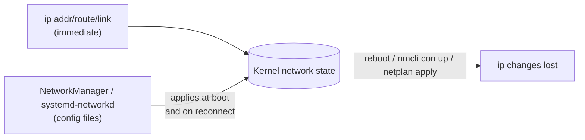

# Runtime Network Configuration with ip

<!-- nav:start -->
> **Module 07 · Networking** — lesson 2 of 11  
> [Module index](README.md) · [Course lesson (commands)](../../course/07-Networking.md#lesson-2---runtime-configuration-with-ip-ch-28) · [Exercises for this lesson](../../exercises/07-networking/02-runtime-ip.md)
<!-- nav:end -->

The `ip` command (package `iproute2`) talks directly to the kernel's networking stack: it shows and changes interfaces, addresses, routes and neighbour tables. Changes made with `ip` take effect **immediately** and are **lost at reboot** (or when a network manager re-applies its configuration). That makes `ip` perfect for inspecting, testing and troubleshooting. Persistent configuration is covered in the [next lesson](03-persistent-config.md).

## What you will learn

- The structure of the `ip` command and its objects
- Reading interfaces, addresses, routes and neighbours
- Bringing interfaces up and down, changing MTU
- Adding and removing IPv4/IPv6 addresses
- Adding and removing routes, checking route decisions
- Statistics and monitoring
- Why net-tools (`ifconfig`, `route`) are obsolete

---

## Key terms

| Term | Definition |
|------|-----------|
| **iproute2** | The package providing `ip`, `ss`, `bridge`, `tc`. |
| **Link** | A network interface at layer 2 (physical NIC, VLAN, bridge, bond, veth). |
| **Address** | An IP address (with prefix) assigned to a link. An interface can have several. |
| **Route** | A rule telling the kernel where to send packets for a destination network. |
| **Neighbour** | An entry in the ARP/NDP cache mapping an IP to a MAC address. |
| **Operational state** | Whether a link is really up: `UP`, `DOWN`, `LOWER_UP` (carrier present), `NO-CARRIER`. |
| **MTU** | *Maximum Transmission Unit*: largest packet size the link carries (usually 1500). |

---

## Command structure

```text
ip [OPTIONS] OBJECT COMMAND [ARGUMENTS]
ip -br      addr   show   dev enp1s0
```

| Object (abbreviation) | Manages |
|-----------------------|---------|
| `link` (`l`) | interfaces |
| `address` (`a`, `addr`) | IP addresses |
| `route` (`r`) | routing table |
| `neigh` (`n`) | ARP/NDP cache |
| `rule` | policy routing rules |
| `monitor` | live events |

Useful options: `-br` brief, `-c` color, `-4`/`-6` one family, `-s` statistics, `-j -p` JSON pretty.

---

## Reading the configuration

```console
$ ip -br link
lo               UNKNOWN        00:00:00:00:00:00 <LOOPBACK,UP,LOWER_UP>
enp1s0           UP             52:54:00:3a:1f:9c <BROADCAST,MULTICAST,UP,LOWER_UP>
enp7s0           DOWN           52:54:00:9e:21:04 <BROADCAST,MULTICAST>

$ ip -br addr
lo               UNKNOWN        127.0.0.1/8 ::1/128
enp1s0           UP             192.168.56.10/24 fd00:56::10/64 fe80::5054:ff:fe3a:1f9c/64
enp7s0           DOWN

$ ip addr show enp1s0
2: enp1s0: <BROADCAST,MULTICAST,UP,LOWER_UP> mtu 1500 qdisc fq_codel state UP group default qlen 1000
    link/ether 52:54:00:3a:1f:9c brd ff:ff:ff:ff:ff:ff
    inet 192.168.56.10/24 brd 192.168.56.255 scope global dynamic noprefixroute enp1s0
       valid_lft 3412sec preferred_lft 3412sec
    inet6 fe80::5054:ff:fe3a:1f9c/64 scope link
```

Reading it:

- Flags `UP` = administratively enabled; `LOWER_UP` = cable/link detected. `UP` without `LOWER_UP` → no carrier.
- `inet` = IPv4, `inet6` = IPv6; `brd` = broadcast; `scope global` = usable for routing, `scope link` = this link only.
- `dynamic` = obtained via DHCP, with a lease time (`valid_lft`).

```console
$ ip route
default via 192.168.56.1 dev enp1s0 proto dhcp src 192.168.56.10 metric 100
192.168.56.0/24 dev enp1s0 proto kernel scope link src 192.168.56.10 metric 100
$ ip -6 route
fd00:56::/64 dev enp1s0 proto kernel metric 100 pref medium
fe80::/64 dev enp1s0 proto kernel metric 1024 pref medium
```

- `default via X` = the default gateway.
- `proto kernel scope link` = a route created automatically for a directly connected subnet when you add an address.

---

## Interfaces: up, down, MTU

```console
$ sudo ip link set enp7s0 up
$ sudo ip link set enp7s0 down
$ sudo ip link set enp7s0 mtu 9000                 # jumbo frames (whole path must support it)
$ sudo ip link set enp7s0 address 02:00:00:00:00:01  # change MAC (interface down first)
$ sudo ip link set enp7s0 name lab0                # rename (interface down)
```

---

## Addresses

```console
$ sudo ip addr add 192.168.100.10/24 dev enp7s0
$ sudo ip addr add 192.168.100.11/24 dev enp7s0           # a second (secondary) address
$ sudo ip addr add fd00:100::10/64 dev enp7s0
$ ip -br addr show enp7s0
enp7s0           UP             192.168.100.10/24 192.168.100.11/24 fd00:100::10/64 fe80::…/64
$ sudo ip addr del 192.168.100.11/24 dev enp7s0
$ sudo ip addr flush dev enp7s0                           # remove all addresses
```

> Always give the **prefix** (`/24`). Without it, `ip` assumes `/32` – the host then has no route to its own subnet.

---

## Routes

```console
$ sudo ip route add 10.10.0.0/16 via 192.168.56.254             # network via a gateway
$ sudo ip route add 10.20.0.0/24 dev enp7s0                     # directly attached network
$ sudo ip route add default via 192.168.56.1                    # default gateway
$ sudo ip route replace default via 192.168.56.2                # change it
$ sudo ip route add 10.30.0.0/16 via 192.168.56.254 metric 50   # with metric
$ sudo ip route del 10.10.0.0/16
$ sudo ip -6 route add 2001:db8:99::/64 via fd00:56::1
```

The gateway (`via`) must be reachable on a directly connected subnet, otherwise: `Error: Nexthop has invalid gateway.`

### Which route will be used?

```console
$ ip route get 10.10.5.5
10.10.5.5 via 192.168.56.254 dev enp1s0 src 192.168.56.10 uid 1000
    cache
$ ip route get 8.8.8.8
8.8.8.8 via 192.168.56.1 dev enp1s0 src 192.168.56.10 uid 1000
```

`ip route get` shows the exact decision: gateway, outgoing interface and source address. Routing logic is explained in [Static Routing](05-static-routing.md).

---

## Neighbours (ARP / NDP)

```console
$ ip neigh
192.168.56.1 dev enp1s0 lladdr 52:54:00:12:35:02 REACHABLE
fe80::1 dev enp1s0 lladdr 52:54:00:12:35:02 router STALE
$ sudo ip neigh flush dev enp1s0          # clear the cache (e.g. after an IP moved to another host)
$ sudo ip neigh add 192.168.56.99 lladdr 52:54:00:aa:bb:cc dev enp1s0   # static entry
```

States: `REACHABLE` (recently confirmed), `STALE` (needs re-check), `FAILED` (no answer – the host is down or not on this link).

---

## Statistics and monitoring

```console
$ ip -s link show enp1s0
    RX:  bytes packets errors dropped  missed   mcast
      98234512   82011      0      12       0     104
    TX:  bytes packets errors dropped carrier collsns
       7231100   41022      0       0       0       0
$ ip monitor                  # live events: link up/down, address changes, routes
$ ethtool enp1s0              # speed, duplex, link detected (physical NICs)
$ ethtool -S enp1s0           # driver statistics
```

Growing `errors` or `dropped` counters point to cabling, duplex mismatches, driver issues or buffer exhaustion.

---

## Why not ifconfig and route?

The old **net-tools** (`ifconfig`, `route`, `arp`, `netstat`) are deprecated and often not installed. They can't show multiple addresses per interface properly and don't know newer kernel features.

| Old | New |
|-----|-----|
| `ifconfig` | `ip addr`, `ip link` |
| `ifconfig eth0 up` | `ip link set eth0 up` |
| `route -n` | `ip route` |
| `arp -n` | `ip neigh` |
| `netstat -tulpn` | `ss -tulpn` |
| `brctl` | `ip link` / `bridge` |

---

## Runtime vs persistent



Use `ip` to test an idea quickly; then write it into the persistent configuration. If a network manager owns the interface, it may overwrite your `ip` changes the next time it reconfigures it (DHCP renewal, reconnect).

---

## Try it yourself

1. Show all interfaces and addresses in brief form; identify which has the default route.
2. On a spare interface, add `192.168.100.10/24` and `fd00:100::10/64`; ping each address.
3. Add a route to `10.99.0.0/24` via the other VM and check it with `ip route get 10.99.0.1`.
4. Bring the spare interface down and observe `ip -br link` and `ip route`.
5. Reboot and confirm that all your changes are gone.

---

## Common mistakes

- Forgetting the prefix length when adding an address.
- Expecting `ip` changes to survive a reboot.
- Adding a route whose gateway isn't on a connected subnet.
- Changing the address of the interface you are connected through over SSH (and locking yourself out). Use the console or `netplan try`.

---

## Summary

| Task | Command |
|------|---------|
| Overview | `ip -br link`, `ip -br addr`, `ip route` |
| Up / down | `ip link set DEV up/down` |
| Add / delete address | `ip addr add IP/PREFIX dev DEV`, `ip addr del …` |
| Add / delete route | `ip route add NET via GW [dev DEV]`, `ip route del NET` |
| Default gateway | `ip route add/replace default via GW` |
| Route decision | `ip route get IP` |
| ARP/NDP cache | `ip neigh`, `ip neigh flush dev DEV` |
| Statistics | `ip -s link`, `ethtool -S DEV` |

## Check yourself

1. What is the difference between the `UP` and `LOWER_UP` flags?
2. What happens if you run `ip addr add 192.168.1.5 dev eth1` without a prefix?
3. Which command shows which interface and gateway will be used for `1.1.1.1`?
4. Are `ip` changes persistent?

<details>
<summary>Answers</summary>

1. `UP`: the interface is administratively enabled. `LOWER_UP`: the physical link (carrier) is detected.
2. The address is added as `/32`, so no route to the 192.168.1.0/24 subnet is created.
3. `ip route get 1.1.1.1`.
4. No – they're lost at reboot or when the network manager reapplies its configuration.

</details>

## Further reading

- `man 8 ip`, `man 8 ip-link`, `man 8 ip-address`, `man 8 ip-route`, `man 8 ip-neighbour`
- [iproute2 cheat sheet (Baturin)](https://baturin.org/docs/iproute2/)
- [ArchWiki: Network configuration](https://wiki.archlinux.org/title/Network_configuration)
- [Red Hat: Configuring and managing networking (RHEL 9)](https://docs.redhat.com/en/documentation/red_hat_enterprise_linux/9/html/configuring_and_managing_networking/index)

---

<!-- footer:start -->
[← Network Addresses: IPv4 and IPv6](01-ip-addressing.md) · [Module index](README.md) · [Persistent Network Configuration: Netplan and NetworkManager →](03-persistent-config.md)  
**Practice now:** [Exercises – Runtime Network Configuration with ip](../../exercises/07-networking/02-runtime-ip.md)
<!-- footer:end -->
