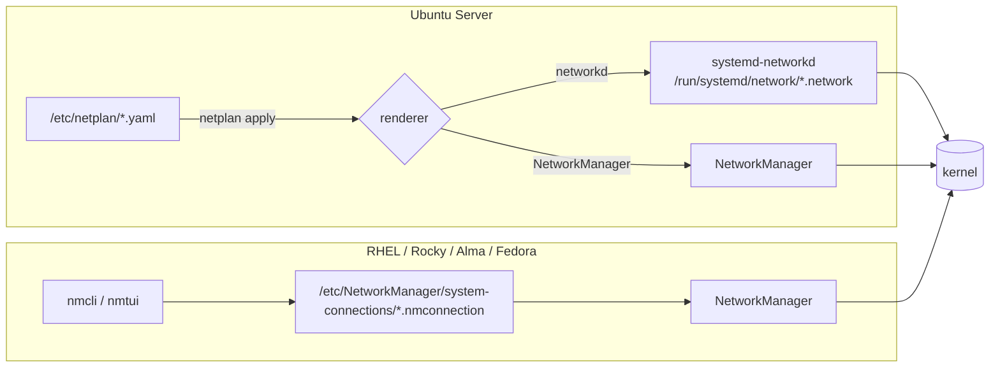

# Persistent Network Configuration: Netplan and NetworkManager

<!-- nav:start -->
> **Module 07 · Networking** — lesson 3 of 11  
> [Module index](README.md) · [Course lesson (commands)](../../course/07-Networking.md#lesson-3---persistent-configuration) · [Exercises for this lesson](../../exercises/07-networking/03-persistent-config.md)
<!-- nav:end -->

Network settings must survive reboots. On modern distributions a **network manager** owns the configuration and applies it at boot: **Netplan** (rendering to systemd-networkd) on Ubuntu Server, and **NetworkManager** (`nmcli`) on the RHEL family and desktops. In this lesson you will learn both, so you can configure static IPv4/IPv6 addresses, gateways, DNS and routes persistently on either family.

## What you will learn

- Who manages the network on each distribution and how to tell
- Netplan: YAML structure, DHCP and static examples, `netplan try/apply`
- NetworkManager concepts: devices and connection profiles
- `nmcli`: show, modify, add, activate and delete connections
- Static IPv4 + IPv6, gateway, DNS, search domains, extra routes
- Where the configuration files live
- `nmtui` and safe practices when working remotely

---

## Key terms

| Term | Definition |
|------|-----------|
| **Network manager** | A daemon that applies and maintains network configuration (NetworkManager, systemd-networkd). |
| **Netplan** | Ubuntu's YAML front-end that *generates* configuration for systemd-networkd or NetworkManager. |
| **Renderer** | The backend Netplan writes config for: `networkd` (servers) or `NetworkManager` (desktops). |
| **systemd-networkd** | systemd's lightweight network daemon (`networkctl`). |
| **NetworkManager** | The network daemon on RHEL/Fedora/desktops; CLI `nmcli`, TUI `nmtui`. |
| **Device** | A network interface as NetworkManager sees it (`enp1s0`). |
| **Connection (profile)** | A named set of settings that can be applied to a device. One device can have several profiles; one is active. |
| **DHCP** | Protocol that hands out addresses, gateway and DNS automatically. |
| **Static configuration** | Address, gateway and DNS set manually (`method manual`). |

---

## Who owns the network?



```console
$ systemctl is-active NetworkManager systemd-networkd
active
inactive
$ ls /etc/netplan/ 2>/dev/null
$ nmcli general status 2>/dev/null
$ networkctl 2>/dev/null
```

> Configure an interface with **one** tool only. Editing a networkd file while NetworkManager manages the device (or vice versa) leads to surprises.

---

## Ubuntu: Netplan

### File basics

- Files: `/etc/netplan/*.yaml`, applied in lexical order (later files override earlier ones). Cloud images often have `50-cloud-init.yaml`.
- YAML: **indentation with spaces** matters, no tabs. Lists with `-` or `[a, b]`.
- Permissions must be **600** (netplan warns otherwise because files may contain Wi-Fi passwords).

### DHCP

```yaml
# /etc/netplan/01-netcfg.yaml
network:
  version: 2
  renderer: networkd
  ethernets:
    enp1s0:
      dhcp4: true
      dhcp6: true
```

### Static IPv4 + IPv6, gateway, DNS, routes

```yaml
# /etc/netplan/60-static.yaml
network:
  version: 2
  ethernets:
    enp7s0:
      dhcp4: false
      dhcp6: false
      addresses:
        - 192.168.56.10/24
        - fd00:56::10/64
      routes:
        - to: default
          via: 192.168.56.1
        - to: 10.10.0.0/16
          via: 192.168.56.254
        - to: default
          via: fd00:56::1
      nameservers:
        addresses: [192.168.56.53, 1.1.1.1]
        search: [example.lab]
```

> The old `gateway4:` / `gateway6:` keys are deprecated – use `routes: - to: default`.

### Applying safely

```console
$ sudo chmod 600 /etc/netplan/60-static.yaml
$ sudo netplan generate            # syntax check + write backend files, don't apply
$ sudo netplan try                 # apply, and roll back after 120 s unless you press Enter
Do you want to keep these settings?
Press ENTER before the timeout to accept the new configuration
Changes will revert in 118 seconds
$ sudo netplan apply               # apply for good
$ ip -br addr show enp7s0
$ networkctl status enp7s0
$ resolvectl status enp7s0         # DNS per link (systemd-resolved)
```

`netplan try` is your safety net when connected over SSH. `netplan get` / `netplan set ethernets.enp7s0.dhcp4=false` read and write keys from the command line. Examples ship with the package: `/usr/share/doc/netplan*/examples/` (or `netplan.io` docs).

### Other useful keys

| Key | Purpose |
|-----|---------|
| `optional: true` | don't wait for this interface at boot |
| `mtu: 9000` | MTU |
| `macaddress:` | set MAC |
| `match: {macaddress: …}` + `set-name: lan0` | rename by MAC |
| `routes: … metric: 50` | route metric |
| `routing-policy:` | policy routing |
| `bonds:`, `bridges:`, `vlans:` | virtual devices (see [Bridges and Bonds](06-bridges-bonds.md)) |

---

## RHEL family: NetworkManager and nmcli

### Devices and connections

```console
$ nmcli device status
DEVICE  TYPE      STATE                   CONNECTION
enp1s0  ethernet  connected               enp1s0
enp7s0  ethernet  disconnected            --
lo      loopback  connected (externally)  lo
$ nmcli connection show
NAME    UUID                                  TYPE      DEVICE
enp1s0  1f9a2c4e-…                            ethernet  enp1s0
$ nmcli connection show enp1s0 | grep -E 'ipv4\.(method|addresses|gateway|dns)'
ipv4.method:                            auto
ipv4.dns:                               --
```

A **connection profile** holds the settings; a **device** is the NIC. Settings are changed on the profile and take effect when the profile is (re)activated.

### Static configuration on an existing profile

```console
$ sudo nmcli connection modify enp1s0 \
      ipv4.method manual \
      ipv4.addresses 192.168.56.20/24 \
      ipv4.gateway 192.168.56.1 \
      ipv4.dns "192.168.56.53 1.1.1.1" \
      ipv4.dns-search example.lab
$ sudo nmcli connection modify enp1s0 ipv6.method manual ipv6.addresses fd00:56::20/64 ipv6.gateway fd00:56::1
$ sudo nmcli connection modify enp1s0 +ipv4.routes "10.10.0.0/16 192.168.56.254"
$ sudo nmcli connection up enp1s0          # apply (re-activate) – changes are NOT live until you do this
$ ip -br addr show enp1s0; ip route
```

- `+property` adds to a list, `-property` removes from it; without a sign the value is replaced.
- `ipv4.method`: `auto` (DHCP), `manual` (static), `disabled`, `link-local`, `shared` (share connection via NAT).
- `connection.autoconnect yes` (default) activates the profile at boot.

### Creating a new profile

```console
$ sudo nmcli connection add type ethernet ifname enp7s0 con-name lab \
      ipv4.method manual ipv4.addresses 192.168.100.20/24 \
      ipv6.method disabled
$ sudo nmcli connection up lab
$ sudo nmcli connection add type ethernet ifname enp7s0 con-name lab-dhcp ipv4.method auto autoconnect no
```

### Other commands

```console
$ nmcli connection down lab              # deactivate
$ nmcli connection delete lab-dhcp       # delete the profile
$ nmcli connection reload                # re-read files after editing them by hand
$ nmcli device reapply enp1s0            # apply changed settings without full down/up (where possible)
$ nmcli connection edit enp1s0           # interactive editor (print, set, save)
$ nmcli -g ipv4.addresses con show enp1s0   # get one value (scripts)
$ nmtui                                  # text user interface
```

`man nmcli-examples` contains ready-to-adapt examples – very useful offline.

### Where the profiles are stored

RHEL 9 and later use **keyfiles**:

```ini
# /etc/NetworkManager/system-connections/enp1s0.nmconnection   (mode 600)
[connection]
id=enp1s0
type=ethernet
interface-name=enp1s0

[ipv4]
method=manual
address1=192.168.56.20/24,192.168.56.1
dns=192.168.56.53;1.1.1.1;
dns-search=example.lab;
route1=10.10.0.0/16,192.168.56.254

[ipv6]
method=manual
address1=fd00:56::20/64,fd00:56::1
```

If you edit a keyfile by hand, run `nmcli connection reload` and then `nmcli connection up <name>`. (RHEL 8 used `/etc/sysconfig/network-scripts/ifcfg-*` files – deprecated.)

---

## DNS with NetworkManager vs systemd-resolved

- With NetworkManager, the DNS servers from profiles are written to `/etc/resolv.conf` (unless NM is configured to use systemd-resolved).
- With Netplan + networkd on Ubuntu, `systemd-resolved` handles DNS; `/etc/resolv.conf` points to `127.0.0.53`.
- In both cases: **don't edit `/etc/resolv.conf` by hand** – set DNS in the profile or YAML. Details in [Hostname and Name Resolution](04-hostname-resolution.md).

---

## Working safely on remote systems

- Prefer adding/changing a **second** interface, or use the VM console.
- On Ubuntu use `netplan try`.
- On RHEL, schedule a rollback before risky changes: `echo "nmcli con up enp1s0-backup" | at now + 5 minutes`, or copy the keyfile first.
- Changing the IP you're connected through will drop your SSH session – reconnect to the new address.

---

## Try it yourself

1. Identify which network manager runs on each VM.
2. On `deb1`, give the lab interface static IPv4 `192.168.56.10/24` and IPv6 `fd00:56::10/64`, gateway and DNS, with Netplan; use `netplan try`.
3. On `rhel1`, do the same with `nmcli` (`192.168.56.20/24`, `fd00:56::20/64`).
4. Add a persistent route to `10.99.0.0/24` via the other VM on both systems.
5. Reboot both and verify addresses, routes and DNS.

---

## Common mistakes

- Tabs or wrong indentation in YAML (`netplan generate` reports the line).
- Netplan file permissions not 600 (warning).
- `nmcli con mod` without `nmcli con up` – settings saved but not active.
- Forgetting `ipv4.method manual` – NM keeps using DHCP and adds the static address alongside.
- Using `ipv4.routes` without `+`, replacing all existing routes.
- Editing `/etc/resolv.conf` instead of the DNS settings.

---

## Summary

| Task | Netplan (Ubuntu) | nmcli (RHEL) |
|------|------------------|--------------|
| Config location | `/etc/netplan/*.yaml` | `/etc/NetworkManager/system-connections/*.nmconnection` |
| Static IPv4 | `addresses: [IP/24]` | `ipv4.method manual ipv4.addresses IP/24` |
| Gateway | `routes: - to: default via: GW` | `ipv4.gateway GW` |
| DNS | `nameservers: addresses: [...] search: [...]` | `ipv4.dns "…"`, `ipv4.dns-search …` |
| Extra route | `routes: - to: NET via: GW` | `+ipv4.routes "NET GW"` |
| IPv6 | same keys with IPv6 addresses | `ipv6.method manual ipv6.addresses …` |
| Apply | `netplan try` / `netplan apply` | `nmcli con up NAME` |
| Status | `networkctl status`, `ip a` | `nmcli dev status`, `nmcli con show NAME` |

## Check yourself

1. Which command applies Netplan config with an automatic rollback?
2. You ran `nmcli con mod enp1s0 ipv4.addresses 10.0.0.5/24` but `ip a` shows no change. Why?
3. Where are NetworkManager profiles stored on RHEL 9?
4. Why is `/etc/resolv.conf` not the right place to set DNS servers on these systems?

<details>
<summary>Answers</summary>

1. `netplan try`.
2. The profile was changed but not re-activated: run `nmcli con up enp1s0` (also make sure `ipv4.method` is `manual`).
3. `/etc/NetworkManager/system-connections/*.nmconnection`.
4. It's generated by NetworkManager or systemd-resolved and will be overwritten; DNS belongs in the profile/YAML.

</details>

## Further reading

- `man netplan`, `man nmcli`, `man 7 nmcli-examples`, `man 5 nm-settings`, `man networkctl`
- [Netplan documentation](https://netplan.readthedocs.io/en/stable/) · [Netplan examples](https://netplan.readthedocs.io/en/stable/examples/)
- [Ubuntu Server: Configuring networks](https://documentation.ubuntu.com/server/explanation/networking/configuring-networks/)
- [NetworkManager: nmcli reference](https://networkmanager.dev/docs/api/latest/nmcli.html)
- [Red Hat: Configuring an Ethernet connection (RHEL 9)](https://docs.redhat.com/en/documentation/red_hat_enterprise_linux/9/html/configuring_and_managing_networking/configuring-an-ethernet-connection_configuring-and-managing-networking)

---

<!-- footer:start -->
[← Runtime Network Configuration with ip](02-runtime-ip.md) · [Module index](README.md) · [Hostname and Name Resolution →](04-hostname-resolution.md)  
**Practice now:** [Exercises – Persistent Network Configuration: Netplan and NetworkManager](../../exercises/07-networking/03-persistent-config.md)
<!-- footer:end -->
