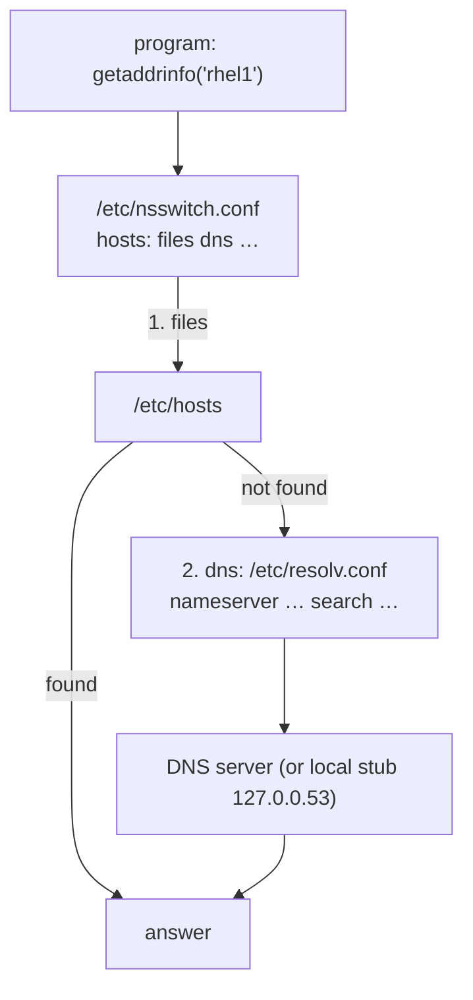

# Hostname and Name Resolution

<!-- nav:start -->
> **Module 07 · Networking** — lesson 4 of 11  
> [Module index](README.md) · [Course lesson (commands)](../../course/07-Networking.md#lesson-4---hostname--name-resolution) · [Exercises for this lesson](../../exercises/07-networking/04-hostname-resolution.md)
<!-- nav:end -->

Humans use names – `web01`, `db.example.lab`, `www.kernel.org` – while the network uses IP addresses. In this lesson you will learn how a Linux host knows its own name, how it translates names to addresses (via `/etc/hosts`, DNS and the Name Service Switch), how systemd-resolved fits in, and how to test resolution correctly.

## What you will learn

- Hostnames: static, transient, pretty; FQDNs; `hostnamectl`
- `/etc/hosts` format and use
- How resolution works: `nsswitch.conf` → files → DNS
- `/etc/resolv.conf`, search domains and who manages the file
- systemd-resolved and `resolvectl`
- DNS basics: record types, recursive resolvers, TTL, reverse lookups
- Testing with `getent`, `dig`, `host`, `nslookup` – and why they differ

---

## Key terms

| Term | Definition |
|------|-----------|
| **Hostname** | The name of this machine (`web01`). |
| **FQDN** | *Fully Qualified Domain Name*: hostname + domain (`web01.example.lab`). |
| **`/etc/hosts`** | Static local table of IP-to-name mappings. |
| **DNS** | *Domain Name System*: the distributed database that maps names to addresses and more. |
| **Resolver** | The client-side code (in glibc, or systemd-resolved) that performs lookups for programs. |
| **NSS** | *Name Service Switch*: `/etc/nsswitch.conf` defines which sources are consulted, in which order. |
| **Search domain** | Domain appended to short names: `web01` → `web01.example.lab`. |
| **Record** | A DNS entry: `A`, `AAAA`, `CNAME`, `MX`, `PTR`, `NS`, `TXT`, `SOA`, `SRV`. |
| **TTL** | *Time To Live*: how long a DNS answer may be cached. |
| **Stub resolver** | A local forwarding resolver, e.g. systemd-resolved at `127.0.0.53`. |

---

## The hostname

```console
$ hostnamectl
 Static hostname: web01.example.lab
       Icon name: computer-vm
         Chassis: vm
      Machine ID: 3e1f…
 Operating System: Rocky Linux 9.5 (Blue Onyx)
          Kernel: Linux 5.14.0-503.14.1.el9_5.x86_64
$ hostname                  # current name
web01.example.lab
$ hostname -s               # short
web01
$ hostname -f               # FQDN (resolved through /etc/hosts or DNS)
$ hostname -I               # all IP addresses
```

| Type | Meaning |
|------|---------|
| static | stored in `/etc/hostname`, used at boot |
| transient | runtime value (may come from DHCP) |
| pretty | free-form description ("Web server #1") |

```console
$ sudo hostnamectl set-hostname web01.example.lab     # persistent (writes /etc/hostname) and immediate
$ sudo hostnamectl set-hostname "Web server 1" --pretty
```

After renaming, add the new name to `/etc/hosts` so that `hostname -f` and local tools (sudo!) resolve it quickly. Open shells show the new name only in new sessions.

---

## /etc/hosts

```text
# /etc/hosts
127.0.0.1       localhost
::1             localhost ip6-localhost ip6-loopback
192.168.56.10   deb1.example.lab   deb1
192.168.56.20   rhel1.example.lab  rhel1   ldap.example.lab
```

Format: **IP address**, **canonical name** (preferably the FQDN), then optional **aliases**, separated by whitespace. One IP per line; a name may appear on several lines (first match wins).

Use it for lab environments, for names that must resolve even if DNS is down, and for overrides during migrations. It doesn't scale for many machines – that's DNS's job.

---

## How a lookup works

When a program calls `getaddrinfo("rhel1")`, glibc consults `/etc/nsswitch.conf`:

```text
# /etc/nsswitch.conf
hosts:      files dns myhostname          ← RHEL typical
hosts:      files mdns4_minimal [NOTFOUND=return] resolve [!UNAVAIL=return] dns   ← Ubuntu desktop
```



- `files` = `/etc/hosts`; `dns` = servers in `/etc/resolv.conf`; `resolve` = systemd-resolved directly; `myhostname` = always resolve the local hostname.
- The **order** matters: with `files dns`, `/etc/hosts` wins over DNS.

---

## /etc/resolv.conf

```text
nameserver 192.168.56.53
nameserver 1.1.1.1
search example.lab lab.local
options timeout:2 attempts:2
```

| Directive | Meaning |
|-----------|---------|
| `nameserver` | DNS server to query (up to 3, tried in order) |
| `search` | domains appended to names that contain fewer dots than `ndots` (default 1) |
| `options` | `timeout:`, `attempts:`, `ndots:`, `rotate`… |

With `search example.lab`, `ping web01` tries `web01.example.lab` first.

### Who writes it?

```console
$ ls -l /etc/resolv.conf
lrwxrwxrwx 1 root root 39 Apr 22 13:08 /etc/resolv.conf -> ../run/systemd/resolve/stub-resolv.conf   ← Ubuntu
-rw-r--r-- 1 root root 72 Oct 21 09:01 /etc/resolv.conf                                            ← RHEL (NM)
$ head -3 /etc/resolv.conf
# Generated by NetworkManager
```

| System | Manager of resolv.conf | Configure DNS in |
|--------|-----------------------|------------------|
| Ubuntu (networkd) | **systemd-resolved** (`nameserver 127.0.0.53`) | Netplan `nameservers:` or `/etc/systemd/resolved.conf` |
| RHEL (NetworkManager) | **NetworkManager** | `nmcli con mod … ipv4.dns …` |

Manual edits get overwritten at the next DHCP renewal or reconnect.

---

## systemd-resolved

A local caching stub resolver listening on `127.0.0.53`. It knows per-interface DNS servers and search domains.

```console
$ resolvectl status
Global
       Protocols: -LLMNR -mDNS -DNSOverTLS DNSSEC=no/unsupported
resolv.conf mode: stub
Link 2 (enp1s0)
    Current Scopes: DNS
Current DNS Server: 192.168.56.53
       DNS Servers: 192.168.56.53 1.1.1.1
        DNS Domain: example.lab
$ resolvectl query rhel1.example.lab
rhel1.example.lab: 192.168.56.20
$ resolvectl statistics            # cache hits/misses
$ sudo resolvectl flush-caches
$ sudo resolvectl dns enp1s0 9.9.9.9        # runtime only
```

Global settings: `/etc/systemd/resolved.conf` (`DNS=`, `FallbackDNS=`, `Domains=`), then `systemctl restart systemd-resolved`.

---

## DNS in one page

- DNS is a hierarchy: root `.` → top-level domain `lab.` → `example.lab.` → hosts.
- Your host asks a **recursive resolver** (company DNS, router, 1.1.1.1), which walks the hierarchy and caches answers for their **TTL**.
- **Authoritative** servers hold the real data for a zone.

| Record | Maps | Example |
|--------|------|---------|
| `A` | name → IPv4 | `web01 A 192.168.56.30` |
| `AAAA` | name → IPv6 | `web01 AAAA fd00:56::30` |
| `CNAME` | alias → canonical name | `www CNAME web01` |
| `MX` | mail server for a domain | `example.lab MX 10 mail` |
| `PTR` | IP → name (reverse) | `30.56.168.192.in-addr.arpa PTR web01` |
| `NS` | authoritative servers of a zone | |
| `TXT` | arbitrary text (SPF, verification) | |
| `SRV` | service location (`_ldap._tcp`) | |

---

## Testing resolution

```console
$ getent hosts rhel1                 # uses NSS → exactly what applications see (incl. /etc/hosts)
192.168.56.20   rhel1.example.lab rhel1 ldap.example.lab
$ getent ahosts www.kernel.org       # all addresses, IPv4 and IPv6

$ dig rhel1.example.lab              # queries DNS directly – IGNORES /etc/hosts
;; ANSWER SECTION:
rhel1.example.lab.   3600  IN  A  192.168.56.20
;; SERVER: 127.0.0.53#53(127.0.0.53) (UDP)
$ dig +short www.kernel.org
$ dig AAAA www.kernel.org +short
$ dig -x 192.168.56.20 +short        # reverse lookup (PTR)
$ dig @1.1.1.1 example.com           # ask a specific server
$ dig example.com MX +short
$ dig +trace example.com             # follow the delegation from the root
$ host rhel1.example.lab             # simpler output
$ nslookup rhel1.example.lab         # classic tool
```

`dig`, `host` and `nslookup` come from `bind9-dnsutils` (Ubuntu) / `bind-utils` (RHEL).

> **Key point:** `ping name` works but `dig name` fails → the name is probably in `/etc/hosts` (or resolved by another NSS source). `dig` only talks DNS. Use **`getent hosts`** to test "can applications resolve this name?".

---

## Try it yourself

1. Set the hostname of each VM to its FQDN (`deb1.example.lab`, `rhel1.example.lab`) persistently.
2. Make each VM resolve the other by short name and FQDN via `/etc/hosts`; test with `getent hosts` and `ping`.
3. Compare `getent hosts rhel1` and `dig rhel1` – explain the difference.
4. Find the DNS servers really used on each VM (`resolvectl status` / `nmcli dev show | grep DNS`).
5. Add the search domain `example.lab` persistently and resolve `rhel1` by short name through DNS (if you run a DNS server) or verify it in `/etc/resolv.conf`.

---

## Common mistakes

- Editing `/etc/resolv.conf` directly on a managed system.
- Testing with `dig` when the entry is in `/etc/hosts`.
- Changing the hostname but not `/etc/hosts` (slow `sudo`, wrong `hostname -f`).
- Putting several IPs on one `/etc/hosts` line.
- Forgetting that `/etc/nsswitch.conf` order decides which source wins.

---

## Summary

| Task | Command / file |
|------|----------------|
| Show / set hostname | `hostnamectl`, `hostnamectl set-hostname NAME` |
| Local names | `/etc/hosts` |
| Source order | `/etc/nsswitch.conf` (`hosts: files dns`) |
| DNS servers in use | `resolvectl status` (Ubuntu), `nmcli dev show` / `/etc/resolv.conf` (RHEL) |
| Persistent DNS | Netplan `nameservers:`, `nmcli con mod … ipv4.dns` |
| What apps see | `getent hosts NAME` |
| DNS only | `dig NAME`, `dig -x IP`, `host`, `nslookup` |
| Flush cache | `resolvectl flush-caches` |

## Check yourself

1. Which file stores the static hostname?
2. With `hosts: files dns`, a name is in `/etc/hosts` and in DNS with different IPs. Which IP is used by `ping`?
3. Why can `dig` fail for a name that `ping` resolves?
4. What does `search example.lab` in `resolv.conf` do?

<details>
<summary>Answers</summary>

1. `/etc/hostname` (set via `hostnamectl`).
2. The one in `/etc/hosts` – `files` is consulted first.
3. `dig` queries DNS servers directly and ignores `/etc/hosts` and other NSS sources.
4. Short names are tried with `.example.lab` appended (`web01` → `web01.example.lab`).

</details>

## Further reading

- `man 5 hosts`, `man 5 nsswitch.conf`, `man 5 resolv.conf`, `man 1 hostnamectl`, `man 1 resolvectl`, `man 1 dig`
- [ArchWiki: Domain name resolution](https://wiki.archlinux.org/title/Domain_name_resolution) · [systemd-resolved](https://wiki.archlinux.org/title/Systemd-resolved)
- [Ubuntu Server: Name resolution](https://documentation.ubuntu.com/server/explanation/networking/configuring-networks/#name-resolution)
- [Cloudflare Learning: What is DNS?](https://www.cloudflare.com/learning/dns/what-is-dns/)

---

<!-- footer:start -->
[← Persistent Network Configuration: Netplan and NetworkManager](03-persistent-config.md) · [Module index](README.md) · [Static Routing →](05-static-routing.md)  
**Practice now:** [Exercises – Hostname and Name Resolution](../../exercises/07-networking/04-hostname-resolution.md)
<!-- footer:end -->
