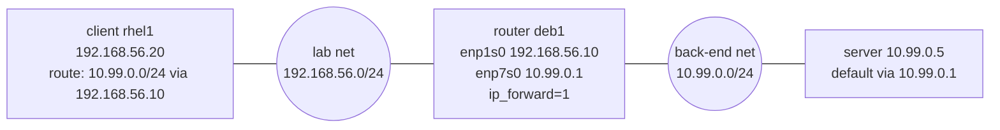

# Static Routing

<!-- nav:start -->
> **Module 07 · Networking** — lesson 5 of 11  
> [Module index](README.md) · [Course lesson (commands)](../../course/07-Networking.md#lesson-5---static-routing-gap) · [Exercises for this lesson](../../exercises/07-networking/05-static-routing.md)
<!-- nav:end -->

A **route** tells the kernel where to send a packet. Most hosts need just two: their local subnet and a default gateway. As soon as you have several networks – a back-end network, a VPN, a lab segment behind another server – you need **static routes**, and sometimes a Linux machine must itself **act as a router**. In this lesson you will learn how the kernel chooses a route, how to add routes at runtime and persistently, and how to turn a Linux host into a router.

## What you will learn

- The routing table and how a route is selected (longest prefix match, metrics)
- Directly connected routes, the default route, host routes
- Adding and removing static routes with `ip route`
- Persistent routes with Netplan and NetworkManager
- IP forwarding: making Linux a router
- Return routes and asymmetric routing
- Testing with `ip route get`, `tracepath`, `traceroute`, `mtr`
- Policy routing (overview)

---

## Key terms

| Term | Definition |
|------|-----------|
| **Routing table** | List of routes the kernel consults for every outgoing packet (`ip route`). |
| **Route** | Destination network + next hop (gateway) and/or outgoing interface. |
| **Next hop / gateway** | The router to which a packet is handed; must be on a directly connected subnet. |
| **Default route** | `0.0.0.0/0` (`::/0`): matches every destination; used when nothing more specific matches. |
| **Longest prefix match** | The rule that the most specific matching route (largest prefix length) wins. |
| **Metric** | Preference value between routes with the same prefix; **lower wins**. |
| **IP forwarding** | Kernel setting allowing a host to pass packets between its interfaces (act as a router). |
| **Static route** | A route configured by an administrator (as opposed to learned via a routing protocol like OSPF/BGP). |

---

## Reading the routing table

```console
$ ip route
default via 192.168.56.1 dev enp1s0 proto static metric 100
10.10.0.0/16 via 192.168.56.254 dev enp1s0 proto static metric 100
192.168.56.0/24 dev enp1s0 proto kernel scope link src 192.168.56.10 metric 100
192.168.100.0/24 dev enp7s0 proto kernel scope link src 192.168.100.10 metric 101
```

| Route | Type |
|-------|------|
| `192.168.56.0/24 dev enp1s0 proto kernel scope link` | **directly connected**: created automatically when the address was added; delivered straight to the destination (ARP) |
| `10.10.0.0/16 via 192.168.56.254` | **static route** via a gateway |
| `default via 192.168.56.1` | **default route** – everything else |

`proto` shows who created the route (`kernel`, `static`, `dhcp`, `ra`); `src` the preferred source address.

---

## How the kernel picks a route

1. Find all routes whose destination network contains the packet's destination address.
2. Choose the one with the **longest prefix** (most specific).
3. If several have the same prefix, choose the lowest **metric**.

Example with the table above:

| Destination | Matching routes | Winner |
|-------------|-----------------|--------|
| `192.168.56.20` | `/24` connected, `/0` default | `192.168.56.0/24` – deliver directly |
| `10.10.5.5` | `10.10.0.0/16`, `/0` | `/16` via 192.168.56.254 |
| `8.8.8.8` | only `/0` | default via 192.168.56.1 |

Always confirm with:

```console
$ ip route get 10.10.5.5
10.10.5.5 via 192.168.56.254 dev enp1s0 src 192.168.56.10 uid 0
```

---

## Runtime static routes

```console
$ sudo ip route add 10.10.0.0/16 via 192.168.56.254               # network via gateway
$ sudo ip route add 10.20.0.0/24 via 192.168.56.20 dev enp1s0     # with explicit interface
$ sudo ip route add 10.30.0.5/32 via 192.168.56.254                # host route (single IP)
$ sudo ip route add 10.40.0.0/24 dev enp7s0                        # network directly on enp7s0
$ sudo ip route add 10.10.0.0/16 via 192.168.56.253 metric 200    # backup route (higher metric)
$ sudo ip route replace default via 192.168.56.2                   # change default gateway
$ sudo ip route del 10.10.0.0/16 via 192.168.56.253
$ sudo ip -6 route add 2001:db8:10::/64 via fd00:56::254
```

Lost at reboot – use them to test, then make them persistent.

---

## Persistent routes

### Netplan (Ubuntu)

```yaml
# /etc/netplan/60-static.yaml (excerpt)
network:
  version: 2
  ethernets:
    enp1s0:
      addresses: [192.168.56.10/24]
      routes:
        - to: default
          via: 192.168.56.1
        - to: 10.10.0.0/16
          via: 192.168.56.254
        - to: 10.20.0.0/24
          via: 192.168.56.20
          metric: 50
        - to: 2001:db8:10::/64
          via: fd00:56::254
```

```console
$ sudo netplan try && sudo netplan apply
```

### NetworkManager (RHEL)

```console
$ sudo nmcli connection modify enp1s0 +ipv4.routes "10.10.0.0/16 192.168.56.254"
$ sudo nmcli connection modify enp1s0 +ipv4.routes "10.20.0.0/24 192.168.56.20 50"     # with metric
$ sudo nmcli connection modify enp1s0 +ipv6.routes "2001:db8:10::/64 fd00:56::254"
$ sudo nmcli connection up enp1s0
$ nmcli -g ipv4.routes connection show enp1s0
10.10.0.0/16 192.168.56.254, 10.20.0.0/24 192.168.56.20 50
$ sudo nmcli connection modify enp1s0 -ipv4.routes "10.20.0.0/24 192.168.56.20 50"     # remove one
```

---

## Making Linux a router

By default a Linux host drops packets that arrive for another destination. To route between its interfaces, enable **IP forwarding**:

```console
$ sysctl net.ipv4.ip_forward
net.ipv4.ip_forward = 0
$ sudo sysctl -w net.ipv4.ip_forward=1                                     # now
$ echo "net.ipv4.ip_forward = 1" | sudo tee /etc/sysctl.d/90-router.conf   # persistent
$ echo "net.ipv6.conf.all.forwarding = 1" | sudo tee -a /etc/sysctl.d/90-router.conf
$ sudo sysctl --system
```

The firewall must also allow forwarded traffic (FORWARD chain / firewalld policies – see [Firewalls](07-firewalls-nat.md)).

### Lab scenario



For `rhel1` to reach `10.99.0.5`:

1. `rhel1` needs a route to `10.99.0.0/24` via `192.168.56.10` (or `deb1` must be its default gateway).
2. `deb1` must forward (`ip_forward=1`) and its firewall must allow it.
3. **The reply must find its way back**: `10.99.0.5` needs a route to `192.168.56.0/24` via `10.99.0.1` (here its default gateway). If not, you get *asymmetric routing* or no reply at all.

Alternatively, the router can **masquerade** (NAT) traffic leaving `enp7s0`, so the back-end server sees requests coming from `10.99.0.1` and doesn't need a return route.

---

## Testing paths

```console
$ ip route get 10.99.0.5                 # local decision
$ ping -c3 10.99.0.5
$ tracepath -n 10.99.0.5                 # hops + path MTU, no root needed (iputils)
 1?: [LOCALHOST]                      pmtu 1500
 1:  192.168.56.10                                         0.412ms
 2:  10.99.0.5                                             0.733ms reached
$ traceroute -n 10.99.0.5                # package traceroute
$ mtr -n 10.99.0.5                       # continuous traceroute with loss statistics (package mtr)
$ sudo tcpdump -ni enp7s0 icmp           # on the router: do packets leave/return?
```

If pings stop at the router: check forwarding, the router's firewall, and the return route on the far side.

---

## Policy routing (overview)

Normally only the destination decides the route. **Policy routing** can choose a routing table by source address, interface or firewall mark – e.g. "traffic from 10.0.0.0/24 uses ISP B":

```console
$ sudo ip route add default via 203.0.113.1 table 100
$ sudo ip rule add from 10.0.0.0/24 table 100
$ ip rule
0:      from all lookup local
32765:  from 10.0.0.0/24 lookup 100
32766:  from all lookup main
32767:  from all lookup default
```

Persistent via Netplan `routing-policy:` or nmcli `ipv4.routing-rules`.

---

## Try it yourself

1. Read your routing table and explain each line.
2. Add a runtime route to `10.10.0.0/16` via a non-existent gateway on your subnet; check `ip route get 10.10.1.1`; delete it.
3. Build the lab scenario: give `deb1` a second interface or a dummy one (`ip link add dummy0 type dummy; ip addr add 10.99.0.1/24 dev dummy0; ip link set dummy0 up`), enable forwarding, and add a persistent route on `rhel1` to `10.99.0.0/24` via `deb1`. Ping `10.99.0.1` from `rhel1`.
4. Add two routes to the same network with different metrics and check which is used.

---

## Common mistakes

- Forgetting `ip_forward` on the router.
- Forgetting the return route.
- Gateway not on a directly connected subnet (`Nexthop has invalid gateway`).
- Two default routes with the same metric on different interfaces – unpredictable.
- Using `nmcli con mod … ipv4.routes` without `+` (replaces all routes) or forgetting `nmcli con up`.

---

## Summary

| Task | Command |
|------|---------|
| Show | `ip route`, `ip -6 route` |
| Which route? | `ip route get IP` |
| Add / delete runtime | `ip route add NET via GW [dev IF] [metric N]`, `ip route del NET` |
| Persistent (Netplan) | `routes: - to: NET via: GW` |
| Persistent (nmcli) | `nmcli con mod CON +ipv4.routes "NET GW [METRIC]"` → `nmcli con up CON` |
| Router | `net.ipv4.ip_forward = 1` in `/etc/sysctl.d/` + firewall FORWARD |
| Path | `tracepath`, `traceroute`, `mtr` |

## Check yourself

1. Routes `10.0.0.0/8 via A` and `10.1.0.0/16 via B` exist. Where does a packet to `10.1.2.3` go?
2. Two routes to `10.5.0.0/16` have metrics 100 and 50. Which is used?
3. A client can ping the router's far interface but not a server behind it. Name two likely causes.
4. What's the difference between a static route and the default route?

<details>
<summary>Answers</summary>

1. Via B – `/16` is more specific than `/8`.
2. The one with metric 50.
3. IP forwarding disabled on the router (or its firewall blocks forwarding), or the server has no route back to the client's network.
4. A static route covers a specific destination network; the default route (`0.0.0.0/0`) matches every destination not covered by a more specific route.

</details>

## Further reading

- `man 8 ip-route`, `man 8 ip-rule`, `man 8 tracepath`, `man 8 mtr`
- [Red Hat: Configuring static routes (RHEL 9)](https://docs.redhat.com/en/documentation/red_hat_enterprise_linux/9/html/configuring_and_managing_networking/configuring-static-routes_configuring-and-managing-networking)
- [Netplan: routes and routing-policy](https://netplan.readthedocs.io/en/stable/netplan-yaml/#properties-for-all-device-types)
- [ArchWiki: Router](https://wiki.archlinux.org/title/Router)

---

<!-- footer:start -->
[← Hostname and Name Resolution](04-hostname-resolution.md) · [Module index](README.md) · [Bridges and Bonds →](06-bridges-bonds.md)  
**Practice now:** [Exercises – Static Routing](../../exercises/07-networking/05-static-routing.md)
<!-- footer:end -->
