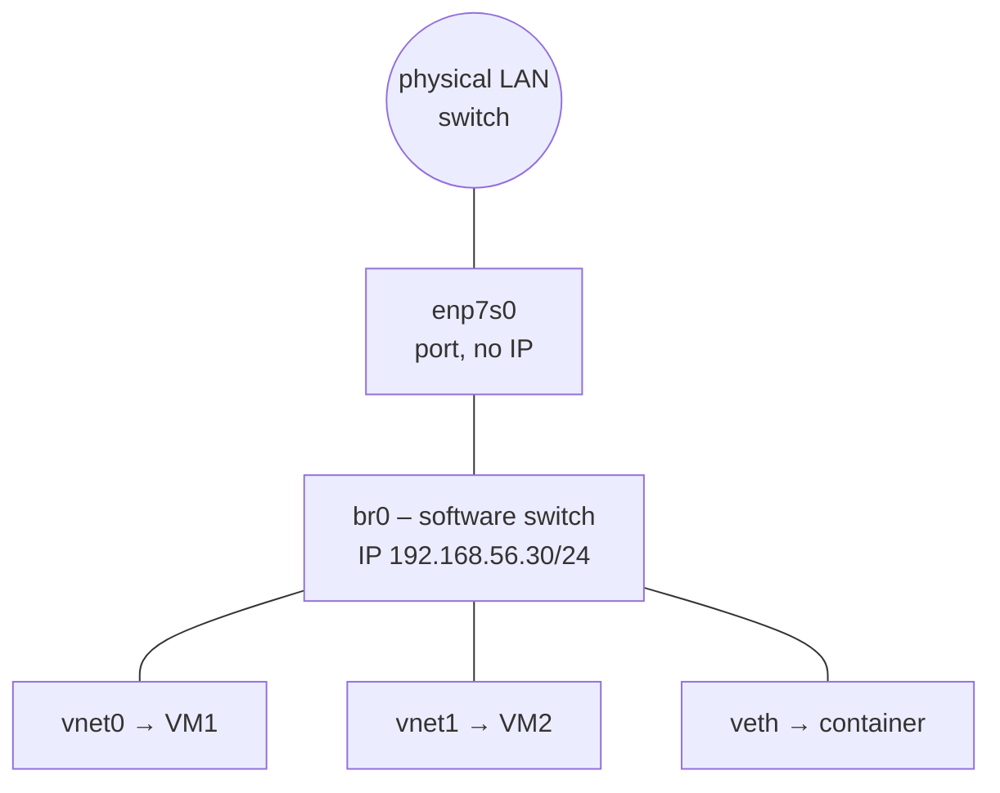
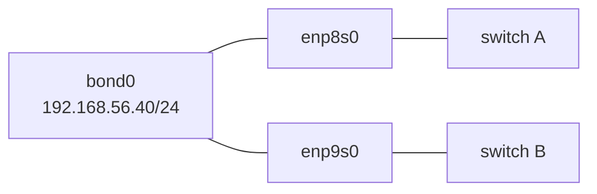

# Bridges and Bonds

<!-- nav:start -->
> **Module 07 · Networking** — lesson 6 of 11  
> [Module index](README.md) · [Course lesson (commands)](../../course/07-Networking.md#lesson-6---bridges--bonds-gap) · [Exercises for this lesson](../../exercises/07-networking/06-bridges-bonds.md)
<!-- nav:end -->

Linux can build **virtual network devices** on top of physical NICs. Two of them are essential for servers: a **bridge** acts as a virtual switch (so VMs and containers can sit directly on the physical network), and a **bond** combines several NICs into one logical interface for redundancy and/or more bandwidth. In this lesson you will learn how both work and how to configure them at runtime and persistently with nmcli and Netplan.

## What you will learn

- What a bridge is, how it forwards frames, and where it's used
- What a bond is and the bonding modes (especially `active-backup` and `802.3ad`)
- Link monitoring (MII) and failover
- Creating bridges and bonds with `ip` (runtime), `nmcli` and Netplan (persistent)
- Checking status: `bridge`, `/proc/net/bonding/`, `nmcli`
- Combining them (bond under a bridge), VLANs (overview), teaming (deprecated)

---

## Key terms

| Term | Definition |
|------|-----------|
| **Bridge** | A software layer-2 switch in the kernel. Interfaces attached to it (ports) can exchange Ethernet frames. |
| **Port / slave / member** | An interface attached to a bridge or bond (NetworkManager calls them *ports*; older docs *slaves*). |
| **FDB** | *Forwarding database*: the bridge's table of learned MAC addresses per port. |
| **STP** | *Spanning Tree Protocol*: prevents loops between bridges/switches. |
| **Bond** | Several NICs aggregated into one logical interface (`bond0`). |
| **Bonding mode** | The algorithm for distributing traffic and handling failure. |
| **MII monitoring (`miimon`)** | Checks link (carrier) state every N ms to detect a failed member. |
| **LACP / 802.3ad** | Standard protocol for negotiating link aggregation with the switch. |
| **Primary** | In `active-backup`, the preferred active member. |

---

## Bridges



- The physical NIC becomes a **port** of the bridge and **loses its IP**; the IP goes on the **bridge** (`br0`).
- VMs connected to `br0` appear on the LAN as separate machines with their own MAC/IP (bridged networking) – unlike NAT networking where they hide behind the host.
- The bridge learns which MAC lives behind which port (FDB) and forwards frames accordingly.
- libvirt's default network uses a bridge `virbr0` with NAT; Docker uses `docker0`; Podman `podman0`/`cni-podman0`.

### Runtime with ip

```console
$ sudo ip link add br0 type bridge
$ sudo ip link set enp7s0 master br0           # attach the NIC as a port
$ sudo ip addr flush dev enp7s0                # remove its old IP
$ sudo ip addr add 192.168.56.30/24 dev br0
$ sudo ip link set br0 up; sudo ip link set enp7s0 up
$ bridge link show
3: enp7s0: <BROADCAST,MULTICAST,UP,LOWER_UP> mtu 1500 master br0 state forwarding priority 32 cost 100
$ bridge fdb show br br0 | head -3
$ ip link set enp7s0 nomaster; ip link del br0   # undo
```

> Do this on a spare NIC or from the console: moving the IP of the interface you're connected through drops your SSH session.

### Persistent with nmcli

```console
$ sudo nmcli connection add type bridge ifname br0 con-name br0 \
      ipv4.method manual ipv4.addresses 192.168.56.30/24 ipv4.gateway 192.168.56.1 \
      bridge.stp no
$ sudo nmcli connection add type ethernet ifname enp7s0 con-name br0-port1 \
      port-type bridge controller br0         # older NM: type bridge-slave ifname enp7s0 master br0
$ sudo nmcli connection up br0
$ nmcli device status
DEVICE  TYPE      STATE      CONNECTION
br0     bridge    connected  br0
enp7s0  ethernet  connected  br0-port1
```

If an old profile for `enp7s0` still exists (with its own IP), delete or disable it (`nmcli con down`/`delete`) so the port profile is used.

### Persistent with Netplan

```yaml
network:
  version: 2
  ethernets:
    enp7s0: {}                       # no addresses on the member
  bridges:
    br0:
      interfaces: [enp7s0]
      addresses: [192.168.56.30/24]
      routes:
        - to: default
          via: 192.168.56.1
      parameters:
        stp: false
        forward-delay: 0
```

---

## Bonds



A bond presents one interface (`bond0`, with one IP and usually one MAC) to the system while distributing traffic over, or failing over between, its members.

### Bonding modes

| Mode | Name | Switch requirement | Behaviour | Use |
|------|------|--------------------|-----------|-----|
| 0 | `balance-rr` | static aggregation (EtherChannel) | round-robin per packet; may reorder packets | rare |
| 1 | **`active-backup`** | **none** | one member active, others standby; failover on link loss | redundancy, works anywhere (also across two switches) |
| 2 | `balance-xor` | static aggregation | hash (MAC/IP) selects the member | |
| 3 | `broadcast` | – | every packet on every member | special cases |
| 4 | **`802.3ad`** (LACP) | **LACP configured on the switch** | dynamic aggregation; flows hashed over members (`xmit_hash_policy`) | bandwidth + redundancy in datacenters |
| 5 | `balance-tlb` | none | adaptive transmit load balancing | |
| 6 | `balance-alb` | none | adaptive transmit + receive load balancing (ARP tricks) | |

Rule of thumb: **`active-backup` when you know nothing about the switch; `802.3ad` when the switch is configured for LACP.**

Important options:

| Option | Meaning |
|--------|---------|
| `miimon=100` | check member links every 100 ms (always set this or ARP monitoring) |
| `primary=enp8s0` | preferred active member (active-backup) |
| `lacp_rate=fast` | LACP PDU every second (802.3ad) |
| `xmit_hash_policy=layer3+4` | hash by IP and port (more even spread for 802.3ad/xor) |
| `fail_over_mac` | MAC behaviour on failover (VM environments) |

### Runtime with ip

```console
$ sudo modprobe bonding
$ sudo ip link add bond0 type bond mode active-backup miimon 100
$ sudo ip link set enp8s0 down; sudo ip link set enp8s0 master bond0
$ sudo ip link set enp9s0 down; sudo ip link set enp9s0 master bond0
$ sudo ip link set bond0 up
$ sudo ip addr add 192.168.56.40/24 dev bond0
```

### Persistent with nmcli

```console
$ sudo nmcli connection add type bond ifname bond0 con-name bond0 \
      bond.options "mode=active-backup,miimon=100,primary=enp8s0" \
      ipv4.method manual ipv4.addresses 192.168.56.40/24 ipv4.gateway 192.168.56.1
$ sudo nmcli connection add type ethernet ifname enp8s0 con-name bond0-port1 port-type bond controller bond0
$ sudo nmcli connection add type ethernet ifname enp9s0 con-name bond0-port2 port-type bond controller bond0
$ sudo nmcli connection up bond0
```

(Older NetworkManager syntax: `type bond-slave ifname enp8s0 master bond0`.)

### Persistent with Netplan

```yaml
network:
  version: 2
  ethernets:
    enp8s0: {}
    enp9s0: {}
  bonds:
    bond0:
      interfaces: [enp8s0, enp9s0]
      addresses: [192.168.56.40/24]
      parameters:
        mode: active-backup
        primary: enp8s0
        mii-monitor-interval: 100
```

### Checking and testing failover

```console
$ cat /proc/net/bonding/bond0
Bonding Mode: fault-tolerance (active-backup)
Primary Slave: enp8s0 (primary_reselect always)
Currently Active Slave: enp8s0
MII Status: up
MII Polling Interval (ms): 100

Slave Interface: enp8s0
MII Status: up
Link Failure Count: 0

Slave Interface: enp9s0
MII Status: up
Link Failure Count: 0
```

Simulate a failure (or unplug the virtual cable in the hypervisor) while pinging the bond's IP from another host:

```console
$ sudo ip link set enp8s0 down
$ grep "Currently Active" /proc/net/bonding/bond0
Currently Active Slave: enp9s0
$ sudo ip link set enp8s0 up
```

The ping continues with at most a lost packet or two.

---

## Combining: bond under a bridge, VLANs

Common hypervisor design: two NICs → `bond0` (redundancy) → `br0` (VMs) with the host IP on `br0`.

```yaml
network:
  version: 2
  ethernets: {enp8s0: {}, enp9s0: {}}
  bonds:
    bond0:
      interfaces: [enp8s0, enp9s0]
      parameters: {mode: active-backup, mii-monitor-interval: 100}
  bridges:
    br0:
      interfaces: [bond0]
      addresses: [192.168.56.30/24]
```

**VLANs** (802.1Q) tag frames to separate networks on one cable: `ip link add link enp7s0 name enp7s0.10 type vlan id 10`; nmcli `type vlan dev enp7s0 id 10`; Netplan `vlans:`.

**Network teaming** (`teamd`) was RHEL 7/8's alternative to bonding; it is **deprecated** in RHEL 9 – use bonding.

---

## Try it yourself

1. Add two extra NICs to `rhel1` in your hypervisor.
2. Create `bond0` in `active-backup` with both NICs and a static IP using nmcli; check `/proc/net/bonding/bond0`.
3. Ping the bond from `deb1` while you take the active member down; confirm failover.
4. On `deb1` (with a spare NIC), create bridge `br0` with Netplan and a static IP; check `bridge link`.
5. Recreate the bond at runtime only with `ip`, then reboot and see it's gone.

---

## Common mistakes

- Leaving the IP on the member NIC instead of the bridge/bond.
- Old profiles for the member NICs still active in NetworkManager.
- Using `802.3ad` without LACP configured on the switch.
- Forgetting `miimon` (the bond never detects a dead link).
- Configuring the interface you're connected through over SSH without console access.

---

## Summary

| Task | ip (runtime) | nmcli | Netplan |
|------|--------------|-------|---------|
| Bridge | `ip link add br0 type bridge`; `ip link set NIC master br0` | `con add type bridge ifname br0 …` + `con add type ethernet ifname NIC port-type bridge controller br0` | `bridges: br0: interfaces: [NIC]` |
| Bond | `ip link add bond0 type bond mode M miimon 100`; `ip link set NIC master bond0` | `con add type bond ifname bond0 bond.options "mode=…,miimon=100"` + ports `port-type bond controller bond0` | `bonds: bond0: interfaces: […] parameters: {mode: …}` |
| Status | `bridge link`, `ip -d link show bond0` | `nmcli dev status` | `networkctl status` |
| Bond details | `cat /proc/net/bonding/bond0` | | |

## Check yourself

1. Where does the IP address go when a NIC is added to a bridge?
2. Which bond mode works without any switch configuration and provides failover?
3. What does `miimon=100` do?
4. Why do VMs on a bridged network appear as separate hosts on the LAN?

<details>
<summary>Answers</summary>

1. On the bridge interface (`br0`); the member NIC has no IP.
2. `active-backup` (mode 1).
3. Checks every member's link state every 100 ms to detect failures.
4. The bridge forwards their frames unchanged onto the LAN, so each VM has its own MAC and IP on that network.

</details>

## Further reading

- `man 8 ip-link` (bridge, bond types), `man 8 bridge`, `man 7 nmcli-examples`
- [Linux kernel: Bonding driver documentation](https://docs.kernel.org/networking/bonding.html)
- [Red Hat: Configuring a network bond (RHEL 9)](https://docs.redhat.com/en/documentation/red_hat_enterprise_linux/9/html/configuring_and_managing_networking/configuring-network-bonding_configuring-and-managing-networking) · [Configuring a network bridge](https://docs.redhat.com/en/documentation/red_hat_enterprise_linux/9/html/configuring_and_managing_networking/configuring-a-network-bridge_configuring-and-managing-networking)
- [Netplan: bonds and bridges](https://netplan.readthedocs.io/en/stable/netplan-yaml/)
- [ArchWiki: Network bridge](https://wiki.archlinux.org/title/Network_bridge)

---

<!-- footer:start -->
[← Static Routing](05-static-routing.md) · [Module index](README.md) · [Packet Filtering, Port Redirection and NAT →](07-firewalls-nat.md)  
**Practice now:** [Exercises – Bridges and Bonds](../../exercises/07-networking/06-bridges-bonds.md)
<!-- footer:end -->
