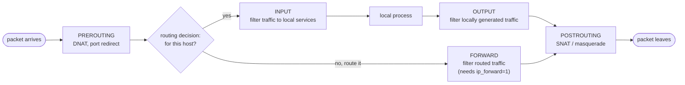
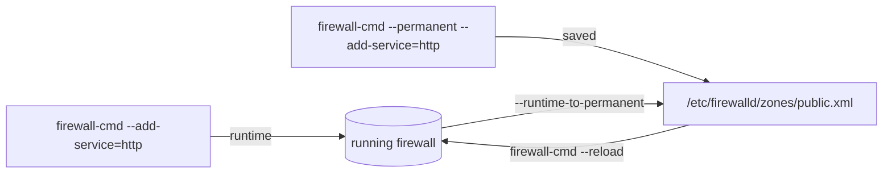

# Packet Filtering, Port Redirection and NAT

<!-- nav:start -->
> **Module 07 · Networking** — lesson 7 of 11  
> [Module index](README.md) · [Course lesson (commands)](../../course/07-Networking.md#lesson-7---firewalls-port-redirection--nat-ch-30) · [Exercises for this lesson](../../exercises/07-networking/07-firewalls-nat.md)
<!-- nav:end -->

A firewall decides which packets may enter, leave or pass through a host. Linux firewalls can also **rewrite** packets: redirect a port to another port, forward a port to another machine, or hide a whole network behind one address (NAT). In this lesson you will learn how the kernel's **Netfilter** framework works, and how to use its three common front-ends – **firewalld** (RHEL), **ufw** (Ubuntu) and **nftables** (everywhere) – plus enough legacy iptables to read old rules.

## What you will learn

- Netfilter hooks and the path of a packet
- Stateful filtering with connection tracking
- NAT: SNAT/masquerade, DNAT/port forwarding, local port redirection
- firewalld: zones, services, ports, sources, forwarding, masquerading, rich rules, runtime vs permanent
- ufw: default policies, allow/deny rules, NAT via `before.rules`
- nftables: tables, chains, rules, sets, NAT, persistence
- iptables syntax for reading legacy rules
- Testing and troubleshooting firewall rules

---

## Key terms

| Term | Definition |
|------|-----------|
| **Netfilter** | The kernel framework that lets code inspect and modify packets at fixed points (hooks). |
| **Hook** | A point in the packet path: `prerouting`, `input`, `forward`, `output`, `postrouting`. |
| **Chain** | An ordered list of rules attached to a hook. |
| **Rule** | A match (protocol, port, address, state…) plus a verdict/action (`accept`, `drop`, `reject`, `dnat`…). |
| **Policy** | The default verdict of a chain when no rule matches. |
| **Connection tracking (conntrack)** | Kernel table of connections that makes the firewall **stateful** (states: new, established, related, invalid). |
| **NAT** | *Network Address Translation*: rewriting addresses/ports. |
| **SNAT / masquerade** | Rewrite the **source** address of outgoing packets (masquerade uses the outgoing interface's current IP). |
| **DNAT / port forwarding** | Rewrite the **destination** of incoming packets – send them to another port or host. |
| **Zone** | firewalld concept: a trust level with its own rules, bound to interfaces or source networks. |

---

## The packet path



| Traffic | Hooks traversed |
|---------|-----------------|
| To a service on this host | prerouting → **input** |
| From this host | **output** → postrouting |
| Routed through this host | prerouting → **forward** → postrouting |

- **DNAT happens in PREROUTING** – before the routing decision, so the kernel routes to the new destination.
- **SNAT/masquerade happens in POSTROUTING** – after routing, when the outgoing interface is known.

### Stateful filtering

With connection tracking you only describe the **first** packet of a connection; replies are allowed by state:

```text
ct state established,related accept      ← replies and related traffic (e.g. FTP data, ICMP errors)
ct state invalid drop
tcp dport 22 ct state new accept         ← new SSH connections
```

NAT is also applied per connection: only the first packet goes through the NAT rules; the rest are translated automatically.

### drop vs reject

`drop` silently discards (the client waits for a timeout); `reject` answers with an error (client gets "connection refused" immediately). Internal networks usually prefer `reject`; internet-facing hosts often `drop`.

---

## The tools

| Tool | Layer | Default on | Notes |
|------|-------|-----------|-------|
| **nftables** (`nft`) | the modern kernel backend and its CLI | all modern distros | one tool for IPv4/IPv6/ARP/bridge |
| iptables | legacy CLI | older systems | today usually `iptables-nft`, translating into nftables |
| **firewalld** (`firewall-cmd`) | daemon/front-end over nftables | **RHEL family** (active by default) | zones, runtime/permanent |
| **ufw** | simple front-end | **Ubuntu** (installed, **inactive** by default) | easy host firewall |

> Use **one** front-end per host. firewalld, ufw and a hand-written nftables ruleset will overwrite or fight each other. Docker/Podman also insert their own rules.

---

## firewalld

### Concepts

- **Zones** (`public`, `internal`, `trusted`, `drop`, `block`, `dmz`, `home`, `work`, `external`…) group rules by trust level.
- A packet is assigned to a zone by its **source address** (if a zone has matching `sources`) or else by the **interface** it arrived on; otherwise the **default zone** (usually `public`).
- **Services** are named port sets (`ssh`, `http`, `https`, `nfs`… defined in `/usr/lib/firewalld/services/*.xml`).
- **Runtime vs permanent**: commands without `--permanent` change only the running firewall (lost on reload/reboot); with `--permanent` they change the saved config but **not** the running one until `--reload`.



### Inspecting

```console
$ sudo firewall-cmd --state
running
$ sudo firewall-cmd --get-default-zone
public
$ sudo firewall-cmd --get-active-zones
public
  interfaces: enp1s0
$ sudo firewall-cmd --list-all
public (active)
  target: default
  interfaces: enp1s0
  sources:
  services: cockpit dhcpv6-client ssh
  ports:
  forward: yes
  masquerade: no
  forward-ports:
  rich rules:
$ sudo firewall-cmd --get-services | tr ' ' '\n' | grep -i nfs
$ sudo firewall-cmd --info-service=nfs
```

### Allowing traffic

```console
$ sudo firewall-cmd --permanent --add-service=http --add-service=https
$ sudo firewall-cmd --permanent --add-port=8080/tcp
$ sudo firewall-cmd --permanent --add-port=60000-61000/udp
$ sudo firewall-cmd --permanent --remove-service=cockpit
$ sudo firewall-cmd --reload
$ sudo firewall-cmd --list-services; sudo firewall-cmd --list-ports
```

### Zones, sources and interfaces

```console
$ sudo firewall-cmd --permanent --zone=trusted --add-source=192.168.56.0/24   # lab subnet fully trusted
$ sudo firewall-cmd --permanent --zone=internal --change-interface=enp7s0     # NIC to another zone
$ sudo firewall-cmd --set-default-zone=public
$ sudo firewall-cmd --permanent --zone=public --add-service=ssh               # target a zone explicitly
```

With NetworkManager, the zone of an interface can also be stored in the connection profile: `nmcli con mod enp7s0 connection.zone internal`.

### Port redirection and forwarding (DNAT)

```console
# Local redirect: connections to port 80 are delivered to port 8080 on this host
$ sudo firewall-cmd --permanent --add-forward-port=port=80:proto=tcp:toport=8080

# Forward to another host: 2222 on this host → 192.168.56.20:22
$ sudo firewall-cmd --permanent --add-forward-port=port=2222:proto=tcp:toport=22:toaddr=192.168.56.20
$ sudo firewall-cmd --permanent --add-masquerade         # needed so replies come back through this host
$ sudo firewall-cmd --reload
$ sudo firewall-cmd --list-forward-ports
```

Forwarding to another host also requires `net.ipv4.ip_forward=1` (firewalld enables it automatically when masquerading is turned on).

> A local `forward-port` (without `toaddr`) applies to traffic **arriving from outside**; connections from the host itself to `localhost:80` are not redirected.

### Masquerading (SNAT) – share a connection

```console
$ sudo firewall-cmd --permanent --zone=external --change-interface=enp1s0   # internet side
$ sudo firewall-cmd --permanent --zone=external --add-masquerade
$ sudo firewall-cmd --permanent --zone=internal --change-interface=enp7s0   # LAN side
$ sudo firewall-cmd --reload
```

Clients on the LAN (gateway = this host) reach the outside world using this host's external IP.

### Rich rules

For conditions that the simple options can't express:

```console
$ sudo firewall-cmd --permanent --add-rich-rule='rule family="ipv4" source address="192.168.56.0/24" service name="ssh" accept'
$ sudo firewall-cmd --permanent --add-rich-rule='rule family="ipv4" source address="10.0.0.5" reject'
$ sudo firewall-cmd --permanent --add-rich-rule='rule family="ipv4" source address="192.168.56.0/24" port port="3306" protocol="tcp" accept'
$ sudo firewall-cmd --permanent --add-rich-rule='rule family="ipv4" forward-port port="8443" protocol="tcp" to-port="443"'
$ sudo firewall-cmd --permanent --add-rich-rule='rule service name="ssh" log prefix="SSH " level="info" limit value="3/m" accept'
$ sudo firewall-cmd --list-rich-rules
```

Syntax reference: `man 5 firewalld.richlanguage`.

### Other useful commands

```console
$ sudo firewall-cmd --runtime-to-permanent       # save what you tested at runtime
$ sudo firewall-cmd --add-service=http --timeout=5m   # temporary rule that expires
$ sudo firewall-cmd --panic-on / --panic-off     # drop ALL traffic (careful!)
$ sudo firewall-cmd --permanent --new-service=myapp; …--service=myapp --add-port=9000/tcp
```

Config files: `/etc/firewalld/firewalld.conf`, `/etc/firewalld/zones/*.xml` (your changes), `/usr/lib/firewalld/` (defaults).

---

## ufw (Ubuntu)

```console
$ sudo ufw status verbose
Status: inactive
$ sudo ufw allow OpenSSH                       # ALWAYS allow SSH before enabling remotely!
$ sudo ufw default deny incoming
$ sudo ufw default allow outgoing
$ sudo ufw enable
$ sudo ufw allow 80/tcp
$ sudo ufw allow 60000:61000/udp
$ sudo ufw allow from 192.168.56.0/24 to any port 3306 proto tcp
$ sudo ufw deny from 10.0.0.5
$ sudo ufw limit ssh                           # rate-limit (brute force protection)
$ sudo ufw status numbered
$ sudo ufw delete 3                            # or: ufw delete allow 80/tcp
$ sudo ufw app list                            # application profiles (/etc/ufw/applications.d)
$ sudo ufw logging on
```

ufw rules are **persistent** immediately. Rules are evaluated in order; first match wins (`ufw insert 1 …` to put a rule first).

### NAT and port forwarding with ufw

ufw has no direct command for NAT. Add a `*nat` section (in `iptables-restore` syntax) at the top of `/etc/ufw/before.rules` and allow forwarding:

```text
# /etc/ufw/before.rules  (at the very top, before *filter)
*nat
:PREROUTING ACCEPT [0:0]
:POSTROUTING ACCEPT [0:0]
-A PREROUTING -i enp1s0 -p tcp --dport 8080 -j REDIRECT --to-port 80
-A POSTROUTING -s 10.99.0.0/24 -o enp1s0 -j MASQUERADE
COMMIT
```

```text
# /etc/default/ufw
DEFAULT_FORWARD_POLICY="ACCEPT"
# /etc/ufw/sysctl.conf
net/ipv4/ip_forward=1
```

```console
$ sudo ufw reload
```

`ufw route allow in on enp7s0 out on enp1s0` controls forwarded traffic.

---

## nftables

### Structure

```text
table <family> <name> {
    chain <name> {
        type <filter|nat|route> hook <hook> priority <n>; policy <accept|drop>;
        <rules>
    }
}
```

Families: `ip` (IPv4), `ip6`, **`inet`** (both – use it for filtering), `arp`, `bridge`, `netdev`.

### A complete host firewall

```nft
#!/usr/sbin/nft -f
flush ruleset

table inet filter {
    chain input {
        type filter hook input priority 0; policy drop;
        ct state established,related accept
        ct state invalid drop
        iif "lo" accept
        ip protocol icmp accept
        ip6 nexthdr icmpv6 accept
        tcp dport 22 accept
        tcp dport { 80, 443 } accept
        ip saddr 192.168.56.0/24 tcp dport 3306 accept
        counter reject
    }
    chain forward {
        type filter hook forward priority 0; policy drop;
    }
    chain output {
        type filter hook output priority 0; policy accept;
    }
}
```

```console
$ sudo nft -c -f /etc/nftables.conf      # check syntax
$ sudo nft -f /etc/nftables.conf         # load
$ sudo nft list ruleset
$ sudo nft list ruleset -a               # with rule handles
```

### Interactive commands

```console
$ sudo nft add table inet filter
$ sudo nft add chain inet filter input '{ type filter hook input priority 0; policy accept; }'
$ sudo nft add rule inet filter input tcp dport 8080 accept
$ sudo nft insert rule inet filter input position 0 ip saddr 10.0.0.5 drop   # at the beginning
$ sudo nft -a list chain inet filter input
$ sudo nft delete rule inet filter input handle 7
$ sudo nft add set inet filter blocked '{ type ipv4_addr; }'
$ sudo nft add element inet filter blocked '{ 203.0.113.9, 203.0.113.10 }'
$ sudo nft add rule inet filter input ip saddr @blocked drop
```

### NAT with nftables

```nft
table ip nat {
    chain prerouting {
        type nat hook prerouting priority dstnat; policy accept;
        tcp dport 8080 redirect to :80                               # local port redirect
        iif "enp1s0" tcp dport 2222 dnat to 192.168.56.20:22         # port forward to another host
    }
    chain postrouting {
        type nat hook postrouting priority srcnat; policy accept;
        oif "enp1s0" ip saddr 10.99.0.0/24 masquerade                # share the connection
    }
}
```

(Remember `net.ipv4.ip_forward=1` and a forward chain that allows the traffic.)

### Persistence

| Distribution | File loaded at boot by `nftables.service` |
|--------------|------------------------------------------|
| Debian/Ubuntu | `/etc/nftables.conf` |
| RHEL family | `/etc/sysconfig/nftables.conf` (which typically `include`s files from `/etc/nftables/`) |

```console
$ sudo nft list ruleset | sudo tee /etc/nftables.conf    # save the current ruleset (Debian path)
$ sudo systemctl enable --now nftables
```

On RHEL, don't run `nftables.service` and `firewalld` together – choose one (`systemctl disable --now firewalld` first if you go pure nftables).

---

## iptables (legacy, for reading)

Fixed tables (`filter`, `nat`, `mangle`, `raw`) with built-in chains (`INPUT`, `FORWARD`, `OUTPUT`, `PREROUTING`, `POSTROUTING`).

```console
$ sudo iptables -L -n -v --line-numbers
$ sudo iptables -t nat -L -n -v
$ sudo iptables -A INPUT -m conntrack --ctstate ESTABLISHED,RELATED -j ACCEPT
$ sudo iptables -A INPUT -p tcp --dport 22 -j ACCEPT
$ sudo iptables -P INPUT DROP                                            # policy
$ sudo iptables -t nat -A PREROUTING -p tcp --dport 80 -j REDIRECT --to-port 8080
$ sudo iptables -t nat -A PREROUTING -p tcp --dport 2222 -j DNAT --to-destination 192.168.56.20:22
$ sudo iptables -t nat -A POSTROUTING -o enp1s0 -j MASQUERADE
$ sudo iptables-save > /root/rules.v4; sudo iptables-restore < /root/rules.v4
$ iptables -V
iptables v1.8.10 (nf_tables)          ← the "nft" backend: rules end up in nftables
```

`iptables-translate -A INPUT -p tcp --dport 22 -j ACCEPT` prints the equivalent nft rule.

---

## Testing and troubleshooting

```console
$ ss -tlnp | grep 8080                     # is the service listening, on which address?
$ curl -v http://192.168.56.20:8080        # from ANOTHER host
$ nc -zv 192.168.56.20 8080
$ sudo nft list ruleset | less             # what's really loaded (also shows firewalld's rules)
$ sudo conntrack -L | head                 # tracked connections (package conntrack-tools)
$ sudo tcpdump -ni enp1s0 tcp port 8080    # do packets arrive? are there replies?
$ sudo firewall-cmd --set-log-denied=all   # log rejected packets → journalctl -k
```

Checklist when "the port is blocked":

1. Is the service listening on the right address (`0.0.0.0` vs `127.0.0.1`)?
2. Does the rule exist in the **running** firewall (runtime vs permanent)?
3. Is the traffic in the zone you think (source/interface binding)?
4. For forwarding: `ip_forward`, masquerade/return route, FORWARD policy.
5. SELinux (non-standard ports need `semanage port`).
6. Another firewall manager (Docker, ufw + firewalld) changing rules?

---

## Try it yourself

1. On `rhel1`: list the active zone, allow HTTP and HTTPS permanently, remove `cockpit`. Verify from `deb1`.
2. On `rhel1`: redirect TCP 8080 to local 80 with firewalld; test from `deb1` with `curl http://rhel1:8080`.
3. On `rhel1`: forward TCP 2222 to `deb1:22`; `ssh -p 2222 rhel1` from a third host (or from `deb1` itself).
4. On `deb1`: enable ufw allowing only SSH and HTTP from the lab subnet.
5. On `deb1` (with ufw disabled): write an nftables ruleset that allows SSH, HTTP, ICMP, established traffic and drops the rest; masquerade traffic leaving the main interface; make it persistent.

---

## Common mistakes

- `--permanent` without `--reload` (or runtime only, lost at reload).
- Enabling ufw remotely without allowing SSH first.
- Two firewall managers at once.
- Forgetting `ip_forward` or masquerade for port forwarding to other hosts.
- `policy drop` on the input chain without `ct state established,related accept` – replies to your own connections are dropped.
- Testing a redirect from the host itself (local traffic doesn't pass PREROUTING).

---

## Summary

| Task | firewalld | ufw | nftables |
|------|-----------|-----|----------|
| Allow service/port | `--add-service=http`, `--add-port=8080/tcp` | `ufw allow 80/tcp` | `tcp dport 80 accept` |
| Allow from network | `--zone=trusted --add-source=NET` or rich rule | `ufw allow from NET to any port P` | `ip saddr NET tcp dport P accept` |
| Local port redirect | `--add-forward-port=port=80:proto=tcp:toport=8080` | `before.rules` REDIRECT | `tcp dport 80 redirect to :8080` |
| Forward to host | `…:toaddr=IP` + `--add-masquerade` | `before.rules` DNAT | `dnat to IP:PORT` |
| Masquerade | `--add-masquerade` | `before.rules` MASQUERADE | `oif X masquerade` |
| Persist | `--permanent` + `--reload` | automatic | `/etc/nftables.conf` + `enable nftables` |
| Show | `--list-all` | `status verbose` | `nft list ruleset` |

## Check yourself

1. In which hook is DNAT applied, and why there?
2. You added `firewall-cmd --permanent --add-port=9000/tcp` but the port is still blocked. Why?
3. What does masquerading do?
4. Why do you need `ct state established,related accept` in a `policy drop` input chain?
5. A local redirect 80→8080 works from other hosts but not with `curl localhost:80`. Why?

<details>
<summary>Answers</summary>

1. PREROUTING – before the routing decision, so the packet is routed to the new destination.
2. Permanent changes only apply after `firewall-cmd --reload`.
3. It rewrites the source address of outgoing packets to the outgoing interface's IP (SNAT), so a private network can share that address.
4. Otherwise reply packets for connections the host initiated (and related ICMP) would be dropped.
5. Locally generated traffic goes through OUTPUT, not PREROUTING, so the PREROUTING redirect doesn't apply.

</details>

## Further reading

- `man firewall-cmd`, `man 5 firewalld.richlanguage`, `man 5 firewalld.zones`, `man ufw`, `man 8 nft`, `man 8 iptables`
- [firewalld documentation](https://firewalld.org/documentation/)
- [nftables wiki](https://wiki.nftables.org/) · [Quick reference: nftables in 10 minutes](https://wiki.nftables.org/wiki-nftables/index.php/Quick_reference-nftables_in_10_minutes)
- [Ubuntu Server: Firewall (ufw)](https://documentation.ubuntu.com/server/how-to/security/firewalls/)
- [Red Hat: Configuring firewalls and packet filters (RHEL 9)](https://docs.redhat.com/en/documentation/red_hat_enterprise_linux/9/html/configuring_firewalls_and_packet_filters/index)
- [ArchWiki: nftables](https://wiki.archlinux.org/title/Nftables)

---

<!-- footer:start -->
[← Bridges and Bonds](06-bridges-bonds.md) · [Module index](README.md) · [The OpenSSH Server and Client →](08-openssh.md)  
**Practice now:** [Exercises – Packet Filtering, Port Redirection and NAT](../../exercises/07-networking/07-firewalls-nat.md)
<!-- footer:end -->
