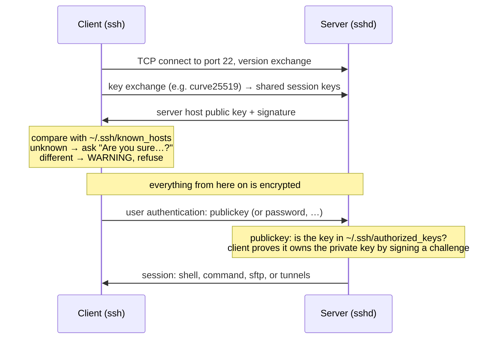
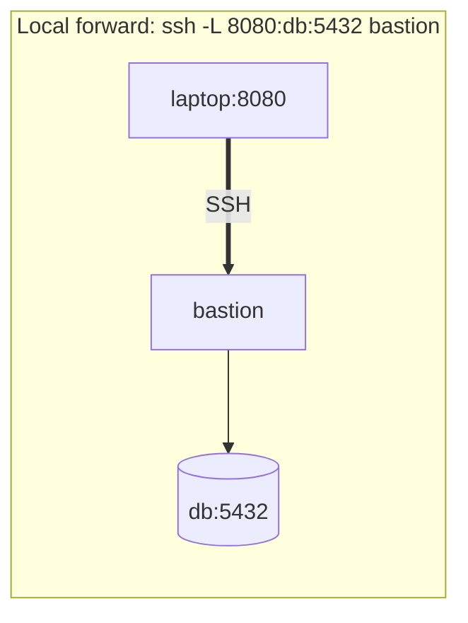

# The OpenSSH Server and Client

<!-- nav:start -->
> **Module 07 · Networking** — lesson 8 of 11  
> [Module index](README.md) · [Course lesson (commands)](../../course/07-Networking.md#lesson-8---openssh-server--client-gap) · [Exercises for this lesson](../../exercises/07-networking/08-openssh.md)
<!-- nav:end -->

**SSH** (*Secure Shell*) is how administrators reach Linux servers: encrypted remote logins, remote commands, file transfers and tunnels. **OpenSSH** provides both the server (`sshd`) and the client (`ssh`, `scp`, `sftp`, `ssh-keygen`, `ssh-copy-id`, `ssh-agent`). In this lesson you will learn how SSH secures a connection, how to use key-based authentication, how to configure and harden the server, how to configure the client, and how to use SSH for file transfer, port forwarding and jump hosts.

## What you will learn

- How an SSH connection is established: host keys, key exchange, user authentication
- Host key verification and `known_hosts`
- Key pairs: creating, installing (`ssh-copy-id`), permissions, `ssh-agent`
- Server configuration: `sshd_config`, drop-ins, important options, testing and reloading
- Restricting access (users, groups, root, passwords) and changing the port (incl. SELinux and firewall)
- Client configuration: `~/.ssh/config`
- `scp`, `sftp`, `rsync` over SSH
- Local, remote and dynamic port forwarding; jump hosts
- Troubleshooting

---

## Key terms

| Term | Definition |
|------|-----------|
| **sshd** | The SSH server daemon (service `sshd` on RHEL, `ssh` on Ubuntu). Port 22/TCP. |
| **Host key** | The server's key pair (`/etc/ssh/ssh_host_*_key`); proves the server's identity to clients. |
| **`known_hosts`** | Client file recording the host keys of servers already seen (`~/.ssh/known_hosts`). |
| **Key pair** | A private key (secret, stays on the client) and a public key (installed on servers). |
| **`authorized_keys`** | Server-side file listing public keys allowed to log in as a user (`~/.ssh/authorized_keys`). |
| **Passphrase** | Password that encrypts a private key on disk. |
| **ssh-agent** | Process that holds decrypted private keys in memory for the session. |
| **Port forwarding (tunnel)** | Carrying other TCP connections inside the SSH connection. |
| **Jump host (bastion)** | An intermediate server used to reach internal hosts. |

---

## How an SSH connection works



1. **Encryption** is set up first using a key exchange – nobody on the network can read the session, including passwords.
2. **Server authentication** with the host key prevents man-in-the-middle attacks.
3. **User authentication**: public key (recommended), password, keyboard-interactive (OTP), GSSAPI (Kerberos).

### Host key verification

```console
$ ssh ana@rhel1
The authenticity of host 'rhel1 (192.168.56.20)' can't be established.
ED25519 key fingerprint is SHA256:k3N9u7…Xq0.
Are you sure you want to continue connecting (yes/no/[fingerprint])? yes
Warning: Permanently added 'rhel1' (ED25519) to the list of known hosts.
```

Compare the fingerprint with the one on the server (`ssh-keygen -lf /etc/ssh/ssh_host_ed25519_key.pub`) before typing `yes`.

If a host key changes later, you'll see:

```text
@@@@@@@@@@@@@@@@@@@@@@@@@@@@@@@@@@@@@@@@@@@@@@@@@@@@@@@@@@@
@    WARNING: REMOTE HOST IDENTIFICATION HAS CHANGED!     @
@@@@@@@@@@@@@@@@@@@@@@@@@@@@@@@@@@@@@@@@@@@@@@@@@@@@@@@@@@@
```

Legitimate reason: the server was reinstalled. Otherwise: possible attack. After verifying, remove the old key: `ssh-keygen -R rhel1`.

---

## Key-based authentication

### Create a key pair

```console
$ ssh-keygen -t ed25519 -C "ana@deb1"
Generating public/private ed25519 key pair.
Enter file in which to save the key (/home/ana/.ssh/id_ed25519):
Enter passphrase (empty for no passphrase):
Your identification has been saved in /home/ana/.ssh/id_ed25519
Your public key has been saved in /home/ana/.ssh/id_ed25519.pub
```

- **ed25519** is the modern default: small, fast, secure. Use `-t rsa -b 4096` only for old systems.
- The **private key** (`id_ed25519`) never leaves your machine; protect it with a passphrase.
- The **public key** (`id_ed25519.pub`) is one line you can share.

### Install the public key on the server

```console
$ ssh-copy-id ana@rhel1                         # appends the key to ~/.ssh/authorized_keys on rhel1
$ ssh-copy-id -i ~/.ssh/deploy_key.pub ana@rhel1
$ ssh ana@rhel1                                 # no password asked (maybe the key passphrase)
```

Manually: append the `.pub` line to `~/.ssh/authorized_keys` on the server.

### Permissions – strictly enforced

sshd ignores keys if files are too open (`StrictModes yes`):

| Path | Mode | Owner |
|------|------|-------|
| `~` (home) | not group/world-writable (e.g. 755 or 700) | user |
| `~/.ssh` | `700` | user |
| `~/.ssh/authorized_keys` | `600` | user |
| private key `~/.ssh/id_*` | `600` | user |
| public key | `644` | user |

```console
$ chmod 700 ~/.ssh; chmod 600 ~/.ssh/authorized_keys
```

On SELinux systems, a hand-created `.ssh` may have a wrong label: `restorecon -Rv ~/.ssh`.

### ssh-agent

```console
$ eval "$(ssh-agent)"            # usually already running in desktop sessions
$ ssh-add ~/.ssh/id_ed25519      # enter the passphrase once
$ ssh-add -l                     # loaded keys
$ ssh -A bastion                 # agent forwarding (use only to trusted hosts)
```

### Restricting a key

Options in front of a key in `authorized_keys`:

```text
from="192.168.56.0/24",command="/usr/local/bin/backup.sh",no-port-forwarding,no-pty ssh-ed25519 AAAA… backup@deb1
```

---

## Server configuration

### Files

| File | Purpose |
|------|---------|
| `/etc/ssh/sshd_config` | main server configuration |
| `/etc/ssh/sshd_config.d/*.conf` | drop-ins, included at the top of `sshd_config` (`Include` line) |
| `/etc/ssh/ssh_host_*_key{,.pub}` | host keys |
| `/etc/ssh/ssh_config`, `/etc/ssh/ssh_config.d/` | system-wide **client** config |

> **First value wins.** For most sshd options, the first occurrence is used. Because the `Include` of `sshd_config.d/*.conf` is at the top, drop-in files override the main file – put your settings in a drop-in like `/etc/ssh/sshd_config.d/50-local.conf`. Some distributions ship drop-ins (e.g. Ubuntu cloud images `50-cloud-init.conf` setting `PasswordAuthentication yes`) – check them!

### Important options

```text
# /etc/ssh/sshd_config.d/50-local.conf
Port 22
ListenAddress 0.0.0.0
PermitRootLogin no                 # or prohibit-password (keys only)
PasswordAuthentication no          # keys only (make sure your key works first!)
PubkeyAuthentication yes
KbdInteractiveAuthentication no
AllowUsers ana luis                # only these users (or AllowGroups sshusers)
MaxAuthTries 3
LoginGraceTime 30
ClientAliveInterval 300            # keepalive / idle detection
ClientAliveCountMax 2
X11Forwarding no
AllowTcpForwarding yes
Banner /etc/issue.net
```

`Match` blocks apply options conditionally (must come at the end of a file):

```text
Match Group sftponly
    ChrootDirectory /srv/sftp/%u
    ForceCommand internal-sftp
    AllowTcpForwarding no
Match Address 192.168.56.0/24
    PasswordAuthentication yes
```

### Test, then reload

```console
$ sudo sshd -t                    # syntax check – no output = OK
$ sudo sshd -T | grep -E 'permitrootlogin|passwordauthentication|port '   # effective config
permitrootlogin no
passwordauthentication no
port 22
$ sudo systemctl reload sshd      # Ubuntu: ssh. Existing sessions stay open.
```

> **Golden rule:** keep your current session open and test a **new** login in a second terminal before closing it. A broken sshd config can lock you out.

### Changing the port

Changing `Port` involves three layers on RHEL:

```console
# 1. sshd
$ echo "Port 2222" | sudo tee /etc/ssh/sshd_config.d/10-port.conf
# 2. SELinux: allow sshd to bind 2222
$ sudo semanage port -a -t ssh_port_t -p tcp 2222
# 3. firewall
$ sudo firewall-cmd --permanent --add-port=2222/tcp && sudo firewall-cmd --reload
$ sudo sshd -t && sudo systemctl restart sshd
$ ss -tlnp | grep sshd
LISTEN 0 128 0.0.0.0:2222 0.0.0.0:* users:(("sshd",pid=4120,fd=3))
```

> **Ubuntu 24.04+**: sshd is **socket-activated** – `ssh.socket` listens and starts `ssh.service`. The listening port is generated from `sshd_config` when you run `systemctl daemon-reload`, then `systemctl restart ssh.socket`. (Or disable socket activation: `systemctl disable --now ssh.socket; systemctl enable --now ssh.service`.)

### Logs

```console
$ journalctl -u sshd -f            # Ubuntu: -u ssh
$ sudo grep sshd /var/log/secure   # RHEL  (/var/log/auth.log on Ubuntu)
Oct 21 11:02:13 rhel1 sshd[4321]: Accepted publickey for ana from 192.168.56.10 port 51234 ssh2: ED25519 SHA256:…
Oct 21 11:03:40 rhel1 sshd[4400]: Failed password for invalid user admin from 203.0.113.9 port 40022 ssh2
```

---

## Client configuration

```console
$ ssh ana@rhel1                      # user@host
$ ssh -p 2222 ana@rhel1              # port
$ ssh -i ~/.ssh/deploy_key ana@rhel1 # specific key
$ ssh ana@rhel1 'uptime; df -h /'    # run commands remotely
$ ssh -v ana@rhel1                   # debug (-vv, -vvv more)
```

### ~/.ssh/config

```text
# ~/.ssh/config   (mode 600)
Host web
    HostName 192.168.56.20
    User ana
    Port 2222
    IdentityFile ~/.ssh/id_ed25519

Host internal-*
    User admin
    ProxyJump bastion

Host *
    ServerAliveInterval 60
    AddKeysToAgent yes
```

Now `ssh web` replaces `ssh -p 2222 -i ~/.ssh/id_ed25519 ana@192.168.56.20`. For each option, the **first** matching value wins – put specific `Host` blocks before `Host *`. System-wide defaults: `/etc/ssh/ssh_config(.d/)`.

---

## Copying files

```console
$ scp report.txt ana@rhel1:/tmp/                  # local → remote
$ scp ana@rhel1:/var/log/messages ./               # remote → local
$ scp -r -P 2222 ./site ana@rhel1:/srv/            # directory, port (capital P)
$ sftp ana@rhel1                                   # interactive: ls, cd, get, put, mkdir, exit
$ rsync -avz -e ssh ./site/ ana@rhel1:/srv/site/   # efficient sync (only changes)
$ rsync -avz -e "ssh -p 2222" ...
```

---

## Port forwarding and jump hosts



| Type | Command | Meaning |
|------|---------|---------|
| **Local** | `ssh -L 8080:localhost:80 ana@rhel1` | connections to **your** `localhost:8080` go to `rhel1`'s port 80 (as seen from rhel1) |
| | `ssh -L 5432:db.internal:5432 ana@bastion` | reach an internal database through a bastion |
| **Remote** | `ssh -R 9000:localhost:3000 ana@server` | connections to **server**'s port 9000 come back to your port 3000 |
| **Dynamic** | `ssh -D 1080 ana@bastion` | a SOCKS proxy on your port 1080 |
| **Jump host** | `ssh -J bastion ana@internal` | connect to `internal` through `bastion` (or `ProxyJump` in config) |

Add `-N` (no remote command) and `-f` (background) for tunnels only: `ssh -fN -L 8080:localhost:80 rhel1`. Server-side control: `AllowTcpForwarding`, `GatewayPorts`, `PermitOpen`.

---

## Troubleshooting

| Symptom | Check |
|---------|-------|
| `Connection refused` | sshd not running / wrong port: `systemctl status sshd`, `ss -tlnp` |
| `Connection timed out` | firewall, routing, wrong IP |
| `Permission denied (publickey)` | key not in `authorized_keys`, wrong permissions on `~`/`.ssh`, wrong user, SELinux label, `PubkeyAuthentication no`, user not in `AllowUsers` |
| Asks for password although a key is installed | same as above – look at `ssh -v` ("Offering public key… ") and server logs |
| `Host key verification failed` | changed host key → verify, then `ssh-keygen -R host` |
| sshd fails to start after a change | `sshd -t`, `journalctl -u sshd`; port label (SELinux) |
| Slow login | DNS reverse lookup (`UseDNS no`), GSSAPI (`GSSAPIAuthentication no`) |

---

## Try it yourself

1. As user `ana` on `deb1`, create an ed25519 key with a passphrase and install it on `rhel1`. Log in using `ssh-agent`.
2. On `rhel1`, disable root login and password authentication with a drop-in; verify with `sshd -T`; test in a new terminal.
3. Allow only users in group `sshusers`.
4. Move `rhel1`'s SSH to port 2222 (sshd + SELinux + firewall).
5. Create a `~/.ssh/config` entry `web` for it and copy a directory with `scp` and `rsync`.
6. Run a web server on `rhel1` bound to `127.0.0.1:8080` and reach it from `deb1` through a local port forward.

---

## Common mistakes

- Disabling passwords before testing key login → locked out.
- Wrong permissions on home, `.ssh` or `authorized_keys`.
- Editing `sshd_config` while a drop-in already sets the same option (first value wins).
- Changing the port without SELinux/firewall updates on RHEL – or without `ssh.socket` handling on new Ubuntu.
- Restarting sshd with a syntax error – always `sshd -t` first.

---

## Summary

| Task | Command / file |
|------|----------------|
| Create key | `ssh-keygen -t ed25519` |
| Install key | `ssh-copy-id user@host` |
| Server config | `/etc/ssh/sshd_config.d/*.conf` → `sshd -t` → `systemctl reload sshd` |
| Effective config | `sshd -T` |
| Key options | `PermitRootLogin`, `PasswordAuthentication`, `PubkeyAuthentication`, `AllowUsers/AllowGroups`, `Port` |
| New port (RHEL) | `semanage port -a -t ssh_port_t -p tcp N` + firewall |
| Client config | `~/.ssh/config` (`Host`, `HostName`, `User`, `Port`, `IdentityFile`, `ProxyJump`) |
| Copy | `scp`, `sftp`, `rsync -e ssh` |
| Tunnels | `-L`, `-R`, `-D`, `-J` |
| Logs | `journalctl -u sshd`, `/var/log/secure`, `/var/log/auth.log` |

## Check yourself

1. What does the host key protect against?
2. Which three permissions do you check when key login fails?
3. Two lines set `PasswordAuthentication` – one in `sshd_config.d/50-cloud-init.conf` (yes) and one in `sshd_config` (no). Which wins?
4. Which three things must change on RHEL to move SSH to port 2222?
5. What does `ssh -L 8080:localhost:80 rhel1` do?

<details>
<summary>Answers</summary>

1. Man-in-the-middle attacks – the client verifies it's talking to the same server as before.
2. Home directory not group/world-writable, `~/.ssh` 700, `authorized_keys` 600 (all owned by the user).
3. The drop-in (yes) – it's included before the rest of `sshd_config` and the first value wins.
4. The `Port` in sshd config, the SELinux port label (`ssh_port_t`), and the firewall.
5. Opens port 8080 on the local machine; connections to it are tunnelled to rhel1 and delivered to rhel1's `localhost:80`.

</details>

## Further reading

- `man 1 ssh`, `man 8 sshd`, `man 5 sshd_config`, `man 5 ssh_config`, `man 1 ssh-keygen`, `man 1 ssh-copy-id`
- [OpenSSH manual pages](https://www.openssh.com/manual.html)
- [Ubuntu Server: OpenSSH server](https://documentation.ubuntu.com/server/how-to/security/openssh-server/)
- [Red Hat: Using secure communications between two systems with OpenSSH (RHEL 9)](https://docs.redhat.com/en/documentation/red_hat_enterprise_linux/9/html/securing_networks/assembly_using-secure-communications-between-two-systems-with-openssh_securing-networks)
- [ArchWiki: OpenSSH](https://wiki.archlinux.org/title/OpenSSH) · [SSH keys](https://wiki.archlinux.org/title/SSH_keys)

---

<!-- footer:start -->
[← Packet Filtering, Port Redirection and NAT](07-firewalls-nat.md) · [Module index](README.md) · [Setting and Synchronizing System Time →](09-time-sync.md)  
**Practice now:** [Exercises – The OpenSSH Server and Client](../../exercises/07-networking/08-openssh.md)
<!-- footer:end -->
