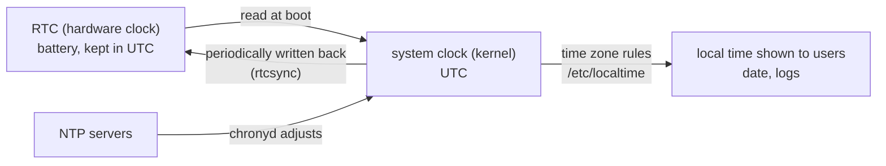
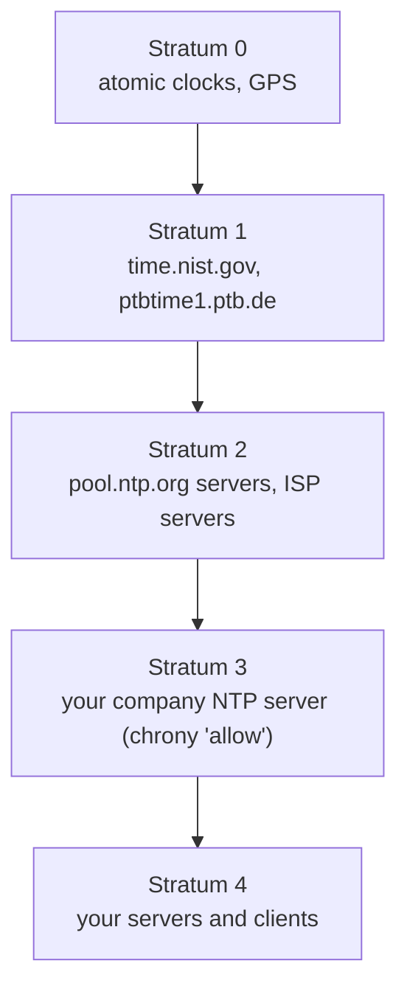

# Setting and Synchronizing System Time

<!-- nav:start -->
> **Module 07 · Networking** — lesson 9 of 11  
> [Module index](README.md) · [Course lesson (commands)](../../course/07-Networking.md#lesson-9---time-synchronization-gap) · [Exercises for this lesson](../../exercises/07-networking/09-time-sync.md)
<!-- nav:end -->

Correct time is critical: log timestamps must line up across servers, TLS certificates have validity dates, Kerberos rejects clocks that are more than 5 minutes off, cron and timers fire at the wrong moment, and distributed databases can corrupt data with skewed clocks. In this lesson you will learn how Linux keeps time, how to set the time zone and clock, how NTP works, and how to configure **chrony** (and systemd-timesyncd) as a client and as a server.

## What you will learn

- System clock vs hardware clock (RTC), UTC vs local time, time zones
- `timedatectl`: status, time zone, manual time, NTP on/off
- NTP concepts: servers, pools, strata, offset, jitter, stepping vs slewing
- chrony: configuration, `chronyc` monitoring, acting as an NTP server
- systemd-timesyncd as a simple client
- Firewall and troubleshooting

---

## Key terms

| Term | Definition |
|------|-----------|
| **System clock** | The kernel's clock, used by everything at runtime. Counts in UTC. |
| **Hardware clock / RTC** | Battery-backed clock on the motherboard; read at boot, keeps time while powered off. |
| **UTC** | Coordinated Universal Time – the reference; no daylight saving. |
| **Time zone** | Rules converting UTC to local time (`Europe/Madrid`); stored as `/etc/localtime` → `/usr/share/zoneinfo/…`. |
| **NTP** | *Network Time Protocol*, UDP port **123**. Synchronizes clocks over the network to milliseconds or better. |
| **Stratum** | Distance from a reference clock: stratum 0 = atomic/GPS clock, stratum 1 = server attached to it, stratum 2 = synced from stratum 1… |
| **Offset** | Difference between the local clock and the server's. |
| **Slewing** | Correcting the clock gradually by running it slightly faster/slower (no jumps). |
| **Stepping** | Setting the clock to the correct time in one jump. |
| **chrony** | Modern NTP implementation: `chronyd` daemon + `chronyc` client. Default on RHEL and Ubuntu 24.04+. |
| **systemd-timesyncd** | Lightweight SNTP client from systemd (client only). |

---

## Clocks and time zones



The kernel always counts in UTC. The **time zone** is only a display rule, so changing it doesn't change the actual time – just how it's shown. Keep the RTC in **UTC** (Windows dual-boot is the only reason to use local time).

---

## timedatectl

```console
$ timedatectl
               Local time: Tue 2026-10-21 12:15:03 CEST
           Universal time: Tue 2026-10-21 10:15:03 UTC
                 RTC time: Tue 2026-10-21 10:15:03
                Time zone: Europe/Madrid (CEST, +0200)
System clock synchronized: yes
              NTP service: active
          RTC in local TZ: no
```

| Line | Meaning |
|------|---------|
| System clock synchronized | the clock is currently disciplined by NTP |
| NTP service | an NTP client (chronyd or timesyncd) is enabled |
| RTC in local TZ | `no` = RTC in UTC (recommended) |

### Time zones

```console
$ timedatectl list-timezones | grep -i madrid
Europe/Madrid
$ sudo timedatectl set-timezone Europe/Madrid
$ ls -l /etc/localtime
lrwxrwxrwx 1 root root 35 Oct 21 12:16 /etc/localtime -> ../usr/share/zoneinfo/Europe/Madrid
$ TZ=America/New_York date            # show time in another zone (one command only)
```

### Setting the time manually

```console
$ sudo timedatectl set-ntp false                       # must disable NTP first
$ sudo timedatectl set-time "2026-10-21 12:30:00"
$ sudo timedatectl set-ntp true                        # re-enable synchronization
$ sudo hwclock --show                                  # read the RTC
$ sudo hwclock --systohc                               # write system time → RTC
```

`set-ntp true/false` enables/disables the NTP service (chronyd or systemd-timesyncd, whichever is installed).

---

## NTP concepts



- A client queries several servers, filters bad ones, and disciplines the local clock.
- Small offsets are **slewed** (at most ~0.5 ms/s) to avoid time jumping backwards; large offsets at startup are **stepped**.
- **Pools** (`pool.ntp.org`, `2.rhel.pool.ntp.org`, `ntp.ubuntu.com`) resolve to many servers; `pool` directives use several of them.
- In organizations, a few internal servers sync from the internet and all other machines sync from them.

---

## chrony

### Install and enable

```console
$ sudo dnf install chrony            # RHEL: installed by default
$ sudo apt install chrony            # Ubuntu (replaces systemd-timesyncd)
$ sudo systemctl enable --now chronyd     # Ubuntu service name: chrony
```

### Configuration

File: `/etc/chrony.conf` (RHEL) or `/etc/chrony/chrony.conf` (Debian/Ubuntu; also `/etc/chrony/sources.d/*.sources`).

```text
# Time sources
pool 2.rocky.pool.ntp.org iburst          # several servers from a pool
server ntp1.example.lab iburst prefer     # a specific server, preferred
server 192.168.56.10 iburst

# Step the clock if the offset is > 1 s during the first 3 updates
makestep 1.0 3

# Keep the RTC synchronized
rtcsync

# Record the clock's drift rate
driftfile /var/lib/chrony/drift

# Act as a server for the lab subnet
allow 192.168.56.0/24

# Serve time even when not synchronized (isolated labs only)
#local stratum 10

logdir /var/log/chrony
```

| Directive | Meaning |
|-----------|---------|
| `server HOST` | one NTP server |
| `pool NAME` | a pool of servers (several addresses) |
| `iburst` | send a burst of requests at start → faster initial sync |
| `prefer` | prefer this source |
| `makestep T N` | step instead of slew if offset > T seconds, during the first N updates (`-1` = always) |
| `rtcsync` | let the kernel copy system time to the RTC periodically |
| `allow NET` | allow clients from NET to query this host → **NTP server** |
| `deny NET` | deny clients |
| `local stratum N` | serve time even without upstream sync |

Apply: `sudo systemctl restart chronyd` (Ubuntu: `chrony`).

### Monitoring with chronyc

```console
$ chronyc sources -v
MS Name/IP address         Stratum Poll Reach LastRx Last sample
===============================================================================
^* ntp1.example.lab              2   6   377    34   +215us[ +301us] +/-   12ms
^+ 162.159.200.123               3   6   377    35   -1210us[-1124us] +/-  18ms
^- 192.168.56.10                 4   6   377    33   +4.2ms[ +4.2ms] +/-   40ms
^? 203.0.113.5                   0   6     0     -     +0ns[   +0ns] +/-    0ns
```

| Symbol | Meaning |
|--------|---------|
| `^` | server (`=` peer, `#` local reference clock) |
| `*` | **currently selected** source |
| `+` | acceptable, combined with the selected one |
| `-` | acceptable but excluded |
| `?` | unreachable / not yet usable |
| `x` | falseticker (disagrees with the others) |
| Reach | octal bitmask of the last 8 polls; `377` = all answered |

```console
$ chronyc tracking
Reference ID    : C0A8380A (ntp1.example.lab)
Stratum         : 3
System time     : 0.000214300 seconds fast of NTP time
Last offset     : +0.000086124 seconds
RMS offset      : 0.000101532 seconds
Leap status     : Normal
$ chronyc sourcestats           # drift and offset statistics per source
$ sudo chronyc makestep          # step the clock now (after a big jump)
$ sudo chronyc clients           # on a server: which clients asked us
$ chronyc activity               # number of online/offline sources
```

### chrony as an NTP server

```console
$ echo "allow 192.168.56.0/24" | sudo tee -a /etc/chrony.conf     # Debian: /etc/chrony/chrony.conf
$ sudo systemctl restart chronyd
$ sudo firewall-cmd --permanent --add-service=ntp && sudo firewall-cmd --reload   # UDP 123
$ sudo ufw allow from 192.168.56.0/24 to any port 123 proto udp                   # Ubuntu
$ ss -ulnp | grep 123
UNCONN 0 0 0.0.0.0:123 0.0.0.0:* users:(("chronyd",pid=812,fd=7))
```

On each client, point chrony at it (`server 192.168.56.10 iburst`), restart, and check `chronyc sources` shows it with `*`.

---

## systemd-timesyncd

A simple SNTP **client** (no server function), used by default on some Ubuntu/Debian installs.

```text
# /etc/systemd/timesyncd.conf   (or a drop-in in timesyncd.conf.d/)
[Time]
NTP=192.168.56.10 ntp.ubuntu.com
FallbackNTP=pool.ntp.org
```

```console
$ sudo systemctl restart systemd-timesyncd
$ timedatectl timesync-status
       Server: 192.168.56.10 (192.168.56.10)
Poll interval: 34min 8s (min: 32s; max 34min 8s)
         Leap: normal
       Stratum: 3
        Offset: -312us
$ timedatectl show-timesync --all
```

Only one NTP client should run: installing chrony on Ubuntu removes/disables timesyncd.

---

## Troubleshooting

| Symptom | Check |
|---------|-------|
| `System clock synchronized: no` | NTP service running? `chronyc sources` – any `*`? |
| All sources `?` | DNS resolves the server? UDP 123 outbound blocked? `chronyc activity` |
| Clients can't sync from your server | `allow` directive, firewall (UDP 123 inbound), `chronyc clients` on the server |
| Huge offset that doesn't go away | `makestep` missing → `chronyc makestep`; or wrong time zone (time looks off by whole hours but UTC is right) |
| `timedatectl set-time` fails: "Automatic time synchronization is enabled" | `timedatectl set-ntp false` first |
| Time wrong after reboot | RTC wrong / not synced (`rtcsync`, `hwclock --systohc`), RTC in local TZ |

---

## Try it yourself

1. Set the time zone of both VMs to your zone; check with `timedatectl` and `date`.
2. Disable NTP, set the clock 10 minutes wrong, re-enable NTP and watch `chronyc tracking` correct it (use `chronyc makestep` if needed).
3. Make `deb1` an NTP server for the lab subnet (chrony `allow`, firewall).
4. Configure `rhel1` to sync **only** from `deb1`; verify `^*` next to `deb1` in `chronyc sources`, and `chronyc clients` on `deb1`.
5. Configure systemd-timesyncd (on a VM without chrony) to use `deb1`; check `timedatectl timesync-status`.

---

## Common mistakes

- Confusing time zone with time: changing the zone doesn't fix a wrong UTC time.
- Running two NTP clients (chrony and timesyncd/ntpd).
- Forgetting `allow` (chrony serves no clients by default) or the UDP 123 firewall rule.
- Editing the wrong file (`/etc/chrony.conf` vs `/etc/chrony/chrony.conf`) or restarting the wrong service name (`chronyd` vs `chrony`).
- `timedatectl set-time` while NTP is on.

---

## Summary

| Task | Command / file |
|------|----------------|
| Status | `timedatectl` |
| Time zone | `timedatectl set-timezone Area/City` |
| NTP on/off | `timedatectl set-ntp true/false` |
| Manual time | `timedatectl set-time "YYYY-MM-DD HH:MM:SS"` (NTP off) |
| RTC | `hwclock --show`, `hwclock --systohc` |
| chrony config | `/etc/chrony.conf` (RHEL), `/etc/chrony/chrony.conf` (Debian): `server`, `pool`, `iburst`, `makestep`, `allow` |
| chrony status | `chronyc sources -v`, `chronyc tracking`, `chronyc clients` |
| Force step | `chronyc makestep` |
| timesyncd | `/etc/systemd/timesyncd.conf` `NTP=`, `timedatectl timesync-status` |
| Firewall | UDP 123 (`firewall-cmd --add-service=ntp`) |

## Check yourself

1. Why should the hardware clock be kept in UTC?
2. What does `^*` mean in `chronyc sources`?
3. Which directive turns chrony into an NTP server for a subnet?
4. What's the difference between slewing and stepping the clock?
5. Which port and protocol does NTP use?

<details>
<summary>Answers</summary>

1. UTC has no daylight-saving jumps; the OS applies the time zone. Local-time RTCs cause errors twice a year and with multiple OSes.
2. A server (`^`) that is the currently selected synchronization source (`*`).
3. `allow <network>` (plus the firewall rule).
4. Slewing gradually adjusts the clock speed so time never jumps; stepping sets the correct time at once.
5. UDP 123.

</details>

## Further reading

- `man timedatectl`, `man 5 chrony.conf`, `man 1 chronyc`, `man 5 timesyncd.conf`, `man 8 hwclock`
- [chrony documentation](https://chrony-project.org/documentation.html) · [chrony FAQ](https://chrony-project.org/faq.html)
- [Red Hat: Configuring time synchronization (RHEL 9)](https://docs.redhat.com/en/documentation/red_hat_enterprise_linux/9/html/configuring_basic_system_settings/configuring-time-synchronization_configuring-basic-system-settings)
- [Ubuntu Server: About time synchronisation](https://documentation.ubuntu.com/server/explanation/networking/about-time-synchronisation/)
- [ArchWiki: System time](https://wiki.archlinux.org/title/System_time) · [Chrony](https://wiki.archlinux.org/title/Chrony)

---

<!-- footer:start -->
[← The OpenSSH Server and Client](08-openssh.md) · [Module index](README.md) · [Reverse Proxies and Load Balancers →](10-reverse-proxy.md)  
**Practice now:** [Exercises – Setting and Synchronizing System Time](../../exercises/07-networking/09-time-sync.md)
<!-- footer:end -->
