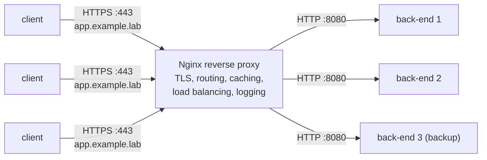

# Reverse Proxies and Load Balancers

<!-- nav:start -->
> **Module 07 · Networking** — lesson 10 of 11  
> [Module index](README.md) · [Course lesson (commands)](../../course/07-Networking.md#lesson-10---reverse-proxy--load-balancer-gap) · [Exercises for this lesson](../../exercises/07-networking/10-reverse-proxy.md)
<!-- nav:end -->

Most web applications are not exposed directly to users. A **reverse proxy** sits in front of them: it accepts client connections, terminates TLS, routes requests to the right back-end, and can spread the load over several back-ends (**load balancing**). In this lesson you will learn the concepts and how to implement both with **Nginx** – the tool most LFCS tasks use – and see how HAProxy does the same.

## What you will learn

- Forward vs reverse proxies; why use a reverse proxy
- Layer 7 (HTTP) vs layer 4 (TCP/UDP) proxying
- Nginx structure: configuration files, `server` and `location` blocks
- A single-backend reverse proxy with `proxy_pass` and the important headers
- Load balancing with `upstream`: algorithms, weights, backups, health checks
- TLS termination at the proxy
- TCP/UDP load balancing with the `stream` module
- SELinux and firewall considerations; testing and troubleshooting
- HAProxy equivalent (overview)

---

## Key terms

| Term | Definition |
|------|-----------|
| **Forward proxy** | Acts on behalf of **clients** to reach other servers (e.g. corporate web proxy). |
| **Reverse proxy** | Acts on behalf of **servers**: clients connect to it, it forwards to back-ends. Clients never see the back-ends. |
| **Back-end / upstream** | A server the proxy forwards requests to. |
| **Load balancer** | A reverse proxy distributing requests over several back-ends. |
| **Layer 7 proxy** | Understands HTTP: can route by host name, path, headers; can rewrite. |
| **Layer 4 proxy** | Forwards TCP/UDP connections without understanding the protocol. |
| **TLS termination** | The proxy handles HTTPS and talks plain HTTP (or new TLS) to back-ends. |
| **Health check** | Detecting failed back-ends and removing them from rotation. |
| **Session persistence (sticky sessions)** | Sending a client to the same back-end every time. |

---

## Why a reverse proxy?



- **Single entry point** for many applications (`/api` → API servers, `/` → web servers; or by host name).
- **TLS termination**: certificates managed in one place.
- **Load balancing and high availability**: if a back-end fails, traffic goes to the others.
- **Security**: back-ends on private networks, not reachable directly; rate limiting; request size limits.
- **Performance**: caching, compression, keep-alive connection reuse.

---

## Nginx basics

### Install and files

```console
$ sudo apt install nginx                         # Ubuntu – starts automatically
$ sudo dnf install nginx && sudo systemctl enable --now nginx   # RHEL
```

| Path | Purpose |
|------|---------|
| `/etc/nginx/nginx.conf` | main configuration; includes the others |
| `/etc/nginx/conf.d/*.conf` | site configs (both families) |
| `/etc/nginx/sites-available/` + `sites-enabled/` (symlinks) | Debian/Ubuntu site management |
| `/var/log/nginx/access.log`, `error.log` | logs |
| `/usr/share/nginx/html/`, `/var/www/html/` | default document roots |

### Structure

```nginx
http {                                  # in nginx.conf
    upstream app_backend { … }          # groups of back-ends
    server {                            # a virtual host
        listen 80;
        server_name app.example.lab;
        location / { … }                # what to do for matching URLs
        location /api/ { … }
    }
}
stream { … }                            # optional: TCP/UDP proxying (layer 4)
```

- **`server_name`** selects the virtual host from the HTTP `Host` header. If none matches, the `default_server` (or the first server) answers.
- **`location`** blocks match URL paths; the most specific prefix wins (`=` exact, `^~` prefix, `~` regex).
- Every directive ends with `;`.

### Always test before reloading

```console
$ sudo nginx -t
nginx: the configuration file /etc/nginx/nginx.conf syntax is ok
nginx: configuration file /etc/nginx/nginx.conf test is successful
$ sudo systemctl reload nginx            # graceful: existing connections finish
```

---

## A single-backend reverse proxy

Example: a Python app listens on `127.0.0.1:3000`; publish it on port 80 as `app.example.lab`.

```nginx
# /etc/nginx/conf.d/app.conf
server {
    listen 80;
    server_name app.example.lab;

    location / {
        proxy_pass http://127.0.0.1:3000;
        proxy_set_header Host              $host;
        proxy_set_header X-Real-IP         $remote_addr;
        proxy_set_header X-Forwarded-For   $proxy_add_x_forwarded_for;
        proxy_set_header X-Forwarded-Proto $scheme;
    }
}
```

| Header | Why |
|--------|-----|
| `Host` | the back-end sees the original host name (not `127.0.0.1:3000`) |
| `X-Real-IP`, `X-Forwarded-For` | the back-end learns the real client IP (otherwise it sees the proxy's IP) |
| `X-Forwarded-Proto` | the back-end knows the client used HTTPS |

### Trailing slash in proxy_pass

```nginx
location /api/ { proxy_pass http://127.0.0.1:3000; }    # /api/users → http://127.0.0.1:3000/api/users
location /api/ { proxy_pass http://127.0.0.1:3000/; }   # /api/users → http://127.0.0.1:3000/users
```

With a URI part (even just `/`), the matched location prefix is **replaced**.

### Test

```console
$ curl -H "Host: app.example.lab" http://localhost/          # without DNS
$ curl -I http://app.example.lab/                             # with /etc/hosts entry
```

---

## Load balancing with upstream

```nginx
# /etc/nginx/conf.d/lb.conf
upstream app_backend {
    # algorithm (default: round robin)
    # least_conn;
    # ip_hash;
    server 192.168.56.20:8081 weight=2;
    server 192.168.56.20:8082;
    server 192.168.56.21:8080 max_fails=3 fail_timeout=30s;
    server 192.168.56.22:8080 backup;
    keepalive 16;
}

server {
    listen 80;
    server_name app.example.lab;

    location / {
        proxy_pass http://app_backend;
        proxy_http_version 1.1;
        proxy_set_header Connection "";
        proxy_set_header Host $host;
        proxy_set_header X-Forwarded-For $proxy_add_x_forwarded_for;
        proxy_next_upstream error timeout http_502 http_503;
    }
}
```

| Method / option | Behaviour |
|-----------------|-----------|
| (default) round robin | requests in turn to each server |
| `weight=N` | server gets N times its share |
| `least_conn` | to the server with the fewest active connections |
| `ip_hash` | same client IP → same server (sticky) |
| `hash $request_uri consistent` | by any key |
| `backup` | only used when all primary servers are down |
| `down` | mark a server permanently unavailable |
| `max_fails`, `fail_timeout` | passive health check: after N failures, skip the server for the timeout |
| `proxy_next_upstream` | retry the request on another server on these errors |

Open-source Nginx does **passive** health checks (based on real request failures); active probing is an Nginx Plus / HAProxy feature.

### Demonstrating load balancing

On a back-end host, run two tiny servers with different content:

```console
$ mkdir -p /srv/b1 /srv/b2; echo "backend 1" > /srv/b1/index.html; echo "backend 2" > /srv/b2/index.html
$ (cd /srv/b1 && python3 -m http.server 8081 &) ; (cd /srv/b2 && python3 -m http.server 8082 &)
```

On the proxy:

```console
$ for i in 1 2 3 4; do curl -s http://localhost/; done
backend 1
backend 1
backend 2
backend 1
```

(weight=2 on 8081.) Stop one back-end and repeat: all requests go to the remaining one.

---

## TLS termination

```nginx
server {
    listen 443 ssl;
    http2 on;                                    # Nginx ≥ 1.25.1; older: listen 443 ssl http2;
    server_name app.example.lab;
    ssl_certificate     /etc/nginx/ssl/app.crt;   # certificate (+ intermediate chain)
    ssl_certificate_key /etc/nginx/ssl/app.key;   # private key, mode 600
    ssl_protocols TLSv1.2 TLSv1.3;

    location / {
        proxy_pass http://app_backend;
        proxy_set_header Host $host;
        proxy_set_header X-Forwarded-Proto https;
    }
}

server {                                         # redirect HTTP → HTTPS
    listen 80;
    server_name app.example.lab;
    return 301 https://$host$request_uri;
}
```

Creating the certificate is covered in [SSL Certificates](../08-security-vms-containers/04-ssl-certificates.md).

---

## Layer 4: the stream module

For non-HTTP protocols (databases, SSH, DNS) Nginx can balance raw TCP/UDP. The `stream` block goes at the **top level** of `nginx.conf`, not inside `http`:

```nginx
# /etc/nginx/nginx.conf (top level) – RHEL may need the package nginx-mod-stream
stream {
    upstream db_backend {
        least_conn;
        server 192.168.56.21:5432;
        server 192.168.56.22:5432;
    }
    server {
        listen 5432;
        proxy_pass db_backend;
    }
    server {
        listen 53 udp;
        proxy_pass 192.168.56.53:53;
    }
}
```

---

## SELinux and firewall (RHEL)

```console
$ sudo firewall-cmd --permanent --add-service=http --add-service=https && sudo firewall-cmd --reload
$ sudo setsebool -P httpd_can_network_connect 1      # allow nginx to connect to back-ends
$ sudo semanage port -a -t http_port_t -p tcp 8443    # if nginx must LISTEN on a non-standard port
```

Without the boolean, the error log shows `connect() to 192.168.56.20:8081 failed (13: Permission denied) while connecting to upstream` and clients get **502 Bad Gateway**.

---

## Troubleshooting

| Client sees | Meaning | Check |
|-------------|---------|-------|
| connection refused | nginx not listening | `systemctl status nginx`, `ss -tlnp`, `nginx -t` |
| 404 | wrong `server`/`location` matched | `server_name`, `Host` header, `default_server` |
| **502 Bad Gateway** | proxy can't talk to the back-end | back-end running? reachable from the proxy (`curl` from the proxy)? SELinux boolean? |
| **504 Gateway Timeout** | back-end too slow | `proxy_read_timeout`, back-end performance |
| wrong client IPs in app logs | headers not set | `X-Forwarded-For`, `X-Real-IP` |

```console
$ sudo tail -f /var/log/nginx/error.log
$ sudo nginx -T | less                     # dump the full effective configuration
$ curl -v -H "Host: app.example.lab" http://127.0.0.1/
```

---

## HAProxy (overview)

HAProxy is a dedicated, very fast load balancer with active health checks and rich statistics.

```text
# /etc/haproxy/haproxy.cfg (excerpt)
frontend web
    bind *:80
    default_backend app

backend app
    balance roundrobin
    option httpchk GET /health
    server b1 192.168.56.20:8081 check
    server b2 192.168.56.20:8082 check
```

```console
$ sudo haproxy -c -f /etc/haproxy/haproxy.cfg && sudo systemctl reload haproxy
```

Apache can also proxy with `mod_proxy` and `mod_proxy_balancer` (`ProxyPass`, `BalancerMember`).

---

## Try it yourself

1. Install Nginx on `deb1`; publish a Python HTTP server on `127.0.0.1:3000` as `app.example.lab` on port 80.
2. On `rhel1`, start two back-ends on ports 8081 and 8082 with different pages (open the firewall).
3. On `deb1`, load-balance them; check the round robin; add `weight=3` to one; then mark the other `backup` and stop the first.
4. Add HTTPS with a self-signed certificate and an HTTP → HTTPS redirect.
5. Reproduce a 502 by stopping both back-ends; read the error log.

---

## Common mistakes

- Forgetting `nginx -t` before reloading.
- `upstream` or `proxy_pass` outside the right context (`upstream` belongs in `http`, `stream` blocks at the top level).
- Trailing-slash surprises with `proxy_pass`.
- Missing `Host` / `X-Forwarded-For` headers.
- 502 on RHEL because of `httpd_can_network_connect`.
- The default site still catching requests (`server_name` mismatch / `default_server`).

---

## Summary

| Task | Configuration |
|------|---------------|
| Simple reverse proxy | `location / { proxy_pass http://127.0.0.1:3000; proxy_set_header Host $host; … }` |
| Group of back-ends | `upstream NAME { server IP:PORT [weight=N] [backup]; }` |
| Algorithms | round robin (default), `least_conn`, `ip_hash`, `hash KEY` |
| Health | `max_fails=`, `fail_timeout=`, `proxy_next_upstream` |
| TLS | `listen 443 ssl; ssl_certificate …; ssl_certificate_key …;` |
| Layer 4 | `stream { upstream …; server { listen PORT; proxy_pass …; } }` |
| Validate / apply | `nginx -t && systemctl reload nginx` |
| RHEL | `setsebool -P httpd_can_network_connect 1`, firewall |

## Check yourself

1. What's the difference between a forward and a reverse proxy?
2. Why set `X-Forwarded-For`?
3. Which upstream option sends traffic to a server only when the others are down?
4. Clients get 502 from Nginx on RHEL although the back-end works with `curl` from another host. What do you check first?
5. Where does a `stream {}` block go?

<details>
<summary>Answers</summary>

1. A forward proxy acts for clients to reach any server; a reverse proxy acts for specific servers and receives client connections on their behalf.
2. So the back-end can see and log the real client IP instead of the proxy's.
3. `backup`.
4. The SELinux boolean `httpd_can_network_connect` (and whether the back-end is reachable from the proxy host).
5. At the top level of `nginx.conf`, outside `http {}`.

</details>

## Further reading

- [Nginx: Reverse proxy guide](https://docs.nginx.com/nginx/admin-guide/web-server/reverse-proxy/) · [HTTP load balancing](https://nginx.org/en/docs/http/load_balancing.html) · [ngx_http_upstream_module](https://nginx.org/en/docs/http/ngx_http_upstream_module.html) · [TCP/UDP load balancing](https://docs.nginx.com/nginx/admin-guide/load-balancer/tcp-udp-load-balancer/)
- [Ubuntu Server: Nginx](https://documentation.ubuntu.com/server/how-to/web-services/install-nginx/)
- [HAProxy documentation](https://docs.haproxy.org/)
- [Mozilla SSL Configuration Generator](https://ssl-config.mozilla.org/)

---

<!-- footer:start -->
[← Setting and Synchronizing System Time](09-time-sync.md) · [Module index](README.md) · [Monitoring and Troubleshooting the Network →](11-troubleshooting.md)  
**Practice now:** [Exercises – Reverse Proxies and Load Balancers](../../exercises/07-networking/10-reverse-proxy.md)
<!-- footer:end -->
