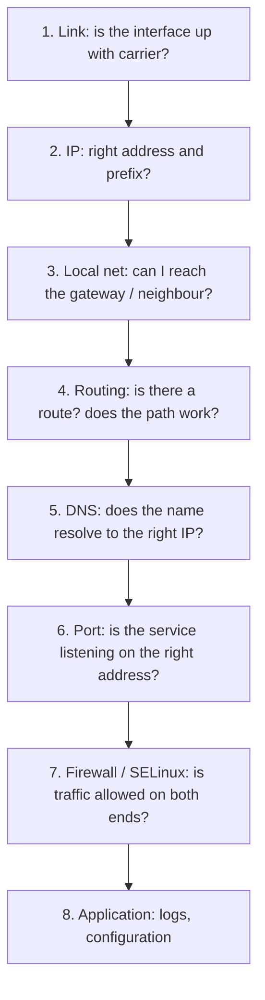

# Monitoring and Troubleshooting the Network

<!-- nav:start -->
> **Module 07 · Networking** — lesson 11 of 11  
> [Module index](README.md) · [Course lesson (commands)](../../course/07-Networking.md#lesson-11---monitoring--troubleshooting) · [Exercises for this lesson](../../exercises/07-networking/11-troubleshooting.md)
<!-- nav:end -->

"I can't reach the server" can mean a dozen different problems: a cable, an address, a route, DNS, a firewall, a stopped service, a service listening on the wrong address, or SELinux. In this lesson you will learn a systematic **bottom-up** method and the tools for each layer, from link state to packet captures.

## What you will learn

- The bottom-up troubleshooting method
- Layer 1–2: link state, statistics, ARP
- Layer 3: addresses, routes, `ping`, `tracepath`/`traceroute`/`mtr`
- Name resolution checks
- Layer 4: listening sockets (`ss`), connectivity tests (`nc`, `curl`)
- Firewall and SELinux checks
- Capturing traffic with `tcpdump`
- Monitoring bandwidth and connections

---

## Key terms

| Term | Definition |
|------|-----------|
| **Bottom-up troubleshooting** | Checking layers in order – link, IP, routing, DNS, transport, application – because each depends on those below. |
| **ICMP** | Control protocol used by `ping` (echo request/reply) and error messages (unreachable, time exceeded). |
| **TTL / hop limit** | Counter decremented by each router; used by traceroute to discover the path. |
| **Socket** | An endpoint (IP + port + protocol) a program listens on or connects from. |
| **Connection refused** | The host answered with a TCP RST – reachable, but nothing listens on that port (or a firewall rejects). |
| **Timeout** | No answer – packets are dropped (firewall drop, routing problem, host down). |
| **Packet capture** | Recording packets on an interface (`tcpdump`, Wireshark) to see exactly what's sent and received. |

---

## The method



Test from **both sides** when possible, and change one thing at a time.

---

## 1. Link

```console
$ ip -br link
enp1s0  UP    52:54:00:3a:1f:9c <BROADCAST,MULTICAST,UP,LOWER_UP>
enp7s0  DOWN  52:54:00:9e:21:04 <NO-CARRIER,BROADCAST,MULTICAST,UP>
$ sudo ethtool enp1s0 | grep -E 'Speed|Duplex|Link detected'
        Speed: 1000Mb/s
        Duplex: Full
        Link detected: yes
$ ip -s link show enp1s0            # errors / dropped counters
$ nmcli device status               # NetworkManager view
$ journalctl -k | grep -i enp1s0    # link up/down events
```

`NO-CARRIER` = no cable / virtual NIC disconnected / switch port down. Growing `errors` → cabling, duplex mismatch, driver.

---

## 2. IP configuration

```console
$ ip -br addr
enp1s0  UP  192.168.56.10/24 fd00:56::10/64 fe80::5054:ff:fe3a:1f9c/64
```

Check: correct address? correct **prefix**? duplicate address? DHCP lease obtained (`journalctl -u NetworkManager`, `networkctl status`)? An address `169.254.x.x` means DHCP failed.

---

## 3. Local network and gateway

```console
$ ip route | grep default
default via 192.168.56.1 dev enp1s0
$ ping -c3 192.168.56.1
64 bytes from 192.168.56.1: icmp_seq=1 ttl=64 time=0.412 ms
$ ip neigh show 192.168.56.1
192.168.56.1 dev enp1s0 lladdr 52:54:00:12:35:02 REACHABLE      ← FAILED/INCOMPLETE = no ARP answer
```

| ping result | Meaning |
|-------------|---------|
| replies | layer 3 works to that host |
| `Destination Host Unreachable` | no ARP answer on the local link (host down / wrong subnet) |
| `Network is unreachable` | no route at all |
| 100% loss, no error | packets dropped (firewall drops ICMP, or no route back) |

Note: some hosts block ping – a failed ping is not always proof of a problem.

---

## 4. Routing and path

```console
$ ip route get 10.99.0.5
10.99.0.5 via 192.168.56.20 dev enp1s0 src 192.168.56.10
$ tracepath -n 10.99.0.5
 1?: [LOCALHOST]                      pmtu 1500
 1:  192.168.56.20                    0.512ms
 2:  no reply
$ traceroute -n -T -p 443 example.com      # TCP traceroute to port 443 (root)
$ mtr -n -c 50 --report example.com        # loss and latency per hop
```

A path that stops at a router: check forwarding on that router, its firewall, and the **return route** from the destination. Asymmetric paths and MTU problems (large packets lost, small ones fine – test with `ping -M do -s 1472`) are classic intermittent issues.

---

## 5. Name resolution

```console
$ getent hosts rhel1.example.lab       # what applications see (/etc/hosts + DNS)
$ dig +short rhel1.example.lab         # DNS only
$ resolvectl status | grep -A2 'DNS Servers'
$ cat /etc/resolv.conf
```

If the IP works but the name doesn't → DNS problem. If `getent` and `dig` disagree → `/etc/hosts` or nsswitch order. See [Hostname and Name Resolution](04-hostname-resolution.md).

---

## 6. Is the service listening?

```console
$ sudo ss -tulpn
Netid State  Recv-Q Send-Q Local Address:Port  Peer Address:Port Process
udp   UNCONN 0      0      0.0.0.0:123         0.0.0.0:*         users:(("chronyd",pid=812,fd=7))
tcp   LISTEN 0      128    0.0.0.0:22          0.0.0.0:*         users:(("sshd",pid=905,fd=3))
tcp   LISTEN 0      511    127.0.0.1:8080      0.0.0.0:*         users:(("python3",pid=2210,fd=3))
tcp   LISTEN 0      4096   [::]:80             [::]:*            users:(("nginx",pid=1201,fd=7))
```

`-t` TCP, `-u` UDP, `-l` listening, `-p` process, `-n` numeric. **Local Address** tells you where it listens:

| Local Address | Reachable from |
|---------------|----------------|
| `0.0.0.0:P` / `*:P` | all IPv4 addresses of the host |
| `[::]:P` | all IPv6 (and usually IPv4 too) |
| `127.0.0.1:P` | **only the host itself** |
| `192.168.56.10:P` | only via that address |

Other `ss` uses:

```console
$ ss -tn state established            # current connections
$ ss -tnp dst 192.168.56.20           # connections to a host
$ ss -s                               # summary (counts per state)
$ ss -tan | awk '{print $1}' | sort | uniq -c   # count by state (many TIME-WAIT/CLOSE-WAIT?)
```

### Test the port from the client

```console
$ nc -zv 192.168.56.20 80
Connection to 192.168.56.20 80 port [tcp/http] succeeded!
$ nc -zv 192.168.56.20 8080
nc: connect to 192.168.56.20 port 8080 (tcp) failed: Connection refused      ← host up, nothing listening (or REJECT)
$ nc -zv -w3 192.168.56.20 3306
nc: connect to 192.168.56.20 port 3306 (tcp) timed out                       ← dropped (firewall / routing)
$ curl -v http://192.168.56.20/
$ curl -vk https://192.168.56.20/        # -k ignore certificate errors (test only)
$ openssl s_client -connect 192.168.56.20:443 -servername app.example.lab </dev/null
```

Refused vs timeout is the most useful distinction in network troubleshooting.

---

## 7. Firewall and SELinux

```console
$ sudo firewall-cmd --list-all                 # RHEL
$ sudo ufw status verbose                      # Ubuntu
$ sudo nft list ruleset | less                 # everything actually loaded
$ sudo firewall-cmd --set-log-denied=all; journalctl -k -f    # watch rejected packets
$ sudo ausearch -m AVC -ts recent              # SELinux blocking a bind/connect?
```

Check both ends: the server's INPUT and, for outgoing connections, the client's OUTPUT (rarely restricted).

---

## 8. Capturing traffic with tcpdump

When you're unsure whether packets arrive or leave, look at them:

```console
$ sudo tcpdump -ni enp1s0 port 80
$ sudo tcpdump -ni enp1s0 host 192.168.56.20 and tcp port 22
$ sudo tcpdump -ni any icmp
$ sudo tcpdump -ni enp1s0 -c 20 'tcp[tcpflags] & tcp-syn != 0'     # only SYNs
$ sudo tcpdump -ni enp1s0 -w /tmp/web.pcap port 443               # save for Wireshark
$ sudo tcpdump -r /tmp/web.pcap -nn | head
```

| Option | Meaning |
|--------|---------|
| `-i IF` / `-i any` | interface |
| `-n` / `-nn` | don't resolve names / ports |
| `-c N` | stop after N packets |
| `-w FILE` / `-r FILE` | write / read pcap |
| `-v`, `-vv`, `-X` | more detail / hex dump |

Reading a TCP handshake:

```text
10:01:02.100 IP 192.168.56.10.51234 > 192.168.56.20.80: Flags [S], seq 1000      ← SYN from client
10:01:02.101 IP 192.168.56.20.80 > 192.168.56.10.51234: Flags [S.], seq 5000, ack 1001   ← SYN-ACK
10:01:02.101 IP 192.168.56.10.51234 > 192.168.56.20.80: Flags [.], ack 5001      ← ACK
```

| You see on the server | Conclusion |
|-----------------------|-----------|
| no SYN arrives | blocked before the server (client firewall, routing, upstream firewall) |
| SYN arrives, no reply | server firewall drops it, or reply routed elsewhere |
| SYN → `[R.]` (RST) | nothing listening on that port / reject rule |
| handshake completes | network is fine → look at the application |

---

## Monitoring bandwidth and traffic

```console
$ ip -s link show enp1s0          # byte/packet counters
$ sar -n DEV 1 5                  # per-interface throughput (sysstat)
$ nstat -az | grep -i retrans     # TCP retransmissions (packet loss)
$ iftop -i enp1s0                 # live bandwidth per connection (package iftop)
$ nload enp1s0                    # live graph (package nload)
$ iperf3 -s                       # on one host;  iperf3 -c HOST  on the other → throughput test
```

---

## A worked example

> *"Users can't open http://app.example.lab."*

1. `getent hosts app.example.lab` → `192.168.56.20` ✔ (DNS fine).
2. `ping -c2 192.168.56.20` ✔ (L3 fine).
3. `nc -zv 192.168.56.20 80` → **timed out** → packets dropped.
4. On the server: `ss -tlnp | grep :80` → nginx on `0.0.0.0:80` ✔.
5. `sudo tcpdump -ni enp1s0 port 80` on the server shows SYNs arriving, no replies → server-side drop.
6. `firewall-cmd --list-services` → `http` missing. `firewall-cmd --permanent --add-service=http; firewall-cmd --reload`.
7. `curl -I http://app.example.lab` from the client → `200 OK`. ✔

---

## Try it yourself

1. Disconnect a VM's NIC in the hypervisor and observe `ip -br link`, `nmcli dev status` and the kernel log.
2. Set a wrong prefix (`/32`) on an interface and explain the resulting symptoms.
3. Start `python3 -m http.server 8080 --bind 127.0.0.1` and diagnose why other hosts can't reach it.
4. Block port 8080 with `reject` and then with `drop`; compare `nc -zv` results.
5. Capture an SSH connection setup with tcpdump and identify the three-way handshake.

---

## Summary

| Layer | Tools |
|-------|-------|
| Link | `ip -br link`, `ethtool`, `ip -s link`, `nmcli dev status` |
| IP | `ip -br addr` |
| Local / gateway | `ping`, `ip neigh` |
| Routing / path | `ip route get`, `tracepath`, `traceroute`, `mtr` |
| DNS | `getent hosts`, `dig`, `resolvectl` |
| Ports | `ss -tulpn`, `nc -zv`, `curl -v`, `openssl s_client` |
| Firewall / MAC | `firewall-cmd --list-all`, `ufw status`, `nft list ruleset`, `ausearch -m AVC` |
| Packets | `tcpdump -ni IF FILTER` |
| Bandwidth | `sar -n DEV`, `iftop`, `iperf3` |

## Check yourself

1. What's the difference between "connection refused" and "timed out"?
2. A service shows `127.0.0.1:5432` in `ss`. Can other hosts connect?
3. You see SYN packets arriving on the server in tcpdump but no SYN-ACK. Where is the problem?
4. Which command shows which route and source IP the kernel will use for a destination?

<details>
<summary>Answers</summary>

1. Refused: the host answered (RST) – reachable but nothing listening or a reject rule. Timed out: no answer – packets dropped or lost (firewall drop, routing, host down).
2. No – it listens on loopback only.
3. On the server: its firewall drops the packets, or the service isn't listening and a drop rule hides the RST, or the reply goes out another way.
4. `ip route get <destination>`.

</details>

## Further reading

- `man 8 ss`, `man 8 tcpdump`, `man 7 pcap-filter`, `man 8 tracepath`, `man 1 nc`, `man 1 curl`
- [Red Hat: Monitoring and managing system status and performance – network](https://docs.redhat.com/en/documentation/red_hat_enterprise_linux/9/html/monitoring_and_managing_system_status_and_performance/index)
- [Julia Evans: tcpdump zine and networking comics](https://wizardzines.com/)
- [ArchWiki: Network configuration – Troubleshooting](https://wiki.archlinux.org/title/Network_configuration#Troubleshooting)

---

<!-- footer:start -->
[← Reverse Proxies and Load Balancers](10-reverse-proxy.md) · [Module index](README.md)  
**Practice now:** [Exercises – Monitoring and Troubleshooting the Network](../../exercises/07-networking/11-troubleshooting.md)
<!-- footer:end -->
