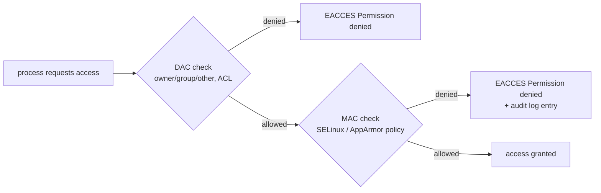

# Linux Security Modules: DAC and MAC

<!-- nav:start -->
> **Module 08 · Security, Virtualization & Containers** — lesson 1 of 6  
> [Module index](README.md) · [Course lesson (commands)](../../course/08-Security-VMs-Containers.md#lesson-1---linux-security-modules-ch-33) · [Exercises for this lesson](../../exercises/08-security-vms-containers/01-lsm-dac-mac.md)
<!-- nav:end -->

File permissions (owner, group, other, ACLs) are only half of Linux access control. Modern distributions add a second, independent layer – **Mandatory Access Control** – implemented by **Linux Security Modules** such as SELinux and AppArmor. In this lesson you will learn why that second layer exists, how the two layers interact, and which security modules you'll meet.

## What you will learn

- Discretionary Access Control (DAC) and its limits
- Mandatory Access Control (MAC) and the principle of least privilege
- The LSM framework: hooks, major and minor modules, stacking
- SELinux vs AppArmor at a glance
- Capabilities, seccomp and other kernel hardening layers
- How to tell which LSMs are active and recognize MAC denials

---

## Key terms

| Term | Definition |
|------|-----------|
| **DAC** | *Discretionary Access Control*: the **owner** of an object decides who may access it (chmod, chown, ACLs). Root bypasses it. |
| **MAC** | *Mandatory Access Control*: a **system-wide policy** decides; users (even root) cannot change it at will. |
| **Subject** | The active entity requesting access – a process. |
| **Object** | The thing accessed – file, directory, socket, port, device, another process. |
| **Policy** | The set of rules defining which subjects may do what to which objects. |
| **LSM** | *Linux Security Modules*: a kernel framework of hooks where security modules plug in their checks. |
| **Confinement** | Restricting a process to the minimum it needs (least privilege). |
| **Capability** | A slice of root's power (e.g. `CAP_NET_BIND_SERVICE`) that can be granted or removed individually. |

---

## DAC and its limits

With DAC, every file has an owner who sets permissions, and the kernel checks the process's UID/GIDs:

```console
$ ls -l /var/www/html/index.html
-rw-r--r-- 1 root root 615 Oct 21 10:00 /var/www/html/index.html
```

Problems DAC can't solve:

1. **Root is all-powerful.** Any process running as root – or exploiting a root service – can read `/etc/shadow`, load kernel modules, or change any permission.
2. **Permissions follow the user, not the program.** If a web server running as `www-data` is compromised, the attacker can do everything `www-data` can – e.g. read any world-readable file, open outbound connections, run shells.
3. **Users can give away access.** A careless `chmod 777` on sensitive data is allowed.

---

## MAC: a policy above the owners

MAC adds rules about **what each program is allowed to do**, regardless of UID:

> *The web server process may read web content, write its logs, bind ports 80/443 – and nothing else.*

Even if the web server runs as root and is completely compromised, it still can't read `/etc/shadow` or users' home directories, because the policy doesn't allow it.

### How the two layers combine



- **Both** must allow the access. MAC can only **restrict** further, never grant what DAC denies.
- The error message is the same (`Permission denied`), so when permissions look right but access fails, suspect MAC and check its logs.

---

## The LSM framework

LSM places **hooks** at every security-relevant point in the kernel: opening a file, executing a program, creating a socket, binding a port, sending a signal, loading a module… Each active security module gets a say.

| Module | Type | Used by | Model |
|--------|------|---------|-------|
| **SELinux** | major MAC | RHEL, Fedora, Rocky, Alma, Android | labels on everything (type enforcement) |
| **AppArmor** | major MAC | Ubuntu, Debian, SUSE | per-program path-based profiles |
| Smack | major MAC | embedded (Tizen) | simple labels |
| TOMOYO | MAC | niche | path-based, learning mode |
| **Yama** | minor | most distros | restricts `ptrace` (debugging other processes) |
| **Landlock** | minor, unprivileged | apps sandboxing themselves | per-process sandboxes |
| **lockdown** | minor | Secure Boot systems | restricts root from modifying the running kernel |
| BPF LSM | – | security tools | policies written in eBPF |
| capability | always | all | the classic capability checks |

Usually only one "major" MAC module (SELinux **or** AppArmor) is active; minor modules stack with it.

```console
$ cat /sys/kernel/security/lsm
lockdown,capability,landlock,yama,selinux,bpf          ← RHEL
lockdown,capability,landlock,yama,apparmor,ima,evm     ← Ubuntu
```

The active set can be changed with the kernel parameter `lsm=` (advanced).

---

## SELinux vs AppArmor

| | SELinux | AppArmor |
|--|---------|----------|
| Identifies objects by | **labels** (security contexts) stored in extended attributes | **paths** |
| What is confined | everything has a label; the "targeted" policy confines network services and many daemons | only programs that have a profile |
| Policy style | type enforcement rules compiled into a binary policy | readable text profiles per program |
| Granularity | very fine (files, ports, processes, sockets, booleans, MLS) | good, simpler |
| Moving a file | label travels with the file (`mv` keeps it) | rules follow the new path |
| Modes | enforcing / permissive / disabled (global or per domain) | enforce / complain per profile |
| Main commands | `getenforce`, `ls -Z`, `semanage`, `restorecon`, `setsebool`, `ausearch` | `aa-status`, `aa-enforce`, `aa-complain`, `apparmor_parser` |
| Logs | `/var/log/audit/audit.log` (AVC messages) | kernel log (`apparmor="DENIED"`) |

Details: [SELinux](02-selinux.md) · [AppArmor](03-apparmor.md).

---

## Other hardening layers

| Layer | What it does | Example |
|-------|--------------|---------|
| **Capabilities** | split root's power into ~40 pieces | `ping` only needs `CAP_NET_RAW`; a service can get `CAP_NET_BIND_SERVICE` to bind port 80 without being root |
| **seccomp** | filter which **system calls** a process may use | Docker/Podman default profiles, systemd `SystemCallFilter=` |
| **namespaces / cgroups** | isolation and resource limits | containers ([Containers](06-containers.md)) |
| **systemd sandboxing** | `ProtectSystem=`, `PrivateTmp=`, `NoNewPrivileges=` | [Service Constraints](../04-processes-services/05-service-constraints.md) |

```console
$ getcap /usr/bin/ping
/usr/bin/ping cap_net_raw=ep
$ grep Cap /proc/self/status
$ capsh --decode=0000000000003000
0x0000000000003000=cap_net_admin,cap_net_raw
```

---

## Recognizing a MAC denial

Symptom: "Permission denied" (or a service failing) although `ls -l`, ownership, ACLs and parent directories are all fine.

```console
# SELinux (RHEL)
$ getenforce
Enforcing
$ sudo ausearch -m AVC -ts recent
type=AVC msg=audit(1729505000.123:456): avc:  denied  { read } for  pid=906 comm="nginx" name="index.html" dev="vda3" ino=1234 scontext=system_u:system_r:httpd_t:s0 tcontext=unconfined_u:object_r:user_home_t:s0 tclass=file permissive=0

# AppArmor (Ubuntu)
$ sudo aa-status | head -3
$ sudo journalctl -k | grep 'apparmor="DENIED"'
audit: type=1400 audit(…): apparmor="DENIED" operation="open" profile="/usr/sbin/nginx" name="/srv/site/index.html" pid=906 comm="nginx" requested_mask="r" denied_mask="r"
```

A quick (temporary!) test: switch SELinux to permissive (`setenforce 0`) or the AppArmor profile to complain mode. If it then works, the MAC policy is the cause – fix the policy/labels properly and switch back.

---

## Try it yourself

1. Check which LSMs are active on each VM.
2. On `rhel1`, show the security context of your shell (`id -Z`), of `sshd` (`ps -eZ | grep sshd`) and of `/etc/shadow` (`ls -Z`).
3. On `deb1`, list loaded AppArmor profiles and which processes are confined (`aa-status`).
4. List the capabilities of `ping` and remove/restore them with `setcap` to see the effect.

---

## Common mistakes

- Disabling SELinux/AppArmor to "fix" a problem instead of fixing labels or profiles.
- Believing root bypasses MAC.
- Looking only at `ls -l` when a permission problem persists.
- Forgetting that both layers must allow access.

---

## Summary

- **DAC** = owner-controlled permissions; root bypasses it.
- **MAC** = system policy confining programs; applies to root too; checked after DAC.
- **LSM** = kernel hook framework; SELinux (RHEL) and AppArmor (Ubuntu) are the major MAC modules; Yama, Landlock, lockdown stack with them.
- Capabilities and seccomp further reduce what processes can do.
- Denials: `ausearch -m AVC` (SELinux), `journalctl -k | grep apparmor` (AppArmor).

## Check yourself

1. Can a process running as root read a file that DAC allows but MAC denies?
2. What is the main conceptual difference between SELinux and AppArmor?
3. Which file shows the active LSMs?
4. Which capability lets a non-root program bind port 80?

<details>
<summary>Answers</summary>

1. No – MAC applies to all processes, including root.
2. SELinux identifies objects by labels attached to them; AppArmor identifies them by path in per-program profiles.
3. `/sys/kernel/security/lsm`.
4. `CAP_NET_BIND_SERVICE`.

</details>

## Further reading

- `man 7 capabilities`, `man 8 selinux`, `man 7 apparmor`
- [Linux kernel: LSM usage](https://docs.kernel.org/admin-guide/LSM/index.html)
- [Red Hat: Using SELinux – Getting started](https://docs.redhat.com/en/documentation/red_hat_enterprise_linux/9/html/using_selinux/getting-started-with-selinux_using-selinux)
- [Ubuntu Server: AppArmor](https://documentation.ubuntu.com/server/how-to/security/apparmor/)

---

<!-- footer:start -->
[Module index](README.md) · [SELinux →](02-selinux.md)  
**Practice now:** [Exercises – Linux Security Modules: DAC and MAC](../../exercises/08-security-vms-containers/01-lsm-dac-mac.md)
<!-- footer:end -->
