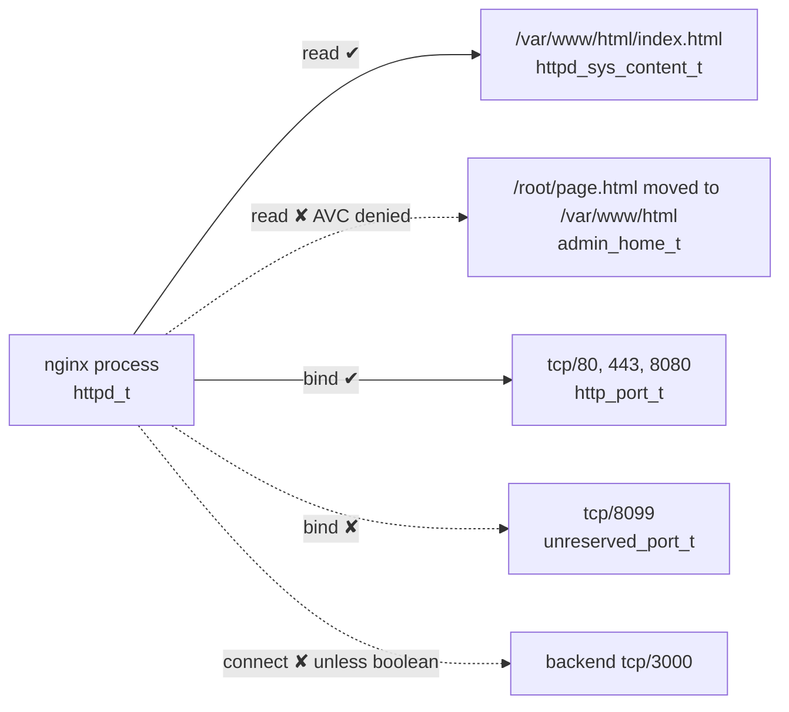

# SELinux

<!-- nav:start -->
> **Module 08 · Security, Virtualization & Containers** — lesson 2 of 6  
> [Module index](README.md) · [Course lesson (commands)](../../course/08-Security-VMs-Containers.md#lesson-2---selinux) · [Exercises for this lesson](../../exercises/08-security-vms-containers/02-selinux.md)
<!-- nav:end -->

**SELinux** (Security-Enhanced Linux) is the MAC system of the RHEL family. Every process and every object carries a **security label**, and a policy decides which labelled processes may access which labelled objects. On RHEL it protects network services out of the box – and it's the reason a correctly configured web server may still answer "403 Forbidden". The LFCS objective is *"Create and enforce MAC using SELinux"*. In this lesson you will learn how SELinux decides, how to manage modes, contexts, ports and booleans, and how to troubleshoot denials properly.

## What you will learn

- Security contexts and type enforcement
- Modes: enforcing, permissive, disabled – runtime and persistent
- Viewing contexts of files, processes, users and ports
- How files get their labels; `mv` vs `cp`
- Changing file contexts temporarily (`chcon`) and persistently (`semanage fcontext` + `restorecon`)
- Port labels (`semanage port`)
- Booleans (`getsebool`, `setsebool -P`)
- Troubleshooting with `ausearch`, `sealert`, `audit2why`, `audit2allow`
- Permissive domains and relabelling the whole filesystem

---

## Key terms

| Term | Definition |
|------|-----------|
| **Security context (label)** | `user:role:type:level` attached to every process and object. |
| **Type** | The most important part of a context: `httpd_t` (process domain), `httpd_sys_content_t` (file type). |
| **Domain** | The type of a **process** (e.g. `httpd_t`, `sshd_t`). |
| **Type enforcement (TE)** | Policy rules of the form "domain X may perform operations Y on objects of type Z". |
| **Targeted policy** | RHEL's default policy: confines selected services; regular users run `unconfined_t`. |
| **AVC** | *Access Vector Cache*; an "AVC denied" message records an SELinux denial. |
| **File context rule** | Policy mapping of path patterns to default types (`semanage fcontext -l`). |
| **Relabel** | Resetting file labels to the policy defaults (`restorecon`, `/.autorelabel`). |
| **Boolean** | An on/off switch that enables optional policy rules. |
| **Port type** | Label assigned to network ports (`http_port_t`, `ssh_port_t`). |

---

## Contexts and type enforcement

```console
$ ls -Z /var/www/html/index.html
system_u:object_r:httpd_sys_content_t:s0 /var/www/html/index.html
$ ps -eZ | grep nginx
system_u:system_r:httpd_t:s0        905 ?        00:00:00 nginx
$ id -Z
unconfined_u:unconfined_r:unconfined_t:s0-s0:c0.c1023
```

```text
system_u : object_r : httpd_sys_content_t : s0
  user       role          TYPE             level (MLS/MCS)
```

For administration, focus on the **type**. The policy contains rules like:

```text
allow httpd_t httpd_sys_content_t:file { read open getattr map };
allow httpd_t http_port_t:tcp_socket name_bind;
allow httpd_t httpd_log_t:file { append create };
```

Everything **not explicitly allowed is denied**.



---

## Modes

| Mode | Policy loaded | Denies | Logs denials |
|------|---------------|--------|--------------|
| **enforcing** | yes | **yes** | yes |
| **permissive** | yes | no | yes – great for diagnosis |
| **disabled** | no | no | no |

```console
$ getenforce
Enforcing
$ sestatus
SELinux status:                 enabled
SELinuxfs mount:                /sys/fs/selinux
Loaded policy name:             targeted
Current mode:                   enforcing
Mode from config file:          enforcing
$ sudo setenforce 0            # permissive now (runtime only)
$ sudo setenforce 1            # enforcing now
```

Persistent mode: `/etc/selinux/config`

```text
SELINUX=enforcing        # enforcing | permissive | disabled
SELINUXTYPE=targeted
```

- `setenforce` can't switch to or from **disabled**; that needs a reboot.
- On RHEL 9, prefer the kernel parameter `selinux=0` to disable SELinux; just editing the config may not fully disable it.
- Files created while SELinux was disabled have **no labels**. Before re-enabling: `touch /.autorelabel` and reboot (the relabel takes a while). Going to **permissive** first is safer than straight to enforcing.

> **Exam advice:** never "solve" a task by disabling SELinux. Tasks often require enforcing mode and check it.

---

## How files get their labels

1. The policy has **file context rules**: path regex → type.
   ```console
   $ sudo semanage fcontext -l | grep '^/var/www'
   /var/www(/.*)?                      all files   system_u:object_r:httpd_sys_content_t:s0
   /var/www(/.*)?/logs(/.*)?           all files   system_u:object_r:httpd_log_t:s0
   /var/www/cgi-bin(/.*)?              all files   system_u:object_r:httpd_sys_script_exec_t:s0
   ```
2. New files normally **inherit the type of the parent directory** (or a type-transition rule).
3. `restorecon` resets files to what the rules say.

### mv vs cp

```console
$ echo hello > /root/page.html; ls -Z /root/page.html
unconfined_u:object_r:admin_home_t:s0 /root/page.html
$ mv /root/page.html /var/www/html/          # mv KEEPS the original label
$ ls -Z /var/www/html/page.html
unconfined_u:object_r:admin_home_t:s0 /var/www/html/page.html     ← nginx gets 403
$ cp /root/other.html /var/www/html/         # cp creates a NEW file → inherits httpd_sys_content_t
$ sudo restorecon -v /var/www/html/page.html
Relabeled /var/www/html/page.html from unconfined_u:object_r:admin_home_t:s0 to unconfined_u:object_r:httpd_sys_content_t:s0
```

`cp -a` / `cp --preserve=context` and `tar --selinux` / `rsync -X` **preserve** the old label – sometimes wanted (backups), sometimes not.

---

## Changing file contexts

### Temporary: chcon

```console
$ sudo chcon -t httpd_sys_content_t /srv/web/index.html
$ sudo chcon -R --reference=/var/www/html /srv/web
```

`chcon` changes the label on disk but **not the policy**: the next `restorecon` or full relabel reverts it. Use it only for quick tests.

### Persistent: semanage fcontext + restorecon

Example: serve a website from `/srv/web`.

```console
$ sudo semanage fcontext -a -t httpd_sys_content_t "/srv/web(/.*)?"   # 1. add a rule to the policy
$ sudo restorecon -Rv /srv/web                                         # 2. apply it to existing files
Relabeled /srv/web from unconfined_u:object_r:var_t:s0 to unconfined_u:object_r:httpd_sys_content_t:s0
Relabeled /srv/web/index.html from … to …:httpd_sys_content_t:s0
$ sudo semanage fcontext -l -C                                          # list YOUR local customizations
$ sudo matchpathcon /srv/web/index.html                                 # what the label should be
```

- The regex `"/srv/web(/.*)?"` matches the directory and everything below it. Quote it.
- Use `-a` to add, `-m` to modify, `-d` to delete a rule.
- Common types: `httpd_sys_content_t` (read-only web content), `httpd_sys_rw_content_t` (web app writes), `httpd_log_t`, `public_content_t` (shared by FTP/HTTP/Samba), `samba_share_t`, `nfs_t`, `container_file_t`, `ssh_home_t`.
- Copy the labelling of an existing path: `semanage fcontext -a -e /var/www /srv/web` (equivalence).

---

## Port labels

Services may only bind ports with the right type:

```console
$ sudo semanage port -l | grep -w http_port_t
http_port_t                    tcp      80, 81, 443, 488, 8008, 8009, 8443, 9000
$ sudo semanage port -l | grep ssh
ssh_port_t                     tcp      22
$ sudo semanage port -a -t http_port_t -p tcp 8099       # allow web servers on 8099
$ sudo semanage port -a -t ssh_port_t -p tcp 2222        # allow sshd on 2222
$ sudo semanage port -m -t http_port_t -p tcp 9090       # port already has another type → modify
$ sudo semanage port -d -t http_port_t -p tcp 8099       # remove
$ sudo semanage port -l -C                               # your customizations
```

Symptom without it: the service fails to start with `bind() … Permission denied` and an AVC `name_bind` denial.

---

## Booleans

The policy contains optional rules that can be switched on/off:

```console
$ getsebool -a | grep httpd | head -5
httpd_can_network_connect --> off
httpd_can_network_connect_db --> off
httpd_enable_homedirs --> off
httpd_use_nfs --> off
$ sudo semanage boolean -l | grep httpd_can_network_connect      # with descriptions
httpd_can_network_connect      (off  ,  off)  Allow httpd to can network connect
$ sudo setsebool -P httpd_can_network_connect on                  # -P = persistent
$ getsebool httpd_can_network_connect
httpd_can_network_connect --> on
```

Without `-P`, the change is lost at reboot.

| Boolean | Allows |
|---------|--------|
| `httpd_can_network_connect` | web servers/proxies to connect to any port (reverse proxy!) |
| `httpd_can_network_connect_db` | web servers to connect to database ports |
| `httpd_enable_homedirs` | serving `~user/public_html` |
| `httpd_use_nfs` / `httpd_use_cifs` | serving content from NFS / SMB |
| `use_nfs_home_dirs` | home directories on NFS |
| `samba_enable_home_dirs`, `samba_export_all_rw` | Samba shares |
| `ftpd_anon_write` | anonymous FTP upload |
| `container_manage_cgroup` | containers running systemd |

---

## Troubleshooting

### The method

1. **Is it SELinux?** Check for AVCs right after reproducing the problem:
   ```console
   $ sudo ausearch -m AVC,USER_AVC -ts recent
   $ sudo journalctl -t setroubleshoot --since "10 min ago"     # if setroubleshoot-server is installed
   ```
   Or briefly `setenforce 0`, retry, `setenforce 1`.
2. **Read the AVC**: `comm` (program), `{ operation }`, `scontext` (process type), `tcontext` (object type), `tclass` (file, dir, tcp_socket…).
3. **Fix in this order:**
   1. Wrong **file label** → `semanage fcontext` + `restorecon` (or just `restorecon` if the rule is already right).
   2. Non-standard **port** → `semanage port -a`.
   3. A **boolean** exists → `setsebool -P`.
   4. Only if none applies → a custom policy module (below), reviewed carefully.

### Reading an AVC

```text
type=AVC msg=audit(…): avc:  denied  { name_connect } for  pid=906 comm="nginx" dest=3000
  scontext=system_u:system_r:httpd_t:s0 tcontext=system_u:object_r:ntop_port_t:s0 tclass=tcp_socket permissive=0
```

→ nginx (`httpd_t`) tried to **connect** to TCP port 3000 → boolean `httpd_can_network_connect`.

### Helpers

```console
$ sudo ausearch -m AVC -ts recent | audit2why
        Was caused by:
        The boolean httpd_can_network_connect was set incorrectly.
        Allow access by executing:
        # setsebool -P httpd_can_network_connect 1
$ sudo sealert -a /var/log/audit/audit.log      # human-readable analysis with suggested commands (setroubleshoot-server)
```

Packages: `policycoreutils-python-utils` (semanage, audit2allow, audit2why), `setroubleshoot-server` (sealert), `setools-console` (sesearch).

### Custom policy module (last resort)

```console
$ sudo ausearch -m AVC -c myapp --raw | audit2allow -M mymyapp
******************** IMPORTANT ***********************
To make this policy package active, execute:
semodule -i mymyapp.pp
$ cat mymyapp.te                 # REVIEW what will be allowed!
$ sudo semodule -i mymyapp.pp
$ sudo semodule -l | grep mymyapp
$ sudo semodule -r mymyapp       # remove
```

`audit2allow` allows exactly what was denied – which may be far more than is safe. Prefer labels, ports and booleans.

### Permissive for one domain

Instead of making the whole system permissive:

```console
$ sudo semanage permissive -a httpd_t      # only httpd_t logs instead of denying
$ sudo semanage permissive -d httpd_t
```

### Hidden denials

Some denials are silenced by `dontaudit` rules. If nothing shows up: `semodule -DB` (disable dontaudit), reproduce, check, then `semodule -B`.

---

## SELinux and other tools

| Situation | SELinux aspect |
|-----------|----------------|
| sshd on another port | `semanage port -a -t ssh_port_t` |
| Hand-created `~/.ssh` | `restorecon -Rv ~/.ssh` |
| Web content outside `/var/www` | `semanage fcontext … httpd_sys_content_t` |
| Nginx as reverse proxy | `setsebool -P httpd_can_network_connect 1` |
| NFS-mounted web content | `setsebool -P httpd_use_nfs 1` (or mount with `context=`) |
| Container bind mounts | `:Z` / `:z` volume option (labels `container_file_t`) |
| Root password reset via `rd.break` | `touch /.autorelabel` |
| Restored backups | `restorecon -Rv` (or restore with `--selinux`/`-X`) |

---

## Try it yourself

1. Show the mode, the policy and the contexts of `/etc/shadow`, `/var/www/html`, your shell and `sshd`.
2. Install nginx (or httpd). Create `/root/test.html`, `mv` it into the document root and request it. Find the AVC and fix it with `restorecon`.
3. Serve `/srv/web` persistently labelled with `semanage fcontext`.
4. Make the web server listen on 8099; fix the `name_bind` denial with `semanage port`.
5. Configure a `proxy_pass` to a local back-end on port 3000; fix the `name_connect` denial with a boolean.
6. Switch to permissive persistently, reboot, check, then back to enforcing.

---

## Common mistakes

- `setenforce 0` / disabling SELinux instead of fixing the cause.
- Using `chcon` for a persistent fix (lost on relabel).
- Forgetting `restorecon` after `semanage fcontext -a` (rule added, files unchanged).
- Wrong regex: `"/srv/web/*"` instead of `"/srv/web(/.*)?"`.
- `setsebool` without `-P`.
- Running `audit2allow -M` blindly.

---

## Summary

| Task | Command |
|------|---------|
| Mode now / persistent | `getenforce`, `setenforce 0/1`, `/etc/selinux/config` |
| Show contexts | `ls -Z`, `ps -eZ`, `id -Z`, `ss -Z` |
| Default rules | `semanage fcontext -l` (`-C` = local) |
| Persistent file label | `semanage fcontext -a -t TYPE "/path(/.*)?"` + `restorecon -Rv /path` |
| Reset labels | `restorecon -Rv /path` |
| Temporary label | `chcon -t TYPE file` |
| Ports | `semanage port -l`, `semanage port -a -t TYPE -p tcp N` |
| Booleans | `getsebool -a`, `setsebool -P NAME on` |
| Denials | `ausearch -m AVC -ts recent`, `audit2why`, `sealert -a /var/log/audit/audit.log` |
| Custom module | `audit2allow -M name` → review → `semodule -i name.pp` |
| Full relabel | `touch /.autorelabel && reboot` |

## Check yourself

1. Which part of a context matters most for type enforcement?
2. Why does a file moved with `mv` into `/var/www/html` cause a 403, but a copied one doesn't?
3. What's the difference between `chcon` and `semanage fcontext`?
4. Nginx can't bind port 8099. Which command fixes it?
5. A reverse proxy returns 502 and the AVC shows `name_connect`. What's the fix?

<details>
<summary>Answers</summary>

1. The type (`httpd_t`, `httpd_sys_content_t`).
2. `mv` keeps the original label (e.g. `admin_home_t`); `cp` creates a new file that inherits the directory's type.
3. `chcon` relabels files directly and temporarily; `semanage fcontext` changes the policy's labelling rules, which `restorecon` (and relabels) then apply persistently.
4. `semanage port -a -t http_port_t -p tcp 8099`.
5. `setsebool -P httpd_can_network_connect on`.

</details>

## Further reading

- `man 8 selinux`, `man 8 semanage-fcontext`, `man 8 semanage-port`, `man 8 restorecon`, `man 8 setsebool`, `man 8 ausearch`, `man 1 audit2allow`, `man 8 httpd_selinux`
- [Red Hat: Using SELinux (RHEL 9)](https://docs.redhat.com/en/documentation/red_hat_enterprise_linux/9/html/using_selinux/index)
- [The SELinux Notebook](https://github.com/SELinuxProject/selinux-notebook)
- [Your visual how-to guide for SELinux policy enforcement ("SELinux Coloring Book")](https://opensource.com/business/13/11/selinux-policy-guide)
- [ArchWiki: SELinux](https://wiki.archlinux.org/title/SELinux)

---

<!-- footer:start -->
[← Linux Security Modules: DAC and MAC](01-lsm-dac-mac.md) · [Module index](README.md) · [AppArmor →](03-apparmor.md)  
**Practice now:** [Exercises – SELinux](../../exercises/08-security-vms-containers/02-selinux.md)
<!-- footer:end -->
