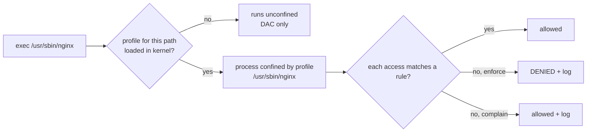

# AppArmor

<!-- nav:start -->
> **Module 08 · Security, Virtualization & Containers** — lesson 3 of 6  
> [Module index](README.md) · [Course lesson (commands)](../../course/08-Security-VMs-Containers.md#lesson-3---apparmor-ubuntu) · [Exercises for this lesson](../../exercises/08-security-vms-containers/03-apparmor.md)
<!-- nav:end -->

**AppArmor** is the MAC system of Ubuntu, Debian and SUSE. Instead of labelling every object, it attaches a **profile** to individual programs, listing the files (by path), capabilities and network access each program may use. Programs without a profile are not confined. In this lesson you will learn how AppArmor works, how to see what's confined, how to switch profiles between enforce and complain mode, how to read denials, and how to adjust or create profiles.

## What you will learn

- AppArmor's path-based model and profile attachment
- Profile modes: enforce, complain, unconfined, disabled
- `aa-status` and the profile files in `/etc/apparmor.d/`
- Profile syntax: file rules and permissions, capabilities, network, abstractions, includes
- Local overrides (`local/`) and tunables
- Reading denials in the logs
- Switching modes, reloading and disabling profiles
- Generating and refining profiles (`aa-genprof`, `aa-logprof`)
- AppArmor and containers / snaps

---

## Key terms

| Term | Definition |
|------|-----------|
| **Profile** | A set of rules confining a specific program, identified by the program's path (or a name). |
| **Enforce mode** | Rule violations are **denied** and logged. |
| **Complain mode** | Violations are **allowed** but logged – for building/testing profiles. |
| **Unconfined** | A process without a profile – only DAC applies. |
| **Abstraction** | A reusable rule fragment (`abstractions/base`, `abstractions/nameservice`). |
| **Tunable** | A variable used in profiles (`@{HOME}`, `@{PROC}`). |
| **Local override** | A file in `/etc/apparmor.d/local/` included by a profile for site-specific additions. |
| **`apparmor_parser`** | Compiles and loads profiles into the kernel. |

---

## How AppArmor works



- Profiles are attached when a program is **executed**, matched by its path.
- Rules refer to **paths** – so moving a file to another path changes what rules apply to it (unlike SELinux labels).
- Rules are allow-lists: anything not allowed is denied (in enforce mode). `deny` rules can explicitly forbid.

---

## Checking the status

```console
$ sudo aa-status                   # = apparmor_status
apparmor module is loaded.
62 profiles are loaded.
55 profiles are in enforce mode.
   /usr/bin/man
   /usr/sbin/chronyd
   /usr/sbin/cupsd
   nvidia_modprobe
   …
7 profiles are in complain mode.
   …
4 processes have profiles defined.
4 processes are in enforce mode.
   /usr/sbin/chronyd (812)
   /usr/sbin/cupsd (1022)
0 processes are in complain mode.
0 processes are unconfined but have a profile defined.
$ systemctl status apparmor
$ cat /sys/module/apparmor/parameters/enabled
Y
$ ps auxZ | grep -v unconfined | head      # processes and their profiles
```

"unconfined but have a profile defined" = the program started before the profile was loaded – restart it.

Tools: package `apparmor-utils` (`aa-enforce`, `aa-complain`, `aa-disable`, `aa-genprof`, `aa-logprof`); extra profiles: `apparmor-profiles`, `apparmor-profiles-extra`.

---

## Profile files

```console
$ ls /etc/apparmor.d/
abstractions/  local/  tunables/  disable/  force-complain/
usr.sbin.chronyd  usr.bin.man  usr.sbin.cupsd  …
```

File names are the program path with `/` replaced by `.` (`/usr/sbin/chronyd` → `usr.sbin.chronyd`).

### Example profile

```text
# /etc/apparmor.d/usr.sbin.nginx   (simplified example)
#include <tunables/global>

/usr/sbin/nginx {
  #include <abstractions/base>
  #include <abstractions/nameservice>
  #include <abstractions/openssl>

  capability net_bind_service,
  capability setuid,
  capability setgid,
  capability dac_override,

  network inet stream,
  network inet6 stream,

  /usr/sbin/nginx           mr,
  /etc/nginx/**             r,
  /etc/ssl/**               r,
  /var/www/**               r,
  /srv/site/**              r,
  /var/log/nginx/*.log      w,
  /run/nginx.pid            rw,
  owner /var/lib/nginx/**   rw,

  deny /etc/shadow          r,

  #include <local/usr.sbin.nginx>
}
```

### File permissions

| Flag | Meaning |
|------|---------|
| `r` | read |
| `w` | write |
| `a` | append |
| `k` | lock |
| `l` | link |
| `m` | memory-map as executable |
| `ix` | execute, **inherit** this profile |
| `px` / `Px` | execute under the program's **own** profile (`P` = scrub environment) |
| `ux` / `Ux` | execute **unconfined** (dangerous) |
| `cx` | execute under a child profile |

Globbing: `*` (any characters except `/`), `**` (including `/`), `{a,b}` alternatives, `[abc]`. Modifiers: `owner` (only files owned by the process's user), `deny`, `audit`.

### Other rule types

```text
capability net_admin,               # Linux capabilities
network inet tcp,                   # network access
signal (send) peer=/usr/sbin/foo,   # signals
dbus send bus=system,               # D-Bus
mount fstype=tmpfs,                 # mounts
```

### Local overrides

Package profiles may change on upgrade, so add site-specific rules to the matching file in `local/`:

```console
$ echo '/srv/site/** r,' | sudo tee -a /etc/apparmor.d/local/usr.sbin.nginx
$ sudo apparmor_parser -r /etc/apparmor.d/usr.sbin.nginx    # reload the profile
```

Tunables like `@{HOME}` and `@{HOMEDIRS}` live in `/etc/apparmor.d/tunables/` (e.g. add extra home directory locations to `tunables/home.d/`).

---

## Modes and management

```console
$ sudo aa-complain /usr/sbin/nginx          # or the profile path /etc/apparmor.d/usr.sbin.nginx
Setting /usr/sbin/nginx to complain mode.
$ sudo aa-enforce /usr/sbin/nginx
Setting /usr/sbin/nginx to enforce mode.
$ sudo aa-disable /usr/sbin/nginx           # unload + symlink into /etc/apparmor.d/disable/
$ sudo apparmor_parser -r /etc/apparmor.d/usr.sbin.nginx   # (re)load after editing
$ sudo apparmor_parser -R /etc/apparmor.d/usr.sbin.nginx   # unload
$ sudo systemctl reload apparmor            # reload all profiles
```

These changes are persistent: `aa-complain` sets a `flags=(complain)` in the profile (or uses `force-complain/`), `aa-disable` creates a link in `disable/`.

Disable AppArmor completely (rarely appropriate): kernel parameter `apparmor=0`, or `systemctl disable apparmor` (profiles then aren't loaded at boot).

---

## Reading denials

```console
$ sudo journalctl -k | grep -i apparmor | tail -2
audit: type=1400 audit(1729505000.123:88): apparmor="DENIED" operation="open" class="file"
  profile="/usr/sbin/nginx" name="/srv/newsite/index.html" pid=906 comm="nginx"
  requested_mask="r" denied_mask="r" fsuid=33 ouid=0
$ sudo grep apparmor /var/log/syslog          # also /var/log/kern.log, or /var/log/audit/audit.log with auditd
```

| Field | Meaning |
|-------|---------|
| `apparmor="DENIED"` / `"ALLOWED"` | enforce denial / complain-mode log |
| `profile=` | which profile |
| `operation=` | `open`, `exec`, `mknod`, `connect`, `capable`… |
| `name=` | the path accessed |
| `requested_mask` / `denied_mask` | permissions |

Fix by adding a rule (in `local/`), reloading the profile, and testing.

---

## Building profiles

For a program without a profile:

```console
$ sudo aa-genprof /usr/local/bin/myapp
# 1. it puts myapp in complain mode
# 2. you run myapp in another terminal and exercise its features
# 3. press S to scan the logs; answer each question (Allow / Deny / Glob / …)
# 4. press F to finish – the profile is saved in enforce mode
$ sudo aa-logprof            # later: review new log entries and update profiles interactively
```

`aa-autodep` creates a minimal skeleton profile; `aa-unconfined` lists network-listening processes without profiles.

---

## AppArmor elsewhere

- **Snaps** on Ubuntu are confined by AppArmor profiles generated by snapd (`snap.<name>.*` in `aa-status`).
- **Docker/Podman** apply a default profile (`docker-default`, `containers-default-…`) to containers; override with `--security-opt apparmor=<profile>` or `unconfined`.
- **libvirt** confines each VM with a generated profile (`libvirt-<uuid>`).

---

## Try it yourself

1. Run `aa-status` and note how many profiles are in enforce/complain mode and which processes are confined.
2. Install `apparmor-utils` and `apparmor-profiles`; find the profile of a running service (e.g. `chronyd` or `cupsd`) and read it.
3. Put that profile into complain mode, confirm with `aa-status`, return to enforce.
4. Write a tiny script `/usr/local/bin/readit` that `cat`s `/etc/hostname` and `/etc/shadow`; create a profile with `aa-genprof` allowing only `/etc/hostname`; test both reads in enforce mode and read the denial.

---

## Common mistakes

- Editing the vendor profile instead of `local/` (lost on upgrade).
- Forgetting to reload (`apparmor_parser -r`) after editing.
- Profile changes don't affect already running processes in some cases – restart the service.
- Disabling AppArmor instead of fixing a path rule.
- Moving data to a new path and forgetting the profile only allows the old one.

---

## Summary

| Task | Command |
|------|---------|
| Status | `aa-status`, `ps auxZ` |
| Profiles | `/etc/apparmor.d/` (local additions in `local/`) |
| Complain / enforce | `aa-complain PROG`, `aa-enforce PROG` |
| Disable a profile | `aa-disable PROG` |
| Load / reload | `apparmor_parser -r FILE`, `systemctl reload apparmor` |
| Denials | `journalctl -k \| grep apparmor`, `/var/log/syslog`, `/var/log/audit/audit.log` |
| Create / update | `aa-genprof PROG`, `aa-logprof` |

## Check yourself

1. What happens to a program that has no AppArmor profile?
2. What's the difference between enforce and complain mode?
3. Where should you add an extra path rule for a packaged profile?
4. After editing a profile, which command loads the change?
5. In a profile, what does `/srv/site/** r,` allow?

<details>
<summary>Answers</summary>

1. It runs unconfined – only normal permissions (DAC) apply.
2. Enforce denies and logs violations; complain allows them but logs them.
3. In `/etc/apparmor.d/local/<profile-name>`.
4. `apparmor_parser -r /etc/apparmor.d/<profile>` (or `systemctl reload apparmor`).
5. Read access to every file in `/srv/site` and all its subdirectories.

</details>

## Further reading

- `man 7 apparmor`, `man 5 apparmor.d`, `man 8 aa-status`, `man 8 apparmor_parser`, `man 8 aa-genprof`
- [Ubuntu Server: AppArmor](https://documentation.ubuntu.com/server/how-to/security/apparmor/)
- [AppArmor wiki (GitLab)](https://gitlab.com/apparmor/apparmor/-/wikis/home) · [Quick profile language](https://gitlab.com/apparmor/apparmor/-/wikis/QuickProfileLanguage)
- [ArchWiki: AppArmor](https://wiki.archlinux.org/title/AppArmor)

---

<!-- footer:start -->
[← SELinux](02-selinux.md) · [Module index](README.md) · [Working with SSL/TLS Certificates →](04-ssl-certificates.md)  
**Practice now:** [Exercises – AppArmor](../../exercises/08-security-vms-containers/03-apparmor.md)
<!-- footer:end -->
