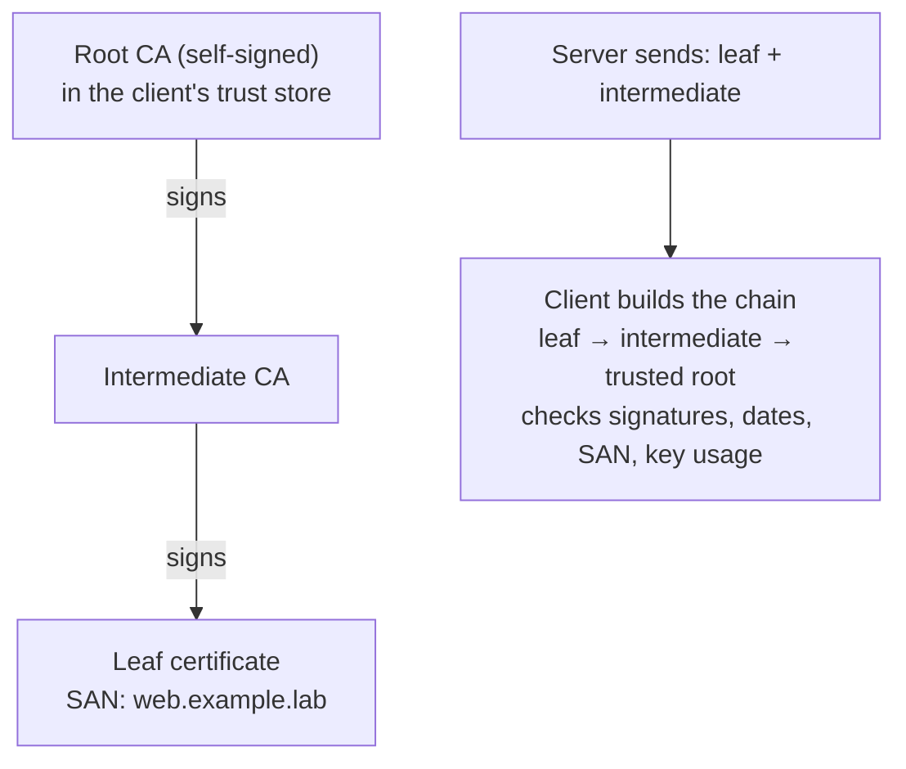

# Working with SSL/TLS Certificates

<!-- nav:start -->
> **Module 08 · Security, Virtualization & Containers** — lesson 4 of 6  
> [Module index](README.md) · [Course lesson (commands)](../../course/08-Security-VMs-Containers.md#lesson-4---ssltls-certificates-gap) · [Exercises for this lesson](../../exercises/08-security-vms-containers/04-ssl-certificates.md)
<!-- nav:end -->

HTTPS, LDAPS, SMTP with STARTTLS, VPNs and many APIs rely on **TLS**, and TLS relies on **X.509 certificates**. Administrators routinely create keys and certificate requests, build self-signed or internal-CA certificates, install them in services, check their expiry, and fix "certificate verify failed" errors. In this lesson you will learn the cryptographic basics, what a certificate contains, how trust works, and how to do all of this with `openssl`.

## What you will learn

- Symmetric vs asymmetric cryptography, hashes and signatures
- What an X.509 certificate contains (subject, issuer, SAN, validity, key usage)
- Chains of trust: root CA, intermediate CA, leaf certificate; trust stores
- The TLS handshake, briefly
- Generating private keys (RSA, ECDSA, Ed25519)
- Certificate Signing Requests (CSRs)
- Self-signed certificates and your own lab CA
- Inspecting, verifying and testing certificates and servers
- File formats (PEM, DER, PKCS#12) and conversions
- Installing certificates: system trust store, Nginx/Apache, permissions
- Let's Encrypt / ACME (overview)

---

## Key terms

| Term | Definition |
|------|-----------|
| **TLS** | *Transport Layer Security* – the protocol encrypting HTTPS and others (SSL is its obsolete predecessor; the name stuck). |
| **Private key** | The secret half of a key pair. Must never leave the server. |
| **Public key** | The shareable half; contained in the certificate. |
| **Certificate (X.509)** | A public key + identity information + validity dates, **signed by a CA**. |
| **CA** | *Certificate Authority*: an entity whose signature vouches for certificates. |
| **Root CA** | A self-signed CA certificate trusted directly by clients (shipped in the OS/browser trust store). |
| **Intermediate CA** | A CA signed by the root, used to sign server certificates. |
| **Leaf / end-entity certificate** | The server's (or client's) own certificate. |
| **CSR** | *Certificate Signing Request*: public key + requested identity, signed with the private key, sent to a CA. |
| **SAN** | *Subject Alternative Name*: the DNS names / IPs a certificate is valid for. Clients check this. |
| **Self-signed certificate** | A certificate signed by its own key – nobody vouches for it. |
| **Trust store** | The set of CA certificates a system trusts. |
| **PEM** | Base64 text format with `-----BEGIN …-----` lines. |

---

## Cryptography in five minutes

| Concept | Idea | Examples |
|---------|------|----------|
| **Symmetric encryption** | same key encrypts and decrypts; fast | AES, ChaCha20 |
| **Asymmetric encryption** | key pair: what one key encrypts, only the other decrypts | RSA, ECDSA, Ed25519 |
| **Hash** | fixed-size fingerprint; any change to the data changes it | SHA-256 |
| **Digital signature** | hash of data encrypted with a private key; anyone with the public key can verify it | RSA/ECDSA signatures |

TLS uses asymmetric crypto to authenticate the server and agree on keys, then symmetric crypto for the bulk data.

---

## What's in a certificate

```console
$ openssl x509 -in server.crt -noout -text
Certificate:
    Data:
        Version: 3 (0x2)
        Serial Number: 4f:1a:…
        Signature Algorithm: sha256WithRSAEncryption
        Issuer: CN = Lab CA, O = Example Lab
        Validity
            Not Before: Oct 21 10:00:00 2026 GMT
            Not After : Oct 21 10:00:00 2027 GMT
        Subject: CN = web.example.lab, O = Example Lab
        Subject Public Key Info:
            Public Key Algorithm: rsaEncryption
                Public-Key: (2048 bit)
        X509v3 extensions:
            X509v3 Subject Alternative Name:
                DNS:web.example.lab, DNS:www.example.lab, IP Address:192.168.56.20
            X509v3 Key Usage: critical
                Digital Signature, Key Encipherment
            X509v3 Extended Key Usage:
                TLS Web Server Authentication
            X509v3 Basic Constraints: critical
                CA:FALSE
    Signature Value: …
```

| Field | Meaning |
|-------|---------|
| Subject | who the certificate is for (`CN` = common name) |
| Issuer | who signed it |
| Validity | not before / not after – expired certificates are rejected |
| Public key | the server's public key |
| **SAN** | the names it's valid for – **modern clients ignore the CN and only check SAN** |
| Key Usage / Extended Key Usage | what the key may be used for (server auth, client auth, signing certificates) |
| Basic Constraints | `CA:TRUE` for CA certificates |

---

## The chain of trust



The client trusts the leaf because each certificate is signed by the next one up and the top is in its **trust store**. That's why servers must send the **intermediate** certificates too (the "full chain") – a missing intermediate is a common error.

### The TLS handshake (TLS 1.3, simplified)

1. **ClientHello**: supported versions/ciphers, key share, **SNI** (the host name it wants).
2. **ServerHello** + key share; then (encrypted) the **certificate chain** and a signature proving possession of the private key.
3. Client verifies chain, dates and that the requested name is in the **SAN**.
4. Both derive **symmetric session keys**; application data flows encrypted.

---

## Private keys

```console
$ openssl genrsa -out server.key 2048                                   # RSA 2048 (widely compatible)
$ openssl genpkey -algorithm RSA -pkeyopt rsa_keygen_bits:3072 -out server.key
$ openssl genpkey -algorithm EC -pkeyopt ec_paramgen_curve:P-256 -out server.key   # ECDSA – smaller, faster
$ openssl genpkey -algorithm ed25519 -out server.key                    # Ed25519 (not all clients support it for TLS)
$ chmod 600 server.key
$ openssl pkey -in server.key -noout -text | head -1                    # inspect
$ openssl genpkey -algorithm RSA -aes256 -out protected.key             # encrypted with a passphrase
```

Services that start unattended usually need **unencrypted** keys (protected by file permissions, mode `600`, owner root).

---

## Certificate Signing Requests

A CSR contains your public key and the identity you want, signed with your private key.

```console
$ openssl req -new -key server.key -out server.csr \
      -subj "/C=ES/O=Example Lab/CN=web.example.lab" \
      -addext "subjectAltName=DNS:web.example.lab,DNS:www.example.lab,IP:192.168.56.20"
$ openssl req -in server.csr -noout -text | grep -A1 "Subject:\|Alternative"
        Subject: C = ES, O = Example Lab, CN = web.example.lab
            X509v3 Subject Alternative Name:
                DNS:web.example.lab, DNS:www.example.lab, IP Address:192.168.56.20
$ openssl req -in server.csr -noout -verify
Certificate request self-signature verify OK
```

Key and CSR in one step: `openssl req -new -newkey rsa:2048 -nodes -keyout server.key -out server.csr -subj "/CN=…"` (`-nodes` = don't encrypt the key; OpenSSL 3 also accepts `-noenc`).

Send the CSR (never the key) to a public CA, your company CA, or sign it yourself (below).

---

## Self-signed certificates

Quick, for labs and internal tools. Clients will warn until they trust it explicitly.

```console
$ openssl req -x509 -newkey rsa:2048 -nodes -days 365 \
      -keyout /etc/pki/tls/private/web.key -out /etc/pki/tls/certs/web.crt \
      -subj "/CN=web.example.lab" \
      -addext "subjectAltName=DNS:web.example.lab"
```

`-x509` outputs a certificate instead of a CSR; `-days` sets validity.

---

## Your own lab CA

A better approach for labs: create a CA once, trust it on all machines, sign as many server certificates as you like.

```console
# 1. CA key and self-signed CA certificate (10 years)
$ openssl req -x509 -newkey rsa:4096 -nodes -days 3650 \
      -keyout ca.key -out ca.crt -subj "/CN=Example Lab CA/O=Example Lab" \
      -addext "basicConstraints=critical,CA:TRUE" -addext "keyUsage=critical,keyCertSign,cRLSign"

# 2. Server key + CSR (as above)
$ openssl req -new -newkey rsa:2048 -nodes -keyout web.key -out web.csr -subj "/CN=web.example.lab"

# 3. Sign the CSR with the CA, adding SAN and usage extensions
$ cat > web.ext << 'EOF'
subjectAltName = DNS:web.example.lab, DNS:www.example.lab
basicConstraints = CA:FALSE
keyUsage = critical, digitalSignature, keyEncipherment
extendedKeyUsage = serverAuth
EOF
$ openssl x509 -req -in web.csr -CA ca.crt -CAkey ca.key -CAcreateserial \
      -out web.crt -days 825 -sha256 -extfile web.ext
Certificate request self-signature ok
subject=CN = web.example.lab

# 4. Verify
$ openssl verify -CAfile ca.crt web.crt
web.crt: OK
```

> Extensions in the CSR are **not** copied automatically by `openssl x509 -req` – pass them with `-extfile` (or `-copy_extensions copy` in OpenSSL 3).

Keep `ca.key` very safe – whoever has it can create certificates every machine trusts.

---

## Inspecting and testing

```console
$ openssl x509 -in web.crt -noout -subject -issuer -dates
subject=CN = web.example.lab
issuer=CN = Example Lab CA, O = Example Lab
notBefore=Oct 21 10:00:00 2026 GMT
notAfter=Jan 23 10:00:00 2029 GMT
$ openssl x509 -in web.crt -noout -ext subjectAltName
$ openssl x509 -in web.crt -noout -fingerprint -sha256
$ openssl x509 -in web.crt -noout -checkend 2592000 && echo "valid for at least 30 more days"

# Does a key belong to a certificate? Compare their public keys:
$ openssl x509 -in web.crt -noout -pubkey | sha256sum
$ openssl pkey -in web.key -pubout | sha256sum              # must be identical
# (RSA-only classic: openssl x509 -noout -modulus … | md5sum  vs  openssl rsa -noout -modulus …)

# Test a live server:
$ openssl s_client -connect web.example.lab:443 -servername web.example.lab </dev/null
…
Certificate chain
 0 s:CN = web.example.lab
   i:CN = Example Lab CA, O = Example Lab
…
Verify return code: 0 (ok)
$ openssl s_client -connect web.example.lab:443 -servername web.example.lab </dev/null 2>/dev/null | openssl x509 -noout -dates
$ curl -v https://web.example.lab/                    # uses the system trust store
$ curl --cacert ca.crt https://web.example.lab/       # trust a specific CA
$ curl -k https://web.example.lab/                    # ignore verification (testing only!)
```

Common verify errors:

| Error | Cause |
|-------|-------|
| `self-signed certificate` / `unable to get local issuer certificate` | CA not trusted, or intermediate missing |
| `certificate has expired` | validity ended (or the client's clock is wrong!) |
| `Hostname mismatch` / `no alternative certificate subject name matches` | name not in SAN |
| `key values mismatch` (nginx) | certificate and key don't belong together |

---

## File formats and conversions

| Format | Encoding | Extensions | Typical use |
|--------|----------|-----------|-------------|
| **PEM** | Base64 text, `-----BEGIN CERTIFICATE-----` | `.pem`, `.crt`, `.cer`, `.key`, `.csr` | Linux software (nginx, Apache, Postfix) |
| **DER** | binary | `.der`, `.cer` | Java, Windows, some appliances |
| **PKCS#12** | binary, password-protected bundle (key + cert + chain) | `.p12`, `.pfx` | Windows/IIS, Java, browsers |
| PKCS#7 | certs only (no key) | `.p7b` | Windows chains |

```console
$ openssl x509 -in web.crt -outform der -out web.der                  # PEM → DER
$ openssl x509 -in web.der -inform der -out web.pem                   # DER → PEM
$ openssl pkcs12 -export -inkey web.key -in web.crt -certfile ca.crt -out web.p12   # → PKCS#12
$ openssl pkcs12 -in web.p12 -nodes -out all.pem                       # PKCS#12 → PEM (key + certs)
$ cat web.crt intermediate.crt > fullchain.pem                         # chain file: leaf first
```

---

## Installing certificates

### System trust store (to trust your lab CA)

```console
# Debian/Ubuntu (file must end in .crt)
$ sudo cp ca.crt /usr/local/share/ca-certificates/example-lab-ca.crt
$ sudo update-ca-certificates
1 added, 0 removed; done.
# RHEL family
$ sudo cp ca.crt /etc/pki/ca-trust/source/anchors/example-lab-ca.crt
$ sudo update-ca-trust
$ trust list | grep -i "Example Lab"        # RHEL: show it
```

`curl`, `wget`, Python requests, `git`… then trust certificates signed by your CA. (Browsers like Firefox may use their own store.)

### In Nginx

```nginx
server {
    listen 443 ssl;
    server_name web.example.lab;
    ssl_certificate     /etc/pki/tls/certs/web-fullchain.crt;   # leaf + intermediates
    ssl_certificate_key /etc/pki/tls/private/web.key;
    ssl_protocols TLSv1.2 TLSv1.3;
}
```

### In Apache (httpd + mod_ssl)

```apache
<VirtualHost *:443>
    ServerName web.example.lab
    SSLEngine on
    SSLCertificateFile    /etc/pki/tls/certs/web.crt
    SSLCertificateKeyFile /etc/pki/tls/private/web.key
    SSLCertificateChainFile /etc/pki/tls/certs/intermediate.crt   # older versions; newer: put the chain in SSLCertificateFile
</VirtualHost>
```

### Conventions and permissions

| | Debian/Ubuntu | RHEL family |
|--|---------------|-------------|
| Certificates | `/etc/ssl/certs/` | `/etc/pki/tls/certs/` |
| Private keys | `/etc/ssl/private/` (mode 710, group ssl-cert) | `/etc/pki/tls/private/` |

Keys: `chmod 600`, owner root (the service reads them before dropping privileges). On SELinux systems, files under these standard paths get the right labels (`cert_t`); if you put certificates elsewhere, `restorecon` or label them `cert_t`.

---

## Let's Encrypt and ACME (overview)

Public, free, automated certificates (90-day validity) via the ACME protocol. The client proves control of the domain (HTTP-01 challenge on port 80, or DNS-01):

```console
$ sudo certbot --nginx -d www.example.com        # obtain + configure nginx
$ sudo certbot renew --dry-run                   # renewal runs from a systemd timer
```

Requires a public DNS name and reachability – not usable in an isolated lab, but the standard in production.

---

## Try it yourself

1. Generate an RSA 2048 key and a CSR for `web.example.lab` with two SANs; inspect the CSR.
2. Create a self-signed certificate valid 730 days at `/etc/pki/tls/certs/web.crt` with the key in `/etc/pki/tls/private/web.key`; show its dates and SAN.
3. Create a lab CA, sign a server certificate with it, verify it with `openssl verify`.
4. Trust the CA system-wide on both VMs; configure Nginx with the certificate; `curl https://web.example.lab` without `-k`.
5. Prove a key and certificate match; then try a mismatched pair in Nginx and read the error from `nginx -t`.
6. Convert the certificate and key to PKCS#12 and back.

---

## Common mistakes

- No SAN (only CN) – browsers and curl reject it.
- Forgetting the intermediate certificate in the chain.
- Private key world-readable, or committed to Git.
- Signing with `openssl x509 -req` and losing the CSR's extensions (no `-extfile`).
- Using `curl -k` in production scripts.
- Wrong clock on the client → "not yet valid" / "expired".

---

## Summary

| Task | Command |
|------|---------|
| Private key | `openssl genpkey -algorithm RSA -pkeyopt rsa_keygen_bits:2048 -out k.key` (or `genrsa`) |
| CSR | `openssl req -new -key k.key -out r.csr -subj "/CN=…" -addext "subjectAltName=DNS:…"` |
| Self-signed | `openssl req -x509 -newkey rsa:2048 -nodes -days N -keyout k.key -out c.crt -subj … -addext …` |
| Sign with CA | `openssl x509 -req -in r.csr -CA ca.crt -CAkey ca.key -CAcreateserial -out c.crt -days N -extfile ext` |
| Inspect | `openssl x509 -in c.crt -noout -text` / `-subject -issuer -dates -ext subjectAltName` |
| Verify | `openssl verify -CAfile ca.crt c.crt` |
| Test server | `openssl s_client -connect host:443 -servername host` |
| Key ↔ cert | compare `openssl x509 -noout -pubkey` and `openssl pkey -pubout` |
| Trust a CA | Debian: `/usr/local/share/ca-certificates/` + `update-ca-certificates`; RHEL: `/etc/pki/ca-trust/source/anchors/` + `update-ca-trust` |
| Convert | `openssl x509 -outform der`, `openssl pkcs12 -export` |

## Check yourself

1. What does a CA actually sign, and why does a client trust the result?
2. Which certificate field must contain the host name for modern clients?
3. You get "unable to get local issuer certificate". Name two possible causes.
4. Why must the private key never be sent to the CA?
5. How do you check whether a certificate expires within 30 days?

<details>
<summary>Answers</summary>

1. The certificate data (identity + public key + validity…). The client trusts it because the signature chains up to a CA certificate in its trust store.
2. The Subject Alternative Name (SAN).
3. The issuing CA isn't in the client's trust store, or the server doesn't send the intermediate certificate.
4. Whoever has the private key can impersonate the server; the CA only needs the public key (inside the CSR).
5. `openssl x509 -in cert.crt -noout -checkend 2592000` (exit code 0 = still valid then).

</details>

## Further reading

- `man openssl`, `man openssl-req`, `man openssl-x509`, `man openssl-s_client`, `man update-ca-certificates`, `man update-ca-trust`
- [OpenSSL documentation](https://docs.openssl.org/master/man1/openssl/) · [OpenSSL Cookbook (Feisty Duck, free)](https://www.feistyduck.com/library/openssl-cookbook/)
- [The Illustrated TLS 1.3 Connection](https://tls13.xargs.org/) · [Cloudflare: What happens in a TLS handshake?](https://www.cloudflare.com/learning/ssl/what-happens-in-a-tls-handshake/)
- [Red Hat: Creating and managing TLS keys and certificates (RHEL 9)](https://docs.redhat.com/en/documentation/red_hat_enterprise_linux/9/html/securing_networks/creating-and-managing-tls-keys-and-certificates_securing-networks)
- [Ubuntu Server: Install a root CA certificate in the trust store](https://documentation.ubuntu.com/server/how-to/security/install-a-root-ca-certificate-in-the-trust-store/)
- [Mozilla SSL Configuration Generator](https://ssl-config.mozilla.org/)

---

<!-- footer:start -->
[← AppArmor](03-apparmor.md) · [Module index](README.md) · [Virtual Machines with libvirt →](05-libvirt-vms.md)  
**Practice now:** [Exercises – Working with SSL/TLS Certificates](../../exercises/08-security-vms-containers/04-ssl-certificates.md)
<!-- footer:end -->
