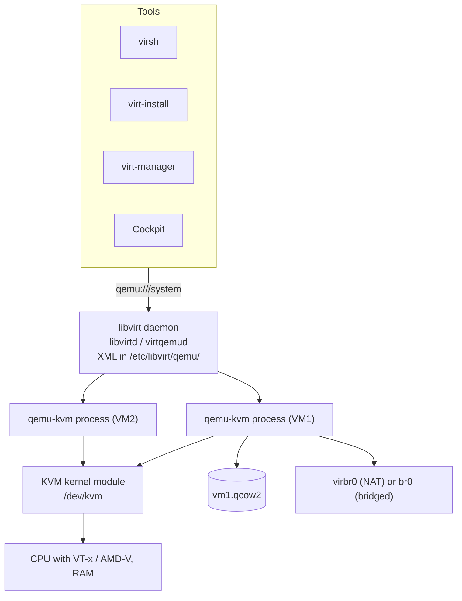

# Virtual Machines with libvirt

<!-- nav:start -->
> **Module 08 · Security, Virtualization & Containers** — lesson 5 of 6  
> [Module index](README.md) · [Course lesson (commands)](../../course/08-Security-VMs-Containers.md#lesson-5---virtual-machines-with-libvirt-gap) · [Exercises for this lesson](../../exercises/08-security-vms-containers/05-libvirt-vms.md)
<!-- nav:end -->

Linux is itself a hypervisor: with the **KVM** kernel module, **QEMU** and the **libvirt** management layer, any Linux server can run virtual machines. The LFCS objective *"Manage Virtual Machines (libvirt)"* expects you to create VMs, start/stop them, change their resources, connect to their consoles, manage storage and networks, and take snapshots – all from the command line with `virsh` and `virt-install`. In this lesson you will learn the architecture and the essential commands.

## What you will learn

- Hypervisor types; how KVM, QEMU and libvirt fit together
- Checking hardware support and installing the stack
- Domains, XML definitions, persistent vs transient VMs
- Creating VMs with `virt-install` (ISO, cloud image, import)
- Lifecycle with `virsh`: start, shutdown, destroy, autostart, undefine
- Consoles: serial console, VNC/SPICE
- Changing CPU and memory; editing XML
- Storage pools and volumes; disk images (qcow2, raw) with `qemu-img`
- Virtual networks (NAT `default`) and bridged networking
- Snapshots
- Other tools: virt-manager, Cockpit, virt-clone, virt-customize

---

## Key terms

| Term | Definition |
|------|-----------|
| **Hypervisor** | Software that runs virtual machines. Type 1 runs on hardware (KVM, ESXi, Hyper-V); type 2 runs as an app (VirtualBox). |
| **KVM** | *Kernel-based Virtual Machine*: Linux kernel module using CPU virtualization extensions (Intel VT-x, AMD-V). Turns Linux into a type-1 hypervisor. |
| **QEMU** | Emulator providing the virtual hardware (disks, NICs, display) for KVM guests. |
| **libvirt** | Management API/daemon (`libvirtd` or modular `virtqemud`) for KVM/QEMU, LXC, Xen; used by `virsh`, virt-manager, Cockpit, OpenStack. |
| **Domain** | libvirt's name for a VM. |
| **Domain XML** | The VM definition (CPU, memory, disks, NICs…) in XML. |
| **Persistent / transient domain** | Defined (survives host reboot, can be stopped and started) / exists only while running. |
| **Storage pool / volume** | A storage location (directory, LVM VG, NFS…) / a disk image in it. |
| **qcow2** | QEMU copy-on-write image format: thin provisioning, snapshots, backing files. |
| **virtio** | Paravirtualized drivers for fast disk/network I/O in guests. |

---

## Architecture



Each running VM is a `qemu-kvm` (or `qemu-system-x86_64`) process on the host – you can see it with `ps`.

Connection URIs: `qemu:///system` (system VMs, root/`libvirt` group – the usual one) and `qemu:///session` (per-user VMs). `virsh` as root uses `qemu:///system`; as a normal user, set `export LIBVIRT_DEFAULT_URI=qemu:///system` or use `virsh -c qemu:///system`.

---

## Checking support and installing

```console
$ grep -cE 'vmx|svm' /proc/cpuinfo     # > 0 = CPU supports virtualization (vmx Intel, svm AMD)
2
$ lsmod | grep kvm
kvm_intel             409600  0
kvm                  1363968  1 kvm_intel
$ ls -l /dev/kvm
```

> Inside your lab VMs you need **nested virtualization** enabled on the physical host (e.g. `cat /sys/module/kvm_intel/parameters/nested` → `Y`, and CPU mode "host-passthrough" for the lab VM). Without it, KVM isn't available and VMs run very slowly in pure emulation.

```console
# RHEL family
$ sudo dnf install qemu-kvm libvirt virt-install guestfs-tools
$ sudo systemctl enable --now libvirtd       # RHEL 9 also supports modular daemons: virtqemud.socket etc.
# Debian/Ubuntu
$ sudo apt install qemu-kvm libvirt-daemon-system libvirt-clients virtinst
$ sudo usermod -aG libvirt $USER             # manage VMs without sudo (re-login)
$ sudo virt-host-validate
  QEMU: Checking for hardware virtualization                 : PASS
  QEMU: Checking if device /dev/kvm exists                   : PASS
  QEMU: Checking for cgroup 'cpu' controller support         : PASS
```

---

## Creating VMs with virt-install

### Find the OS variant

```console
$ osinfo-query os | grep -iE 'ubuntu24|rocky9'      # package osinfo-db-tools / libosinfo-bin
 rocky9               | Rocky Linux 9          | 9       | http://rockylinux.org/rocky/9
 ubuntu24.04          | Ubuntu 24.04 LTS       | 24.04   | http://ubuntu.com/ubuntu/24.04
$ virt-install --osinfo list | grep rocky
```

The OS variant lets libvirt choose good defaults (virtio, firmware, recommended RAM).

### Install from an ISO

```console
$ sudo virt-install \
    --name vm1 \
    --memory 2048 --vcpus 2 \
    --disk size=10,format=qcow2 \
    --cdrom /var/lib/libvirt/images/Rocky-9-x86_64-minimal.iso \
    --osinfo rocky9 \
    --network network=default \
    --graphics vnc,listen=127.0.0.1 \
    --noautoconsole
```

`--disk size=10` creates a 10 GiB qcow2 volume in the `default` pool (`/var/lib/libvirt/images/vm1.qcow2`).

### Text install over the serial console (no GUI)

```console
$ sudo virt-install --name vm2 --memory 2048 --vcpus 2 --disk size=10 \
    --location /var/lib/libvirt/images/Rocky-9-x86_64-minimal.iso \
    --osinfo rocky9 --graphics none \
    --extra-args "console=ttyS0,115200n8 inst.text"
```

(`--location` allows `--extra-args` for the installer kernel.)

### Import a cloud image (fast)

```console
$ cd /var/lib/libvirt/images
$ sudo curl -LO https://cloud-images.ubuntu.com/noble/current/noble-server-cloudimg-amd64.img
$ sudo qemu-img create -f qcow2 -F qcow2 -b noble-server-cloudimg-amd64.img vm3.qcow2 10G   # overlay on the base image
$ sudo virt-install --name vm3 --memory 1024 --vcpus 1 \
    --disk vm3.qcow2 --import --osinfo ubuntu24.04 \
    --network network=default --graphics none --noautoconsole \
    --cloud-init root-password-generate=on       # newer virt-install; prints a root password
```

`--import` skips installation and boots the existing disk.

---

## Lifecycle with virsh

```console
$ virsh list --all
 Id   Name   State
-----------------------
 1    vm1    running
 -    vm2    shut off
$ virsh start vm2
$ virsh shutdown vm1          # ACPI shutdown request – the guest OS shuts down cleanly
$ virsh reboot vm1
$ virsh destroy vm1           # immediate power-off (not deletion!) – like pulling the plug
$ virsh suspend vm1; virsh resume vm1     # pause / continue (state kept in RAM)
$ virsh autostart vm1         # start with the host
$ virsh autostart --disable vm1
$ virsh list --autostart
$ virsh dominfo vm1
Name:           vm1
State:          running
CPU(s):         2
Max memory:     2097152 KiB
Used memory:    2097152 KiB
Persistent:     yes
Autostart:      enable
$ virsh domstate vm1
```

### Deleting

```console
$ virsh destroy vm2                               # stop it first if running
$ virsh undefine vm2 --remove-all-storage         # delete the definition AND its disks
$ virsh undefine vm2 --nvram                      # UEFI VMs also have an NVRAM file
```

`undefine` alone keeps the disk images.

---

## Consoles

```console
$ virsh console vm1            # serial console – exit with Ctrl+]
$ virsh vncdisplay vm1         # graphical console port (connect with a VNC viewer / virt-viewer)
:0
$ virt-viewer vm1              # if you have a desktop
```

For `virsh console` to show a login prompt, the guest must have a serial console: on most cloud images it's on by default; for installed systems add `console=ttyS0` to the guest's kernel command line (or `systemctl enable --now serial-getty@ttyS0` in the guest).

---

## Information about a VM

```console
$ virsh domblklist vm1                 # disks
 Target   Source
------------------------------------------------
 vda      /var/lib/libvirt/images/vm1.qcow2
 sda      /var/lib/libvirt/images/Rocky-9-x86_64-minimal.iso
$ virsh domiflist vm1                  # NICs
 Interface   Type      Source    Model    MAC
-----------------------------------------------------------
 vnet0       network   default   virtio   52:54:00:6b:1d:22
$ virsh domifaddr vm1                  # guest IP (from DHCP leases or guest agent)
$ virsh net-dhcp-leases default
$ virsh vcpuinfo vm1; virsh domstats vm1
$ virsh dumpxml vm1 | less
```

---

## Changing resources

Changes can apply to the **running** VM (`--live`), to the **saved definition** (`--config`, effective at next boot), or both.

```console
# vCPUs
$ virsh setvcpus vm1 4 --maximum --config     # raise the maximum (definition)
$ virsh setvcpus vm1 4 --config               # next boot
$ virsh setvcpus vm1 3 --live                 # hot-add if supported (up to the maximum)

# Memory (KiB by default, or use units)
$ virsh setmaxmem vm1 4G --config             # maximum – requires the VM to be off or takes effect next boot
$ virsh setmem vm1 3G --config
$ virsh setmem vm1 3G --live                  # balloon within the maximum

$ virsh dominfo vm1 | grep -E 'CPU|memory'
```

### Editing the XML

```console
$ virsh edit vm1                   # opens the XML in $EDITOR, validates it on save, applies to the definition
```

```xml
<domain type='kvm'>
  <name>vm1</name>
  <memory unit='KiB'>4194304</memory>
  <currentMemory unit='KiB'>3145728</currentMemory>
  <vcpu placement='static'>4</vcpu>
  <os><type arch='x86_64' machine='q35'>hvm</type></os>
  <devices>
    <disk type='file' device='disk'>
      <driver name='qemu' type='qcow2'/>
      <source file='/var/lib/libvirt/images/vm1.qcow2'/>
      <target dev='vda' bus='virtio'/>
    </disk>
    <interface type='network'>
      <source network='default'/>
      <model type='virtio'/>
    </interface>
  </devices>
</domain>
```

Export and recreate: `virsh dumpxml vm1 > vm1.xml` … `virsh define vm1.xml`. Persistent definitions live in `/etc/libvirt/qemu/*.xml` – **don't edit those files directly**; use `virsh edit`/`define`.

### Adding a disk

```console
$ sudo qemu-img create -f qcow2 /var/lib/libvirt/images/vm1-data.qcow2 5G
$ virsh attach-disk vm1 /var/lib/libvirt/images/vm1-data.qcow2 vdb --driver qemu --subdriver qcow2 --persistent
$ virsh detach-disk vm1 vdb --persistent
```

`attach-interface` / `detach-interface` do the same for NICs.

---

## Storage

### Disk images with qemu-img

| Format | Properties |
|--------|-----------|
| **qcow2** | thin (grows as used), internal snapshots, backing files, compression |
| **raw** | plain bytes, fastest, simplest; sparse files keep it thin on most filesystems |

```console
$ qemu-img create -f qcow2 disk.qcow2 20G
$ qemu-img info disk.qcow2
image: disk.qcow2
file format: qcow2
virtual size: 20 GiB (21474836480 bytes)
disk size: 196 KiB
$ qemu-img resize disk.qcow2 +10G        # then grow the partition/FS inside the guest
$ qemu-img convert -f raw -O qcow2 disk.raw disk.qcow2
$ qemu-img check disk.qcow2
```

### Pools and volumes

```console
$ virsh pool-list --all
 Name      State    Autostart
-------------------------------
 default   active   yes
$ virsh pool-info default
$ virsh vol-list default
$ virsh vol-create-as default data1.qcow2 5G --format qcow2
$ virsh vol-delete data1.qcow2 --pool default
# a new directory pool
$ virsh pool-define-as vmstore dir --target /srv/vmstore
$ virsh pool-build vmstore; virsh pool-start vmstore; virsh pool-autostart vmstore
```

Pools can also be LVM volume groups (`logical`), NFS shares (`netfs`), iSCSI targets…

> On SELinux hosts, images outside `/var/lib/libvirt/images` need the label `virt_image_t` (`semanage fcontext -a -t virt_image_t "/srv/vmstore(/.*)?"; restorecon -Rv /srv/vmstore`).

---

## Networking

```console
$ virsh net-list --all
 Name      State    Autostart   Persistent
--------------------------------------------
 default   active   yes         yes
$ virsh net-dumpxml default
<network>
  <name>default</name>
  <forward mode='nat'/>
  <bridge name='virbr0' stp='on' delay='0'/>
  <ip address='192.168.122.1' netmask='255.255.255.0'>
    <dhcp><range start='192.168.122.2' end='192.168.122.254'/></dhcp>
  </ip>
</network>
$ virsh net-start default; virsh net-autostart default
$ virsh net-dhcp-leases default
```

| Mode | How | Guest is |
|------|-----|----------|
| **NAT** (`default` network) | `virbr0` bridge + dnsmasq (DHCP/DNS) + masquerading | behind the host, `192.168.122.0/24`; reachable from the host only |
| **Bridged** | host bridge `br0` containing the physical NIC (see [Bridges](../07-networking/06-bridges-bonds.md)) | directly on the LAN |
| Isolated | network without `<forward>` | only VMs and host |

Use a host bridge: `virt-install … --network bridge=br0`.

---

## Snapshots

```console
$ virsh snapshot-create-as vm1 before-update --description "pre dnf upgrade"
Domain snapshot before-update created
$ virsh snapshot-list vm1
 Name            Creation Time               State
-------------------------------------------------------
 before-update   2026-10-21 12:00:01 +0200   running
$ virsh snapshot-revert vm1 before-update
$ virsh snapshot-delete vm1 before-update
$ virsh snapshot-create-as vm1 disk-only --disk-only --atomic    # external snapshot (overlay files)
```

Internal snapshots (default for qcow2) store disk and optionally RAM state inside the qcow2 file.

---

## Other useful tools

| Tool | Purpose |
|------|---------|
| `virt-manager` | GUI (desktop or over SSH: `virt-manager -c qemu+ssh://root@host/system`) |
| Cockpit (`cockpit-machines`) | web UI on port 9090 |
| `virt-clone --original vm1 --name vm1-clone --auto-clone` | clone a VM |
| `virt-customize`, `virt-sysprep` (guestfs-tools) | modify images offline (set passwords, install packages, reset machine-id) |
| `virt-df`, `virt-cat`, `guestmount` | inspect guest disks without booting them |
| `virsh -c qemu+ssh://root@host/system list` | manage a remote hypervisor |

---

## Try it yourself

1. Check CPU virtualization support and run `virt-host-validate` on a lab VM (with nested virtualization) or your workstation.
2. Install the libvirt stack; list networks and pools.
3. Create a VM from a cloud image with `virt-install --import`; connect with `virsh console`.
4. Set it to autostart; give it 2 vCPUs and 1.5 GiB RAM persistently; verify with `dominfo` after a shutdown/start.
5. Attach an extra 2 GiB qcow2 disk persistently and find it inside the guest.
6. Take a snapshot, break something in the guest, revert.
7. Shut it down and remove it completely including storage.

---

## Common mistakes

- `virsh destroy` thinking it deletes the VM (it powers it off) – or `undefine` thinking it deletes the disks (it doesn't, without `--remove-all-storage`).
- Changing settings with `--live` only and losing them at the next boot (or `--config` only and expecting them now).
- Editing `/etc/libvirt/qemu/*.xml` directly.
- Running as a normal user against `qemu:///session` and not seeing system VMs.
- Disk images in custom paths without the right SELinux label.
- No serial console configured in the guest → `virsh console` shows nothing.

---

## Summary

| Task | Command |
|------|---------|
| Check host | `grep -cE 'vmx\|svm' /proc/cpuinfo`, `virt-host-validate` |
| Create | `virt-install --name N --memory M --vcpus C --disk size=S --cdrom ISO --osinfo OS` (or `--import`) |
| List / state | `virsh list --all`, `virsh dominfo N` |
| Start / stop / force off | `virsh start`, `virsh shutdown`, `virsh destroy` |
| Boot with host | `virsh autostart N` |
| Console | `virsh console N` (exit `Ctrl+]`) |
| CPU / RAM | `virsh setvcpus N X --config`, `virsh setmaxmem N 4G --config`, `virsh setmem N 3G --config` |
| Edit definition | `virsh edit N`, `virsh dumpxml N`, `virsh define file.xml` |
| Disks | `qemu-img create/info/resize`, `virsh attach-disk`, `virsh domblklist` |
| Storage | `virsh pool-list`, `virsh vol-list default` |
| Networks | `virsh net-list --all`, `virsh net-dhcp-leases default` |
| Snapshots | `virsh snapshot-create-as`, `snapshot-list`, `snapshot-revert` |
| Delete | `virsh undefine N --remove-all-storage` |

## Check yourself

1. What are the roles of KVM, QEMU and libvirt?
2. What's the difference between `virsh shutdown` and `virsh destroy`?
3. Which option makes a change apply only at the next boot?
4. A VM on the `default` network has IP 192.168.122.50. Can another machine on your LAN reach it directly? Why?
5. Which command removes a VM and its disk images?

<details>
<summary>Answers</summary>

1. KVM: kernel module providing hardware-accelerated CPU/memory virtualization. QEMU: emulates the VM's devices and runs the VM process. libvirt: management layer/API used by virsh and other tools.
2. `shutdown` asks the guest OS to shut down cleanly (ACPI); `destroy` powers it off immediately.
3. `--config`.
4. No – the default network is NAT behind `virbr0`; use a bridged network (or port forwarding) for LAN access.
5. `virsh undefine NAME --remove-all-storage` (after stopping it).

</details>

## Further reading

- `man virsh`, `man virt-install`, `man qemu-img`, `man virt-clone`
- [libvirt documentation](https://libvirt.org/docs.html) · [virsh command reference](https://www.libvirt.org/manpages/virsh.html) · [Domain XML format](https://libvirt.org/formatdomain.html)
- [Red Hat: Configuring and managing virtualization (RHEL 9)](https://docs.redhat.com/en/documentation/red_hat_enterprise_linux/9/html/configuring_and_managing_virtualization/index)
- [Ubuntu Server: Virtualisation with libvirt](https://documentation.ubuntu.com/server/how-to/virtualisation/libvirt/)
- [ArchWiki: libvirt](https://wiki.archlinux.org/title/Libvirt) · [KVM](https://wiki.archlinux.org/title/KVM)

---

<!-- footer:start -->
[← Working with SSL/TLS Certificates](04-ssl-certificates.md) · [Module index](README.md) · [Containers: Docker and Podman →](06-containers.md)  
**Practice now:** [Exercises – Virtual Machines with libvirt](../../exercises/08-security-vms-containers/05-libvirt-vms.md)
<!-- footer:end -->
