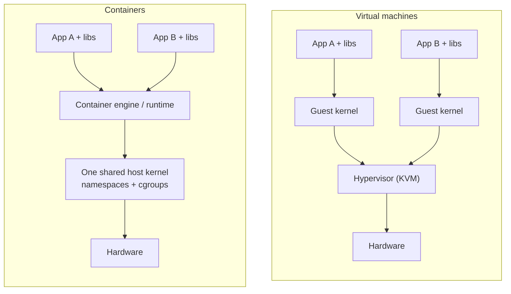
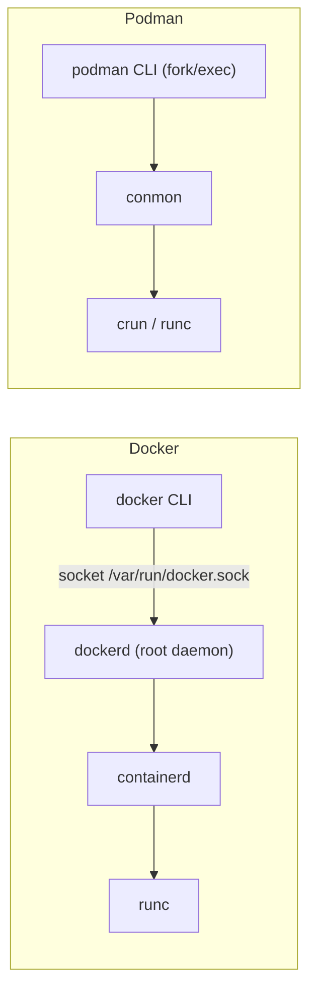

# Containers: Docker and Podman

<!-- nav:start -->
> **Module 08 · Security, Virtualization & Containers** — lesson 6 of 6  
> [Module index](README.md) · [Course lesson (commands)](../../course/08-Security-VMs-Containers.md#lesson-6---containers-ch-18--gap) · [Exercises for this lesson](../../exercises/08-security-vms-containers/06-containers.md)
<!-- nav:end -->

Containers package an application with everything it needs – libraries, runtime, configuration – and run it isolated from the rest of the system, sharing the host's kernel. They start in milliseconds and behave the same on a laptop, a test server and production. The LFCS objectives ask you to *configure container engines* and *create and manage containers*. In this lesson you will learn how containers work under the hood, the image/container model, and how to run, inspect, persist, network, build and manage containers with **Docker** and **Podman**.

## What you will learn

- Containers vs virtual machines; namespaces, cgroups and union filesystems
- Images, layers, tags, digests and registries
- Docker vs Podman architecture (daemon vs daemonless, rootless)
- Running containers: detached, interactive, ports, environment, names, restart policies
- Inspecting: `ps`, `logs`, `inspect`, `exec`, `top`, `stats`
- Persistent data: volumes and bind mounts (and SELinux `:Z`)
- Container networks
- Building images with a Dockerfile/Containerfile
- Configuring engines: `daemon.json`, `registries.conf`, storage locations
- Running containers as systemd services (Quadlet)
- Cleaning up

---

## Key terms

| Term | Definition |
|------|-----------|
| **Container** | An isolated group of processes running from an image, with its own filesystem view, network and process tree. |
| **Image** | A read-only, layered template (filesystem + metadata such as the default command). |
| **Layer** | One read-only filesystem change set in an image (≈ one Dockerfile instruction). |
| **Tag / digest** | Human-readable version name (`nginx:1.27`) / immutable content hash (`nginx@sha256:…`). |
| **Registry** | A server storing images: Docker Hub (`docker.io`), Quay (`quay.io`), GitHub (`ghcr.io`), private ones. |
| **Container engine** | The tool that manages images and containers: Docker, Podman. |
| **OCI runtime** | Low-level program that actually creates the container (`runc`, `crun`). |
| **Namespace** | Kernel feature giving processes their own view of a resource (PIDs, network, mounts…). |
| **cgroup** | Kernel feature limiting resources (CPU, memory, PIDs) of a group of processes. |
| **Volume** | Engine-managed persistent storage, independent of a container's lifecycle. |
| **Bind mount** | A host directory mounted into a container. |
| **Rootless** | Running containers as a normal user, mapping container root to an unprivileged host UID. |

---

## Containers vs virtual machines



| | Virtual machine | Container |
|--|----------------|-----------|
| Kernel | its own | the host's |
| Boot time | seconds to minutes | milliseconds |
| Size | GBs | MBs |
| Isolation | strong (hardware virtualization) | process-level (kernel features) |
| Other OS kernels | yes (Windows on Linux) | no – Linux containers need a Linux kernel |
| Typical unit | a whole server | one application/service |

---

## How containers work

A container is **just processes** on the host, made to look like a separate machine by kernel features:

| Feature | Controls | Effect in the container |
|---------|----------|------------------------|
| **PID namespace** | process IDs | the app is PID 1; can't see host processes |
| **Mount namespace** | filesystem view | its own root filesystem from the image |
| **Network namespace** | interfaces, routes, ports | its own `eth0`, IP, port space |
| **UTS namespace** | hostname | its own hostname |
| **IPC namespace** | shared memory, semaphores | isolated |
| **User namespace** | UID/GID mapping | root inside = unprivileged user outside (rootless) |
| **cgroups** | CPU, memory, I/O, PIDs | resource limits (`--memory`, `--cpus`) |
| **Capabilities, seccomp, SELinux/AppArmor** | privileges, system calls, MAC | reduced attack surface |
| **overlayfs** | layered filesystem | image layers read-only + a thin writable layer per container |

```console
$ podman run -d --name web nginx:alpine
$ ps -ef | grep "nginx: master"            # visible as a normal host process
root     4410  4398  0 10:01 ?  00:00:00 nginx: master process nginx -g daemon off;
$ sudo lsns -p 4410                        # its namespaces
```

---

## Images and registries

```text
docker.io/library/nginx:1.27-alpine
└─ registry ─┘└ namespace┘└repo┘└ tag ┘
```

- Tags are mutable pointers (`latest` changes!). Digests (`@sha256:…`) never change – use them for reproducibility.
- Short names (`nginx`) are expanded: Docker assumes `docker.io/library/`. Podman uses `unqualified-search-registries` in `/etc/containers/registries.conf` and may ask which registry to use – fully qualified names avoid ambiguity.

```console
$ podman pull docker.io/library/nginx:alpine
$ podman images
REPOSITORY                TAG      IMAGE ID      CREATED      SIZE
docker.io/library/nginx   alpine   a5967740120f  2 weeks ago  48.3 MB
$ podman image inspect nginx:alpine --format '{{.Config.Cmd}} {{.Config.ExposedPorts}}'
$ podman history nginx:alpine           # layers
$ podman search httpd --limit 5
$ podman rmi nginx:alpine
$ podman login registry.example.lab     # private registries
```

---

## Docker vs Podman



| | Docker | Podman |
|--|--------|--------|
| Architecture | client + root daemon `dockerd` | **daemonless** – each container is a child of `conmon` |
| Rootless | possible (extra setup) | default for normal users |
| CLI | `docker …` | `podman …` – mostly identical (`alias docker=podman`, package `podman-docker`) |
| Default on | Ubuntu (`docker.io` package or Docker CE repo) | RHEL family |
| Restart at boot | `--restart` policy + daemon | systemd (Quadlet units) |
| Pods | – (Compose) | `podman pod` (Kubernetes-like groups) |
| Compose | `docker compose` | `podman compose` / `podman-compose` |

### Installing

```console
# Ubuntu – Docker from the distribution
$ sudo apt install docker.io
$ sudo systemctl enable --now docker
$ sudo usermod -aG docker ana            # run docker without sudo (= root-equivalent access!)
# RHEL – Podman
$ sudo dnf install podman                # container-tools for the full set (buildah, skopeo)
$ podman info | grep -E 'rootless|graphRoot|cgroupVersion'
```

Membership in the `docker` group is equivalent to root (anyone can mount `/` into a container). Rootless Podman avoids this.

---

## Running containers

```console
$ podman run --rm docker.io/library/alpine echo "hello from a container"     # run once, remove afterwards
hello from a container
$ podman run -it --rm alpine sh                                              # interactive shell; exit to stop
$ podman run -d --name web -p 8080:80 nginx:alpine                           # detached, publish port
3f2c1a9e7b…
$ curl -s localhost:8080 | head -4
$ podman ps
CONTAINER ID  IMAGE                           COMMAND               CREATED        STATUS        PORTS                 NAMES
3f2c1a9e7b0d  docker.io/library/nginx:alpine  nginx -g daemon o...  5 seconds ago  Up 5 seconds  0.0.0.0:8080->80/tcp  web
$ podman ps -a                                                               # including stopped
```

| Option | Meaning |
|--------|---------|
| `-d` | detached (background) |
| `-it` | interactive with a terminal |
| `--rm` | remove the container when it exits |
| `--name NAME` | name instead of a random one |
| `-p HOST:CONTAINER` | publish a port (`-p 127.0.0.1:8080:80` to bind only locally; `-P` all exposed ports) |
| `-e KEY=value`, `--env-file f` | environment variables |
| `-v SRC:DST[:opts]` | volume or bind mount |
| `--restart no/on-failure/always/unless-stopped` | restart policy |
| `--memory 512m`, `--cpus 1.5`, `--pids-limit 100` | cgroup limits |
| `--user 1000:1000` | run as a specific UID/GID inside |
| `--hostname`, `--network`, `--read-only`, `--cap-drop ALL` | more isolation settings |

Publishing a port creates NAT rules on the host (DNAT from host port to container IP:port – see [Firewalls and NAT](../07-networking/07-firewalls-nat.md)). Rootless containers can't publish ports below 1024 by default (`net.ipv4.ip_unprivileged_port_start`).

### Lifecycle

```console
$ podman stop web           # SIGTERM, then SIGKILL after 10 s
$ podman start web
$ podman restart web
$ podman kill web           # SIGKILL immediately
$ podman pause web; podman unpause web
$ podman rm web             # remove a stopped container (-f to force a running one)
```

---

## Inspecting

```console
$ podman logs web                 # stdout/stderr of the container
$ podman logs -f --tail 20 web    # follow
$ podman exec -it web sh          # shell inside a running container
$ podman exec web nginx -t        # run one command
$ podman top web                  # processes in the container
$ podman stats --no-stream        # CPU / memory / network usage
$ podman inspect web | less       # full JSON
$ podman inspect web --format '{{.NetworkSettings.IPAddress}} {{.State.Status}} {{.HostConfig.RestartPolicy.Name}}'
$ podman port web
80/tcp -> 0.0.0.0:8080
$ podman cp ./index.html web:/usr/share/nginx/html/     # copy files in/out
$ podman diff web                 # files changed in the container's writable layer
```

---

## Persistent data

The container's writable layer is deleted with the container. Store data in a **volume** or a **bind mount**:

```console
# Named volume (managed by the engine)
$ podman volume create webdata
$ podman run -d --name web -p 8080:80 -v webdata:/usr/share/nginx/html nginx:alpine
$ podman volume ls; podman volume inspect webdata    # Mountpoint: …/volumes/webdata/_data

# Bind mount (a host directory)
$ mkdir -p /srv/site && echo "<h1>Hello</h1>" > /srv/site/index.html
$ podman run -d --name site -p 8081:80 -v /srv/site:/usr/share/nginx/html:ro,Z nginx:alpine
```

| | Volume | Bind mount |
|--|--------|-----------|
| Location | engine-managed (`/var/lib/containers/storage/volumes/`, `~/.local/share/containers/…`, `/var/lib/docker/volumes/`) | any host path you choose |
| Created | `volume create` or automatically | must exist |
| Best for | databases, app data | config files, site content, development |

Options: `ro` (read-only), and on SELinux hosts **`:Z`** (relabel for this container only) or **`:z`** (shared between containers). Without it, SELinux denies access to the host directory (labels must be `container_file_t`). Never use `:Z` on system directories like `/home` or `/etc`.

Rootless containers write files with **mapped UIDs** (e.g. container root = your UID; other container UIDs map to subordinate UIDs from `/etc/subuid`) – `podman unshare chown` fixes ownership inside the user namespace.

---

## Networking

```console
$ podman network ls
NETWORK ID    NAME     DRIVER
2f259bab93aa  podman   bridge
$ podman network create appnet
$ podman run -d --name db  --network appnet -e POSTGRES_PASSWORD=secret docker.io/library/postgres:16
$ podman run -d --name app --network appnet -p 8080:8080 myapp:1.0
$ podman exec app getent hosts db             # containers on a user-defined network resolve each other by name
10.89.0.2       db.dns.podman db
$ podman network inspect appnet
```

- The default bridge network gives containers private IPs; publish ports to reach them from outside.
- On **user-defined** networks, containers find each other **by name** (built-in DNS).
- `--network host` shares the host's network namespace (no isolation, no `-p` needed).
- Podman **pods** share a network namespace between containers (`podman pod create -p 8080:80 --name mypod`, then `podman run --pod mypod …`) – like Kubernetes pods.

---

## Building images

```dockerfile
# Containerfile (or Dockerfile)
FROM docker.io/library/nginx:alpine
LABEL maintainer="ana@example.lab"
COPY index.html /usr/share/nginx/html/
RUN apk add --no-cache curl
ENV APP_ENV=production
EXPOSE 80
HEALTHCHECK CMD curl -fs http://localhost/ || exit 1
CMD ["nginx", "-g", "daemon off;"]
```

| Instruction | Purpose |
|-------------|---------|
| `FROM` | base image |
| `RUN` | run a command at build time (creates a layer) |
| `COPY` / `ADD` | copy files from the build context |
| `WORKDIR` | working directory |
| `ENV` | environment variable |
| `EXPOSE` | document the listening port |
| `USER` | run as this user |
| `CMD` | default command (overridable) |
| `ENTRYPOINT` | fixed executable; `CMD` becomes its arguments |

```console
$ podman build -t mysite:1.0 .
STEP 1/7: FROM docker.io/library/nginx:alpine
…
Successfully tagged localhost/mysite:1.0
$ podman run -d --name mysite -p 8082:80 mysite:1.0
$ podman tag mysite:1.0 registry.example.lab/team/mysite:1.0
$ podman push registry.example.lab/team/mysite:1.0
$ podman save -o mysite.tar mysite:1.0; podman load -i mysite.tar    # move images without a registry
$ podman commit web web-snapshot:1                                   # image from a container (avoid for production)
```

A `.dockerignore`/`.containerignore` keeps unwanted files out of the build context.

---

## Configuring the engine

### Docker: `/etc/docker/daemon.json`

```json
{
  "log-driver": "json-file",
  "log-opts": { "max-size": "10m", "max-file": "3" },
  "data-root": "/srv/docker",
  "insecure-registries": ["registry.example.lab:5000"],
  "registry-mirrors": ["https://mirror.example.lab"],
  "default-address-pools": [{ "base": "172.30.0.0/16", "size": 24 }]
}
```

```console
$ sudo systemctl restart docker
$ docker info | grep -E 'Docker Root Dir|Logging Driver|Insecure'
```

### Podman: `/etc/containers/`

| File | Configures |
|------|-----------|
| `registries.conf` (+ `registries.conf.d/`) | search registries, mirrors, insecure/blocked registries |
| `containers.conf` | defaults: log driver, network backend, ulimits, environment |
| `storage.conf` | storage driver and location (`graphroot`) |
| `policy.json` | image signature policy |
| `~/.config/containers/` | per-user overrides (rootless) |

```toml
# /etc/containers/registries.conf.d/lab.conf
unqualified-search-registries = ["docker.io", "quay.io"]

[[registry]]
location = "registry.example.lab:5000"
insecure = true
```

Storage locations: rootful Podman `/var/lib/containers/storage`, rootless `~/.local/share/containers/storage`, Docker `/var/lib/docker`.

---

## Containers as services

### Docker: restart policies

```console
$ docker run -d --name web --restart unless-stopped -p 8080:80 nginx:alpine
$ docker update --restart always web
```

| Policy | Restarts when… |
|--------|---------------|
| `no` (default) | never |
| `on-failure[:N]` | it exits with a non-zero code |
| `always` | it stops for any reason, and when the daemon starts (boot) |
| `unless-stopped` | like always, unless you stopped it manually |

### Podman: systemd with Quadlet

Podman has no daemon to restart containers at boot; **systemd** does it. **Quadlet** (Podman ≥ 4.4) generates units from simple files:

```ini
# /etc/containers/systemd/web.container     (rootless: ~/.config/containers/systemd/)
[Unit]
Description=Nginx web container

[Container]
Image=docker.io/library/nginx:alpine
ContainerName=web
PublishPort=8080:80
Volume=/srv/site:/usr/share/nginx/html:ro,Z
Environment=TZ=Europe/Madrid

[Service]
Restart=always

[Install]
WantedBy=multi-user.target default.target
```

```console
$ sudo systemctl daemon-reload            # generates web.service
$ sudo systemctl start web.service
$ systemctl status web.service
$ podman ps
```

(No `enable` needed – the `[Install]` section is applied by the generator.) For rootless services that must run without a login: `loginctl enable-linger ana`, then `systemctl --user daemon-reload; systemctl --user start web`.

The older `podman generate systemd --new --files --name web` still works but is deprecated.

Podman also honours `--restart=always` for containers it starts, but only systemd brings them back after a reboot (`podman-restart.service` restarts containers with `--restart=always` at boot when enabled).

---

## Cleaning up

```console
$ podman ps -a; podman images; podman volume ls
$ podman rm -f $(podman ps -aq)           # remove all containers (careful)
$ podman container prune                  # stopped containers
$ podman image prune -a                   # unused images
$ podman volume prune                     # unused volumes – data loss!
$ podman system df                        # disk usage
$ podman system prune -a                  # everything unused
```

---

## Try it yourself

1. Install Podman on `rhel1` and Docker on `deb1`. Run `hello-world` / `alpine echo hi` on each.
2. Run `nginx:alpine` named `web` on port 8080 with a bind-mounted page from `/srv/site` (SELinux `:Z` on RHEL); check logs, `exec` into it, inspect its IP and restart policy.
3. Create a named volume, run a container that writes to it, remove the container, and show the data survives in a new container.
4. Create a network `appnet` with two containers that reach each other by name.
5. Build `mysite:1.0` from a Containerfile and run it.
6. On `rhel1`, make `web` start at boot with a Quadlet file; reboot and check. On `deb1`, use `--restart always`.
7. Configure an insecure/private registry entry for each engine.

---

## Common mistakes

- Storing data in the container layer and losing it on `rm`.
- Forgetting `:Z` on SELinux hosts → "Permission denied" inside the container.
- Expecting Podman containers to come back after reboot without systemd/Quadlet.
- Publishing ports below 1024 as a rootless user.
- Using `latest` and getting a different image next time.
- Adding users to the `docker` group without realizing it grants root.
- Confusing `-p 8080:80` order (host first, container second).

---

## Summary

| Task | Command |
|------|---------|
| Pull / list / remove images | `podman pull IMG`, `podman images`, `podman rmi IMG` |
| Run detached with port | `podman run -d --name N -p 8080:80 IMG` |
| Interactive | `podman run -it --rm IMG sh` |
| List | `podman ps`, `podman ps -a` |
| Logs / shell / info | `podman logs -f N`, `podman exec -it N sh`, `podman inspect N` |
| Stop / start / remove | `podman stop N`, `podman start N`, `podman rm -f N` |
| Volume / bind mount | `-v vol:/path`, `-v /host:/path:ro,Z` |
| Network | `podman network create NET`, `--network NET` |
| Build / tag / push | `podman build -t NAME:TAG .`, `podman tag`, `podman push` |
| Restart policy | `docker run --restart always …`, `docker update --restart …` |
| Boot persistence (Podman) | Quadlet `/etc/containers/systemd/N.container` → `daemon-reload` → `systemctl start N` |
| Engine config | `/etc/docker/daemon.json`; `/etc/containers/{registries,containers,storage}.conf` |
| Clean up | `podman system prune -a`, `podman volume prune` |

## Check yourself

1. Which kernel features isolate containers, and which one limits their resources?
2. Why does data disappear when you `rm` a container, and how do you prevent it?
3. What does `:Z` do on a bind mount?
4. How do you make a Podman container start automatically at boot?
5. In `-p 8080:80`, which number is the host port?

<details>
<summary>Answers</summary>

1. Namespaces (PID, mount, network, UTS, IPC, user) isolate; cgroups limit resources.
2. Data written inside the container goes to its writable layer, which is deleted with the container; use a volume or bind mount.
3. Relabels the host directory with a private SELinux label (`container_file_t` with this container's MCS category) so the container may access it.
4. Create a Quadlet `.container` file in `/etc/containers/systemd/` (or `~/.config/containers/systemd/`), run `systemctl daemon-reload` and start the generated service (it is wanted by the target in its `[Install]` section).
5. 8080 (host), 80 is the container port.

</details>

## Further reading

- `man podman`, `man podman-run`, `man podman-systemd.unit`, `man containers-registries.conf`, `man docker-run` (if installed), `man 7 namespaces`, `man 7 cgroups`
- [Podman documentation](https://docs.podman.io/en/latest/) · [Quadlet (podman-systemd.unit)](https://docs.podman.io/en/latest/markdown/podman-systemd.unit.5.html)
- [Docker documentation – Get started](https://docs.docker.com/get-started/) · [Dockerfile reference](https://docs.docker.com/reference/dockerfile/) · [daemon.json](https://docs.docker.com/reference/cli/dockerd/#daemon-configuration-file)
- [Red Hat: Building, running, and managing containers (RHEL 9)](https://docs.redhat.com/en/documentation/red_hat_enterprise_linux/9/html/building_running_and_managing_containers/index)
- [Ubuntu Server: Docker for system admins](https://documentation.ubuntu.com/server/how-to/containers/docker-for-system-admins/)

---

<!-- footer:start -->
[← Virtual Machines with libvirt](05-libvirt-vms.md) · [Module index](README.md)  
**Practice now:** [Exercises – Containers: Docker and Podman](../../exercises/08-security-vms-containers/06-containers.md)
<!-- footer:end -->
