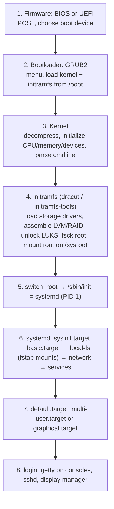
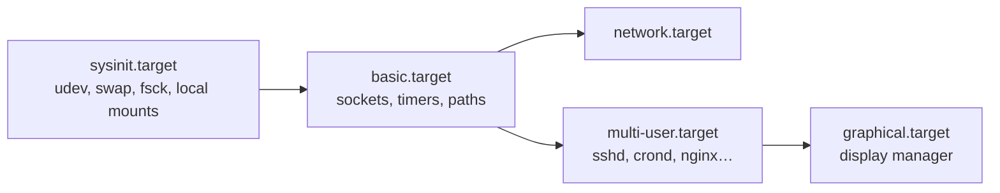

# The Boot Process – and Where It Breaks

<!-- nav:start -->
> **Module 09 · Backup, Recovery & System Rescue** — lesson 3 of 4  
> [Module index](README.md) · [Course lesson (commands)](../../course/09-Backup-Recovery-Rescue.md#lesson-3---boot-process-recap-where-it-can-break) · [Exercises for this lesson](../../exercises/09-backup-rescue/03-boot-process.md)
<!-- nav:end -->

To repair a system that doesn't boot, you need to know exactly what happens between pressing the power button and seeing a login prompt, and what each failure looks like. In this lesson you will follow the boot chain step by step – firmware, bootloader, kernel, initramfs, systemd – learn the files involved at each stage, how to observe and analyze a boot, and how to recognize which stage has failed.

## What you will learn

- BIOS vs UEFI firmware; MBR vs ESP boot
- GRUB2: stages, configuration files, menu, BLS entries
- Kernel start and the kernel command line
- The initramfs and `switch_root`
- systemd boot: targets, the default target, ordering
- Observing a boot: `journalctl -b`, `systemd-analyze`, `dmesg`
- Symptoms at each stage and the matching fix

---

## Key terms

| Term | Definition |
|------|-----------|
| **Firmware** | Code in the motherboard that initializes hardware and starts a bootloader: legacy **BIOS** or **UEFI**. |
| **POST** | *Power-On Self Test* performed by firmware. |
| **MBR** | First 512 bytes of a disk: BIOS boot code + partition table. |
| **ESP** | *EFI System Partition*: FAT32 partition (usually `/boot/efi`) holding UEFI bootloaders. |
| **Secure Boot** | UEFI feature that only runs signed bootloaders/kernels (shim → GRUB → kernel). |
| **GRUB2** | *GRand Unified Bootloader*: shows the menu, loads kernel + initramfs, passes the command line. |
| **BLS** | *Boot Loader Specification*: one file per kernel entry in `/boot/loader/entries/` (RHEL/Fedora). |
| **initramfs** | Temporary root filesystem in RAM with drivers/tools to mount the real root. |
| **switch_root** | Moving from the initramfs to the real root filesystem and starting its `/sbin/init`. |
| **Target** | systemd unit representing a system state (`multi-user.target`, `graphical.target`, `rescue.target`). |

---

## The boot chain



---

## Stage 1 – Firmware

| | BIOS (legacy) | UEFI |
|--|---------------|------|
| Finds the bootloader | first 446 bytes of the **MBR** of the boot disk (+ GRUB core in the gap after it, or a BIOS boot partition on GPT) | a `.efi` file on the **ESP** registered in NVRAM boot entries |
| Partition table | usually MBR | GPT |
| Typical file | – | `/boot/efi/EFI/ubuntu/shimx64.efi`, `/boot/efi/EFI/rocky/grubx64.efi` |
| Tools | – | `efibootmgr -v` (list/change boot entries) |

```console
$ [ -d /sys/firmware/efi ] && echo UEFI || echo BIOS
UEFI
$ sudo efibootmgr -v
BootCurrent: 0004
BootOrder: 0004,0001
Boot0004* rocky   HD(1,GPT,…)/File(\EFI\rocky\shimx64.efi)
```

**Failures:** "No bootable device", firmware boot menu, booting from the wrong disk → check boot order (firmware setup, `efibootmgr`), disk present, ESP intact.

---

## Stage 2 – GRUB2

GRUB reads its configuration, shows a menu (often hidden), loads the selected **kernel** and **initramfs** from `/boot`, and passes the kernel command line.

| File | Purpose |
|------|---------|
| `/etc/default/grub` | **your** settings (timeout, default entry, kernel parameters) |
| `/etc/grub.d/*` | scripts that generate the config |
| `/boot/grub/grub.cfg` (Debian) · `/boot/grub2/grub.cfg` (RHEL) | **generated** config – don't edit |
| `/boot/loader/entries/*.conf` | RHEL BLS entries – one per kernel (managed by `grubby`) |
| `/boot/efi/EFI/<distro>/` | UEFI bootloader binaries (and on RHEL a small `grub.cfg` stub pointing to `/boot/grub2`) |

```console
$ sudo update-grub                                   # Debian/Ubuntu: regenerate grub.cfg
$ sudo grub2-mkconfig -o /boot/grub2/grub.cfg        # RHEL 9 (BIOS and UEFI)
$ sudo grubby --info=ALL | grep -E '^(index|kernel|args)'
$ cat /boot/loader/entries/*.conf | head
title Rocky Linux (5.14.0-503.14.1.el9_5.x86_64) 9.5 (Blue Onyx)
linux /vmlinuz-5.14.0-503.14.1.el9_5.x86_64
initrd /initramfs-5.14.0-503.14.1.el9_5.x86_64.img
options root=/dev/mapper/rl-root ro crashkernel=… rd.lvm.lv=rl/root rhgb quiet
```

At the menu: arrow keys choose an entry (older kernels under "Advanced options"), **`e`** edits it once, **`c`** opens the GRUB command line, `Ctrl+X` boots the edited entry.

**Failures:**

| Symptom | Likely cause |
|---------|-------------|
| `grub>` prompt | GRUB runs but can't find/parse `grub.cfg` (deleted, wrong `/boot` UUID) |
| `grub rescue>` | GRUB can't find its own modules (`/boot` partition missing/changed) |
| `error: file '/vmlinuz-…' not found` | kernel removed or `/boot` not as expected |
| no menu, straight to firmware | bootloader overwritten / ESP or boot entry missing |

Fixes are in [System Rescue](04-system-rescue.md) (manual boot from `grub>`, reinstall GRUB from rescue media).

---

## Stage 3 – The kernel

The kernel decompresses itself, initializes CPUs, memory and built-in drivers, mounts the initramfs as a temporary root, and runs its `/init`.

```console
$ cat /proc/cmdline
BOOT_IMAGE=(hd0,gpt2)/vmlinuz-5.14.0-503.14.1.el9_5.x86_64 root=/dev/mapper/rl-root ro rd.lvm.lv=rl/root rhgb quiet
$ journalctl -k -b | head -5
Oct 21 09:00:01 rhel1 kernel: Linux version 5.14.0-503.14.1.el9_5.x86_64 …
Oct 21 09:00:01 rhel1 kernel: Command line: BOOT_IMAGE=…
```

**Failures:** `Kernel panic - not syncing: VFS: Unable to mount root fs on unknown-block(0,0)` – no driver for the root disk or missing initramfs; wrong `root=`. Try an older kernel from the GRUB menu; rebuild the initramfs.

---

## Stage 4 – initramfs

Built by **dracut** (RHEL, Fedora, SUSE) or **initramfs-tools** (Debian/Ubuntu). It:

1. loads the drivers for the root storage (virtio, NVMe, RAID, network for iSCSI/NFS root),
2. activates LVM (`rd.lvm.lv=`), assembles RAID, asks for LUKS passphrases,
3. finds the root device (`root=UUID=…` or `/dev/mapper/…`), optionally runs fsck,
4. mounts it read-only on `/sysroot`,
5. `switch_root`s into it and executes `/sbin/init` (systemd).

```console
$ lsinitrd | head -20                               # RHEL: content of the current initramfs
$ lsinitramfs /boot/initrd.img-$(uname -r) | head   # Debian
$ sudo dracut -f                                    # rebuild (RHEL)
$ sudo update-initramfs -u -k all                   # rebuild (Debian)
```

**Failures:** you land in a **dracut emergency shell** (`dracut:/#`) or **`(initramfs)`** prompt with messages like `Warning: /dev/mapper/rl-root does not exist` → wrong root UUID/LV name on the command line, missing LVM/driver in the initramfs, renamed VG. From that shell: `lvm vgscan; lvm vgchange -ay`, check `blkid`, then `exit` to continue, and rebuild the initramfs once booted.

Debugging parameters: `rd.break` (stop before switch_root – used for password resets), `rd.shell`, `rd.debug`, `break=premount` (Debian).

---

## Stage 5–7 – systemd

systemd (PID 1) starts units in parallel, respecting dependencies, until the **default target** is reached.



```console
$ systemctl get-default
multi-user.target
$ sudo systemctl set-default multi-user.target
$ systemctl list-dependencies multi-user.target | head
```

| Target | State |
|--------|-------|
| `emergency.target` | root FS read-only, nothing else – minimal shell |
| `rescue.target` | single-user: local filesystems mounted, no network/services |
| `multi-user.target` | normal server |
| `graphical.target` | with GUI |

### fstab is part of boot

Each `/etc/fstab` line becomes a `.mount` unit required by `local-fs.target`. A line that can't be mounted (wrong UUID, missing disk, typo, fsck failure) without `nofail` makes `local-fs.target` fail → **emergency mode**:

```text
You are in emergency mode. After logging in, type "journalctl -xb" to view
system logs, "systemctl reboot" to reboot, "systemctl default" or "exit"
to boot into default mode.
Give root password for maintenance
(or press Control-D to continue):
```

(Ubuntu: root has no password by default → "root account is locked"; you then need the GRUB `init=/bin/bash` or a rescue medium approach.)

**Other systemd-stage failures:** a service fails (boot continues; `systemctl --failed`), a hanging unit delays boot ("A start job is running for…" – often a network mount without `_netdev`/`nofail`, or a device timeout).

---

## Stage 8 – Login

`getty@tty1.service` shows the console login, `sshd` accepts remote logins, display managers handle GUIs. **Failures:** wrong/forgotten password, expired account, broken PAM configuration, full disk (`/var` or `/tmp`), bad SELinux labels on `/etc/shadow` after editing it offline → login refused.

---

## Observing and analyzing a boot

```console
$ journalctl -b                    # this boot (from the first kernel message)
$ journalctl -b -1 -p err          # errors of the previous boot (needs persistent journal)
$ journalctl --list-boots
$ systemctl --failed
$ systemd-analyze                  # firmware + loader + kernel + initrd + userspace times
Startup finished in 2.1s (firmware) + 1.5s (loader) + 1.9s (kernel) + 3.2s (initrd) + 8.4s (userspace) = 17.1s
$ systemd-analyze blame | head     # slowest units
$ systemd-analyze critical-chain   # what the default target waited for
$ dmesg -T | less                  # kernel ring buffer
```

To see boot messages on screen: remove `rhgb quiet` / `quiet splash` from the kernel command line (permanently or for one boot via `e` in GRUB). On the console, `Esc` during a graphical boot shows the text messages.

---

## Symptom → stage → fix

| What you see | Stage | First actions |
|--------------|-------|--------------|
| "No bootable device", firmware menu | 1 Firmware | boot order, disk present, `efibootmgr`, reinstall bootloader from rescue media |
| `grub rescue>` / `grub>` | 2 GRUB | manual boot from `grub>`, then regenerate config / reinstall GRUB |
| Kernel panic: unable to mount root | 3 Kernel | older kernel from menu; check `root=`; rebuild initramfs |
| `dracut:/#` / `(initramfs)` shell | 4 initramfs | check LVM/UUIDs (`blkid`, `lvm lvs`), fix cmdline, rebuild initramfs |
| "You are in emergency mode" | 6 systemd | fix `/etc/fstab` (remount `/` rw), fsck the failing FS |
| "A start job is running…" for minutes | 6 systemd | network mounts without `_netdev,nofail`, missing devices |
| Boots but services missing | 6–7 systemd | `systemctl --failed`, `journalctl -u` |
| Can't log in | 8 Login | reset password (`rd.break` / `init=/bin/bash`), check PAM, disk space, SELinux relabel |

---

## Try it yourself

1. Find out whether each VM boots via BIOS or UEFI; list UEFI boot entries if applicable.
2. Locate the GRUB config, the kernel, the initramfs and (RHEL) the BLS entries on each VM.
3. Boot once without `quiet` and read the boot messages; then read the same boot with `journalctl -b`.
4. Run `systemd-analyze`, `blame` and `critical-chain` and identify the slowest unit.
5. Add a wrong fstab line (without `nofail`), reboot, observe emergency mode – then repair it (see [System Rescue](04-system-rescue.md)).

---

## Summary

- Boot chain: **firmware → GRUB → kernel → initramfs → systemd → targets → login**.
- GRUB config is generated (`update-grub` / `grub2-mkconfig`, `grubby`); never edit `grub.cfg`.
- The initramfs mounts the real root; rebuild it with `dracut -f` / `update-initramfs -u`.
- fstab errors → emergency mode; use `nofail` for non-critical mounts.
- Analyze with `journalctl -b`, `systemctl --failed`, `systemd-analyze`.

## Check yourself

1. Where does a UEFI system look for its bootloader?
2. What is the difference between the `grub>` and the `grub rescue>` prompts?
3. What does the initramfs do, and what does a dracut emergency shell usually indicate?
4. Which targets are used for rescue and emergency, and how do they differ?
5. Which command shows which unit delayed reaching the default target?

<details>
<summary>Answers</summary>

1. In `.efi` files on the EFI System Partition, using the boot entries stored in firmware NVRAM.
2. `grub>`: GRUB is fully loaded but has no (usable) configuration. `grub rescue>`: GRUB can't even load its modules – it can't find its own files.
3. It loads drivers, assembles LVM/RAID/LUKS and mounts the real root. A dracut shell usually means the root device couldn't be found (wrong UUID/LV, missing driver).
4. `rescue.target` (local filesystems mounted, single user) and `emergency.target` (only root, read-only).
5. `systemd-analyze critical-chain`.

</details>

## Further reading

- `man 7 bootup`, `man 7 boot`, `man 7 dracut.cmdline`, `man 8 systemd-analyze`, `man 8 efibootmgr`
- [ArchWiki: Arch boot process](https://wiki.archlinux.org/title/Arch_boot_process) – distro-neutral and excellent
- [GNU GRUB manual](https://www.gnu.org/software/grub/manual/grub/grub.html)
- [Red Hat: Managing, monitoring and updating the kernel – boot (RHEL 9)](https://docs.redhat.com/en/documentation/red_hat_enterprise_linux/9/html/managing_monitoring_and_updating_the_kernel/index)
- [systemd: bootup(7)](https://www.freedesktop.org/software/systemd/man/latest/bootup.html)

---

<!-- footer:start -->
[← Backup Tools: tar, rsync, dd and Friends](02-backup-tools.md) · [Module index](README.md) · [System Rescue and Recovery →](04-system-rescue.md)  
**Practice now:** [Exercises – The Boot Process – and Where It Breaks](../../exercises/09-backup-rescue/03-boot-process.md)
<!-- footer:end -->
